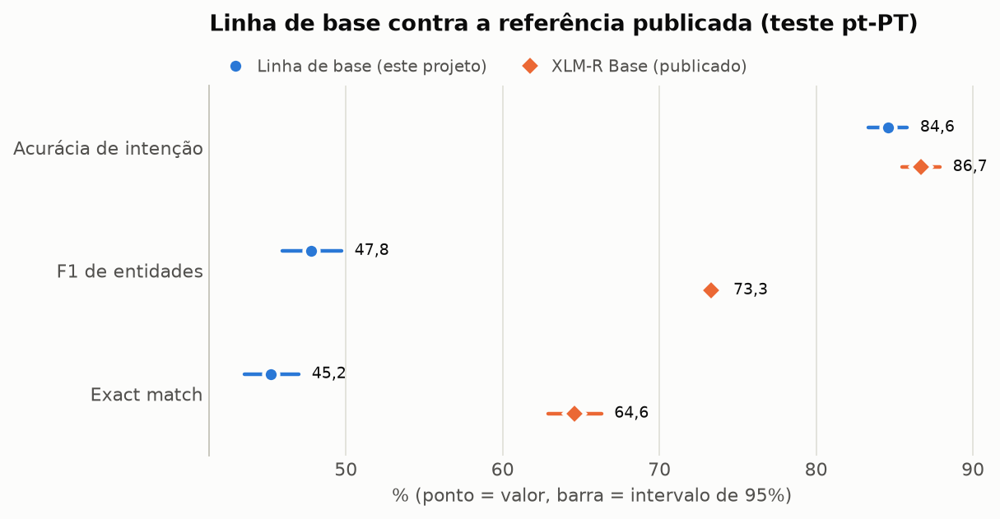

# Etapa 2 · Avaliação: resumo da entrega

**Pergunta.** Como saber se um sistema resolve a tarefa, e a que custo?

**Resposta.** Com uma régua de duas faces, a mesma para todos os sistemas do projeto.

- **Qualidade:** acurácia e macro-F1 de intenção, F1 de entidades inteiras e exact match, sempre contra os rótulos humanos, com intervalo de 95% por bootstrap.
- **Eficiência:** latência por consulta (uma por vez, 1024 consultas, percentis), parâmetros e tamanho em disco, com a máquina registrada.

A régua foi conferida antes de medir qualquer coisa: dá os mesmos números da conta oficial do MASSIVE (maior diferença: 6e-17).

## Resultado no teste (pt-PT, 2.974 enunciados)

| Sistema | Intenção (acurácia) | Intenção (macro-F1) | Entidades (F1) | Exact match | Parâmetros | Latência p50 |
|---|---|---|---|---|---|---|
| Piso (classe majoritária) | 7,0 | 0,2 | 0,0 | 1,2 | 1 | 0,00 ms |
| Linha de base (palavras + caracteres) | 84,6 | 81,4 | 47,8 | 45,2 | 3.940.300 | 0,82 ms |
| XLM-R Base (publicado) | 86,7 | n/d | 73,3 | 64,6 | 270.000.000 | n/d |
| mT5 Base (encoder) (publicado) | 86,9 | n/d | 74,9 | 66,0 | 258.000.000 | n/d |
| mT5 Base (texto para texto) (publicado) | 86,7 | n/d | 76,6 | 67,6 | 580.000.000 | n/d |

Os modelos publicados (FitzGerald et al., Tabelas 7 a 9) treinaram com os 51 idiomas juntos; os deste projeto, só com pt-PT.



## O que a régua já mostrou

- **Resolução do teste.** Na linha de base, a margem de 95% é de ±1,2 em acurácia de intenção, ±1,9 em F1 de entidades e ±1,7 em exact match. Diferenças menores só aparecem em comparação pareada.
- **Intenção é a parte fácil.** Um saco de palavras fica a 2,1 pontos do XLM-R publicado em acurácia de intenção.
- **Entidades são a parte difícil.** A distância é de 25,5 pontos em F1 de entidades e de 19,4 em exact match. É onde a arquitetura da Etapa 3 precisa ganhar.
- **Olhar dentro da palavra ajuda.** Somar n-gramas de caracteres deu +2,5 pontos de acurácia de intenção em dev (intervalo de +1,5 a +3,4), o que confirma a hipótese da Etapa 1.
- **Classes raras.** As intenções com menos de 100 exemplos de treino têm F1 médio de 73,1 em dev, contra 85,6 das demais.

## Regras de avaliação daqui para frente

| Regra | Motivo |
|---|---|
| Decide-se em `dev`, reporta-se em teste | O teste não pode escolher o modelo que ele mesmo avalia |
| A regra de decisão é escrita antes do resultado | Evita escolher a métrica que favorece a resposta desejada |
| Toda comparação entre dois sistemas é pareada | Enxerga diferenças menores que a margem de cada sistema |
| Todo resultado traz intervalo de 95% | Um número sem margem não diz se a diferença é real |
| Latência sempre com o mesmo protocolo e a máquina registrada | Tempo sem máquina e sem cenário não é comparável |

## Limites

- O bootstrap mede a incerteza do conjunto de teste, não a do treino. Para modelos treinados, a variação entre sementes entra a partir da Etapa 4.
- A latência foi medida dentro do WSL2 (13th Gen Intel(R) Core(TM) i7-13700K), sem garantia de fixar o processo nos núcleos de desempenho.
- A referência publicada usa treino multilíngue; a comparação com ela é de ordem de grandeza, não de igual para igual.

## Arquivos

| Arquivo | Conteúdo |
|---|---|
| `resultados.csv` | Uma linha por sistema e partição: métricas, intervalos, latência, parâmetros, máquina |
| `previsoes/` | As respostas do piso e da linha de base em dev e teste |
| `manifesto.json` | Protocolo usado: sorteios do bootstrap, consultas de latência, regra de decisão |
| `figuras/` | Os gráficos deste notebook |
| `02_avaliacao.html` | Este notebook executado, para leitura |

Para avaliar um sistema novo nas próximas etapas:

```python
from especialista.avaliacao import qualidade, eficiencia, resultados
from especialista.avaliacao.previsao import ouro

prev = sistema.prever(list(dev["utt"]))
qualidade.intervalo(ouro(dev), prev)             # métricas com intervalo
qualidade.comparar(ouro(dev), prev_base, prev)   # contra a linha de base, pareado
eficiencia.medir_latencia(sistema, list(dev["utt"]))
```
