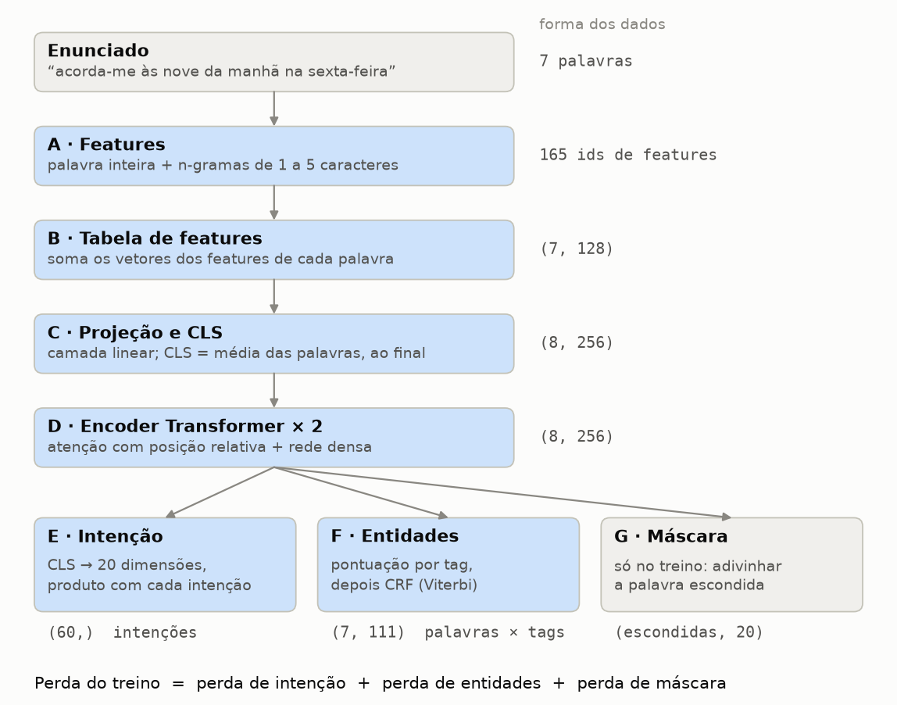

# Etapa 3 · Arquitetura: resumo da entrega

**Pergunta.** Que rede desenhar, do zero, para este problema?

**Resposta.** Uma reimplementação em PyTorch do DIET (Bunk et al., arXiv 2004.09936), sem nenhum peso pré-treinado: features de palavra e de caracteres, um encoder Transformer de 2 blocos com posição relativa, e duas cabeças treinadas juntas, uma para a intenção e um CRF para as entidades. São **4.895.834 parâmetros**, 55 vezes menos que o XLM-R Base da referência publicada. A rede ainda **não foi treinada**; esta etapa entrega a rede e a prova de que está corretamente ligada.



## As camadas

| | Camada | O que faz | Parâmetros | Para que serve |
|---|---|---|---|---|
| A | Features | Palavra + n-gramas de 1 a 5 caracteres | 25.202 features | Palavras inéditas |
| B | Tabela de features | Soma dos vetores dos features, 128 dimensões | 3.225.856 | Equivale à camada densa do DIET |
| C | Projeção e CLS | Linear para 256; CLS = média das palavras, ao final | 33.280 | Resumo do enunciado para a intenção |
| D | Encoder | 2 blocos Transformer, 4 cabeças, posição relativa | 1.581.440 | Contexto entre as palavras |
| E | Intenção | Produto interno num espaço de 20 dimensões | 6.340 | Cabeça minúscula |
| F | Entidades | Pontuação por tag + CRF com regras BIO fixas | 41.070 | Limites das entidades |
| G | Máscara | Adivinhar 15% das palavras escondidas (só no treino) | 7.848 | Regularização |

## O que já se sabe sem treinar

- **Tamanho.** 66% dos parâmetros estão na tabela de features, e não no Transformer. A poda e a quantização (Etapas 7 e 8) precisam tratar a tabela para reduzir o modelo de verdade.
- **Latência.** 1,08 ms por consulta (p50) e 1,45 ms (p95), em 1 núcleo de CPU, uma consulta por vez. A linha de base leva 0,82 ms.
- **Disco.** 19,9 MB em ponto flutuante de 32 bits.

| Trecho da consulta | Tempo médio | Parte |
|---|---|---|
| A. Texto para ids de features | 0,04 ms | 4% |
| B a D. Tabela, projeção e encoder | 0,78 ms | 77% |
| E e F. Pontuações das cabeças | 0,02 ms | 2% |
| F. Viterbi do CRF e montagem da resposta | 0,17 ms | 17% |

## A rede está bem ligada

| Teste | Resultado |
|---|---|
| CRF contra a força bruta | Soma e melhor sequência idênticas em todos os comprimentos testados |
| Perdas iniciais | Intenção 4,11 (teoria 4,09); entidades 25,98 (teoria 25,88); máscara 4,40 (teoria 4,37) |
| Gradiente | Chega aos 53 tensores de parâmetros |
| Independência do lote | 200 enunciados com a mesma resposta juntos e um por um |
| Decorar 64 exemplos | Exact match de 100% a partir do passo 75 |

O pacote também tem 4 arquivos de teste automático (`uv run pytest`).

## Desvios declarados em relação ao artigo

- **Todas as intenções na perda**, em vez de uma amostra das erradas. Com 60 intenções é a versão exata.
- **BIO com regras fixas no CRF**, em vez de BILOU: 30 dos 55 tipos de entidade têm menos de 100 exemplos.
- **Palavras erradas da máscara vêm do próprio lote**, em vez de sorteadas.
- **CLS começa como a média dos vetores das palavras**, que é a regra do artigo para vetores sem contexto.
- O que o artigo não informa (cabeças, dimensão da tabela, dropout, alcance da posição) usa o padrão da implementação de referência. A lista completa está em `decisoes.csv`.

## Para a Etapa 4 (treino com rótulos humanos)

Pontos de partida do artigo: Adam, taxa de aprendizado de 0,001, lote crescendo de 64 para 128, lotes balanceados por intenção, 200 épocas.

Comparações a decidir em `dev`, com a regra escrita antes do resultado:

1. Máscara ligada contra desligada.
2. Treino conjunto contra cada tarefa sozinha (a ablação central do DIET).
3. Com CRF contra sem CRF.

Aviso de expectativa: o F1 de entidades do DIET no NLU-Benchmark (86,04) conta sobreposição como acerto; a nossa régua exige limites exatos.

## Arquivos

| Arquivo | Conteúdo |
|---|---|
| `ficha.json` | Configuração, vocabulário de features, parâmetros por parte, ambiente |
| `decisoes.csv` | Cada decisão de desenho, com valor, origem e observação |
| `resultados.csv` | A linha do modelo sem treino na régua (eficiência) |
| `modelo_sem_treino/` | Pesos iniciais, vocabulário de features e configuração |
| `figuras/` | Diagrama e gráficos deste notebook |
| `03_arquitetura.html` | Este notebook executado, para leitura |

Para criar a rede nas próximas etapas:

```python
from especialista.modelos.diet import Config, SistemaDiet

sistema = SistemaDiet.novo(treino, rotulos, Config(), semente=0)
perdas = sistema.modelo.perda(sistema.lote(treino.iloc[:64]))   # intenção, entidades, máscara, total
previsoes = sistema.prever(["acorda-me às nove da manhã"])
```
