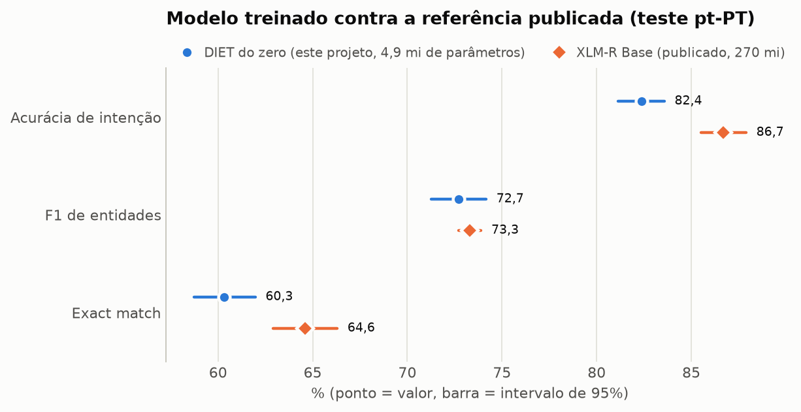
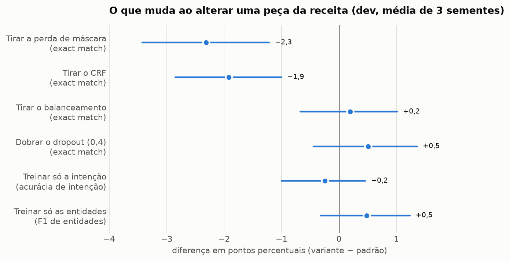

# Etapa 4 · Treino com rótulos humanos: resumo da entrega

**Pergunta.** Até onde a arquitetura chega quando aprende com rótulos humanos?

**Resposta.** No teste, a rede do zero faz **60,3 de exact match**, 72,7 de F1 de entidades e 82,4 de acurácia de intenção (média de 3 sementes). São +15,1 pontos de exact match em relação à linha de base e −4,3 em relação ao XLM-R publicado, que tem 55 vezes mais parâmetros e pré-treino. Este é o **teto** do projeto: o que a arquitetura faz com os rótulos certos.

## Resultado no teste (pt-PT, 2.974 enunciados)

| Sistema | Intenção (acurácia) | Intenção (macro-F1) | Entidades (F1) | Exact match | Parâmetros |
|---|---|---|---|---|---|
| DIET do zero, rótulos humanos (média de 3 sementes, intervalo de 95%) | 82,4 (81,1 a 83,6) | 80,0 (78,2 a 82,4) | 72,7 (71,3 a 74,2) | 60,3 (58,7 a 62,0) | 4.895.834 |
| Linha de base (Etapa 2) | 84,6 | 81,4 | 47,8 | 45,2 | 3.940.300 |
| XLM-R Base (publicado) | 86,7 | n/d | 73,3 | 64,6 | 270.000.000 |

O modelo publicado treinou com os 51 idiomas juntos; o deste projeto, só com pt-PT.



Diferença para a linha de base, pareada, no teste: intenção −2,2 (−3,1 a −1,3); entidades +24,9 (+23,0 a +26,7); exact match +15,1 (+13,4 a +16,7).

## O ponto fraco: a intenção

Em acurácia de intenção, a rede do zero fica −2,2 pontos em relação à linha de base no teste (intervalo de −3,1 a −1,3). Um saco de n-gramas com classificador linear é difícil de bater em intenção, e o próprio artigo do DIET mede cerca de 3 pontos a menos de intenção sem embeddings pré-treinados. O ganho da rede está todo nas entidades, e é ele que carrega o exact match.

## O que cada peça da receita acrescenta (dev, média de 3 sementes)

Diferença da variante em relação ao padrão. Negativo quer dizer que tirar a peça piora.

| Mudança | Métrica | Diferença | Intervalo de 95% | Distinguível |
|---|---|---|---|---|
| Tirar a perda de máscara | Exact match | −2,3 | −3,4 a −1,2 | sim |
| Tirar o CRF | Exact match | −1,9 | −2,9 a −1,0 | sim |
| Tirar o balanceamento | Exact match | +0,2 | −0,7 a +1,0 | não |
| Dobrar o dropout (0,4) | Exact match | +0,5 | −0,4 a +1,4 | não |
| Treinar só a intenção | Acurácia de intenção | −0,2 | −1,0 a +0,5 | não |
| Treinar só as entidades | F1 de entidades | +0,5 | −0,3 a +1,2 | não |



**Configuração final:** a receita do artigo, sem alteração. Regra: uma variante só substitui o padrão se o intervalo de 95% da diferença em exact match, em dev, ficar todo acima de zero.

O que se repetiu do artigo e o que não:

- **Máscara e CRF se pagam.** Tirar qualquer um dos dois piora o exact match de forma distinguível.
- **O ganho do treino conjunto não se repetiu.** Treinar as entidades sozinhas dá +0,5 de F1 (−0,3 a +1,2); treinar a intenção sozinha dá −0,2 de acurácia (−1,0 a +0,5). O treino conjunto continua valendo pelo custo: uma rede para as duas respostas.
- **Balanceamento e dropout maior não fizeram diferença distinguível.**

## Onde o modelo ainda erra (dev)

- Resposta inteira certa em 60,9% dos enunciados; só as entidades erradas em 21,9%; só a intenção errada em 10,0%.
- Exact match de 93,7 nos enunciados cujo texto está no treino e de 58,4 nos inéditos.
- Tipos de entidade com menos de 100 exemplos de treino: F1 médio de 61,1, contra 73,4 dos demais.

## Eficiência (1 núcleo de CPU, uma consulta por vez)

| | DIET do zero | Linha de base |
|---|---|---|
| Latência p50 | 1,25 ms | 0,82 ms |
| Latência p95 | 1,74 ms | 1,08 ms |
| Parâmetros | 4.895.834 | 3.940.300 |
| Tamanho em disco | 19,9 MB | 33,0 MB |

## Limites

- A época de parada e as comparações usam o mesmo `dev`. O teste só confirma a configuração final.
- Três sementes dão uma ideia da variação do treino, não uma estimativa precisa dela.
- A GPU não é determinística em todas as operações: reexecutar um treino pode mudar o resultado na casa dos décimos. Os resultados desta entrega são os das execuções gravadas.
- A referência publicada usa treino multilíngue; a comparação com ela é de ordem de grandeza.

## Arquivos

| Arquivo | Conteúdo |
|---|---|
| `modelos/semente_0`, `semente_1`, `semente_2` | Os três modelos finais: pesos, vocabulário de features e configuração |
| `resultados.csv` | Uma linha por semente e partição, mais a média das sementes |
| `previsoes/` | As respostas de cada semente em dev e teste |
| `comparacoes.csv` | Cada variante contra o padrão, em todas as métricas |
| `historicos/` | Perdas e métricas em dev, época por época, de cada semente |
| `manifesto.json` | Configuração final, receita, épocas escolhidas, ambiente |
| `figuras/` | Os gráficos deste notebook |
| `04_treino.html` | Este notebook executado, para leitura |

Para carregar o modelo nas próximas etapas:

```python
from especialista.caminhos import ENTREGAS
from especialista.modelos.diet import SistemaDiet

sistema = SistemaDiet.carregar(ENTREGAS / "04_treino" / "modelos" / "semente_0")
sistema.prever(["acorda-me às nove da manhã"])
```
