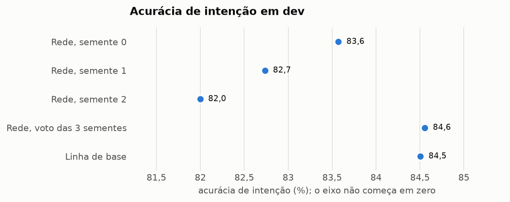
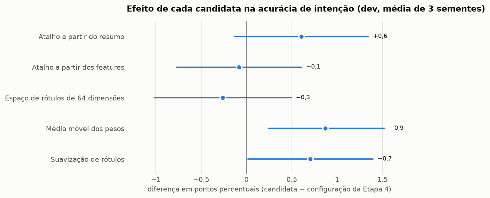

# Etapa 4b · Investigação da intenção: resumo da entrega

**Pergunta.** Por que a rede do zero perde para o saco de palavras em intenção, e dá para recuperar sem perder as entidades?

**Resposta.** A rede perde por **variância**, não por falta de acesso aos features: ela acerta 99,2% da intenção no treino e 83,6% em `dev`, e duas sementes só concordam em 85,6% dos enunciados. Das candidatas que davam à intenção mais acesso aos features ou mais espaço, passaram 0 de 3; das que atacam a variância, 2 de 2. Fica adotada **suavização de rótulos + média móvel dos pesos**: em `dev`, +1,2 (+0,5 a +1,9) pontos de acurácia de intenção e +1,7 (+0,8 a +2,7) de exact match. No teste, a intenção vai de 82,4 para 84,4 e o exact match de 60,3 para 62,5, sem nenhum parâmetro a mais: a rede é a mesma na hora de usar. No teste, a rede e a linha de base deixam de se distinguir em intenção: −0,2 (−1,1 a +0,8).

## Diagnóstico (dev)

| Medida | Valor | O que diz |
|---|---|---|
| Só a linha de base acerta / só a rede acerta | 5,9% / 4,2% | Os erros são em boa parte diferentes |
| Acurácia de intenção no treino / em dev (semente 0) | 99,2% / 83,6% | A rede decora o treino |
| Concordância entre duas sementes | 85,6% | Cada treino decora de um jeito |
| Voto das 3 sementes / média das 3 / linha de base | 84,6% / 82,8% / 84,5% | Tirar a variância já fecha a distância |
| Linear sobre os features da rede, com TF-IDF / sem | 83,6% / 81,6% | A informação está nos features |

## Candidatas (dev, média de 3 sementes, diferença para a configuração da Etapa 4)

| Candidata | Intenção (intervalo de 95%) | Exact match (intervalo de 95%) | Parâmetros a mais | Aprovada |
|---|---|---|---|---|
| Atalho a partir do resumo | +0,6 (−0,1 a +1,3) | +0,2 (−0,8 a +1,1) | 7.740 | não |
| Atalho a partir dos features | −0,1 (−0,8 a +0,6) | +0,2 (−0,7 a +1,1) | 1.512.120 | não |
| Espaço de rótulos de 64 dimensões | −0,3 (−1,0 a +0,5) | −0,1 (−1,0 a +0,8) | 30.932 | não |
| Média móvel dos pesos | +0,9 (+0,2 a +1,5) | +1,6 (+0,7 a +2,5) | 0 | sim |
| Suavização de rótulos | +0,7 (+0,0 a +1,4) | +0,3 (−0,6 a +1,2) | 0 | sim |
| Suavização de rótulos + média móvel dos pesos | +1,2 (+0,5 a +1,9) | +1,7 (+0,8 a +2,7) | 0 | sim |

Regra: aprovada se a acurácia de intenção melhorar com intervalo de 95% todo acima de zero e o exact match não piorar de forma distinguível.

## A configuração que segue adiante (teste, média de 3 sementes)

| Métrica | Etapa 4 | Configuração que segue | Diferença para a Etapa 4 | Linha de base | Diferença para a linha de base |
|---|---|---|---|---|---|
| Acurácia de intenção | 82,4 | 84,4 (83,2 a 85,6) | +2,0 (+1,4 a +2,6) | 84,6 | −0,2 (−1,1 a +0,8) |
| Macro-F1 de intenção | 80,0 | 82,8 (81,0 a 84,8) | +2,8 (+1,5 a +4,0) | 81,4 | +1,4 (−0,6 a +3,4) |
| F1 de entidades | 72,7 | 73,6 (72,2 a 75,1) | +0,9 (+0,3 a +1,6) | 47,8 | +25,9 (+24,0 a +27,6) |
| Exact match | 60,3 | 62,5 (60,8 a 64,1) | +2,1 (+1,4 a +2,9) | 45,2 | +17,2 (+15,6 a +18,8) |

- Parâmetros: 4.895.834 (0 a mais que na Etapa 4).
- Latência: 1,20 ms (p50) em 1 núcleo de CPU; o modelo da Etapa 4, medido na mesma sessão, 1,21 ms. Tamanho em disco: 19,9 MB.
- Modelos de referência para as próximas etapas: `entregas/04b_intencao/modelos`.

## O que fica para depois

- **O voto das sementes.** Três redes votando recuperam a intenção, ao custo de três vezes a latência. Ensinar uma rede só a imitar o voto é destilação, que é o assunto da Etapa 6.
- **A linha de base como professor.** Os erros dela e os da rede são diferentes; um aluno que aprendesse com as duas poderia passar das duas.

## Cuidado para a Etapa 6

A suavização de rótulos entra na perda de intenção quando o alvo é um rótulo (alunos que aprendem com rótulos da LLM). No aluno que aprende com os logits da LLM o alvo já é uma distribuição, e a suavização não se aplica. Müller et al. também mostram que suavizar os rótulos de um **professor** prejudica a destilação; aqui a rede é aluna, mas o ponto precisa ser lembrado se algum destes modelos virar professor.

## Limites

- As candidatas foram comparadas no mesmo `dev` que escolhe a época de parada.
- O teste já tinha sido aberto na Etapa 4. Aqui ele foi aberto de novo só para a configuração decidida em `dev`.
- O diagnóstico de variância usa 3 sementes; é uma indicação, não uma medida precisa.

## Arquivos

| Arquivo | Conteúdo |
|---|---|
| `decisao.json` | A configuração que segue adiante e onde estão os modelos de referência |
| `candidatas.csv` | Cada candidata contra o controle, em todas as métricas |
| `resultados.csv` | A configuração que segue, em dev e teste |
| `modelos/`, `previsoes/` | Só existem se a configuração mudou: os três modelos novos e as suas respostas |
| `figuras/` | Os gráficos deste notebook |
| `04b_intencao.html` | Este notebook executado, para leitura |
