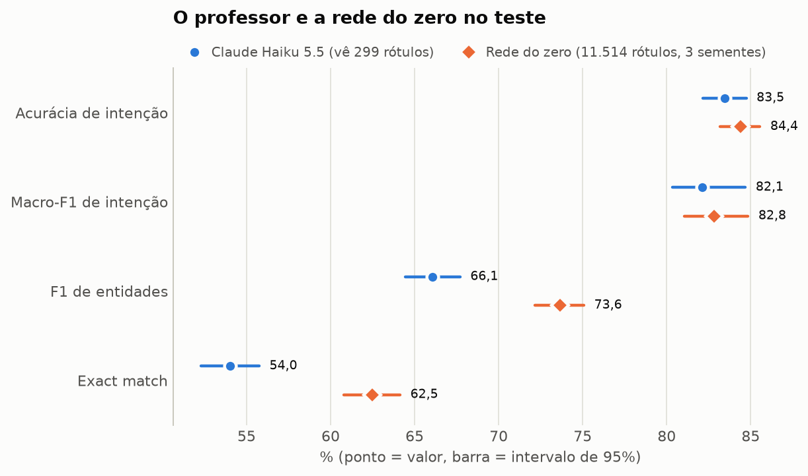
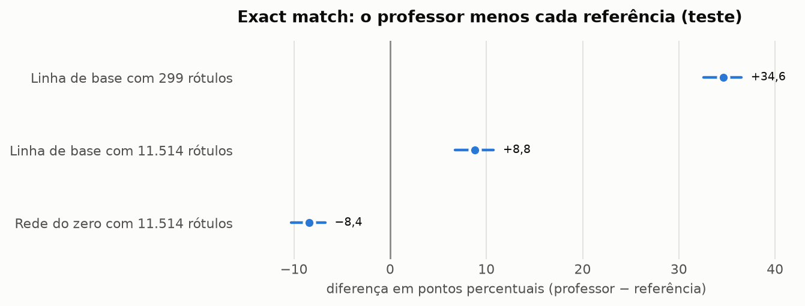
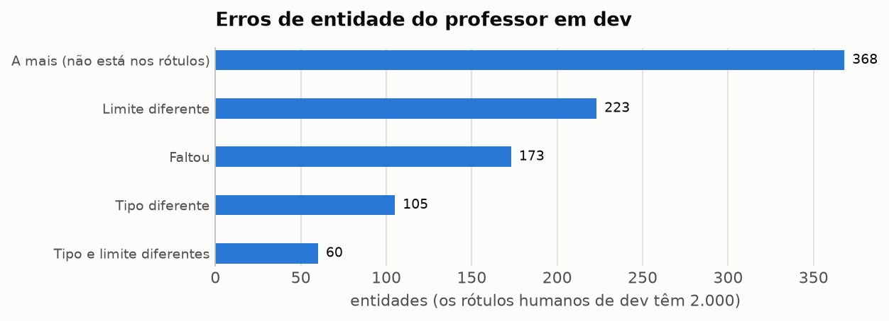
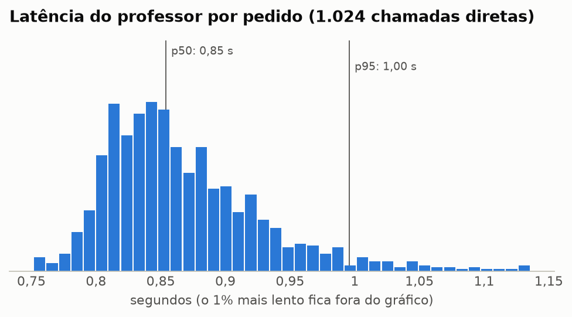

# Etapa 5a · O professor fechado: resumo da entrega

**Pergunta.** Quão bem uma LLM fechada resolve a tarefa quando tudo o que se tem dela é o texto da resposta, quanto custa e quanto demora, e que rótulos ela deixa para o aluno?

**Resposta.** O Claude Haiku 5.5, vendo 299 rótulos humanos como exemplos, faz no teste 83,5% de acurácia de intenção, 66,1% de F1 de entidades e 54,0% de exact match. **Vale como professor**: em `dev`, o exact match dele (54,7%) fica +34,5 (+32,3 a +37,1) pontos acima do da linha de base treinada com os mesmos 299 rótulos (20,2%). Contra a rede do zero treinada com os 11.514 rótulos humanos, no teste, ele fica sem diferença distinguível em intenção (−0,9 (−2,2 a +0,3)), abaixo em entidades (−7,6 (−9,1 a −5,9)) e abaixo em exact match (−8,4 (−10,3 a −6,7)). Cada resposta leva 0,85 s (mediana) e custa US$ 0,114 por mil pedidos; a rede do zero responde em 1,2 ms. O treino rotulado por ele concorda inteiramente com os rótulos humanos em 53,6% dos pedidos, e custou US$ 0,66.

O desenho (intenção perto de um modelo supervisionado, entidades atrás) é o que He & Garner ([arXiv 2305.13512](https://arxiv.org/abs/2305.13512)) relatam para LLMs com poucos exemplos.

## O cenário

- A LLM vê 299 exemplos rotulados por humanos (2,6% do treino, até 5 por intenção). Em cada pedido entram os 10 mais parecidos.
- Modelo `claude-haiku-5-5`, raciocínio desligado, esforço `low`, resposta em JSON imposta por esquema.
- 16.521 pedidos rotulados em lote: 11.514 de treino, 2.033 de dev, 2.974 de teste.

## Qualidade no teste

Cada coluna de referência traz o valor da referência e, depois do ponto, a diferença professor − referência com intervalo de 95%.

| Métrica | Claude Haiku 5.5 (intervalo de 95%) | Linha de base com 299 rótulos | Linha de base com 11.514 rótulos | Rede do zero com 11.514 rótulos |
|---|---|---|---|---|
| Acurácia de intenção | 83,5 (82,1 a 84,7) | 47,8 · +35,6 (+33,8 a +37,5) | 84,6 · −1,1 (−2,5 a +0,2) | 84,4 · −0,9 (−2,2 a +0,3) |
| Macro-F1 de intenção | 82,1 (80,3 a 84,7) | 47,7 · +34,4 (+32,4 a +37,0) | 81,4 · +0,7 (−1,8 a +3,5) | 82,8 · −0,7 (−2,6 a +1,5) |
| F1 de entidades | 66,1 (64,5 a 67,7) | 35,6 · +30,5 (+28,6 a +32,5) | 47,8 · +18,3 (+16,4 a +20,3) | 73,6 · −7,6 (−9,1 a −5,9) |
| Exact match | 54,0 (52,3 a 55,7) | 19,4 · +34,6 (+32,6 a +36,5) | 45,2 · +8,8 (+6,8 a +10,8) | 62,5 · −8,4 (−10,3 a −6,7) |

## O que voltou da API

- Sem resposta aproveitável: 0 de 16.521 pedidos (0,00%).
- Intenções fora da lista: 0. Tipos de entidade fora da lista: 0.
- Entidades com texto que não está no pedido, descartadas: 45 de 17.932 (0,25%).

## Onde o professor erra (dev)

Em dev, o professor acerta tudo em 54,7% dos pedidos, erra só as entidades em 29,4%, só a intenção em 7,3% e as duas em 8,6%.

| Destino de cada entidade dos rótulos humanos | Claude Haiku 5.5 | Rede do zero (média de 3 sementes) |
|---|---|---|
| Certa | 1.439 (72,0%) | 1.531 (76,5%) |
| Limite diferente | 223 (11,2%) | 181 (9,0%) |
| Tipo diferente | 105 (5,2%) | 68 (3,4%) |
| Tipo e limite diferentes | 60 (3,0%) | 59 (2,9%) |
| Faltou | 173 (8,6%) | 162 (8,1%) |
| A mais (não está nos rótulos) | 368 (18,4%) | 205 (10,3%) |

- A troca de intenção mais frequente: `general_quirky` respondida como `qa_factoid` (13 vezes em dev).
- Quando a intenção certa aparece entre os 10 exemplos do prompt (75,9% de dev), o professor acerta a intenção em 91,2% dos pedidos; quando não aparece, em 61,8%. A rede do zero faz 89,3% e 66,9% nos mesmos grupos.

## Os rótulos do aluno

Concordância do professor com os rótulos humanos, em % (intervalo de 95%):

| Métrica | Treino | Dev | Teste |
|---|---|---|---|
| Acurácia de intenção | 84,2 (83,6 a 84,9) | 84,1 (82,6 a 85,6) | 83,5 (82,1 a 84,7) |
| Macro-F1 de intenção | 82,1 (81,2 a 83,1) | 84,4 (82,4 a 86,4) | 82,1 (80,3 a 84,7) |
| F1 de entidades | 67,5 (66,7 a 68,3) | 68,5 (66,5 a 70,5) | 66,1 (64,5 a 67,7) |
| Exact match | 53,6 (52,8 a 54,5) | 54,7 (52,6 a 57,0) | 54,0 (52,3 a 55,7) |

- Pedidos de treino sem rótulo aproveitável: 0.
- A medida em `dev` antecipa bem a qualidade dos rótulos do treino.

## Latência e custo

- Latência por pedido, uma chamada por vez, 1.024 chamadas: p50 0,85 s, p95 1,00 s, p99 1,15 s. Medida em 2026-11-17, de: rede do usuário, Brasil.
- Por pedido: 3.235 tokens de entrada e 40 de saída, em média.
- Chamada direta: US$ 0,114 por mil pedidos (US$ 0,344 sem cache). Em lote: US$ 0,057 por mil, com leitura de cache em 100,0% dos pedidos.

| Parte da etapa | Pedidos | Custo |
|---|---|---|
| Teste de formato (chamadas diretas) | 5 | US$ 0,0005 |
| Lote de dev | 2.033 | US$ 0,1170 |
| Lote de teste | 2.974 | US$ 0,1701 |
| Lote de treino | 11.514 | US$ 0,6614 |
| Latência (todas as chamadas diretas com registro) | 1.080 | US$ 0,1234 |
| Total com registro | 17.606 | US$ 1,0724 |
| Chamadas sem registro (teto) | até 1.081 | até US$ 0,1236 |

Envio dos lotes: o treino inteiro num único envio (84 MB) foi recusado pelo servidor; os lotes foram enviados em partes de 1.500 pedidos. Nenhum pedido foi cobrado em dobro.

## Limites

- **Sem piloto.** A configuração (10 exemplos, raciocínio desligado) não foi comparada com alternativas. Mais exemplos, raciocínio ligado ou um modelo maior poderiam dar um professor melhor, a outro custo.
- **Um modelo, uma execução.** A API não tem temperatura neste modelo e a saída não é garantidamente determinística; cada pedido foi feito uma vez.
- **A latência é de uma rede e de um horário.** Inclui a ida e a volta até o provedor.
- **O custo é o preço de lista** em 17/11/2026, somado dos tokens que a API informou. As chamadas sem registro entram só como teto (US$ 0,12); o valor exato está no painel de uso da conta.
- **A latência foi medida duas vezes.** A primeira medição concorreu com o envio dos lotes e foi descartada; vale a segunda, feita com a rede livre.
- **O modelo pode conhecer o MASSIVE.** O conjunto é público desde 2022 e pode estar nos dados de treino da LLM. Isso não se mede daqui.

## Para a Etapa 6

- O aluno A treina com `rotulos_treino.parquet`: as colunas que o treino da rede lê (`id`, `utt`, `tokens`, `intent`, `tags`), com `intent` e `tags` do professor. A coluna `valido` marca os pedidos sem rótulo aproveitável.
- A referência "sem LLM" do cenário é um modelo treinado só com os 299 rótulos de `demonstracoes.parquet`.

## Arquivos

| Arquivo | Conteúdo |
|---|---|
| `rotulos_treino.parquet` | O treino rotulado pelo professor |
| `demonstracoes.parquet` | Os 299 exemplos com rótulo humano que a LLM vê |
| `previsoes/` | As respostas do professor em dev e teste, no formato da régua |
| `respostas/` | As respostas brutas da API, com os tokens cobrados; a latência medida |
| `resultados.csv`, `comparacoes.csv` | O professor e a linha de base com 299 rótulos na régua; cada comparação pareada |
| `custo.json`, `configuracao.json` | Tokens e dólares por parte; modelo e ajustes da chamada |
| `pedido_de_exemplo.md` | Um pedido completo, como foi enviado |
| `figuras/` | Os gráficos deste notebook |
| `05a_professor_fechado.html` | Este notebook executado, para leitura |
