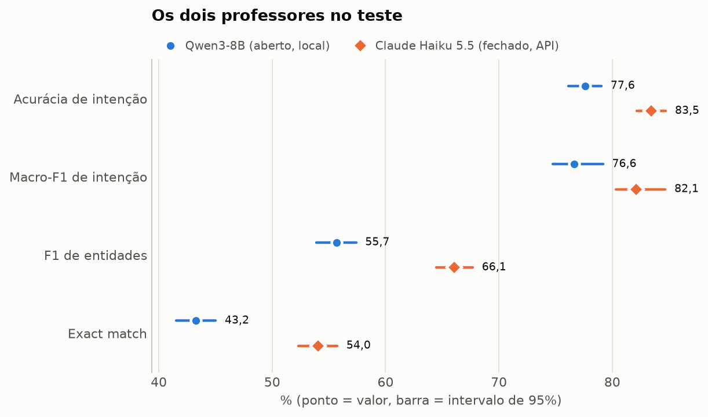
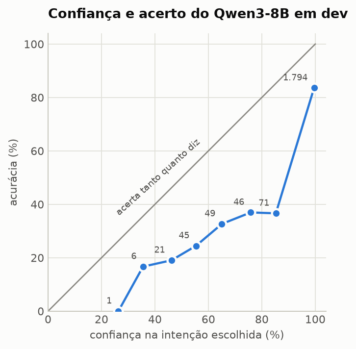
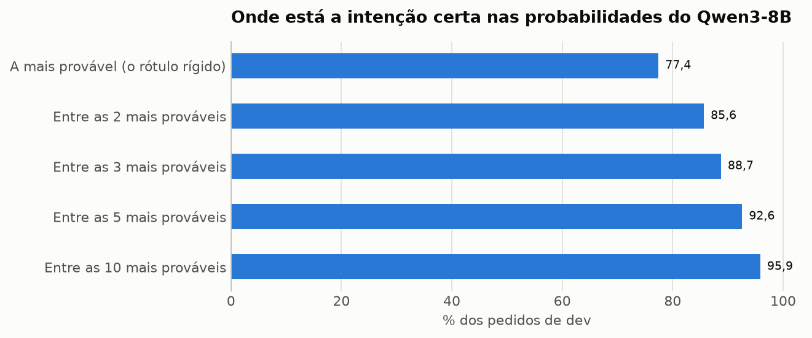
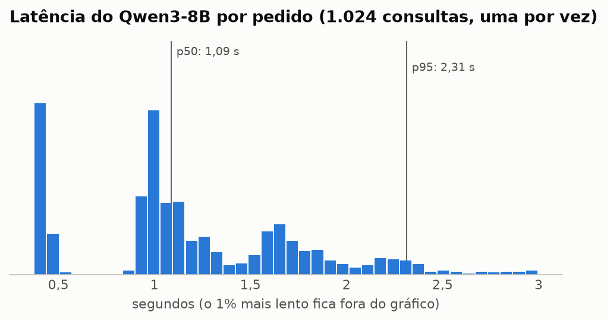

# Etapa 5b · O professor aberto: resumo da entrega

**Pergunta.** Quão bem uma LLM aberta, rodando nesta máquina, resolve a tarefa, e o que ela entrega que a fechada não entrega?

**Resposta.** O professor aberto é o **Qwen3-8B**, em 4 bits, escolhido em `dev` entre 3 candidatos. Ele acrescenta +23,0 pontos de exact match à linha de base treinada com os mesmos 299 rótulos (em `dev`). No teste ele faz 77,6% de acurácia de intenção, 55,7% de F1 de entidades e 43,2% de exact match. Contra o professor fechado (Claude Haiku 5.5), fica abaixo em intenção (−5,9 (−7,2 a −4,5)), abaixo em entidades (−10,4 (−11,9 a −8,9)) e abaixo em exact match (−10,8 (−12,4 a −9,1)). O que ele entrega a mais são as **probabilidades das 60 intenções** para cada pedido: a intenção certa está em primeiro lugar em 77,4% dos pedidos de `dev`, e entre as 3 mais prováveis em 88,7%. Cada resposta leva 1,09 s (mediana) na placa desta máquina; rotular o treino levou 1 h 49 min de GPU, sem custo por pedido.

## A escolha do professor (dev)

Regra, escrita antes: do mais barato para o mais caro, um candidato só toma o lugar do anterior se o exact match dele em `dev` for distinguivelmente maior (intervalo de 95% da diferença pareada todo acima de zero).

| Candidato (4 bits) | Memória na placa (GB) | s por pedido, em lote | Acurácia de intenção | Macro-F1 de intenção | F1 de entidades | Exact match | Escolhido |
|---|---|---|---|---|---|---|---|
| Qwen3-4B | 2,7 | 0,39 | 73,5 | 73,3 | 53,5 | 34,9 |  |
| GAIA 4B (CEIA-UFG) | 3,2 | 0,34 | 71,1 | 71,7 | 50,7 | 38,6 |  |
| Qwen3-8B | 6,1 | 0,54 | 77,4 | 78,3 | 58,0 | 43,2 | sim |

| Desafiante | Titular | Diferença de exact match (intervalo de 95%) | Toma o lugar |
|---|---|---|---|
| GAIA 4B (CEIA-UFG) | Qwen3-4B | +3,7 (+1,6 a +5,9) | sim |
| Qwen3-8B | GAIA 4B (CEIA-UFG) | +4,6 (+2,5 a +6,5) | sim |

## Qualidade no teste

Cada coluna de referência traz o valor da referência e, depois do ponto, a diferença professor aberto − referência com intervalo de 95%.

| Métrica | Qwen3-8B (intervalo de 95%) | Linha de base com 11.514 rótulos | Rede do zero com 11.514 rótulos | Claude Haiku 5.5 (professor fechado) |
|---|---|---|---|---|
| Acurácia de intenção | 77,6 (76,1 a 79,1) | 84,6 · −7,0 (−8,5 a −5,5) | 84,4 · −6,8 (−8,2 a −5,4) | 83,5 · −5,9 (−7,2 a −4,5) |
| Macro-F1 de intenção | 76,6 (74,7 a 79,2) | 81,4 · −4,8 (−7,3 a −2,1) | 82,8 · −6,2 (−8,2 a −4,0) | 82,1 · −5,5 (−7,2 a −3,8) |
| F1 de entidades | 55,7 (53,9 a 57,4) | 47,8 · +7,9 (+5,7 a +10,1) | 73,6 · −18,0 (−19,7 a −16,2) | 66,1 · −10,4 (−11,9 a −8,9) |
| Exact match | 43,2 (41,5 a 45,0) | 45,2 · −2,0 (−4,1 a +0,1) | 62,5 · −19,2 (−21,1 a −17,5) | 54,0 · −10,8 (−12,4 a −9,1) |

## O que voltou do modelo (dev, teste e treino somados)

- Respostas sem aproveitamento: 18 de 16.521. Entidades descartadas na leitura: 1.140 de 20.050 (5,69%), 743 por tipo fora da lista e 397 por texto que não está no pedido. A intenção nunca sai da lista.

## Onde erra (dev)

- Os dois professores dão exatamente a mesma resposta em 53,1% dos pedidos de `dev`; em 16,4% só o fechado acerta tudo e em 4,8% só o aberto.

| Destino de cada entidade dos rótulos humanos | Qwen3-8B | Claude Haiku 5.5 | Rede do zero (média de 3 sementes) |
|---|---|---|---|
| Certa | 1.259 (62,9%) | 1.439 (72,0%) | 1.531 (76,5%) |
| Limite diferente | 242 (12,1%) | 223 (11,2%) | 181 (9,0%) |
| Tipo diferente | 164 (8,2%) | 105 (5,2%) | 68 (3,4%) |
| Tipo e limite diferentes | 117 (5,9%) | 60 (3,0%) | 59 (2,9%) |
| Faltou | 218 (10,9%) | 173 (8,6%) | 162 (8,1%) |
| A mais (não está nos rótulos) | 565 (28,2%) | 368 (18,4%) | 205 (10,3%) |

## O que os logits trazem (dev)

| Faixa de confiança | Pedidos | Confiança média | Acurácia |
|---|---|---|---|
| 20% a 30% | 1 | 26,3% | 0,0% |
| 30% a 40% | 6 | 35,5% | 16,7% |
| 40% a 50% | 21 | 46,2% | 19,0% |
| 50% a 60% | 45 | 55,4% | 24,4% |
| 60% a 70% | 49 | 65,0% | 32,7% |
| 70% a 80% | 46 | 75,9% | 37,0% |
| 80% a 90% | 71 | 85,2% | 36,6% |
| 90% a 100% | 1.794 | 99,6% | 83,6% |

- Confiança média de 95,9% para uma acurácia de 77,4%: erro de calibração esperado (ECE) de 18,5 pontos.
- Intenção certa entre as k mais prováveis: k=1: 77,4%, k=2: 85,6%, k=3: 88,7%, k=5: 92,6%, k=10: 95,9%.
- Nos 459 erros de intenção, a certa é a 2ª colocada em 36,4%.

## Um detalhe de formato

Na primeira versão, o texto forçado depois da intenção ia até o colchete que abre a lista (`", "slots": [`). Para uma lista vazia o modelo escreve `[]` como um token só, e com o `[` já escrito ele errava o fechamento e devolvia entidades de sobra. Forçar só até `"slots":` levou o exact match do Qwen3-8B em `dev` de 28,9% para 43,2% (+14,3 pontos).

## Conferência dos atalhos de cálculo

- Pontuação com os atalhos contra 60 passadas inteiras por pedido (8 pedidos): maior diferença de probabilidade de 0,11 ponto percentual; mesma intenção em 8 de 8.
- Geração própria contra a função `generate` da biblioteca (32 pedidos): mesma resposta, depois de lida, em 32.
- Em lotes de 6 contra um pedido por vez (32 pedidos): mesma intenção em 32; mesma resposta em 31; a probabilidade de uma intenção chega a mudar 9,8 pontos num caso de quase empate. A diferença vem da conta em 16 bits, não dos atalhos.

## Latência e tempo de GPU

- Latência, uma consulta por vez, 1.024 consultas: p50 1,09 s, p95 2,31 s. Ela cresce com o tamanho da resposta: 0,42 s sem entidades e 2,37 s com 3 ou mais. O professor fechado: p50 0,85 s. A rede do zero: 1,2 ms.
- Em lotes de 6: 0,56 s por pedido. Tempo de GPU: 2 h 34 min do professor escolhido (dev, teste e treino) e 25 min dos candidatos não escolhidos.
- Memória: 6,1 GB na placa para o modelo. Máquina: NVIDIA GeForce RTX 3080.

## Limites

- **Os logits são só da intenção.** As entidades são texto gerado; não há probabilidade por palavra do pedido.
- **4 bits.** O modelo roda com os pesos quantizados para caber na placa; em precisão cheia ele pode ser um pouco melhor.
- **Lotes em 16 bits.** Processar pedidos juntos muda a resposta em uma pequena parte deles, quando dois tokens estão quase empatados (ver a conferência).
- **Três candidatos, um prompt.** Modelos maiores não cabem na placa de 10 GB; o prompt é o mesmo da Etapa 5a, sem ajuste por modelo.
- **A escolha usou `dev`.** O valor em `dev` do professor escolhido é levemente otimista; o do teste não.
- **O modelo pode conhecer o MASSIVE**, como na Etapa 5a.

## Para a Etapa 6

- Aluno B1: `rotulos_treino.parquet` (as colunas que o treino da rede lê; `valido` marca pedidos sem rótulo aproveitável).
- Aluno B2: `logits_treino.npy`, 11.514 × 60, na ordem das linhas do treino e das intenções de `intencoes.json`. São log-probabilidades: para usar com temperatura T, divide-se por T antes do softmax. As entidades do B2 vêm de `rotulos_treino.parquet`.
- A suavização de rótulos da Etapa 4b não se aplica ao B2 (o alvo já é uma distribuição).

## Arquivos

| Arquivo | Conteúdo |
|---|---|
| `rotulos_treino.parquet` | O treino rotulado pelo professor aberto |
| `logits_treino.npy`, `logits_dev.npy`, `logits_test.npy`, `intencoes.json` | As log-probabilidades das 60 intenções e a ordem das colunas |
| `escolha.json` | A regra, os candidatos, as disputas, a conferência e a calibração |
| `previsoes/` | As respostas de cada candidato em dev e do escolhido no teste, no formato da régua |
| `respostas/` | As respostas brutas de cada modelo, com as pontuações; latência e conferência |
| `resultados.csv`, `comparacoes.csv` | O professor e os candidatos na régua; cada comparação pareada |
| `figuras/` | Os gráficos deste notebook |
| `05b_professor_aberto.html` | Este notebook executado, para leitura |
