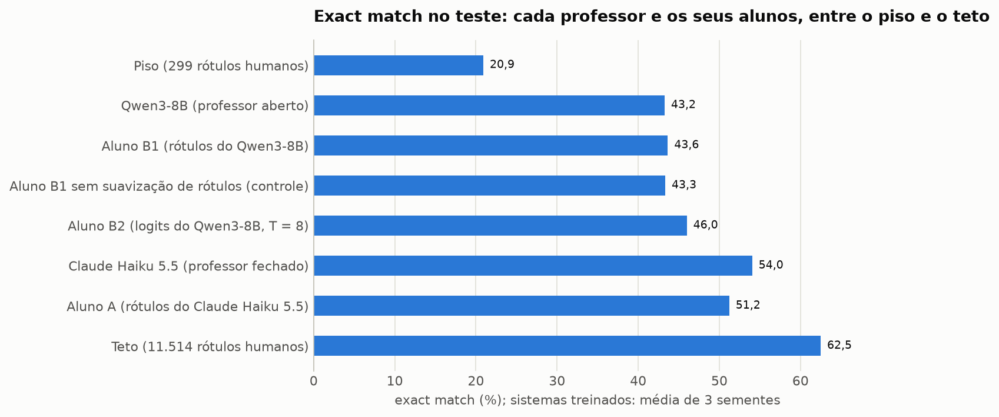
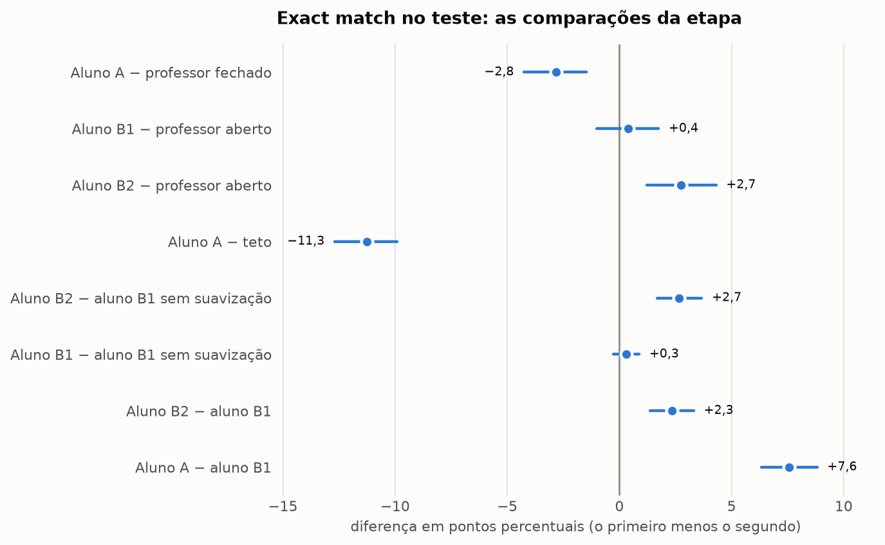
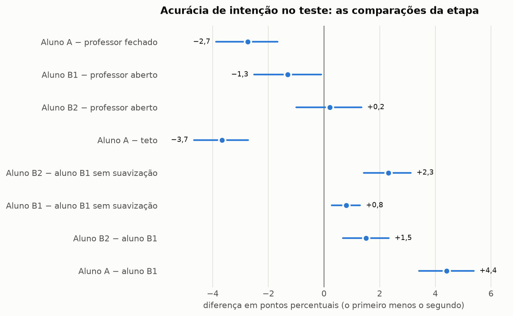
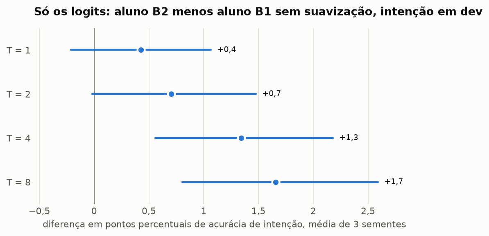
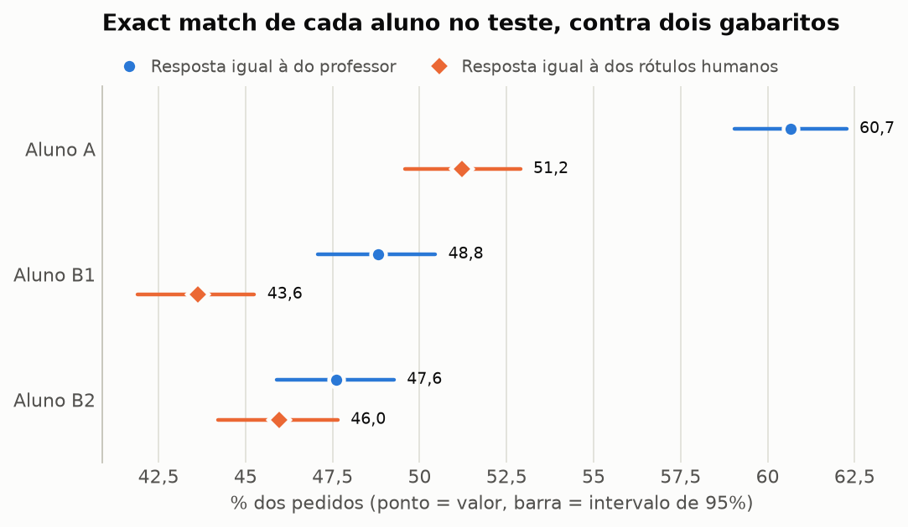

# Etapa 6 · Destilação: resumo da entrega

**Pergunta.** Quanto o aluno aprende só com os rótulos de cada professor, e quanto os logits acrescentam?

**Resposta.** Só com os rótulos do professor fechado (Claude Haiku 5.5), o aluno A faz no teste 80,7% de acurácia de intenção, 64,8% de F1 de entidades e 51,2% de exact match. Contra o piso, que treina só com os 299 rótulos humanos, ele fica acima em intenção (+40,6 (+39,0 a +42,2)), acima em entidades (+24,0 (+22,4 a +25,8)) e acima em exact match (+30,3 (+28,6 a +31,9)). Contra o seu professor, fica abaixo em intenção (−2,7 (−3,9 a −1,7)), abaixo em entidades (−1,2 (−2,5 a −0,0)) e abaixo em exact match (−2,8 (−4,3 a −1,5)). Contra o teto, treinado com os 11.514 rótulos humanos, fica abaixo em intenção (−3,7 (−4,7 a −2,7)), abaixo em entidades (−8,8 (−10,1 a −7,5)) e abaixo em exact match (−11,3 (−12,7 a −9,9)); em exact match, ele cobre 73% da distância entre o piso e o teto. Com o professor aberto (Qwen3-8B), o aluno B1 faz 76,3% / 57,1% / 43,6%; a diferença do aluno A para ele é de +7,6 (+6,3 a +8,8) pontos de exact match. **Os logits**, com a temperatura escolhida em `dev` (T = 8), levam o aluno B2 a 77,8% de intenção. Contra o controle, que é o B1 sem suavização de rótulos e só difere do B2 nos logits, ele fica acima em intenção (+2,3 (+1,4 a +3,1)), acima em entidades (+1,0 (+0,1 a +1,8)) e acima em exact match (+2,7 (+1,7 a +3,7)). Os logits acrescentam: com o resto igual, a intenção do B2 fica acima, com intervalo todo acima de zero. Contra o B1 da receita da Etapa 4b, com suavização, fica acima em intenção (+1,5 (+0,7 a +2,3)), acima em entidades (+0,9 (+0,0 a +1,7)) e acima em exact match (+2,3 (+1,4 a +3,3)).

Seguem para a poda (Etapa 7): **Aluno A (rótulos do Claude Haiku 5.5) e Aluno B2 (logits do Qwen3-8B, T = 8)**. O principal é o Aluno A.

## Os sistemas

Todos têm a rede e a receita da Etapa 4b (4.895.834 parâmetros nos alunos, os mesmos do teto) e 3 sementes. O que muda é de onde vêm os rótulos.

| Sistema | Rótulos do treino | Exemplos de treino | Quem escolhe a época de parada | O que muda na Etapa 4b | Época escolhida (sementes 0, 1 e 2) |
|---|---|---|---|---|---|
| Piso do cenário (só os 299 rótulos humanos) | rótulos humanos | 299 | rótulos humanos de dev | nada | 15, 20, 10 |
| Aluno A (rótulos do professor fechado) | rótulos do professor fechado | 11.514 | rótulos do professor fechado | nada | 45, 30, 30 |
| Aluno B1 (rótulos do professor aberto) | rótulos do professor aberto | 11.503 | rótulos do professor aberto | nada | 45, 45, 25 |
| Aluno B1 sem suavização de rótulos (controle do B2) | rótulos do professor aberto | 11.503 | rótulos do professor aberto | suavizacao = 0 | 30, 75, 25 |
| Aluno B2 (logits do professor aberto, temperatura 1) | rótulos do professor aberto | 11.503 | rótulos do professor aberto | suavizacao = 0, temperatura = 1 | 30, 80, 40 |
| Aluno B2 (logits do professor aberto, temperatura 2) | rótulos do professor aberto | 11.503 | rótulos do professor aberto | suavizacao = 0, temperatura = 2 | 80, 70, 50 |
| Aluno B2 (logits do professor aberto, temperatura 4) | rótulos do professor aberto | 11.503 | rótulos do professor aberto | suavizacao = 0, temperatura = 4 | 70, 80, 80 |
| Aluno B2 (logits do professor aberto, temperatura 8) | rótulos do professor aberto | 11.503 | rótulos do professor aberto | suavizacao = 0, temperatura = 8 | 80, 80, 80 |

- Dos pedidos rotulados pelo Claude Haiku 5.5, 53,6% estão inteiramente iguais aos rótulos humanos; dos rotulados pelo Qwen3-8B, 43,6%.
- Pedidos sem rótulo aproveitável, fora do treino: 0 do professor fechado e 11 do aberto.
- O piso tem 2.154.586 parâmetros: o vocabulário de features dele sai só dos 299 exemplos.
- Latência mediana em 1 núcleo de CPU, nesta sessão: 1,14 ms no aluno A, 1,16 ms no B2 e 1,17 ms no teto, que tem a mesma rede. As diferenças entre eles são ruído de medida.

## No teste

Em % (intervalo de 95%). Sistemas treinados: média de 3 sementes.

| Sistema | Acurácia de intenção | Macro-F1 de intenção | F1 de entidades | Exact match |
|---|---|---|---|---|
| Piso (299 rótulos humanos) | 40,1 (38,6 a 41,5) | 39,3 (37,5 a 41,1) | 40,8 (39,1 a 42,4) | 20,9 (19,6 a 22,2) |
| Qwen3-8B (professor aberto) | 77,6 (76,1 a 79,1) | 76,6 (74,7 a 79,2) | 55,7 (53,9 a 57,4) | 43,2 (41,5 a 45,0) |
| Aluno B1 (rótulos do Qwen3-8B) | 76,3 (74,9 a 77,7) | 74,5 (72,6 a 77,0) | 57,1 (55,4 a 58,9) | 43,6 (41,9 a 45,2) |
| Aluno B1 sem suavização de rótulos (controle) | 75,5 (74,0 a 76,9) | 73,9 (72,0 a 76,4) | 57,1 (55,4 a 58,8) | 43,3 (41,6 a 45,0) |
| Aluno B2 (logits do Qwen3-8B, T = 8) | 77,8 (76,3 a 79,3) | 76,5 (74,6 a 78,7) | 58,0 (56,3 a 59,8) | 46,0 (44,2 a 47,6) |
| Claude Haiku 5.5 (professor fechado) | 83,5 (82,1 a 84,7) | 82,1 (80,3 a 84,7) | 66,1 (64,5 a 67,7) | 54,0 (52,3 a 55,7) |
| Aluno A (rótulos do Claude Haiku 5.5) | 80,7 (79,4 a 82,0) | 78,3 (76,4 a 80,7) | 64,8 (63,2 a 66,5) | 51,2 (49,6 a 52,9) |
| Teto (11.514 rótulos humanos) | 84,4 (83,2 a 85,6) | 82,8 (81,0 a 84,8) | 73,6 (72,2 a 75,1) | 62,5 (60,8 a 64,1) |

## As comparações (teste)

Diferença pareada, em pontos percentuais (intervalo de 95%). Uma diferença só vale quando o intervalo não contém zero.

| Comparação | Acurácia de intenção | F1 de entidades | Exact match |
|---|---|---|---|
| Aluno A − professor fechado | −2,7 (−3,9 a −1,7) | −1,2 (−2,5 a −0,0) | −2,8 (−4,3 a −1,5) |
| Aluno B1 − professor aberto | −1,3 (−2,5 a −0,1) | +1,4 (+0,1 a +2,9) | +0,4 (−1,0 a +1,7) |
| Aluno B2 − professor aberto | +0,2 (−1,0 a +1,3) | +2,3 (+0,8 a +3,9) | +2,7 (+1,2 a +4,3) |
| Aluno A − teto | −3,7 (−4,7 a −2,7) | −8,8 (−10,1 a −7,5) | −11,3 (−12,7 a −9,9) |
| Aluno A − piso | +40,6 (+39,0 a +42,2) | +24,0 (+22,4 a +25,8) | +30,3 (+28,6 a +31,9) |
| Aluno B1 − piso | +36,2 (+34,6 a +37,8) | +16,3 (+14,7 a +18,0) | +22,7 (+21,1 a +24,3) |
| Aluno B2 − aluno B1 sem suavização | +2,3 (+1,4 a +3,1) | +1,0 (+0,1 a +1,8) | +2,7 (+1,7 a +3,7) |
| Aluno B1 − aluno B1 sem suavização | +0,8 (+0,3 a +1,3) | +0,1 (−0,5 a +0,6) | +0,3 (−0,3 a +0,9) |
| Aluno B2 − aluno B1 | +1,5 (+0,7 a +2,3) | +0,9 (+0,0 a +1,7) | +2,3 (+1,4 a +3,3) |
| Aluno A − aluno B1 | +4,4 (+3,4 a +5,4) | +7,7 (+6,6 a +8,9) | +7,6 (+6,3 a +8,8) |

- Entre os dois professores (Claude Haiku 5.5 − Qwen3-8B): +5,9 (+4,5 a +7,2) em intenção e +10,8 (+9,1 a +12,4) em exact match.
- Do B1 para o B2 mudam duas coisas: entram os logits e sai a suavização de rótulos. O controle (B1 sem suavização) separa as duas: "B2 − B1 sem suavização" muda só os logits, e "B1 − B1 sem suavização" muda só a suavização.

## A temperatura do aluno B2 (dev)

Perda de intenção do B2: T² · KL(softmax(logits do professor / T) ‖ softmax(logits do aluno / T)), sem termo de rótulo rígido e sem suavização de rótulos (Hinton et al., arXiv 1503.02531).

| T | Probabilidade média do alvo na intenção escolhida (treino) | Erro de calibração do professor (dev, pontos) | Intenção do B2 | Exact match do B2 | Intenção: B2 − B1 sem suavização (intervalo de 95%) | Intenção: B2 − B1 (intervalo de 95%) | Escolhida |
|---|---|---|---|---|---|---|---|
| 1 | 96,0% | 18,5 | 77,1 | 43,9 | +0,4 (−0,2 a +1,1) | −0,1 (−0,9 a +0,5) |  |
| 2 | 91,8% | 14,3 | 77,3 | 44,6 | +0,7 (−0,0 a +1,5) | +0,1 (−0,6 a +0,9) |  |
| 4 | 81,1% | 3,3 | 78,0 | 46,3 | +1,3 (+0,6 a +2,2) | +0,8 (−0,1 a +1,6) |  |
| 8 | 45,8% | 32,0 | 78,3 | 46,9 | +1,7 (+0,8 a +2,6) | +1,1 (+0,2 a +2,0) | sim |

- Regra: maior acurácia de intenção em `dev`, com os rótulos humanos, na média de 3 sementes. A escolhida só é distinguivelmente melhor que T = 1, 2; das demais ela não se separa, e outra amostra de `dev` poderia escolher diferente.
- Sem rótulos humanos, pela concordância com o professor em `dev`, a escolha seria T = 8. A temperatura escolhida é a maior da grade: daqui não dá para saber se uma temperatura ainda maior seria melhor. A grade foi fixada antes de medir e não foi ampliada.
- O controle (B1 sem suavização) contra o B1, em `dev`: −0,6 (−1,3 a +0,1) em intenção e −0,9 (−1,6 a −0,1) em exact match.

## O aluno imita o professor? (teste)

| Aluno | Intenção igual à do professor | Resposta inteira igual à do professor | Só o aluno acerta a intenção | Só o professor acerta a intenção | Os dois erram a intenção com a mesma resposta |
|---|---|---|---|---|---|
| Aluno A (rótulos do Claude Haiku 5.5) | 83,6 (82,3 a 84,8) | 60,7 (59,0 a 62,3) | 4,5% | 7,2% | 7,3% |
| Aluno B1 (rótulos do Qwen3-8B) | 79,2 (77,7 a 80,5) | 48,8 (47,1 a 50,4) | 6,2% | 7,5% | 9,0% |
| Aluno B2 (logits do Qwen3-8B, T = 8) | 80,1 (78,7 a 81,5) | 47,6 (45,9 a 49,3) | 6,8% | 6,6% | 9,1% |

- Aluno A, na intenção: quando o professor acerta (83,5% do teste), o aluno acerta junto em 91,3% das vezes; quando o professor erra (16,5%), o aluno acerta em 27,1%, repete o mesmo erro em 44,4% e erra de outro jeito em 28,5%.

## O que segue para a poda

- Regra, decidida em `dev`: o aluno A segue; do professor aberto segue o B2 se a intenção for distinguivelmente maior que a do B1 e o exact match não for distinguivelmente menor, senão o B1; o principal é o de maior exact match entre os que seguem.
- Em `dev`, B2 − B1: +1,1 (+0,2 a +2,0) em intenção e +1,7 (+0,7 a +2,9) em exact match. O B2 passou na regra. O B1 da regra é o da receita da Etapa 4b; o controle não concorre.
- Seguem: Aluno A (52,0% de exact match em dev), Aluno B2 (46,9% de exact match em dev). Principal: Aluno A.
- `decisao.json` traz, para cada aluno, onde estão os modelos, a configuração e o sinal de treino. No reajuste depois da poda, cada aluno continua com o sinal com que foi destilado.

## Limites

- **A parada não é igual para todos.** O teto e o piso escolhem a época de parada no `dev` humano; os alunos, no `dev` rotulado pelo professor. O piso recebe assim uma vantagem que o cenário não daria.
- **A temperatura do B2 foi escolhida com os rótulos humanos de `dev`**, que o cenário não tem, e entre 4 tentativas; o B1 teve uma só. A comparação B2 − B1 no teste carrega essa vantagem do B2.
- **O controle veio depois da primeira versão do plano.** O B1 sem suavização (suavização de 0,1 na Etapa 4b) foi acrescentado antes de qualquer treino, para separar o efeito dos logits do efeito de tirar a suavização. Ele não tem grade nem escolha: é um treino só, com 3 sementes.
- **Os logits são só da intenção.** As entidades do B2 são as mesmas do B1.
- **Um professor de cada tipo, uma rotulagem de cada.** A variação medida é a das 3 sementes do aluno, não a do professor.
- **A receita não foi ajustada para o piso.** São as 80 épocas e o balanceamento da Etapa 4b, sobre 299 exemplos.
- **O orçamento de épocas é o da Etapa 4b para todos** (80 épocas). Escolheram a última época, ou seja, ainda melhoravam contra o professor quando o treino acabou: Aluno B2 (logits do professor aberto, temperatura 1), 1 de 3 sementes; Aluno B2 (logits do professor aberto, temperatura 2), 1 de 3 sementes; Aluno B2 (logits do professor aberto, temperatura 4), 2 de 3 sementes; Aluno B2 (logits do professor aberto, temperatura 8), 3 de 3 sementes. Para esses, mais épocas poderiam dar outro resultado; o orçamento não foi aumentado para não mudar duas coisas de uma vez.
- **A fidelidade em `dev` foi o critério de parada**; por isso a fidelidade reportada é a do teste.
- **O teste já tinha sido aberto** nas etapas anteriores. Aqui ele foi aberto para cinco sistemas, com a temperatura do B2 já decidida em `dev`.

## Arquivos

| Arquivo | Conteúdo |
|---|---|
| `decisao.json` | Os alunos que seguem para a poda, o principal, a temperatura do B2, onde estão os modelos e o sinal de treino de cada um, e o controle |
| `modelos/` | Os modelos do piso, do aluno A, do B1 e do B2 na temperatura escolhida, 3 sementes cada |
| `previsoes/` | As respostas de cada treino em `dev` e, para os cinco sistemas medidos (o controle entre eles), no teste |
| `resultados.csv` | Cada sistema em `dev` e teste; as outras temperaturas do B2 só em `dev` |
| `comparacoes.csv` | Cada comparação pareada, em `dev` e teste, em todas as métricas |
| `temperaturas.csv` | A grade do aluno B2 em `dev` |
| `fidelidade.csv` | Cada aluno contra o seu professor, no teste |
| `historicos/` | Perdas e métricas no `dev` de parada, época por época, de cada treino |
| `figuras/` | Os gráficos deste notebook |
| `06_destilacao.html` | Este notebook executado, para leitura |
