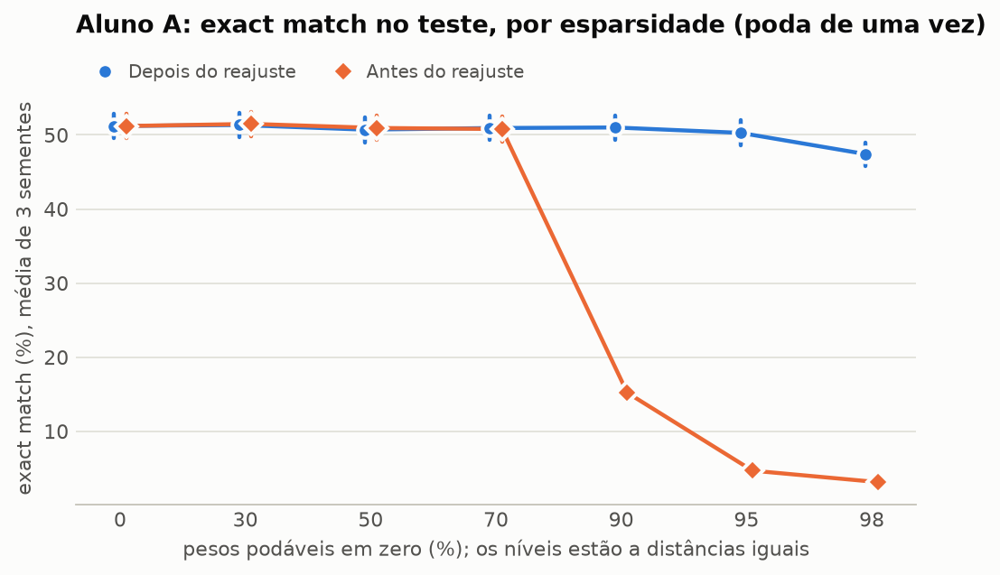
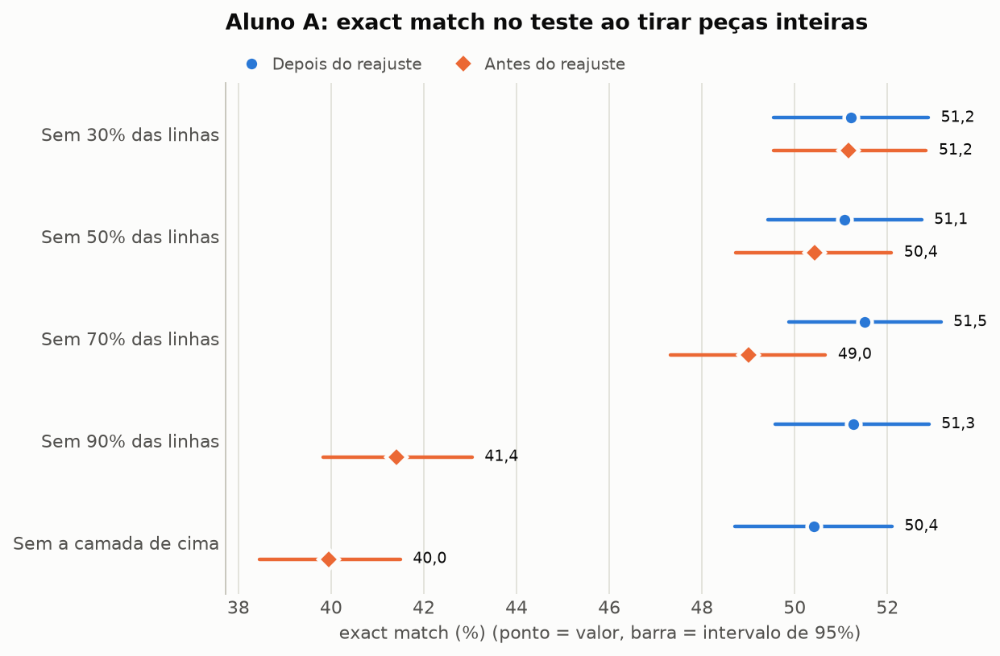
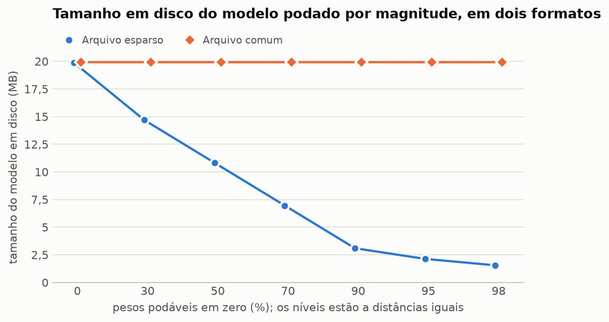

# Etapa 7 · Poda e fine-tuning de recuperação: resumo da entrega

**Pergunta.** Quanto dá para remover da rede, e quanto o reajuste recupera?

**Resposta.** No aluno A, sem reajuste, o exact match fica distinguivelmente abaixo do modelo sem poda em 90%, 95% e 98%; com reajuste, em 50%, 95% e 98%. O reajuste melhora o modelo podado, com intervalo todo acima de zero, em 90%, 95% e 98%. Em 98%: −48,1 (−49,8 a −46,3) antes e −3,8 (−4,7 a −2,9) depois. Pela regra, decidida em `dev`, a maior esparsidade que não se distingue do modelo sem poda é de **95%**. Com peças inteiras: depois do reajuste, não se distinguem do modelo sem poda em exact match: sem 30% das linhas, sem 50% das linhas, sem 70% das linhas e sem 90% das linhas; ficam abaixo: sem a camada de cima. Sem a camada de cima: −0,5 (−1,0 a −0,1) em intenção, −0,9 (−1,4 a −0,4) em entidades e −0,8 (−1,4 a −0,3) em exact match. **No custo**, com 98% dos pesos soltos em zero o arquivo comum não muda (19,9 MB, contra 19,9 MB sem poda) e a latência da execução comum também não; num arquivo que aproveita os zeros o modelo cai para 1,6 MB. Tirar peças inteiras diminui o arquivo comum sem formato especial (8,1 MB sem 90% das linhas da tabela).

Segue para a quantização (Etapa 8), do aluno A: a principal é **sem 90% das linhas da tabela de features** (arquivo comum de 8,1 MB, 1.986.488 parâmetros diferentes de zero; em `dev`, −0,4 (−1,4 a +0,6) de exact match em relação ao modelo sem poda); a secundária é **magnitude, 95% de uma vez** (arquivo comum de 19,9 MB, 299.871 parâmetros diferentes de zero; em `dev`, −0,8 (−1,6 a +0,0) de exact match em relação ao modelo sem poda).

## O que foi feito

- **Modelos de partida:** Aluno A (rótulos do Claude Haiku 5.5), Teto (rótulos humanos) e Aluno B2 (logits do Qwen3-8B, T = 8). Cada um é reajustado com o sinal com que aprendeu; a época de parada dos alunos usa o `dev` rotulado pelo professor.
- **Pesos soltos, por magnitude** (Han et al., arXiv 1506.02626): entram 14 matrizes (98,7% da rede), com o corte por matriz. De uma vez, com medida antes e depois do reajuste, em 30%, 50%, 70%, 90%, 95% e 98%; e gradual (Zhu & Gupta, arXiv 1710.01878), em 30%, 50%, 70% e 90%, com a esparsidade subindo nas primeiras 15 épocas.
- **Peças inteiras:** linhas da tabela de features, pela importância de cada linha na perda de treino, e a camada de cima do encoder.
- **Reajuste:** 30 épocas em todas as execuções, com a receita de quem treinou o modelo e a máscara travada. Fica o melhor ponto em `dev`, e o ponto de partida concorre: em 17 das 108 execuções o reajuste não melhorou o modelo e ele saiu como entrou. Um controle faz o mesmo reajuste sem tirar nada.
- 144 execuções: 3 modelos de partida × 16 variantes × 3 sementes.

## Pesos soltos: antes e depois do reajuste (Aluno A, teste)

Exact match em % (intervalo de 95%), média de 3 sementes; diferenças pareadas em pontos percentuais. Sem poda: 51,2 (49,6 a 52,9).

| | Antes do reajuste | Depois do reajuste | Antes − sem poda | Depois − sem poda | O que o reajuste recupera |
|---|---|---|---|---|---|
| 0% (controle: só o reajuste) | — | 51,2 (49,6 a 52,9) | — | +0,0 (+0,0 a +0,0) | — |
| 30% | 51,5 (49,8 a 53,1) | 51,3 (49,7 a 53,0) | +0,3 (+0,0 a +0,5) | +0,1 (−0,2 a +0,5) | −0,1 (−0,4 a +0,1) |
| 50% | 50,9 (49,3 a 52,6) | 50,7 (49,0 a 52,3) | −0,3 (−0,7 a +0,2) | −0,5 (−0,9 a −0,1) | −0,2 (−0,5 a +0,1) |
| 70% | 50,8 (49,1 a 52,5) | 50,9 (49,3 a 52,6) | −0,4 (−1,1 a +0,2) | −0,3 (−0,8 a +0,2) | +0,1 (−0,5 a +0,8) |
| 90% | 15,2 (14,2 a 16,2) | 51,0 (49,3 a 52,6) | −36,0 (−37,7 a −34,3) | −0,2 (−0,8 a +0,4) | +35,8 (+34,0 a +37,5) |
| 95% | 4,7 (4,1 a 5,3) | 50,3 (48,6 a 52,0) | −46,5 (−48,3 a −44,8) | −0,9 (−1,6 a −0,2) | +45,6 (+43,8 a +47,4) |
| 98% | 3,1 (2,6 a 3,6) | 47,4 (45,8 a 49,0) | −48,1 (−49,8 a −46,3) | −3,8 (−4,7 a −2,9) | +44,3 (+42,6 a +45,9) |

- O controle (o mesmo reajuste, sem poda) fica sem diferença distinguível em relação ao modelo de partida: +0,0 (+0,0 a +0,0).

## De uma vez ou gradual (Aluno A, teste)

| Esparsidade | De uma vez, depois do reajuste | Gradual | Gradual − de uma vez | Gradual − sem poda |
|---|---|---|---|---|
| 30% | 51,3 (49,7 a 53,0) | 50,7 (49,0 a 52,4) | −0,7 (−1,2 a −0,1) | −0,5 (−1,1 a +0,0) |
| 50% | 50,7 (49,0 a 52,3) | 50,7 (49,1 a 52,4) | +0,0 (−0,5 a +0,6) | −0,5 (−1,0 a +0,0) |
| 70% | 50,9 (49,3 a 52,6) | 51,1 (49,4 a 52,8) | +0,1 (−0,3 a +0,6) | −0,1 (−0,7 a +0,4) |
| 90% | 51,0 (49,3 a 52,6) | 50,9 (49,2 a 52,6) | −0,1 (−0,6 a +0,4) | −0,3 (−0,8 a +0,2) |

- A gradual fica acima da poda de uma vez em nenhum nível e abaixo em 30%.

## Peças inteiras (Aluno A, teste)

| Variante | Parâmetros | Antes do reajuste | Depois do reajuste | Depois − sem poda | O que o reajuste recupera |
|---|---|---|---|---|---|
| Sem 30% das linhas da tabela de features | 3.928.026 | 51,2 (49,6 a 52,8) | 51,2 (49,5 a 52,9) | +0,0 (−0,4 a +0,4) | +0,1 (−0,2 a +0,3) |
| Sem 50% das linhas da tabela de features | 3.282.906 | 50,4 (48,7 a 52,1) | 51,1 (49,4 a 52,7) | −0,1 (−0,7 a +0,5) | +0,7 (+0,1 a +1,3) |
| Sem 70% das linhas da tabela de features | 2.637.786 | 49,0 (47,3 a 50,7) | 51,5 (49,9 a 53,1) | +0,3 (−0,3 a +0,9) | +2,5 (+1,7 a +3,3) |
| Sem 90% das linhas da tabela de features | 1.992.538 | 41,4 (39,8 a 43,0) | 51,3 (49,6 a 52,9) | +0,0 (−0,8 a +0,9) | +9,9 (+8,8 a +11,0) |
| Sem a camada de cima do encoder | 4.105.370 | 40,0 (38,5 a 41,5) | 50,4 (48,7 a 52,1) | −0,8 (−1,4 a −0,3) | +10,5 (+9,4 a +11,6) |

- Critério das linhas, conferido em `dev` sem reajuste: sem 50% das linhas, 41,3% de exact match pela norma e 51,6% pela importância (diferença de +10,4 (+9,0 a +11,8)).

## O que muda de verdade (Aluno A, semente 0)

Tamanhos em MB; latência p50 em ms, 1 núcleo de CPU, uma consulta por vez.

| Variante | Parâmetros | Diferentes de zero | Arquivo comum | Arquivo comum com zip | Arquivo esparso | Latência | Latência, execução esparsa |
|---|---|---|---|---|---|---|---|
| Sem poda | 4.895.834 | 4.889.784 | 19,9 | 18,2 | 19,9 | 1,10 | — |
| Magnitude, 30% de uma vez | 4.895.834 | 3.440.337 | 19,9 | 14,3 | 14,7 | 1,10 | 2,12 |
| Magnitude, 50% de uma vez | 4.895.834 | 2.474.040 | 19,9 | 11,2 | 10,8 | 1,11 | 1,72 |
| Magnitude, 70% de uma vez | 4.895.834 | 1.507.743 | 19,9 | 7,1 | 7,0 | 1,11 | 1,37 |
| Magnitude, 90% de uma vez | 4.895.834 | 541.447 | 19,9 | 2,9 | 3,1 | 1,11 | 1,04 |
| Magnitude, 95% de uma vez | 4.895.834 | 299.871 | 19,9 | 1,7 | 2,1 | 1,13 | 0,97 |
| Magnitude, 98% de uma vez | 4.895.834 | 154.928 | 19,9 | 0,9 | 1,6 | 1,12 | 0,85 |
| Magnitude, 30% gradual | 4.895.834 | 3.440.337 | 19,9 | 14,1 | 14,7 | 1,13 | 2,16 |
| Magnitude, 50% gradual | 4.895.834 | 2.474.040 | 19,9 | 10,7 | 10,8 | 1,13 | 1,74 |
| Magnitude, 70% gradual | 4.895.834 | 1.507.743 | 19,9 | 7,0 | 7,0 | 1,13 | 1,37 |
| Magnitude, 90% gradual | 4.895.834 | 541.447 | 19,9 | 2,9 | 3,1 | 1,12 | 1,04 |
| Sem 30% das linhas da tabela de features | 3.928.026 | 3.921.976 | 16,0 | 14,6 | 15,9 | 1,12 | — |
| Sem 50% das linhas da tabela de features | 3.282.906 | 3.276.856 | 13,3 | 12,2 | 13,3 | 1,13 | — |
| Sem 70% das linhas da tabela de features | 2.637.786 | 2.631.736 | 10,7 | 9,8 | 10,7 | 1,12 | — |
| Sem 90% das linhas da tabela de features | 1.992.538 | 1.986.488 | 8,1 | 7,4 | 8,0 | 1,13 | — |
| Sem a camada de cima do encoder | 4.105.370 | 4.099.320 | 16,8 | 15,3 | 16,7 | 0,77 | — |

- **Com os pesos soltos:** o número de parâmetros não muda; o arquivo comum não muda; a latência da execução comum não muda (maior variação: 3%; a própria medida varia 3%). Mudam os parâmetros diferentes de zero e o tamanho de um arquivo que aproveite os zeros. A execução esparsa só compensa em 90%, 95% e 98%.
- **Com as peças inteiras, sem formato especial:** o arquivo comum diminui; a latência não muda sem 90% das linhas e muda −30% sem a camada de cima.

## Todas as variantes, no teste

Métricas em %, média de 3 sementes, depois do reajuste (a coluna "antes" é o exact match logo depois do corte). A diferença é pareada, contra o mesmo modelo sem poda, em pontos percentuais (intervalo de 95%). Tamanhos em MB e latência p50 em ms (1 núcleo de CPU), medidos na semente 0.

| Modelo de partida | Variante | Intenção | F1 de entidades | Exact match antes | Exact match | Exact match − sem poda | Diferentes de zero | Arquivo comum | Com zip | Esparso | Latência |
|---|---|---|---|---|---|---|---|---|---|---|---|
| Aluno A | Sem poda | 80,7 | 64,8 | — | 51,2 | — | 4.889.784 | 19,9 | 18,2 | 19,9 | 1,10 |
| Aluno A | Sem poda, com o mesmo reajuste (controle) | 80,7 | 64,8 | — | 51,2 | +0,0 (+0,0 a +0,0) | 4.889.784 | 19,9 | 18,2 | 19,9 | 1,11 |
| Aluno A | Magnitude, 30% de uma vez | 80,6 | 64,8 | 51,5 | 51,3 | +0,1 (−0,2 a +0,5) | 3.440.337 | 19,9 | 14,3 | 14,7 | 1,10 |
| Aluno A | Magnitude, 50% de uma vez | 80,4 | 64,5 | 50,9 | 50,7 | −0,5 (−0,9 a −0,1) | 2.474.040 | 19,9 | 11,2 | 10,8 | 1,11 |
| Aluno A | Magnitude, 70% de uma vez | 80,3 | 64,6 | 50,8 | 50,9 | −0,3 (−0,8 a +0,2) | 1.507.743 | 19,9 | 7,1 | 7,0 | 1,11 |
| Aluno A | Magnitude, 90% de uma vez | 80,2 | 64,9 | 15,2 | 51,0 | −0,2 (−0,8 a +0,4) | 541.447 | 19,9 | 2,9 | 3,1 | 1,11 |
| Aluno A | Magnitude, 95% de uma vez **(secundária)** | 79,9 | 64,3 | 4,7 | 50,3 | −0,9 (−1,6 a −0,2) | 299.871 | 19,9 | 1,7 | 2,1 | 1,13 |
| Aluno A | Magnitude, 98% de uma vez | 78,4 | 63,1 | 3,1 | 47,4 | −3,8 (−4,7 a −2,9) | 154.928 | 19,9 | 0,9 | 1,6 | 1,12 |
| Aluno A | Magnitude, 30% gradual | 80,5 | 64,4 | — | 50,7 | −0,5 (−1,1 a +0,0) | 3.440.337 | 19,9 | 14,1 | 14,7 | 1,13 |
| Aluno A | Magnitude, 50% gradual | 80,2 | 64,5 | — | 50,7 | −0,5 (−1,0 a +0,0) | 2.474.040 | 19,9 | 10,7 | 10,8 | 1,13 |
| Aluno A | Magnitude, 70% gradual | 80,5 | 64,8 | — | 51,1 | −0,1 (−0,7 a +0,4) | 1.507.743 | 19,9 | 7,0 | 7,0 | 1,13 |
| Aluno A | Magnitude, 90% gradual | 79,9 | 64,9 | — | 50,9 | −0,3 (−0,8 a +0,2) | 541.447 | 19,9 | 2,9 | 3,1 | 1,12 |
| Aluno A | Sem 30% das linhas da tabela de features | 80,6 | 64,6 | 51,2 | 51,2 | +0,0 (−0,4 a +0,4) | 3.921.976 | 16,0 | 14,6 | 15,9 | 1,12 |
| Aluno A | Sem 50% das linhas da tabela de features | 80,6 | 65,0 | 50,4 | 51,1 | −0,1 (−0,7 a +0,5) | 3.276.856 | 13,3 | 12,2 | 13,3 | 1,13 |
| Aluno A | Sem 70% das linhas da tabela de features | 81,2 | 64,8 | 49,0 | 51,5 | +0,3 (−0,3 a +0,9) | 2.631.736 | 10,7 | 9,8 | 10,7 | 1,12 |
| Aluno A | Sem 90% das linhas da tabela de features **(principal)** | 80,2 | 64,8 | 41,4 | 51,3 | +0,0 (−0,8 a +0,9) | 1.986.488 | 8,1 | 7,4 | 8,0 | 1,13 |
| Aluno A | Sem a camada de cima do encoder | 80,2 | 63,9 | 40,0 | 50,4 | −0,8 (−1,4 a −0,3) | 4.099.320 | 16,8 | 15,3 | 16,7 | 0,77 |
| Teto | Sem poda | 84,4 | 73,6 | — | 62,5 | — | 4.889.784 | 19,9 | 18,2 | 19,9 | 1,12 |
| Teto | Sem poda, com o mesmo reajuste (controle) | 84,2 | 73,6 | — | 62,2 | −0,2 (−0,6 a +0,1) | 4.889.784 | 19,9 | 18,2 | 19,9 | 1,12 |
| Teto | Magnitude, 30% de uma vez | 84,1 | 73,6 | 62,5 | 62,2 | −0,3 (−0,7 a +0,1) | 3.440.337 | 19,9 | 14,2 | 14,7 | 1,11 |
| Teto | Magnitude, 50% de uma vez | 84,0 | 73,4 | 62,2 | 62,1 | −0,4 (−0,9 a +0,0) | 2.474.040 | 19,9 | 10,8 | 10,8 | 1,10 |
| Teto | Magnitude, 70% de uma vez | 84,0 | 73,0 | 59,8 | 61,7 | −0,8 (−1,4 a −0,2) | 1.507.743 | 19,9 | 7,0 | 7,0 | 1,11 |
| Teto | Magnitude, 90% de uma vez **(secundária)** | 83,8 | 73,4 | 12,8 | 61,6 | −0,9 (−1,5 a −0,2) | 541.447 | 19,9 | 2,9 | 3,1 | 1,11 |
| Teto | Magnitude, 95% de uma vez | 83,4 | 72,5 | 4,9 | 60,2 | −2,3 (−3,0 a −1,5) | 299.871 | 19,9 | 1,7 | 2,1 | 1,12 |
| Teto | Magnitude, 98% de uma vez | 80,6 | 71,7 | 3,9 | 57,4 | −5,1 (−6,1 a −4,2) | 154.928 | 19,9 | 0,9 | 1,6 | 1,12 |
| Teto | Magnitude, 30% gradual | 83,9 | 72,9 | — | 61,5 | −0,9 (−1,6 a −0,3) | 3.440.337 | 19,9 | 14,2 | 14,7 | 1,12 |
| Teto | Magnitude, 50% gradual | 83,9 | 73,0 | — | 61,7 | −0,8 (−1,4 a −0,2) | 2.474.040 | 19,9 | 10,7 | 10,8 | 1,12 |
| Teto | Magnitude, 70% gradual | 83,7 | 73,3 | — | 61,8 | −0,7 (−1,3 a −0,0) | 1.507.743 | 19,9 | 7,1 | 7,0 | 1,12 |
| Teto | Magnitude, 90% gradual | 83,7 | 73,5 | — | 61,6 | −0,9 (−1,4 a −0,2) | 541.447 | 19,9 | 2,8 | 3,1 | 1,12 |
| Teto | Sem 30% das linhas da tabela de features | 84,2 | 73,6 | 61,8 | 62,2 | −0,3 (−0,9 a +0,3) | 3.921.976 | 16,0 | 14,6 | 15,9 | 1,11 |
| Teto | Sem 50% das linhas da tabela de features | 84,3 | 73,8 | 61,3 | 62,4 | −0,0 (−0,7 a +0,6) | 3.276.856 | 13,3 | 12,2 | 13,3 | 1,11 |
| Teto | Sem 70% das linhas da tabela de features | 84,8 | 74,2 | 59,1 | 63,1 | +0,6 (−0,2 a +1,3) | 2.631.736 | 10,7 | 9,8 | 10,7 | 1,11 |
| Teto | Sem 90% das linhas da tabela de features **(principal)** | 83,4 | 73,5 | 48,4 | 61,3 | −1,2 (−2,1 a −0,3) | 1.986.488 | 8,1 | 7,4 | 8,0 | 1,11 |
| Teto | Sem a camada de cima do encoder | 83,4 | 72,9 | 55,4 | 60,9 | −1,5 (−2,2 a −0,9) | 4.099.320 | 16,8 | 15,3 | 16,7 | 0,76 |
| Aluno B2 | Sem poda | 77,8 | 58,0 | — | 46,0 | — | 4.889.784 | 19,9 | 18,2 | 19,9 | 1,12 |
| Aluno B2 | Sem poda, com o mesmo reajuste (controle) | 77,8 | 58,1 | — | 46,1 | +0,1 (−0,4 a +0,5) | 4.889.784 | 19,9 | 18,2 | 19,9 | 1,12 |
| Aluno B2 | Magnitude, 30% de uma vez | 77,3 | 57,9 | 45,8 | 45,7 | −0,2 (−0,8 a +0,2) | 3.440.337 | 19,9 | 14,2 | 14,7 | 1,11 |
| Aluno B2 | Magnitude, 50% de uma vez | 77,4 | 57,9 | 46,0 | 45,6 | −0,3 (−0,9 a +0,2) | 2.474.040 | 19,9 | 10,8 | 10,8 | 1,13 |
| Aluno B2 | Magnitude, 70% de uma vez | 77,4 | 58,4 | 45,5 | 46,0 | +0,1 (−0,5 a +0,6) | 1.507.743 | 19,9 | 7,0 | 7,0 | 1,12 |
| Aluno B2 | Magnitude, 90% de uma vez | 77,6 | 58,6 | 19,6 | 46,1 | +0,1 (−0,5 a +0,7) | 541.447 | 19,9 | 2,9 | 3,1 | 1,11 |
| Aluno B2 | Magnitude, 95% de uma vez | 77,2 | 57,4 | 4,8 | 45,0 | −1,0 (−1,7 a −0,2) | 299.871 | 19,9 | 1,7 | 2,1 | 1,13 |
| Aluno B2 | Magnitude, 98% de uma vez | 75,5 | 52,9 | 3,9 | 40,2 | −5,8 (−7,0 a −4,7) | 154.928 | 19,9 | 0,9 | 1,6 | 1,13 |
| Aluno B2 | Magnitude, 30% gradual | 77,4 | 58,1 | — | 45,8 | −0,1 (−0,7 a +0,4) | 3.440.337 | 19,9 | 14,1 | 14,7 | 1,12 |
| Aluno B2 | Magnitude, 50% gradual | 77,2 | 57,9 | — | 45,7 | −0,3 (−0,9 a +0,3) | 2.474.040 | 19,9 | 10,7 | 10,8 | 1,12 |
| Aluno B2 | Magnitude, 70% gradual | 77,4 | 58,1 | — | 45,7 | −0,3 (−0,9 a +0,3) | 1.507.743 | 19,9 | 7,0 | 7,0 | 1,11 |
| Aluno B2 | Magnitude, 90% gradual **(secundária)** | 77,5 | 58,6 | — | 46,1 | +0,1 (−0,5 a +0,8) | 541.447 | 19,9 | 2,8 | 3,1 | 1,11 |
| Aluno B2 | Sem 30% das linhas da tabela de features | 77,7 | 58,5 | 46,0 | 46,1 | +0,1 (−0,4 a +0,8) | 3.921.976 | 16,0 | 14,6 | 15,9 | 1,11 |
| Aluno B2 | Sem 50% das linhas da tabela de features | 78,0 | 58,5 | 45,3 | 46,2 | +0,3 (−0,4 a +0,9) | 3.276.856 | 13,3 | 12,2 | 13,3 | 1,12 |
| Aluno B2 | Sem 70% das linhas da tabela de features | 78,0 | 59,0 | 43,7 | 47,0 | +1,0 (+0,2 a +1,7) | 2.631.736 | 10,7 | 9,8 | 10,7 | 1,11 |
| Aluno B2 | Sem 90% das linhas da tabela de features **(principal)** | 77,8 | 58,0 | 35,7 | 46,2 | +0,2 (−0,7 a +1,2) | 1.986.488 | 8,1 | 7,4 | 8,0 | 1,11 |
| Aluno B2 | Sem a camada de cima do encoder | 77,3 | 58,2 | 41,0 | 45,7 | −0,3 (−1,0 a +0,4) | 4.099.320 | 16,8 | 15,3 | 16,7 | 0,76 |

## O que segue para a quantização

Regra, decidida em `dev` com os rótulos humanos: passa a variante cujo exact match, depois do reajuste, não é distinguivelmente menor que o do modelo sem poda. A **principal** é a que passa com o menor arquivo comum, que é o que a quantização e uma execução comum consomem; se nenhuma peça inteira passa, é o modelo sem poda. A **secundária** é a de pesos soltos que passa com a maior esparsidade.

| Modelo de partida | Principal | Secundária |
|---|---|---|
| Aluno A | Sem 90% das linhas da tabela de features: −0,4 (−1,4 a +0,6) em dev, 8,1 MB no arquivo comum, 8,0 MB no esparso | Magnitude, 95% de uma vez: −0,8 (−1,6 a +0,0) em dev, 19,9 MB no arquivo comum, 2,1 MB no esparso |
| Teto | Sem 90% das linhas da tabela de features: −0,8 (−2,0 a +0,2) em dev, 8,1 MB no arquivo comum, 8,0 MB no esparso | Magnitude, 90% de uma vez: −0,6 (−1,3 a +0,2) em dev, 19,9 MB no arquivo comum, 3,1 MB no esparso |
| Aluno B2 | Sem 90% das linhas da tabela de features: −0,0 (−1,1 a +1,0) em dev, 8,1 MB no arquivo comum, 8,0 MB no esparso | Magnitude, 90% gradual: +0,1 (−0,7 a +0,8) em dev, 19,9 MB no arquivo comum, 3,1 MB no esparso |

- **O que a regra descartou, aluno A:** não passam 2 de 15 variantes (magnitude, 98% de uma vez e sem a camada de cima do encoder); passam e ficam de fora, por haver outra menor ou mais esparsa, 11 (magnitude, 30% de uma vez, magnitude, 50% de uma vez, magnitude, 70% de uma vez, magnitude, 90% de uma vez, magnitude, 30% gradual, magnitude, 50% gradual, magnitude, 70% gradual, magnitude, 90% gradual, sem 30% das linhas da tabela de features, sem 50% das linhas da tabela de features e sem 70% das linhas da tabela de features).
- **O que a regra descartou, teto:** não passam 3 de 15 variantes (magnitude, 95% de uma vez, magnitude, 98% de uma vez e sem a camada de cima do encoder); passam e ficam de fora, por haver outra menor ou mais esparsa, 10 (magnitude, 30% de uma vez, magnitude, 50% de uma vez, magnitude, 70% de uma vez, magnitude, 30% gradual, magnitude, 50% gradual, magnitude, 70% gradual, magnitude, 90% gradual, sem 30% das linhas da tabela de features, sem 50% das linhas da tabela de features e sem 70% das linhas da tabela de features).
- **O que a regra descartou, aluno B2:** não passam 2 de 15 variantes (magnitude, 95% de uma vez e magnitude, 98% de uma vez); passam e ficam de fora, por haver outra menor ou mais esparsa, 11 (magnitude, 30% de uma vez, magnitude, 50% de uma vez, magnitude, 70% de uma vez, magnitude, 90% de uma vez, magnitude, 30% gradual, magnitude, 50% gradual, magnitude, 70% gradual, sem 30% das linhas da tabela de features, sem 50% das linhas da tabela de features, sem 70% das linhas da tabela de features e sem a camada de cima do encoder).
- `decisao.json` traz, para cada modelo de partida, a principal, a secundária, a pasta de cada semente (lida por `SistemaDiet.carregar`), o sinal do reajuste e os tamanhos medidos.
- A secundária tem o mesmo arquivo comum do modelo sem poda: só é menor num formato que aproveite os zeros. A Etapa 8 precisa conferir que os zeros continuam zeros depois de quantizar.

## Critério de pronto

| Critério | Atendido |
|---|---|
| Cada variante tem 3 sementes para cada modelo de partida, com o mesmo orçamento de reajuste (144 execuções de 30 épocas) | sim |
| A esparsidade pedida é a obtida | sim |
| Nenhum rótulo humano entrou no reajuste dos alunos | sim |
| Cada nível tem antes e depois do reajuste, com comparação pareada contra o modelo sem poda e intervalo de 95%, no teste (174 comparações) | sim |
| Tamanho e latência foram medidos em arquivos gravados e modelos carregados | sim |
| O que segue para a quantização saiu de dev, pela regra escrita antes | sim |
| Os modelos entregues são pastas comuns de SistemaDiet e reproduzem as respostas do teste | sim |

## Limites

- **O corte é por matriz.** O corte global, com um limite só para a rede inteira, não foi testado.
- **Uma rodada de poda.** Han et al. repetem o ciclo de podar e reajustar; aqui há uma poda de uma vez e uma gradual, com o mesmo orçamento de 30 épocas.
- **O teto serviu ao desenvolvimento.** As medidas dele sem reajuste e um piloto de uma semente foram vistos antes de a grade rodar; a regra do ponto de partida e os níveis de 95% e 98% vieram daí. As medidas dos alunos não tinham sido vistas.
- **A receita do reajuste não foi ajustada por nível.** Mesma taxa, mesmo dropout e mesmas épocas em todos; Han et al. diminuem o dropout quando a rede fica menor.
- **O critério das peças inteiras é fixo**, não aprendido como no CoFi, e só duas peças foram testadas (linhas da tabela e a camada de cima). Treinar do zero a rede menor (Liu et al.) não foi comparado.
- **A regra aceita o que não se distingue.** Com o tamanho de `dev`, uma queda de menos de cerca de 1 ponto de exact match pode passar.
- **As decisões de análise usam os rótulos humanos de `dev`**, que o cenário dos alunos não tem. O reajuste e a parada não usam.
- **A parada do reajuste e a regra olham o mesmo `dev`** (rotulado pelo professor, no caso dos alunos, para a parada; humano, para a regra).
- **O teste foi aberto para todos os níveis**, porque a curva inteira é o resultado da etapa. Nenhuma decisão saiu dele: a regra do que segue usa só `dev`. O teste já tinha sido aberto nas etapas anteriores.
- **Latência só em PyTorch, na CPU, com 1 núcleo.** A execução esparsa usa o formato CSR do PyTorch; outro ambiente de execução pode dar outro número. A memória em uso não foi medida. O mesmo modelo, medido duas vezes nesta sessão, variou 3%.
- **O arquivo esparso é o formato mais simples** (um bit por posição). Não combina com a quantização, que é o assunto da Etapa 8.

## Arquivos

| Arquivo | Conteúdo |
|---|---|
| `decisao.json` | Para cada modelo de partida: a principal, a secundária, a pasta de cada semente, o sinal do reajuste e os tamanhos medidos |
| `modelos/` | Os modelos que seguem, 3 sementes cada, em pastas comuns de `SistemaDiet` (pesos densos, com zeros no lugar dos pesos podados, ou a rede menor) |
| `modelos_esparsos/` | Os modelos de pesos soltos que seguem, gravados no arquivo esparso (`poda.carregar_esparso`) |
| `tabela_principal.csv` | Cada variante de cada modelo de partida no teste: qualidade, diferença para o modelo sem poda, tamanhos e latência |
| `previsoes/` | As respostas dos modelos que seguem, em `dev` e no teste |
| `resultados.csv` | Cada variante de cada modelo de partida, antes e depois do reajuste, em `dev` e no teste |
| `comparacoes.csv` | Cada comparação pareada, em todas as métricas |
| `eficiencia.csv` | Parâmetros, tamanhos em disco e latência de cada variante (semente 0) |
| `historicos/` | Perdas, esparsidade e métricas no `dev` de parada, época por época, de cada execução |
| `figuras/` | Os gráficos deste notebook |
| `07_poda.html` | Este notebook executado, para leitura |
