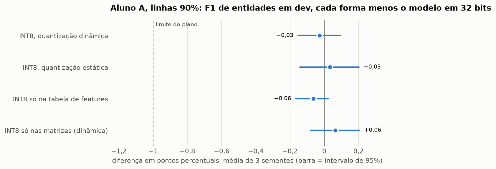
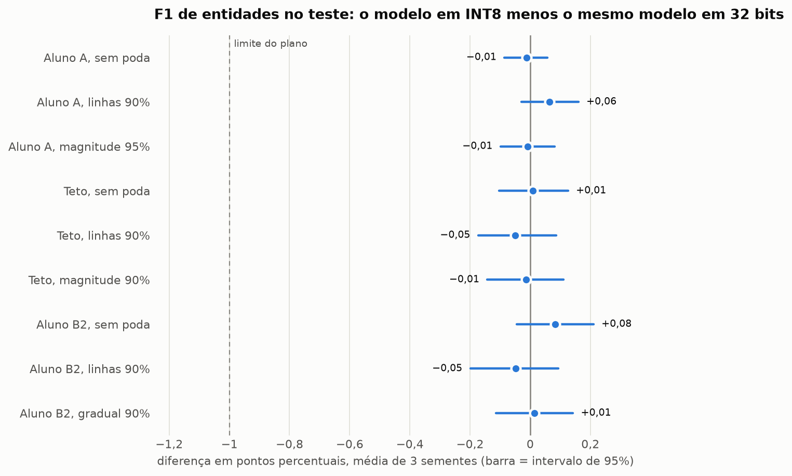
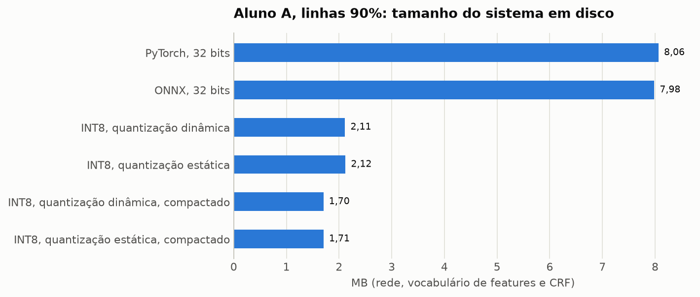
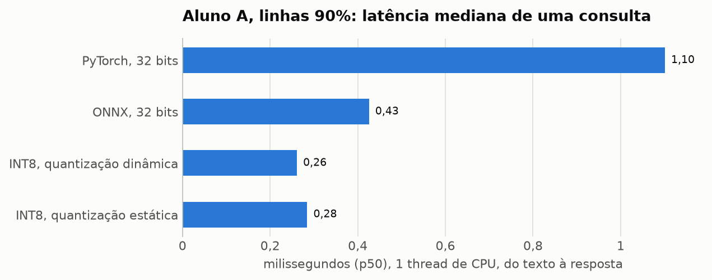

# Etapa 8 · Quantização: resumo da entrega

**Pergunta.** Quanto custa, em qualidade, passar a rede para inteiros de 8 bits, e quanto se ganha em tamanho e latência?

**Resposta.** No modelo final do projeto (Aluno A (rótulos do Claude Haiku 5.5), sem 90% das linhas da tabela de features), passar para inteiros de 8 bits custa, no teste, +0,06 (−0,03 a +0,16) pontos de F1 de entidades, −0,01 (−0,10 a +0,08) de acurácia de intenção e −0,03 (−0,16 a +0,08) de exact match, em relação ao mesmo modelo em 32 bits (diferença pareada, média de 3 sementes, intervalo de 95%). O arquivo vai de 8,06 MB para 2,11 MB (3,8 vezes menos), e a consulta, de 1,10 ms no PyTorch para 0,26 ms (p50, 1 thread). Da latência, a maior parte vem de sair do PyTorch: o ONNX de 32 bits já responde em 0,43 ms. A forma que ficou é a INT8, quantização dinâmica. Treino ciente de quantização: não entra. Em nenhum modelo o F1 de entidades caiu mais de 1 ponto em `dev` com a quantização pós-treino, que era a condição do plano.

## O que foi feito

- Cada modelo foi **exportado para ONNX** (a rede, da tabela de features até as pontuações; o Viterbi do CRF fica em numpy) e **quantizado depois de treinado**, sem nenhum passo de treino, com o ONNX Runtime 1.32.0.
- Em 8 bits: a tabela de features e todas as matrizes de pesos, um degrau por tensor. Em 32 bits: vieses, normalizações de camada e o CRF.
- Duas formas concorrem: **dinâmica** (a faixa das ativações é medida em cada pedido) e **estática** (medida antes, em 512 pedidos do treino, sem rótulo).
- A exportação sozinha não mudou nenhuma resposta: 135.189 de 135.189 respostas do ONNX de 32 bits iguais às do PyTorch, em `dev` e no teste.
- Nenhum peso podado deixou de ser zero depois de quantizar.

## A regra, em dev

F1 de entidades de cada forma menos o do mesmo modelo em 32 bits, em pontos percentuais (intervalo de 95%), média de 3 sementes. O limite do plano é uma queda de 1 ponto; acima disso entraria o treino ciente de quantização.

| Modelo | INT8, quantização dinâmica | INT8, quantização estática | Fica |
|---|---|---|---|
| Aluno A, sem poda | −0,04 (−0,14 a +0,07) | −0,04 (−0,19 a +0,12) | INT8, quantização dinâmica |
| Aluno A, linhas 90% | −0,03 (−0,15 a +0,10) | +0,03 (−0,14 a +0,20) | INT8, quantização dinâmica |
| Aluno A, magnitude 95% | +0,06 (−0,03 a +0,15) | −0,05 (−0,23 a +0,11) | INT8, quantização dinâmica |
| Teto, sem poda | −0,01 (−0,13 a +0,11) | −0,10 (−0,27 a +0,07) | INT8, quantização dinâmica |
| Teto, linhas 90% | −0,01 (−0,13 a +0,11) | −0,11 (−0,30 a +0,07) | INT8, quantização dinâmica |
| Teto, magnitude 90% | +0,06 (−0,10 a +0,22) | −0,14 (−0,36 a +0,08) | INT8, quantização dinâmica |
| Aluno B2, sem poda | −0,03 (−0,17 a +0,11) | −0,02 (−0,24 a +0,19) | INT8, quantização dinâmica |
| Aluno B2, linhas 90% | −0,02 (−0,20 a +0,15) | −0,26 (−0,52 a −0,02) | INT8, quantização dinâmica |
| Aluno B2, gradual 90% | −0,07 (−0,20 a +0,04) | −0,22 (−0,45 a +0,00) | INT8, quantização dinâmica |

- **Treino ciente de quantização:** não entra. Em nenhum modelo o F1 de entidades caiu mais de 1 ponto em `dev` com a quantização pós-treino, que era a condição do plano.
- Entre as duas formas que passam, fica a estática só se for mais rápida que a dinâmica em todas as 5 rodadas de latência; senão a dinâmica, que não precisa de calibração.

## No teste

Cada modelo em INT8, na forma escolhida. Qualidade em %, média de 3 sementes; tamanho e latência (p50, 1 thread) da semente 0.

| Modelo | Forma | MB | MB com zip | Acurácia de intenção | F1 de entidades | Exact match | Exact match: INT8 − 32 bits | p50 (ms) |
|---|---|---|---|---|---|---|---|---|
| Aluno A, sem poda | INT8, quantização dinâmica | 5,26 | 4,35 | 80,7 | 64,8 | 51,3 | +0,07 (−0,02 a +0,17) | 0,26 |
| Aluno A, linhas 90% | INT8, quantização dinâmica | 2,11 | 1,70 | 80,2 | 64,9 | 51,2 | −0,03 (−0,16 a +0,08) | 0,26 |
| Aluno A, magnitude 95% | INT8, quantização dinâmica | 5,26 | 0,92 | 79,8 | 64,3 | 50,3 | −0,02 (−0,16 a +0,11) | 0,27 |
| Teto, sem poda | INT8, quantização dinâmica | 5,26 | 4,40 | 84,3 | 73,7 | 62,5 | +0,00 (−0,12 a +0,12) | 0,27 |
| Teto, linhas 90% | INT8, quantização dinâmica | 2,11 | 1,73 | 83,4 | 73,5 | 61,3 | −0,01 (−0,17 a +0,15) | 0,26 |
| Teto, magnitude 90% | INT8, quantização dinâmica | 5,26 | 1,31 | 83,9 | 73,4 | 61,7 | +0,04 (−0,09 a +0,19) | 0,27 |
| Aluno B2, sem poda | INT8, quantização dinâmica | 5,26 | 4,39 | 77,9 | 58,1 | 45,9 | −0,06 (−0,21 a +0,10) | 0,27 |
| Aluno B2, linhas 90% | INT8, quantização dinâmica | 2,11 | 1,72 | 77,8 | 58,0 | 46,2 | +0,01 (−0,15 a +0,16) | 0,26 |
| Aluno B2, gradual 90% | INT8, quantização dinâmica | 5,26 | 1,26 | 77,5 | 58,6 | 46,1 | +0,03 (−0,11 a +0,19) | 0,27 |

O modelo em INT8 menos o mesmo modelo em 32 bits. Diferença pareada, em pontos percentuais (intervalo de 95%), média de 3 sementes.

| Modelo | Forma | Acurácia de intenção | F1 de entidades | Exact match |
|---|---|---|---|---|
| Aluno A, sem poda | INT8, quantização dinâmica | −0,03 (−0,13 a +0,06) | −0,01 (−0,09 a +0,06) | +0,07 (−0,02 a +0,17) |
| Aluno A, linhas 90% | INT8, quantização dinâmica | −0,01 (−0,10 a +0,08) | +0,06 (−0,03 a +0,16) | −0,03 (−0,16 a +0,08) |
| Aluno A, magnitude 95% | INT8, quantização dinâmica | −0,03 (−0,13 a +0,06) | −0,01 (−0,10 a +0,08) | −0,02 (−0,16 a +0,11) |
| Teto, sem poda | INT8, quantização dinâmica | −0,04 (−0,13 a +0,03) | +0,01 (−0,10 a +0,13) | +0,00 (−0,12 a +0,12) |
| Teto, linhas 90% | INT8, quantização dinâmica | −0,06 (−0,18 a +0,07) | −0,05 (−0,17 a +0,09) | −0,01 (−0,17 a +0,15) |
| Teto, magnitude 90% | INT8, quantização dinâmica | +0,11 (+0,02 a +0,21) | −0,01 (−0,14 a +0,11) | +0,04 (−0,09 a +0,19) |
| Aluno B2, sem poda | INT8, quantização dinâmica | +0,06 (−0,06 a +0,17) | +0,08 (−0,04 a +0,21) | −0,06 (−0,21 a +0,10) |
| Aluno B2, linhas 90% | INT8, quantização dinâmica | −0,02 (−0,12 a +0,08) | −0,05 (−0,20 a +0,09) | +0,01 (−0,15 a +0,16) |
| Aluno B2, gradual 90% | INT8, quantização dinâmica | +0,00 (−0,11 a +0,11) | +0,01 (−0,11 a +0,14) | +0,03 (−0,11 a +0,19) |

- Diferenças distinguíveis de zero no teste: Teto, magnitude 90%, Acurácia de intenção: +0,11 (+0,02 a +0,21). É 1 em 27 comparações; com intervalos de 95%, cerca de 1,4 sairia do zero só por acaso.

## Tamanho e latência

Semente 0. Tamanho: tudo o que o sistema precisa para responder (rede, vocabulário de features, CRF). Latência: p50 de uma consulta, 1 thread de CPU, do texto à resposta, 5 rodadas de 1.024 consultas.

| Modelo | 32 bits (MB) | INT8 (MB) | INT8 compactado (MB) | 32 bits ÷ INT8 | PyTorch 32 bits (ms) | ONNX 32 bits (ms) | INT8 dinâmica (ms) | INT8 estática (ms) |
|---|---|---|---|---|---|---|---|---|
| Aluno A, sem poda | 19,92 | 5,26 | 4,35 | 3,8× | 1,11 | 0,42 | 0,26 | 0,28 |
| Aluno A, linhas 90% | 8,06 | 2,11 | 1,70 | 3,8× | 1,10 | 0,43 | 0,26 | 0,28 |
| Aluno A, magnitude 95% | 19,92 | 5,26 | 0,92 | 3,8× | 1,10 | 0,44 | 0,27 | 0,29 |
| Teto, sem poda | 19,92 | 5,26 | 4,40 | 3,8× | 1,10 | 0,43 | 0,27 | 0,29 |
| Teto, linhas 90% | 8,06 | 2,11 | 1,73 | 3,8× | 1,10 | 0,43 | 0,26 | 0,28 |
| Teto, magnitude 90% | 19,92 | 5,26 | 1,31 | 3,8× | 1,10 | 0,43 | 0,27 | 0,29 |
| Aluno B2, sem poda | 19,92 | 5,26 | 4,39 | 3,8× | 1,11 | 0,44 | 0,27 | 0,29 |
| Aluno B2, linhas 90% | 8,06 | 2,11 | 1,72 | 3,8× | 1,10 | 0,42 | 0,26 | 0,28 |
| Aluno B2, gradual 90% | 19,92 | 5,26 | 1,26 | 3,8× | 1,11 | 0,43 | 0,27 | 0,29 |

- **Aluno A, linhas 90%:** de 8,06 MB em 32 bits para 2,11 MB em INT8, 3,8 vezes menos. Não chega a 4 vezes porque o vocabulário de features, o CRF e os vieses não encolhem: juntos são 0,15 MB do arquivo final.
- **Dinâmica e estática** guardam os mesmos pesos: a diferença entre os dois arquivos é de 8,3 KB (as faixas das ativações, que a estática grava).
- **Aluno A, magnitude 95%** (94,1% dos pesos em zero): o arquivo INT8 tem 5,26 MB, o mesmo de um modelo sem zeros, porque um zero ocupa um byte. Compactado, vai a 0,92 MB (21,7 vezes menos que em 32 bits). É no arquivo compactado que a poda de pesos soltos aparece.
- **Teto, magnitude 90%** (89,2% dos pesos em zero): o arquivo INT8 tem 5,26 MB, o mesmo de um modelo sem zeros, porque um zero ocupa um byte. Compactado, vai a 1,31 MB (15,2 vezes menos que em 32 bits). É no arquivo compactado que a poda de pesos soltos aparece.
- **Aluno B2, gradual 90%** (89,2% dos pesos em zero): o arquivo INT8 tem 5,26 MB, o mesmo de um modelo sem zeros, porque um zero ocupa um byte. Compactado, vai a 1,26 MB (15,8 vezes menos que em 32 bits). É no arquivo compactado que a poda de pesos soltos aparece.
- Nos modelos sem pesos soltos em zero, compactar tira em média 17,7% do arquivo INT8: o compressor aproveita os pesos pequenos que viraram zero e o texto do vocabulário.
- O sistema carregado do arquivo compactado responde igual ao do arquivo comum: confere em todas as execuções.
- Máquina quieta durante a medida de latência: sim (os outros processos ocuparam no máximo 0,05 núcleo de CPU durante as medidas).
- Onde vai o tempo de uma consulta (Aluno A, linhas 90%, INT8, quantização dinâmica): texto para ids, 0,012 ms, rede (ONNX Runtime), 0,168 ms, Viterbi do CRF, 0,080 ms, montar a resposta, 0,004 ms.

## Os zeros da poda e o zip

Semente 0, na forma escolhida. "Pesos em zero" é a parte dos pesos da rede que vale zero; "zeros perdidos" conta, nas 3 sementes, os pesos que eram zero em 32 bits e deixaram de ser em 8 bits.

| Modelo | Pesos em zero em 32 bits | Pesos em zero em INT8 | Zeros perdidos | INT8 (MB) | INT8 com zip (MB) | O zip tira |
|---|---|---|---|---|---|---|
| Aluno A, sem poda | 0,0% | 2,0% | 0 | 5,26 | 4,35 | 17,3% |
| Aluno A, linhas 90% | 0,0% | 2,3% | 0 | 2,11 | 1,70 | 19,4% |
| Aluno A, magnitude 95% | 94,1% | 94,2% | 0 | 5,26 | 0,92 | 82,6% |
| Teto, sem poda | 0,0% | 1,9% | 0 | 5,26 | 4,40 | 16,3% |
| Teto, linhas 90% | 0,0% | 2,1% | 0 | 2,11 | 1,73 | 17,9% |
| Teto, magnitude 90% | 89,2% | 89,2% | 0 | 5,26 | 1,31 | 75,1% |
| Aluno B2, sem poda | 0,0% | 1,8% | 0 | 5,26 | 4,39 | 16,6% |
| Aluno B2, linhas 90% | 0,0% | 2,0% | 0 | 2,11 | 1,72 | 18,4% |
| Aluno B2, gradual 90% | 89,2% | 89,2% | 0 | 5,26 | 1,26 | 76,0% |

- **Os zeros da poda são conservados.** O zero real tem um inteiro só para ele (o ponto zero da quantização), então um peso podado continua exatamente zero. A parte em zero até cresce: pesos muito pequenos são arredondados para zero.
- **Um zero de 8 bits ocupa um byte**, como qualquer outro peso. Por isso o arquivo INT8 de um modelo de pesos soltos tem o mesmo tamanho do arquivo de um modelo sem zeros, e o ganho dele em disco depende da compactação. Esses modelos vão para a entrega já compactados (`rede.onnx.gz`); o sistema carrega direto do arquivo compactado e responde igual.
- Nos modelos sem pesos soltos, o zip aproveita os pesos pequenos que viraram zero e o texto do vocabulário de features.

## O modelo final

**O modelo final do projeto** é o **Aluno A (rótulos do Claude Haiku 5.5), sem 90% das linhas da tabela de features, em INT8, quantização dinâmica**: 2,11 MB em disco e 0,26 ms por consulta (p50), contra 8,06 MB e 1,10 ms do mesmo modelo em 32 bits no PyTorch.

**A variante de pesos soltos do mesmo modelo** (Aluno A, magnitude 95%) fica com 0,92 MB em INT8 compactado, menos que o modelo final (2,11 MB, ou 1,70 MB compactado). Isso vale só para o disco: sem compactar, e na memória depois de carregada, ela ocupa os mesmos 5,26 MB de um modelo sem poda, e a latência é 0,27 ms. No teste, em exact match, ela fica abaixo do modelo final (−0,96 (−1,84 a −0,01)). O modelo final continua sendo a variante que a Etapa 7 marcou como principal: a regra foi escrita antes da medida.

- `decisao.json` traz o modelo final, onde ele está e como carregar, e a mesma ficha para cada modelo quantizado.
- Para carregar: `SistemaOnnx.carregar(pasta / "semente_0")`, de `especialista.compressao.exportacao`. Roda no ONNX Runtime, sem PyTorch.

## Critério de pronto

| Critério | Atendido |
|---|---|
| Cada modelo que a Etapa 7 marcou foi quantizado nas 3 sementes, sem nenhum treino (9 modelos) | sim |
| O ONNX de 32 bits dá as mesmas respostas do PyTorch em dev e no teste (135.189 de 135.189) | sim |
| Os pesos podados continuam em zero depois de quantizar | sim |
| Cada forma tem comparação pareada com o mesmo modelo em 32 bits, com intervalo de 95%, em dev e no teste | sim |
| Tamanho medido em arquivos gravados e latência medida no protocolo, com a máquina quieta | sim |
| A forma final saiu de dev, pela regra escrita antes, e o QAT só entra se a regra mandar | sim |
| Os sistemas entregues reproduzem as respostas do teste | sim |

## Limites

- **Uma máquina, um executor.** A latência é a desta CPU (13th Gen Intel(R) Core(TM) i7-13700K), com o ONNX Runtime, 1 thread. Ela tem as instruções VNNI, que fazem o produto de inteiros de 8 bits sem saturar; numa CPU sem elas, o ONNX Runtime usa uma instrução que pode saturar, e as respostas do modelo quantizado podem mudar um pouco.
- **Pedidos curtos.** Com poucas palavras por pedido as multiplicações são pequenas; o ganho de latência dos 8 bits seria outro com sequências longas ou lotes.
- **A latência é de um modelo** (semente 0) por linha; a variação reportada é a das 5 rodadas, não a de sementes.
- **O limite de 1 ponto é sobre a diferença medida**, na média de 3 sementes; o intervalo de 95% é reportado ao lado.
- **Nem tudo está em 8 bits.** Normalizações de camada, softmax e os produtos da atenção rodam em 32 bits; a rede não é "só inteiros" como em Jacob et al.
- **O vocabulário de features é texto** e não entra na quantização: no modelo em INT8 ele passa a ser uma parte visível do arquivo.
- **A calibração da estática** usa 512 pedidos do treino e a faixa do menor ao maior valor visto; outras escolhas não foram testadas.
- **O teste já tinha sido aberto** nas etapas anteriores. Aqui ele foi aberto para a forma escolhida em `dev`.

## Arquivos

| Arquivo | Conteúdo |
|---|---|
| `decisao.json` | O modelo final do projeto, a forma escolhida para cada modelo, tamanhos, latências e a regra |
| `modelos/` | O sistema de cada modelo na forma escolhida, 3 sementes: rede em ONNX, vocabulário de features, CRF e ficha |
| `resultados.csv` | Cada modelo em 32 bits (PyTorch e ONNX) e em INT8, em `dev` e teste; as formas de diagnóstico só em `dev` |
| `comparacoes.csv` | Cada forma menos o mesmo modelo em 32 bits, pareada, em todas as métricas |
| `eficiencia.csv` | Tamanho e latência de cada sistema, com a máquina e o que os outros processos usaram de CPU durante a medida |
| `tamanhos.csv` | O tamanho de cada sistema, arquivo por arquivo, com e sem zip, e os pesos em zero antes e depois de quantizar |
| `figuras/` | Os gráficos deste notebook |
| `08_quantizacao.html` | Este notebook executado, para leitura |
