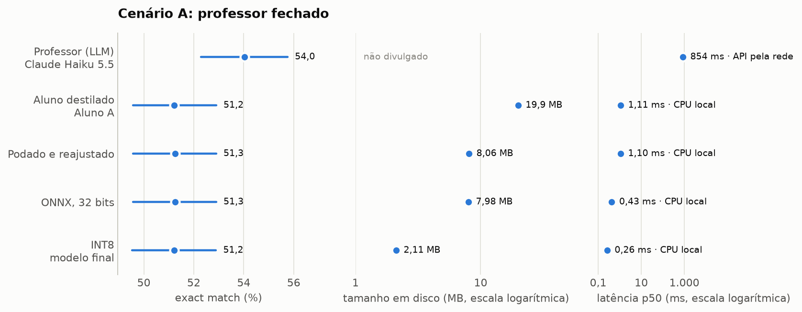
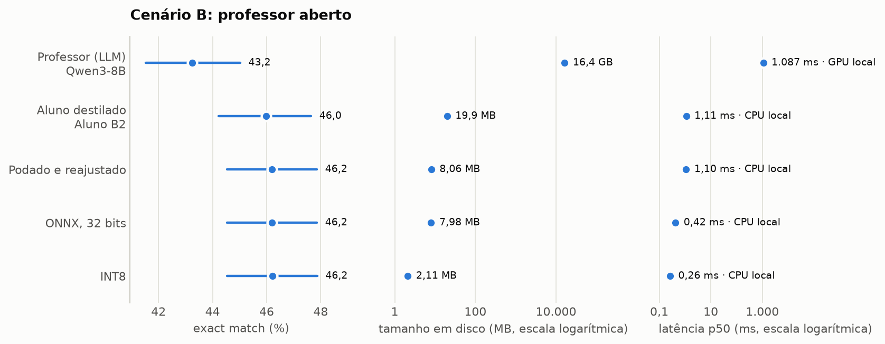
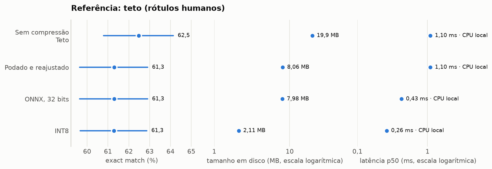
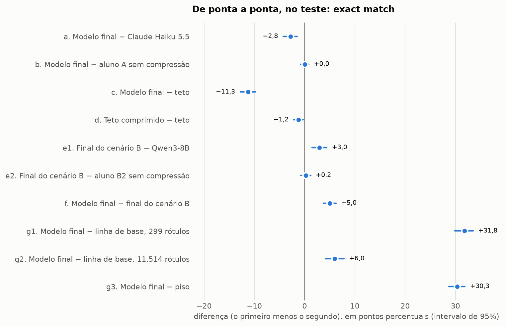
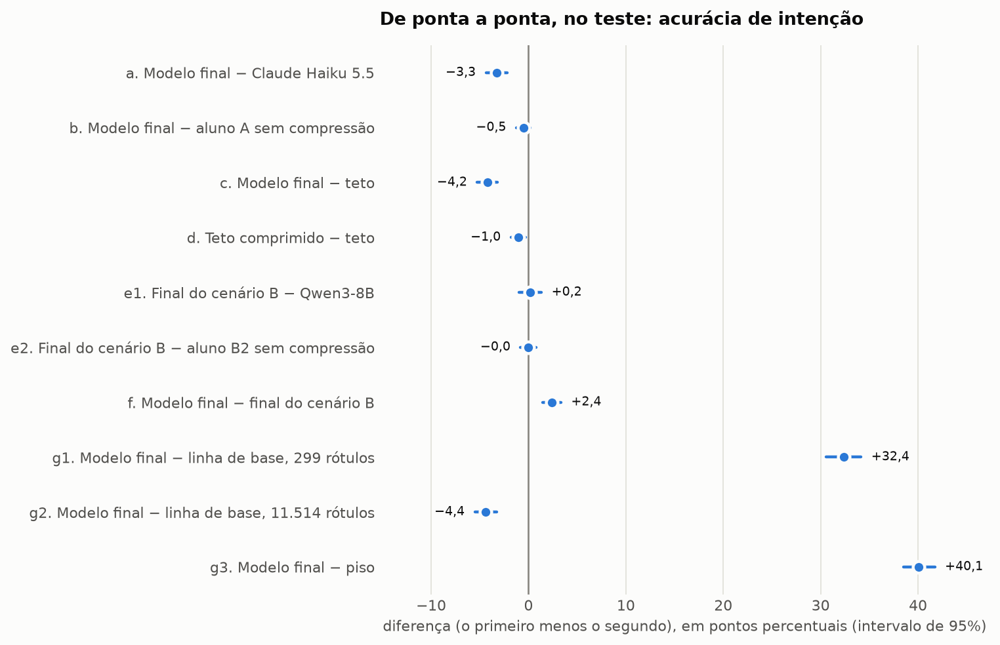
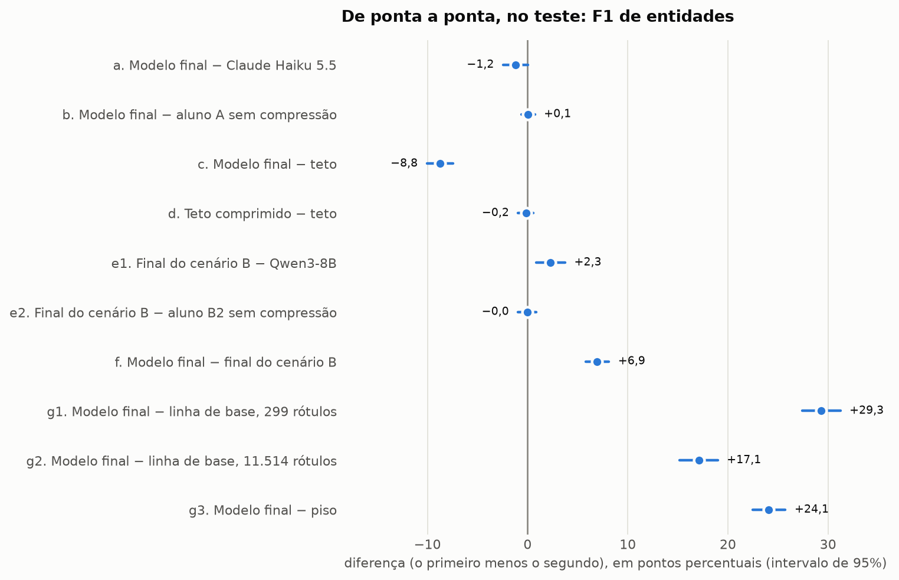
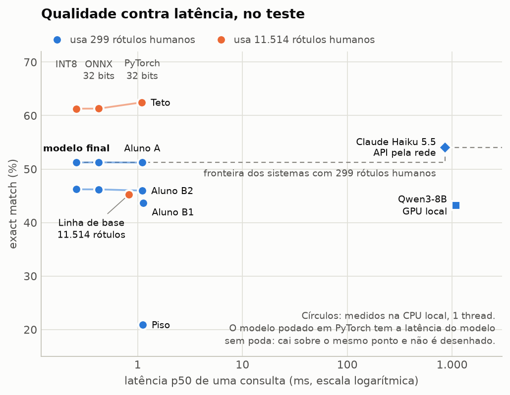
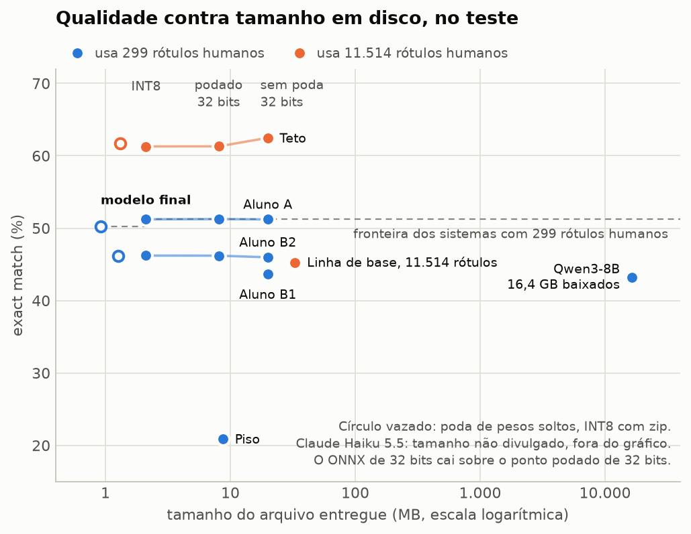

# Etapa 9 · Comparativo: resumo da entrega

**Pergunta.** Somando tudo: o que cada etapa do caminho custou e rendeu, e onde fica o modelo final em relação aos professores, ao teto e às linhas de base?

**Resposta.** O modelo final (Aluno A, sem 90% das linhas da tabela de features, INT8, quantização dinâmica) faz no teste 80,2% de acurácia de intenção, 64,9% de F1 de entidades e 51,2% de exact match, usando 299 rótulos humanos, num arquivo de 2,11 MB que responde em 0,26 ms numa thread de CPU. Contra o professor (Claude Haiku 5.5: 54,0% de exact match, 854 ms pela API, US$ 0,114 por mil consultas), fica abaixo em acurácia de intenção (−3,3 (−4,4 a −2,2)), sem diferença distinguível em F1 de entidades (−1,2 (−2,4 a +0,0)) e abaixo em exact match (−2,8 (−4,3 a −1,5)). **Essa distância vem da destilação** (−2,8 (−4,3 a −1,5) de exact match no degrau professor → aluno); poda, exportação e 8 bits, juntas, ficam em +0,0 (−0,8 a +0,8), e levam o arquivo de 19,9 MB para 2,11 MB e a consulta de 1,11 ms para 0,26 ms. Contra o teto, a mesma rede com os 11.514 rótulos humanos, fica −11,3 (−12,8 a −9,8): é o que custa não ter os rótulos. Contra a linha de base com os mesmos 299 rótulos, +31,8 (+29,9 a +33,5); contra a linha de base com os 11.514, +6,0 (+4,1 a +7,8) em exact match e −4,4 (−5,5 a −3,3) em intenção. No cenário B, o aluno comprimido fica acima do seu professor (Qwen3-8B: +3,0 (+1,5 a +4,4)) e abaixo do final do cenário A (+5,0 (+3,8 a +6,3), A − B). No teto, onde não há professor, a mesma compressão deixa o modelo abaixo do teto sem compressão: −1,2 (−2,2 a −0,3).

Nada foi treinado nesta etapa. Todos os números de qualidade vêm dos arquivos das Etapas 2 a 8 e foram recalculados das respostas gravadas: 24 linhas de qualidade e 11 degraus, todos iguais ao que as etapas de origem gravaram.

## A tabela final (teste, 2.974 pedidos)

Qualidade em % (intervalo de 95%); nos sistemas treinados, média de 3 sementes. Tamanho e latência dos modelos comprimidos são os da semente 0.

| Sistema | Rótulos humanos | Acurácia de intenção | F1 de entidades | Exact match | Parâmetros | Tamanho em disco | Com zip | Latência p50 | Onde a latência foi medida | Consultas por segundo | US$ por 1.000 consultas |
|---|---|---|---|---|---|---|---|---|---|---|---|
| Linha de base com 299 rótulos | 299 (no treino) | 47,8 (46,0 a 49,6) | 35,6 (33,7 a 37,5) | 19,4 (18,1 a 20,8) | 552.636 | não medido | — | não medida | não medida | — | — |
| Linha de base com 11.514 rótulos | 11.514 (no treino) | 84,6 (83,3 a 85,8) | 47,8 (45,9 a 49,7) | 45,2 (43,5 a 47,0) | 3.940.300 | 33,0 MB | — | 0,82 ms | CPU local: scikit-learn, threads não registradas (Etapa 2) | 1.172 | — |
| Claude Haiku 5.5 (professor fechado) | 299 (no prompt) | 83,5 (82,1 a 84,7) | 66,1 (64,5 a 67,7) | 54,0 (52,3 a 55,7) | não divulgado | não divulgado | — | 854 ms | API pela rede: rede do usuário, Brasil, uma chamada por vez (Etapa 5a) | 1,1 | 0,114 |
| Qwen3-8B em 4 bits (professor aberto) | 299 (no prompt) | 77,6 (76,1 a 79,1) | 55,7 (53,9 a 57,4) | 43,2 (41,5 a 45,0) | 8.190.735.360 | 16,4 GB | — | 1.087 ms | GPU local: um pedido por vez (Etapa 5b) | 0,8 | — |
| Teto (DIET do zero com os 11.514 rótulos humanos) | 11.514 (no treino) | 84,4 (83,2 a 85,6) | 73,6 (72,2 a 75,1) | 62,5 (60,8 a 64,1) | 4.895.834 | 19,9 MB | 18,2 MB | 1,10 ms | CPU local: 1 thread, PyTorch (Etapa 8) | 882 | — |
| Piso (DIET do zero só com os 299 rótulos humanos) | 299 (no treino) | 40,1 (38,6 a 41,5) | 40,8 (39,1 a 42,4) | 20,9 (19,6 a 22,2) | 2.154.586 | 8,73 MB | — | 1,12 ms | CPU local: 1 thread, PyTorch (Etapa 6) | 877 | — |
| Aluno A (rótulos do Claude Haiku 5.5) | 299 (pelo professor) | 80,7 (79,4 a 82,0) | 64,8 (63,2 a 66,5) | 51,2 (49,6 a 52,9) | 4.895.834 | 19,9 MB | 18,2 MB | 1,11 ms | CPU local: 1 thread, PyTorch (Etapa 8) | 876 | — |
| Aluno B1 (rótulos do Qwen3-8B) | 299 (pelo professor) | 76,3 (74,9 a 77,7) | 57,1 (55,4 a 58,9) | 43,6 (41,9 a 45,2) | 4.895.834 | 19,9 MB | — | 1,13 ms | CPU local: 1 thread, PyTorch (Etapa 6) | 866 | — |
| Aluno B2 (logits do Qwen3-8B, T = 8) | 299 (pelo professor) | 77,8 (76,3 a 79,3) | 58,0 (56,3 a 59,8) | 46,0 (44,2 a 47,6) | 4.895.834 | 19,9 MB | 18,2 MB | 1,11 ms | CPU local: 1 thread, PyTorch (Etapa 8) | 876 | — |
| Aluno A, sem 90% das linhas da tabela de features, PyTorch, 32 bits | 299 (pelo professor) | 80,2 (78,9 a 81,5) | 64,8 (63,3 a 66,4) | 51,3 (49,6 a 52,9) | 1.992.538 | 8,06 MB | 7,39 MB | 1,10 ms | CPU local: 1 thread, PyTorch (Etapa 8) | 881 | — |
| Aluno A, sem 90% das linhas da tabela de features, ONNX, 32 bits | 299 (pelo professor) | 80,2 (78,9 a 81,5) | 64,8 (63,3 a 66,4) | 51,3 (49,6 a 52,9) | 1.992.538 | 7,98 MB | — | 0,43 ms | CPU local: 1 thread, ONNX Runtime (Etapa 8) | 2.308 | — |
| Aluno A, sem 90% das linhas da tabela de features, INT8, quantização dinâmica **(modelo final)** | 299 (pelo professor) | 80,2 (78,9 a 81,5) | 64,9 (63,3 a 66,4) | 51,2 (49,5 a 52,9) | 1.992.538 | 2,11 MB | 1,70 MB | 0,26 ms | CPU local: 1 thread, ONNX Runtime (Etapa 8) | 3.615 | — |
| Aluno A, magnitude, 95% de uma vez, INT8, quantização dinâmica, arquivo compactado | 299 (pelo professor) | 79,8 (78,5 a 81,1) | 64,3 (62,7 a 66,0) | 50,3 (48,6 a 52,0) | 4.895.834 | 5,26 MB | 0,92 MB | 0,27 ms | CPU local: 1 thread, ONNX Runtime (Etapa 8) | 3.520 | — |
| Aluno B2, sem 90% das linhas da tabela de features, PyTorch, 32 bits | 299 (pelo professor) | 77,8 (76,4 a 79,2) | 58,0 (56,2 a 59,8) | 46,2 (44,5 a 47,9) | 1.992.538 | 8,06 MB | 7,40 MB | 1,10 ms | CPU local: 1 thread, PyTorch (Etapa 8) | 880 | — |
| Aluno B2, sem 90% das linhas da tabela de features, ONNX, 32 bits | 299 (pelo professor) | 77,8 (76,4 a 79,2) | 58,0 (56,2 a 59,8) | 46,2 (44,5 a 47,9) | 1.992.538 | 7,98 MB | — | 0,42 ms | CPU local: 1 thread, ONNX Runtime (Etapa 8) | 2.313 | — |
| Aluno B2, sem 90% das linhas da tabela de features, INT8, quantização dinâmica | 299 (pelo professor) | 77,8 (76,3 a 79,2) | 58,0 (56,2 a 59,8) | 46,2 (44,5 a 47,9) | 1.992.538 | 2,11 MB | 1,72 MB | 0,26 ms | CPU local: 1 thread, ONNX Runtime (Etapa 8) | 3.631 | — |
| Aluno B2, magnitude, 90% gradual, INT8, quantização dinâmica, arquivo compactado | 299 (pelo professor) | 77,5 (76,1 a 78,9) | 58,6 (56,9 a 60,4) | 46,1 (44,4 a 47,8) | 4.895.834 | 5,26 MB | 1,26 MB | 0,27 ms | CPU local: 1 thread, ONNX Runtime (Etapa 8) | 3.472 | — |
| Teto, sem 90% das linhas da tabela de features, PyTorch, 32 bits | 11.514 (no treino) | 83,4 (82,2 a 84,6) | 73,5 (72,0 a 74,9) | 61,3 (59,6 a 62,9) | 1.992.538 | 8,06 MB | 7,39 MB | 1,10 ms | CPU local: 1 thread, PyTorch (Etapa 8) | 883 | — |
| Teto, sem 90% das linhas da tabela de features, ONNX, 32 bits | 11.514 (no treino) | 83,4 (82,2 a 84,6) | 73,5 (72,0 a 74,9) | 61,3 (59,6 a 62,9) | 1.992.538 | 7,98 MB | — | 0,43 ms | CPU local: 1 thread, ONNX Runtime (Etapa 8) | 2.311 | — |
| Teto, sem 90% das linhas da tabela de features, INT8, quantização dinâmica | 11.514 (no treino) | 83,4 (82,1 a 84,6) | 73,5 (72,0 a 74,9) | 61,3 (59,7 a 62,9) | 1.992.538 | 2,11 MB | 1,73 MB | 0,26 ms | CPU local: 1 thread, ONNX Runtime (Etapa 8) | 3.670 | — |
| Teto, magnitude, 90% de uma vez, INT8, quantização dinâmica, arquivo compactado | 11.514 (no treino) | 83,9 (82,6 a 85,1) | 73,4 (71,9 a 74,9) | 61,7 (60,0 a 63,3) | 4.895.834 | 5,26 MB | 1,31 MB | 0,27 ms | CPU local: 1 thread, ONNX Runtime (Etapa 8) | 3.535 | — |

- **Máquina.** CPU local: 13th Gen Intel(R) Core(TM) i7-13700K. GPU local: NVIDIA GeForce RTX 3080. A API foi chamada desta máquina (rede do usuário, Brasil).
- **Rótulos humanos.** "no prompt": a LLM vê 299 exemplos rotulados por humanos, 10 em cada pedido. "pelo professor": a rede nunca vê um rótulo humano de treino; aprende com os 11.514 pedidos rotulados pela LLM, que viu os 299. Onde os rótulos humanos de `dev` entraram em decisões está na tabela "Rótulos humanos em cada ponto do caminho".
- **Consultas por segundo** é o inverso da latência média, uma consulta por vez. **US$ por 1.000 consultas** é o preço de lista da chamada direta (em lote, US$ 0,057); dos sistemas locais não há preço medido.
- **Tamanho.** Do Claude Haiku 5.5, parâmetros e tamanho não são divulgados. Do Qwen3-8B, o tamanho é o dos arquivos baixados, com pesos de 16 bits; carregado em 4 bits ele ocupa 6,1 GB na placa. A poda de pesos soltos em INT8 é entregue já compactada: o tamanho dela em disco é o da coluna "com zip".
- **Linha de base com 299 rótulos.** A Etapa 5a mediu só a qualidade; tamanho e latência não foram medidos.

## O que cada etapa custou e rendeu

Em cada cadeia, de cima para baixo, muda uma coisa por degrau. As diferenças são pareadas, em pontos percentuais (intervalo de 95%), de cada degrau para o anterior.

### Cenário A: professor fechado

| Degrau | Sistema | Exact match | Exact match: diferença para o degrau anterior | Acurácia de intenção: diferença para o degrau anterior | F1 de entidades: diferença para o degrau anterior | Tamanho em disco | Latência p50 | Onde |
|---|---|---|---|---|---|---|---|---|
| Professor (LLM) | Claude Haiku 5.5 | 54,0 (52,3 a 55,7) | — | — | — | não divulgado | 854 ms | API pela rede |
| Aluno destilado | Aluno A | 51,2 (49,6 a 52,9) | −2,8 (−4,3 a −1,5) | −2,7 (−3,9 a −1,7) | −1,2 (−2,5 a −0,0) | 19,9 MB | 1,11 ms | CPU local |
| Podado e reajustado | Aluno A, podado | 51,3 (49,6 a 52,9) | +0,04 (−0,76 a +0,89) | −0,5 (−1,2 a +0,2) | −0,00 (−0,71 a +0,66) | 8,06 MB | 1,10 ms | CPU local |
| ONNX, 32 bits | Aluno A, ONNX 32 bits | 51,3 (49,6 a 52,9) | +0,00 (+0,00 a +0,00) | +0,00 (+0,00 a +0,00) | +0,00 (+0,00 a +0,00) | 7,98 MB | 0,43 ms | CPU local |
| INT8 | Aluno A, INT8 | 51,2 (49,5 a 52,9) | −0,03 (−0,16 a +0,08) | −0,01 (−0,10 a +0,08) | +0,06 (−0,03 a +0,16) | 2,11 MB | 0,26 ms | CPU local |

- **Destilação.** O aluno fica abaixo do professor em exact match: −2,8 (−4,3 a −1,5). Em troca, a consulta sai de 854 ms (API pela rede) para 1,11 ms (CPU local, 1 thread), e o sistema passa a ser um arquivo de 19,9 MB.
- **Poda e reajuste.** Logo depois do corte, sem reajuste, o exact match fica −9,8 (−11,0 a −8,7) em relação ao modelo sem poda; o reajuste devolve +9,9 (+8,8 a +11,0) (Etapa 7). Depois do reajuste, o modelo podado fica sem diferença distinguível para o modelo sem poda: +0,0 (−0,8 a +0,9). O arquivo vai de 19,9 MB para 8,06 MB (2,5 vezes menos); a latência não muda (1,11 ms e 1,10 ms).
- **Exportação.** Sair do PyTorch não muda nenhuma resposta (+0,0 (+0,0 a +0,0)) e leva a consulta de 1,10 ms para 0,43 ms (2,6 vezes menos).
- **8 bits.** Passar para INT8 muda o exact match em −0,03 (−0,16 a +0,08) (sem diferença distinguível), e leva o arquivo de 7,98 MB para 2,11 MB (3,8 vezes menos) e a consulta de 0,43 ms para 0,26 ms.

### Cenário B: professor aberto

| Degrau | Sistema | Exact match | Exact match: diferença para o degrau anterior | Acurácia de intenção: diferença para o degrau anterior | F1 de entidades: diferença para o degrau anterior | Tamanho em disco | Latência p50 | Onde |
|---|---|---|---|---|---|---|---|---|
| Professor (LLM) | Qwen3-8B | 43,2 (41,5 a 45,0) | — | — | — | 16,4 GB | 1.087 ms | GPU local |
| Aluno destilado | Aluno B2 | 46,0 (44,2 a 47,6) | +2,7 (+1,2 a +4,3) | +0,2 (−1,0 a +1,3) | +2,3 (+0,8 a +3,9) | 19,9 MB | 1,11 ms | CPU local |
| Podado e reajustado | Aluno B2, podado | 46,2 (44,5 a 47,9) | +0,2 (−0,7 a +1,2) | −0,01 (−0,78 a +0,83) | +0,01 (−0,90 a +0,93) | 8,06 MB | 1,10 ms | CPU local |
| ONNX, 32 bits | Aluno B2, ONNX 32 bits | 46,2 (44,5 a 47,9) | +0,00 (+0,00 a +0,00) | +0,00 (+0,00 a +0,00) | +0,00 (+0,00 a +0,00) | 7,98 MB | 0,42 ms | CPU local |
| INT8 | Aluno B2, INT8 | 46,2 (44,5 a 47,9) | +0,01 (−0,15 a +0,16) | −0,02 (−0,12 a +0,08) | −0,05 (−0,20 a +0,09) | 2,11 MB | 0,26 ms | CPU local |

- **Destilação.** O aluno fica acima do professor em exact match: +2,7 (+1,2 a +4,3). Em troca, a consulta sai de 1.087 ms (GPU local) para 1,11 ms (CPU local, 1 thread), e o sistema passa a ser um arquivo de 19,9 MB.
- **Poda e reajuste.** Logo depois do corte, sem reajuste, o exact match fica −10,3 (−11,6 a −9,1) em relação ao modelo sem poda; o reajuste devolve +10,5 (+9,5 a +11,6) (Etapa 7). Depois do reajuste, o modelo podado fica sem diferença distinguível para o modelo sem poda: +0,2 (−0,7 a +1,2). O arquivo vai de 19,9 MB para 8,06 MB (2,5 vezes menos); a latência não muda (1,11 ms e 1,10 ms).
- **Exportação.** Sair do PyTorch não muda nenhuma resposta (+0,0 (+0,0 a +0,0)) e leva a consulta de 1,10 ms para 0,42 ms (2,6 vezes menos).
- **8 bits.** Passar para INT8 muda o exact match em +0,01 (−0,15 a +0,16) (sem diferença distinguível), e leva o arquivo de 7,98 MB para 2,11 MB (3,8 vezes menos) e a consulta de 0,42 ms para 0,26 ms.

### Referência: teto (rótulos humanos)

| Degrau | Sistema | Exact match | Exact match: diferença para o degrau anterior | Acurácia de intenção: diferença para o degrau anterior | F1 de entidades: diferença para o degrau anterior | Tamanho em disco | Latência p50 | Onde |
|---|---|---|---|---|---|---|---|---|
| Sem compressão | Teto | 62,5 (60,8 a 64,1) | — | — | — | 19,9 MB | 1,10 ms | CPU local |
| Podado e reajustado | Teto, podado | 61,3 (59,6 a 62,9) | −1,2 (−2,1 a −0,3) | −1,0 (−1,8 a −0,2) | −0,12 (−0,88 a +0,63) | 8,06 MB | 1,10 ms | CPU local |
| ONNX, 32 bits | Teto, ONNX 32 bits | 61,3 (59,6 a 62,9) | +0,00 (+0,00 a +0,00) | +0,00 (+0,00 a +0,00) | +0,00 (+0,00 a +0,00) | 7,98 MB | 0,43 ms | CPU local |
| INT8 | Teto, INT8 | 61,3 (59,7 a 62,9) | −0,01 (−0,17 a +0,15) | −0,06 (−0,18 a +0,07) | −0,05 (−0,17 a +0,09) | 2,11 MB | 0,26 ms | CPU local |

- **Poda e reajuste.** Logo depois do corte, sem reajuste, o exact match fica −14,1 (−15,3 a −12,7) em relação ao modelo sem poda; o reajuste devolve +12,9 (+11,7 a +14,1) (Etapa 7). Depois do reajuste, o modelo podado fica abaixo do modelo sem poda: −1,2 (−2,1 a −0,3). O arquivo vai de 19,9 MB para 8,06 MB (2,5 vezes menos); a latência não muda (1,10 ms e 1,10 ms).
- **Exportação.** Sair do PyTorch não muda nenhuma resposta (+0,0 (+0,0 a +0,0)) e leva a consulta de 1,10 ms para 0,43 ms (2,6 vezes menos).
- **8 bits.** Passar para INT8 muda o exact match em −0,01 (−0,17 a +0,15) (sem diferença distinguível), e leva o arquivo de 7,98 MB para 2,11 MB (3,8 vezes menos) e a consulta de 0,43 ms para 0,26 ms.

**Nas três cadeias.** De 11 degraus × 3 métricas, 7 diferenças se distinguem de zero: cenário A, aluno destilado, acurácia de intenção (−2,7 (−3,9 a −1,7)); cenário A, aluno destilado, F1 de entidades (−1,2 (−2,5 a −0,0)); cenário A, aluno destilado, exact match (−2,8 (−4,3 a −1,5)); cenário B, aluno destilado, F1 de entidades (+2,3 (+0,8 a +3,9)); cenário B, aluno destilado, exact match (+2,7 (+1,2 a +4,3)); teto, podado e reajustado, acurácia de intenção (−1,0 (−1,8 a −0,2)); teto, podado e reajustado, exact match (−1,2 (−2,1 a −0,3)). Nos dois cenários, **toda a mudança de qualidade que se distingue de zero acontece na destilação**; nenhum degrau de compressão se distingue. No teto, a poda principal fica abaixo do modelo sem poda mesmo depois do reajuste (acurácia de intenção e exact match). O que a compressão muda é o custo: a poda diminui o arquivo, a exportação diminui a latência, os 8 bits diminuem os dois.

## De ponta a ponta

Comparações fixadas antes de calcular. Diferença pareada B − A, no teste, em pontos percentuais (intervalo de 95%); uma diferença só vale quando o intervalo não contém zero.

| Comparação (B − A) | Acurácia de intenção | F1 de entidades | Exact match | O que responde |
|---|---|---|---|---|
| a. Modelo final − Claude Haiku 5.5 | −3,3 (−4,4 a −2,2) | −1,2 (−2,4 a +0,0) | −2,8 (−4,3 a −1,5) | o modelo final contra o seu professor |
| b. Modelo final − aluno A sem compressão | −0,5 (−1,2 a +0,2) | +0,1 (−0,6 a +0,7) | +0,0 (−0,8 a +0,8) | o custo de toda a compressão: poda, exportação e 8 bits |
| c. Modelo final − teto | −4,2 (−5,3 a −3,2) | −8,8 (−10,1 a −7,4) | −11,3 (−12,8 a −9,8) | o que custa não ter os rótulos humanos do treino |
| d. Teto comprimido − teto | −1,0 (−1,8 a −0,3) | −0,2 (−0,9 a +0,6) | −1,2 (−2,2 a −0,3) | a compressão sozinha, sem o efeito do professor |
| e1. Final do cenário B − Qwen3-8B | +0,2 (−1,0 a +1,3) | +2,3 (+0,8 a +3,7) | +3,0 (+1,5 a +4,4) | o final do cenário B contra o seu professor |
| e2. Final do cenário B − aluno B2 sem compressão | −0,0 (−0,8 a +0,8) | −0,0 (−1,0 a +0,9) | +0,2 (−0,7 a +1,2) | o custo de toda a compressão no cenário B |
| f. Modelo final − final do cenário B | +2,4 (+1,4 a +3,3) | +6,9 (+5,8 a +8,1) | +5,0 (+3,8 a +6,3) | o final do cenário A contra o final do cenário B |
| g1. Modelo final − linha de base, 299 rótulos | +32,4 (+30,6 a +34,2) | +29,3 (+27,4 a +31,2) | +31,8 (+29,9 a +33,5) | o modelo final contra a linha de base com os mesmos rótulos humanos |
| g2. Modelo final − linha de base, 11.514 rótulos | −4,4 (−5,5 a −3,3) | +17,1 (+15,2 a +19,0) | +6,0 (+4,1 a +7,8) | o modelo final contra a linha de base com todos os rótulos humanos |
| g3. Modelo final − piso | +40,1 (+38,5 a +41,7) | +24,1 (+22,5 a +25,7) | +30,3 (+28,7 a +31,9) | o modelo final contra a mesma rede treinada só com os rótulos humanos que a LLM vê |

- **a. Contra o professor.** O modelo final fica abaixo em acurácia de intenção (−3,3 (−4,4 a −2,2)), sem diferença distinguível em F1 de entidades (−1,2 (−2,4 a +0,0)) e abaixo em exact match (−2,8 (−4,3 a −1,5)). A destilação sozinha tinha deixado −2,8 (−4,3 a −1,5) de exact match (cadeia do cenário A), e a compressão não se distingue de zero (comparação b).
- **b. O custo de toda a compressão.** Poda, exportação e 8 bits, juntas, deixam o modelo final sem diferença distinguível em acurácia de intenção (−0,5 (−1,2 a +0,2)), sem diferença distinguível em F1 de entidades (+0,1 (−0,6 a +0,7)) e sem diferença distinguível em exact match (+0,0 (−0,8 a +0,8)) em relação ao aluno A como saiu da destilação. Nesse caminho o arquivo foi de 19,9 MB para 2,11 MB (9,4 vezes menos) e a consulta de 1,11 ms para 0,26 ms (4,2 vezes menos).
- **c. Contra o teto.** Sem os 11.514 rótulos humanos de treino, o modelo final fica abaixo em acurácia de intenção (−4,2 (−5,3 a −3,2)), abaixo em F1 de entidades (−8,8 (−10,1 a −7,4)) e abaixo em exact match (−11,3 (−12,8 a −9,8)). É a maior queda de exact match da lista.
- **d. A compressão sozinha.** No teto, onde não há professor, a mesma compressão deixa o modelo abaixo em acurácia de intenção (−1,0 (−1,8 a −0,3)), sem diferença distinguível em F1 de entidades (−0,2 (−0,9 a +0,6)) e abaixo em exact match (−1,2 (−2,2 a −0,3)). Em exact match, esse custo se distingue de zero no teto e não se distingue no aluno A (comparação b). Se os dois custos diferem entre si não foi testado.
- **e. O cenário B.** O final do cenário B fica sem diferença distinguível em acurácia de intenção (+0,2 (−1,0 a +1,3)), acima em F1 de entidades (+2,3 (+0,8 a +3,7)) e acima em exact match (+3,0 (+1,5 a +4,4)) em relação ao Qwen3-8B, o professor dele, e sem diferença distinguível em exact match (+0,2 (−0,7 a +1,2)) em relação ao aluno B2 sem compressão.
- **f. Um cenário contra o outro.** O final do cenário A fica acima em acurácia de intenção (+2,4 (+1,4 a +3,3)), acima em F1 de entidades (+6,9 (+5,8 a +8,1)) e acima em exact match (+5,0 (+3,8 a +6,3)) em relação ao final do cenário B. Os dois têm a mesma rede e passaram pela mesma compressão; o que muda entre eles é o professor e o sinal de treino.
- **g. Contra as referências.** Contra a linha de base treinada com os mesmos 299 rótulos, o modelo final fica acima em exact match (+31,8 (+29,9 a +33,5)); contra a mesma rede treinada só com esses 299 rótulos (o piso), acima em exact match (+30,3 (+28,7 a +31,9)). Contra a linha de base que usa os 11.514 rótulos, fica abaixo em acurácia de intenção (−4,4 (−5,5 a −3,3)), acima em F1 de entidades (+17,1 (+15,2 a +19,0)) e acima em exact match (+6,0 (+4,1 a +7,8)).
- São 30 comparações (10 × 3 métricas), e 21 se distinguem de zero. Não há correção para comparações múltiplas: com intervalos de 95%, cerca de 1,5 sairia do zero só por acaso. Nenhuma comparação foi acrescentada depois de ver os resultados.

## As fronteiras

- **Latência.** Entre os sistemas com 299 rótulos humanos, a fronteira tem: Aluno A, INT8 (51,2%), Aluno A, ONNX 32 bits (51,3%), Claude Haiku 5.5 (54,0%). O modelo final responde em 0,26 ms e o professor em 854 ms: 3.271 vezes menos, com a ressalva de que são condições diferentes (CPU local contra API pela rede). Contra o Qwen3-8B na GPU local (1.087 ms), 4.164 vezes menos. Latências a menos de 14% uma da outra contam como empate: é o quanto a mediana variou entre as rodadas da Etapa 8. O ONNX de 32 bits do mesmo modelo também aparece na fronteira, por 0,03 ponto de exact match; essa diferença não se distingue de zero (−0,03 (−0,16 a +0,08), último degrau da cadeia): na prática, é o mesmo ponto com mais custo.
- **Tamanho.** A fronteira tem: Aluno A, pesos soltos, INT8 com zip (50,3%), Aluno A, INT8 (51,2%), Aluno A, ONNX 32 bits (51,3%). O modelo final ocupa 2,11 MB; os arquivos do Qwen3-8B, 16,4 GB: 7.760 vezes mais. A poda de pesos soltos em INT8, compactada, é menor (0,92 MB) e faz 50,3% de exact match; fora do disco ela volta a ocupar 5,26 MB (Etapa 8).
- **O teto.** Com os 11.514 rótulos humanos, a mesma rede comprimida do mesmo jeito fica em 61,3%, com o tamanho e a latência do modelo final. A distância vertical entre as duas trilhas é o que os rótulos humanos de treino compram (comparação c).
- **Como ler a fronteira.** Ela usa os valores medidos, sem os intervalos. Dois sistemas vizinhos nela podem não se distinguir em qualidade; quem diz isso são as comparações pareadas das cadeias e de ponta a ponta.

## Cada passo e o seu artigo

| Passo | Técnica | Artigo | Ano | Onde | Estava citado em |
|---|---|---|---|---|---|
| O caminho inteiro | Trocar a LLM por um modelo pequeno, feito para a tarefa | Belcak et al. | 2025 | [arXiv 2506.02153](https://arxiv.org/abs/2506.02153) | PLANO.md ou RESUMO.md |
| O caminho inteiro | LLM professora, destilação, poda e quantização em sequência | Ni et al., *From Large to Super-Tiny* | 2025 | [arXiv 2504.13471](https://arxiv.org/abs/2504.13471) | PLANO.md ou RESUMO.md |
| O caminho inteiro | A ordem: destilar, podar, quantizar | Han et al., *Deep Compression* | 2015 | [arXiv 1510.00149](https://arxiv.org/abs/1510.00149) | PLANO.md ou RESUMO.md |
| O caminho inteiro | A ordem: destilar, podar, quantizar | Harma et al. | 2024 | [arXiv 2405.20935](https://arxiv.org/abs/2405.20935) | PLANO.md ou RESUMO.md |
| O caminho inteiro | Poda e quantização juntas podem interagir (discussão da ordem) | Nema et al. (preprint; só o resumo foi lido), *Compression Technique Interactions in Small Language Models* | 2026 | [arXiv 2611.00464](https://arxiv.org/abs/2611.00464) | PLANO.md ou RESUMO.md |
| Etapas 1 e 2 · Dados e régua | MASSIVE pt-PT; acurácia de intenção, F1 de entidades e exact match | FitzGerald et al., *MASSIVE* | 2022 | [arXiv 2204.08582](https://arxiv.org/abs/2204.08582) | PLANO.md ou RESUMO.md |
| Etapa 2 · Régua | Intervalo de 95% e comparação pareada por bootstrap, por enunciado | Koehn, *Statistical Significance Tests for Machine Translation Evaluation* | 2004 | [EMNLP 2004](https://aclanthology.org/W04-3250/) | notebook da etapa (conferido agora) |
| Etapa 2 · Régua | Intervalo de 95% e comparação pareada por bootstrap, por enunciado | Berg-Kirkpatrick et al., *An Empirical Investigation of Statistical Significance in NLP* | 2012 | [EMNLP-CoNLL 2012](https://aclanthology.org/D12-1091/) | notebook da etapa (conferido agora) |
| Etapa 2 · Régua | Latência: uma consulta por vez, percentis, máquina registrada | Reddi et al., *MLPerf Inference* | 2019 | [arXiv 1911.02549](https://arxiv.org/abs/1911.02549) | PLANO.md ou RESUMO.md |
| Etapas 2 e 9 · Régua e comparativo | Custo reportado em várias medidas, com a condição de cada uma | Dehghani et al. | 2021 | [arXiv 2110.12894](https://arxiv.org/abs/2110.12894) | PLANO.md ou RESUMO.md |
| Etapas 3 e 4 · Arquitetura | Rede conjunta de intenção e entidades, do zero: features esparsas, Transformer de 2 camadas, CRF | Bunk et al., *DIET* | 2020 | [arXiv 2004.09936](https://arxiv.org/abs/2004.09936) | PLANO.md ou RESUMO.md |
| Etapa 4 · Treino | Três sementes por modelo treinado; o resultado é a média | Reimers & Gurevych, *Reporting Score Distributions Makes a Difference* | 2017 | [arXiv 1707.09861](https://arxiv.org/abs/1707.09861) | notebook da etapa (conferido agora) |
| Etapa 5a · Professor fechado | LLM com poucos exemplos no prompt: intenção perto do supervisionado, entidades atrás | He & Garner | 2023 | [arXiv 2305.13512](https://arxiv.org/abs/2305.13512) | PLANO.md ou RESUMO.md |
| Etapa 6 · Destilação | Destilação caixa-preta: o aluno aprende só com os rótulos da LLM | Xu et al., *survey* | 2024 | [arXiv 2402.13116](https://arxiv.org/abs/2402.13116) | PLANO.md ou RESUMO.md |
| Etapa 6 · Destilação | Destilação caixa-preta: o aluno aprende só com os rótulos da LLM | Di Palo et al. | 2024 | [arXiv 2411.05045](https://arxiv.org/abs/2411.05045) | PLANO.md ou RESUMO.md |
| Etapa 6 · Destilação | Destilação com logits e temperatura | Hinton et al. | 2015 | [arXiv 1503.02531](https://arxiv.org/abs/1503.02531) | PLANO.md ou RESUMO.md |
| Etapa 6 · Destilação | Destilação com logits e temperatura | Jiao et al., *TinyBERT* | 2019 | [arXiv 1909.10351](https://arxiv.org/abs/1909.10351) | PLANO.md ou RESUMO.md |
| Etapa 7 · Poda | Poda por magnitude: treinar, podar, retreinar | Han et al. | 2015 | [arXiv 1506.02626](https://arxiv.org/abs/1506.02626) | PLANO.md ou RESUMO.md |
| Etapa 7 · Poda | Poda gradual, com a esparsidade subindo durante o treino | Zhu & Gupta | 2017 | [arXiv 1710.01878](https://arxiv.org/abs/1710.01878) | PLANO.md ou RESUMO.md |
| Etapa 7 · Poda | Poda de peças inteiras (estruturada) | Xia et al., *CoFi* | 2022 | [arXiv 2204.00408](https://arxiv.org/abs/2204.00408) | PLANO.md ou RESUMO.md |
| Etapa 7 · Reajuste | Fine-tuning de recuperação com a máscara travada, com o sinal do professor | Zafrir et al., *Prune Once for All* | 2021 | [arXiv 2111.05754](https://arxiv.org/abs/2111.05754) | PLANO.md ou RESUMO.md |
| Etapa 7 · Reajuste | Fine-tuning de recuperação com a máscara travada, com o sinal do professor | Sanh et al. | 2020 | [arXiv 2005.07683](https://arxiv.org/abs/2005.07683) | PLANO.md ou RESUMO.md |
| Etapa 8 · Quantização | Inteiros de 8 bits: escala e ponto zero | Jacob et al. | 2017 | [arXiv 1712.05877](https://arxiv.org/abs/1712.05877) | PLANO.md ou RESUMO.md |
| Etapa 8 · Quantização | Um Transformer em 8 bits: o que quantizar e o que deixar em 32 bits | Zafrir et al., *Q8BERT* | 2019 | [arXiv 1910.06188](https://arxiv.org/abs/1910.06188) | PLANO.md ou RESUMO.md |
| Etapa 10 · Em aberto | Encoder pré-treinado com cabeça conjunta de intenção e entidades | Chen et al., *JointBERT* | 2019 | [arXiv 1902.10909](https://arxiv.org/abs/1902.10909) | PLANO.md ou RESUMO.md |

- Só entram artigos já citados no `PLANO.md` ou num `RESUMO.md`. As exceções (Koehn (EMNLP 2004); Berg-Kirkpatrick et al. (EMNLP-CoNLL 2012); Reimers & Gurevych (1707.09861)) estavam nos notebooks das Etapas 2 e 4 e tiveram título e autores conferidos na página de cada uma.
- O ano é o do identificador do arXiv, ou o do evento.
- Do preprint arXiv 2611.00464 o projeto leu só o resumo.

## Rótulos humanos em cada ponto do caminho

| Ponto do caminho | Rótulos humanos de treino (de 11.514) | Decisões tomadas com os rótulos humanos de dev (2.033 pedidos) |
|---|---|---|
| Etapas 4 e 4b · o teto e a receita de treino | 11.514: o teto treina com todos | época de parada do teto e escolha da receita (suavização de rótulos e média móvel dos pesos), que os alunos herdam |
| Etapa 5a · Claude Haiku 5.5 | 299 no prompt (10 por pedido, os mais parecidos) | nenhuma escolha: a configuração não teve piloto |
| Etapa 5b · Qwen3-8B | 299 no prompt (10 por pedido) | escolha entre 3 modelos candidatos e acerto do formato da resposta |
| Etapa 6 · aluno A | nenhum: aprende com os 11.514 pedidos rotulados pela LLM | nenhuma no treino (a parada usa o dev rotulado pelo professor); a regra de quem segue para a poda |
| Etapa 6 · aluno B2 | nenhum: rótulos e logits da LLM aberta | a temperatura (T = 8, entre 4 tentativas) e a regra de quem segue para a poda |
| Etapa 6 · piso | 299 no treino | época de parada |
| Etapa 7 · poda e reajuste | nenhum: o reajuste usa o sinal do professor | a regra do que segue para a quantização (qual poda fica) |
| Etapa 8 · quantização | nenhum: a calibração usa 512 pedidos do treino, sem rótulo | a regra da forma de 8 bits e a do treino ciente de quantização |
| Etapa 9 · este comparativo | nenhum | nenhuma decisão |

## Limites

- **Rótulos humanos de `dev` nas decisões.** O cenário promete 299 rótulos humanos. No treino isso vale: nenhum aluno viu um rótulo humano de treino. Mas os 2.033 rótulos humanos de `dev` decidiram a temperatura do B2 (Etapa 6), quem segue para a poda (Etapa 6), qual poda fica (Etapa 7) e a forma de 8 bits (Etapa 8). Num uso real com só 299 rótulos, essas escolhas teriam de ser feitas de outro jeito, por exemplo pela concordância com o professor. Para a temperatura, esse critério escolheria T = 8 (a mesma escolha, pela grade gravada na Etapa 6); para a poda e a quantização, isso não foi testado.
- **A rede e a receita vieram do teto.** As variantes de arquitetura (Etapa 4) e a receita de treino (Etapa 4b) foram comparadas treinando com os 11.514 rótulos humanos e medindo no `dev` humano. Os alunos herdam essas escolhas.
- **O aluno herda o teto do professor.** O modelo final fica −2,8 (−4,3 a −1,5) pontos de exact match em relação ao Claude Haiku 5.5, e −11,3 (−12,8 a −9,8) em relação ao teto; o próprio professor fica −8,4 (−10,3 a −6,7) em relação ao teto (Etapa 5a). Um professor fechado maior, com raciocínio ligado ou com mais exemplos poderia subir esse limite; a configuração do professor não teve piloto (Etapa 5a).
- **O professor aberto é o que coube na placa.** Foram 3 candidatos em 4 bits, numa placa de 10 GB (NVIDIA GeForce RTX 3080); o escolhido ocupa 6,1 GB. Um modelo aberto maior não foi testado. A diferença entre os finais dos dois cenários é de +5,0 (+3,8 a +6,3) em exact match (A − B).
- **A temperatura do B2 está na borda da grade.** T = 8 é a maior das 4 testadas (1, 2, 4, 8), e em 3 das 3 sementes o melhor ponto do treino foi a última época. Uma temperatura maior ou mais épocas poderiam dar outro B2 (Etapa 6).
- **`dev` e teste discordam em parte das escolhas da poda.** A regra da Etapa 7 aceita a variante que não fica distinguivelmente abaixo do modelo sem poda em `dev`. Das 6 variantes que seguiram, 3 passam em `dev` e ficam abaixo no teste: Aluno A, magnitude 95% (−0,8 (−1,6 a +0,0) em dev e −0,9 (−1,6 a −0,2) no teste); Teto, linhas 90% (−0,8 (−2,0 a +0,2) em dev e −1,2 (−2,1 a −0,3) no teste); Teto, magnitude 90% (−0,6 (−1,3 a +0,2) em dev e −0,9 (−1,5 a −0,2) no teste). A do modelo final não está entre elas (+0,0 (−0,8 a +0,9) no teste). A regra aceita o que não se distingue, e com o tamanho de `dev` uma queda pequena pode passar (limite declarado na Etapa 7).
- **A latência é de uma CPU, de uma semente e de pedidos curtos.** 13th Gen Intel(R) Core(TM) i7-13700K, 1 thread, semente 0, pedidos de poucas palavras. A mediana variou até 14% entre as rodadas da Etapa 8, e o mesmo modelo, medido em sessões diferentes, deu 1,14 ms (Etapa 6), 1,10 ms (Etapa 7), 1,11 ms (Etapa 8) (Aluno A sem poda, PyTorch). Em outra CPU, sem as instruções VNNI, as respostas do modelo em 8 bits podem mudar um pouco (Etapa 8).
- **As três condições de latência não são a mesma medida.** A da API inclui a rede e a fila do provedor, num horário, de uma rede; a da LLM aberta é de uma GPU; a das redes, de uma thread de CPU. A razão entre elas diz o que muda para quem usa o sistema, não quanto cálculo cada um faz.
- **O custo em dólar existe só para a API**, pelo preço de lista de 17/11/2026. Dos sistemas locais não se mediu energia nem custo de máquina; rotular o treino com o professor fechado custou US$ 0,66, uma vez.
- **O teste foi aberto em todas as etapas desde a 4.** Nenhuma decisão saiu dele, mas são os mesmos 2.974 pedidos medindo tudo, e aqui há 30 comparações de ponta a ponta sem correção para comparações múltiplas.
- **Um conjunto, uma língua, uma rotulagem.** MASSIVE, recorte pt-PT; uma rotulagem do treino por professor; 3 sementes por modelo treinado, que dão uma ideia da variação do treino, não uma medida precisa. As LLMs podem conhecer o MASSIVE, que é público desde 2022 (Etapas 5a e 5b).
- **O que foi refeito aqui.** As respostas dos sistemas em INT8 e da linha de base com 299 rótulos não estavam gravadas e foram produzidas agora; as métricas delas são iguais às gravadas pelas etapas de origem (`conferencia.csv`). Da linha de base com 299 rótulos não há tamanho nem latência. O tamanho do Qwen3-8B é o dos arquivos baixados, não o do modelo em 4 bits.
- **A fronteira usa os valores medidos**, sem os intervalos: serve para ver a ordem de grandeza do custo, não para separar sistemas vizinhos.

## O que fica em aberto

- **Etapa 10 · encoder pré-treinado.** Repetir a destilação e a compressão partindo de um encoder pronto (o `PLANO.md` aponta o XLM-R base, com linha publicada no teste pt-PT). Depende de escolher o encoder.
- **Um professor fechado melhor.** O modelo final fica −2,8 (−4,3 a −1,5) em relação ao professor, e o professor, −8,4 (−10,3 a −6,7) em relação ao teto. Falta medir quanto um professor maior, ou a mesma LLM com outra configuração, move o aluno.
- **Um professor aberto maior**, numa máquina com mais de 10 GB de placa, e uma grade de temperatura além de T = 8.
- **Decidir sem rótulos humanos de `dev`.** Refazer as regras das Etapas 6, 7 e 8 usando só a concordância com o professor, e ver se as escolhas mudam.
- **Latência em outra máquina** (outra CPU, um processador ARM, um celular), com mais de uma semente, e a memória em uso, que não foi medida.

## Critério de pronto

| Critério | Atendido |
|---|---|
| A tabela final tem uma linha para cada sistema previsto (21), com qualidade e intervalo de 95% no teste, e diz a condição da latência em cada linha | sim |
| Nada foi treinado nem medido na GPU ou na API; o que foi produzido agora está listado (7 sistemas respondidos na CPU e o tamanho de um modelo em disco) | sim |
| Cada número de qualidade, recalculado das respostas, é igual ao que a etapa de origem gravou (24 linhas) | sim |
| Cada cadeia tem qualidade, tamanho e latência em cada degrau, e a diferença pareada para o anterior é igual à gravada pela etapa de origem (11 degraus) | sim |
| As comparações de ponta a ponta são as 10 da lista fixada antes, pareadas, com 2.000 sorteios; nenhuma exploratória | sim |
| As figuras foram gravadas (8) | sim |
| Todo artigo do quadro está no PLANO.md ou num RESUMO.md, ou foi conferido e está marcado (25 linhas, 3 conferidos) | sim |
| Os limites de cada etapa estão juntos (13 limites, 5 pontos em aberto) | sim |

## Arquivos

| Arquivo | Conteúdo |
|---|---|
| `tabela_final.csv` | Uma linha por sistema, no teste: qualidade com intervalo, rótulos humanos, parâmetros, tamanho, latência e a condição da medida, consultas por segundo e custo |
| `cadeias.csv` | Cada degrau de cada cadeia: qualidade, tamanho, latência e a diferença pareada para o degrau anterior, em todas as métricas |
| `comparacoes.csv` | As comparações de ponta a ponta, B − A, em todas as métricas |
| `conferencia.csv` | Cada número recalculado aqui contra o que a etapa de origem gravou |
| `artigos.csv` | O quadro de artigos |
| `medidas_novas.json` | O que foi produzido nesta etapa por não estar gravado: de que modelos saíram as respostas e o tamanho em disco do professor aberto |
| `previsoes/` | As respostas no teste produzidas nesta etapa: os sistemas em INT8 e a linha de base com 299 rótulos |
| `figuras/` | Os gráficos deste notebook |
| `09_comparativo.html` | Este notebook executado, para leitura |
