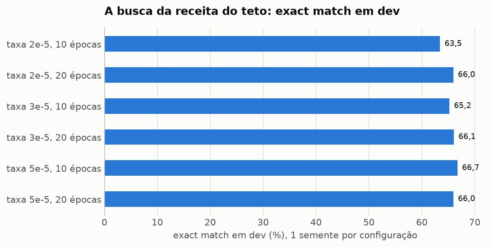
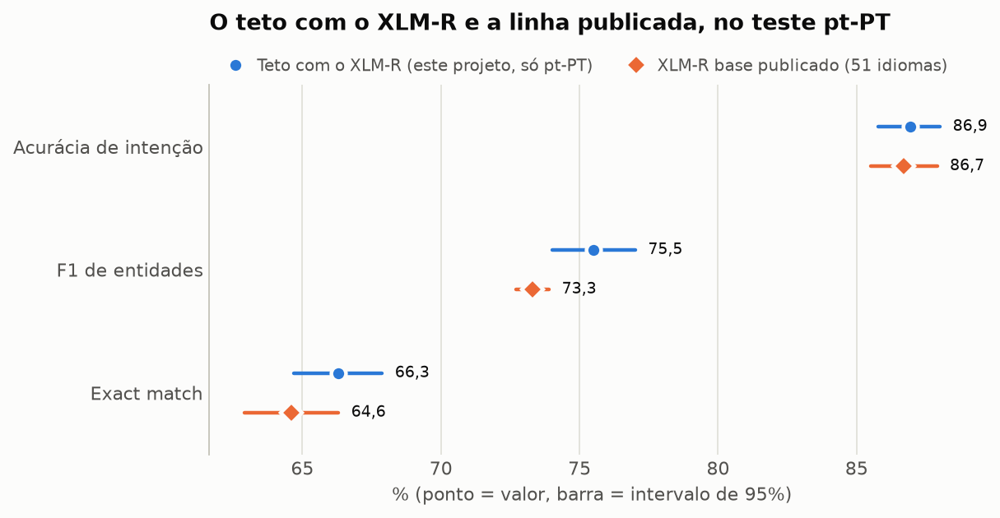
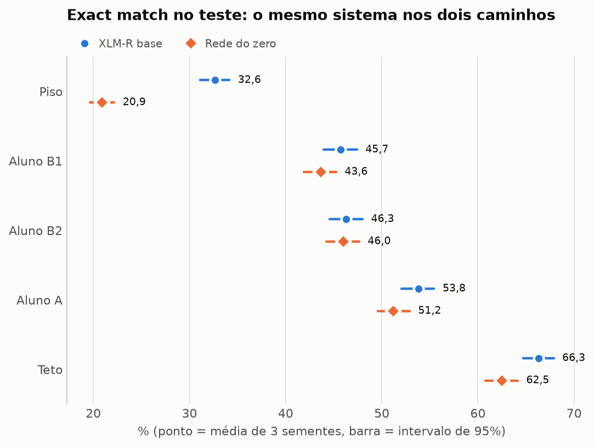
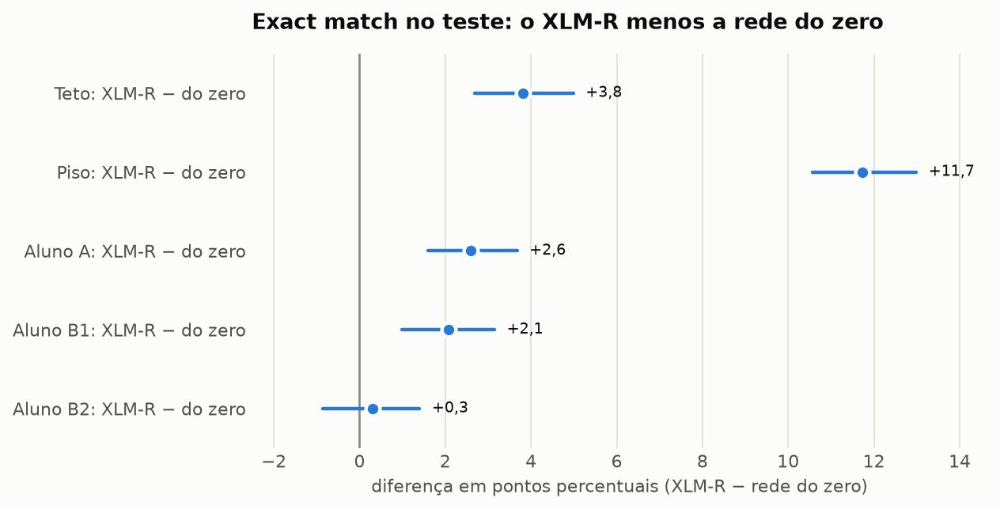
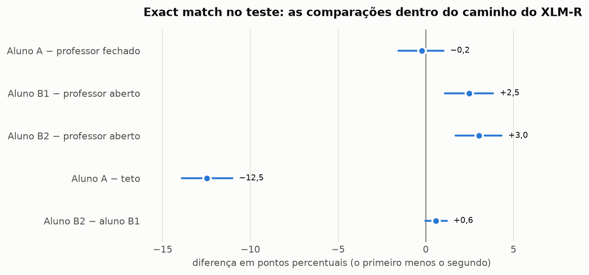
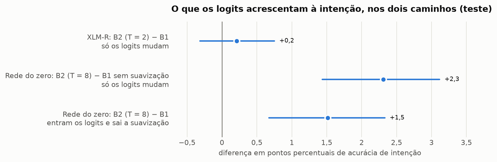
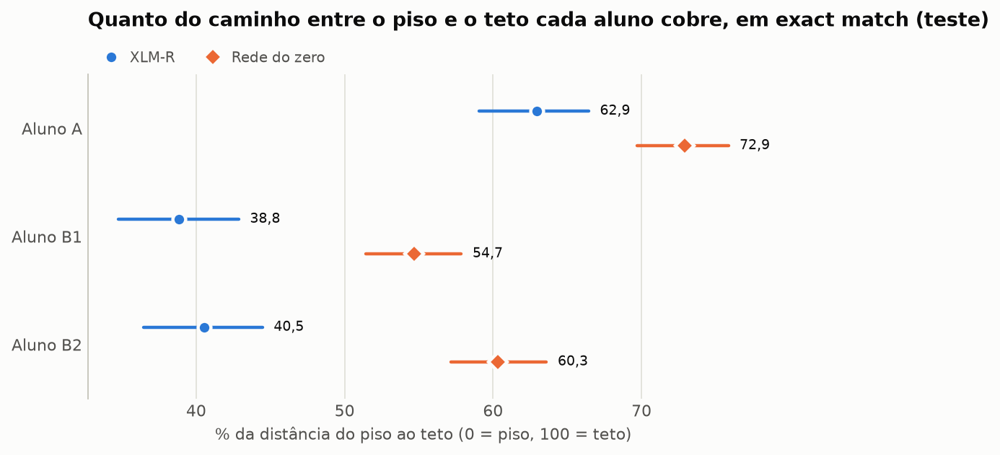
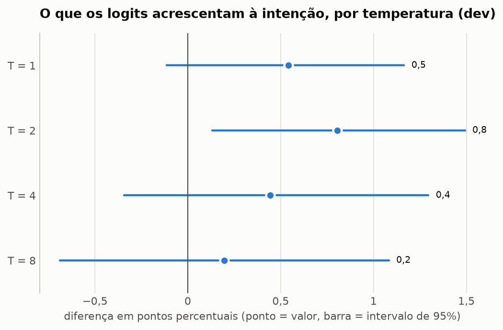

# Etapa 10a · Encoder pré-treinado, teto e alunos: resumo da entrega

**Pergunta.** Com um encoder pré-treinado no lugar da rede do zero, o que muda no teto e no que o aluno aprende de cada professor?

**Resposta.** Com os 11.514 rótulos humanos, o XLM-R base faz no teste 86,9 / 75,5 / 66,3 (intenção / F1 de entidades / exact match); a rede do zero fazia 84,4 / 73,6 / 62,5. Contra o teto da rede do zero, o do XLM-R fica acima em intenção (+2,5 (+1,7 a +3,4)), acima em entidades (+1,9 (+0,8 a +2,9)) e acima em exact match (+3,8 (+2,7 a +5,0)). Contra a linha publicada do XLM-R base no MASSIVE (86,7 / 73,3 / 64,6), ele fica perto, pela regra escrita antes. **No piso**, com só os 299 rótulos humanos, o XLM-R faz 54,7 / 52,8 / 32,6, contra 40,1 / 40,8 / 20,9 da rede do zero: fica acima em intenção (+14,6 (+13,3 a +15,9)), acima em entidades (+12,0 (+10,6 a +13,5)) e acima em exact match (+11,7 (+10,6 a +13,0)). **Nos alunos**, contra o mesmo aluno da rede do zero: o aluno A (82,6 / 65,5 / 53,8) fica acima em intenção (+1,9 (+1,1 a +2,8)), sem diferença distinguível em entidades (+0,7 (−0,3 a +1,7)) e acima em exact match (+2,6 (+1,6 a +3,7)); o B1 (78,7 / 58,5 / 45,7) fica acima em intenção (+2,4 (+1,5 a +3,4)), acima em entidades (+1,4 (+0,3 a +2,4)) e acima em exact match (+2,1 (+1,0 a +3,1)); o B2, em T = 2 (78,9 / 58,8 / 46,3), fica acima em intenção (+1,1 (+0,2 a +2,1)), sem diferença distinguível em entidades (+0,8 (−0,3 a +1,9)) e sem diferença distinguível em exact match (+0,3 (−0,9 a +1,4)). Contra o seu professor, o aluno A fica sem diferença distinguível em intenção (−0,8 (−1,8 a +0,2)), sem diferença distinguível em entidades (−0,5 (−1,7 a +0,7)) e sem diferença distinguível em exact match (−0,2 (−1,6 a +1,0)). **Passam o próprio professor**, com intervalo todo acima de zero: o aluno B1 em F1 de entidades (+2,8 (+1,5 a +4,2)); o aluno B1 em exact match (+2,5 (+1,1 a +3,8)); o aluno B2 em acurácia de intenção (+1,3 (+0,2 a +2,4)); o aluno B2 em F1 de entidades (+3,1 (+1,9 a +4,5)); o aluno B2 em exact match (+3,0 (+1,7 a +4,3)). Contra o teto, fica abaixo em intenção (−4,3 (−5,3 a −3,3)), abaixo em entidades (−10,0 (−11,3 a −8,6)) e abaixo em exact match (−12,5 (−13,9 a −11,0)); em exact match ele cobre 63% (59 a 66) da distância entre o piso e o teto do XLM-R (na rede do zero, 73% (70 a 76)). **Os logits** (B2 − B1, só os logits mudam): sem diferença distinguível em intenção (+0,2 (−0,3 a +0,8)), sem diferença distinguível em entidades (+0,3 (−0,2 a +0,9)) e sem diferença distinguível em exact match (+0,6 (−0,0 a +1,2)). Não dá para distinguir o aluno com logits do aluno com rótulos em intenção: o intervalo contém zero. **O custo:** 277.584.555 parâmetros (69,2% na tabela de subtokens), 1.127 MB em disco (57 vezes o tamanho da rede do zero) e 36,1 ms por pedido em 1 núcleo de CPU (31 vezes a latência da rede do zero, que responde em 1,15 ms).

Seguem para a compressão (Etapa 10b): **Aluno A (rótulos do Claude Haiku 5.5) e Aluno B2 (logits do Qwen3-8B)**. O principal é o Aluno A.

## A rede

XLM-R base (`FacebookAI/xlm-roberta-base`) com duas cabeças lineares, no desenho do JointBERT (Chen et al., arXiv 1902.10909): intenção sobre o primeiro token, entidades sobre o primeiro subtoken de cada palavra, sem CRF.

| Parte | Parâmetros | Parte do modelo |
|---|---|---|
| A. Tabela de subtokens | 192.001.536 | 69,2% |
| A. Posições e normalização da entrada | 397.056 | 0,1% |
| B. Corpo do Transformer | 85.054.464 | 30,6% |
| C. Cabeça de intenção | 46.140 | 0,0% |
| D. Cabeça de entidades | 85.359 | 0,0% |
| Total | 277.584.555 | 100,0% |

- Dos 250.002 subtokens da tabela, o treino usa 5.196 (2,1%).

## A receita do teto (busca em dev, 1 semente por configuração)

| Taxa | Épocas | Melhor época | Intenção | Entidades (F1) | Exact match | Vencedora − esta, em exact match (intervalo de 95%) | Escolhida |
|---|---|---|---|---|---|---|---|
| 2e-5 | 10 | 9 | 83,8 | 75,7 | 63,5 | +3,3 (+1,9 a +4,6) |  |
| 2e-5 | 20 | 20 | 87,0 | 76,3 | 66,0 | +0,8 (−0,6 a +2,2) |  |
| 3e-5 | 10 | 9 | 85,5 | 77,1 | 65,2 | +1,5 (+0,2 a +2,8) |  |
| 3e-5 | 20 | 15 | 86,5 | 76,3 | 66,1 | +0,7 (−0,6 a +2,1) |  |
| 5e-5 | 10 | 9 | 87,1 | 77,4 | 66,7 |  | sim |
| 5e-5 | 20 | 12 | 86,7 | 76,4 | 66,0 | +0,8 (−0,5 a +2,2) |  |

- Regra: maior exact match em dev (rótulos humanos), na melhor época de cada configuração, 1 semente; empate exato: maior acurácia de intenção, depois menos épocas, depois a menor taxa.
- O resto da receita não entrou na busca: lote de 32, AdamW com decaimento de 0,01, taxa que sobe em 10% dos passos e desce em linha reta até zero, corte da norma do gradiente em 1,0, parada pelo melhor exact match em `dev`, medido a cada época.

## O teto contra a linha publicada (teste)

| Métrica | Teto com o XLM-R (intervalo de 95%) | Publicado (± margem de 95%) | Diferença | Os intervalos se tocam, ou o teto está acima |
|---|---|---|---|---|
| Acurácia de intenção | 86,9 (85,8 a 88,0) | 86,7 ± 1,2 | +0,2 | sim |
| F1 de entidades | 75,5 (74,0 a 77,0) | 73,3 ± 0,6 | +2,2 | sim |
| Exact match | 66,3 (64,7 a 67,9) | 64,6 ± 1,7 | +1,7 | sim |

- Regra: em cada uma das três métricas (intenção, entidades, exact match), no teste, o intervalo de 95% do teto (média de 3 sementes, bootstrap por enunciado) alcança o intervalo publicado (valor ± margem do artigo), ou o teto fica acima.
- O modelo publicado (FitzGerald et al., arXiv 2204.08582) treinou com os 51 idiomas juntos; o deste projeto, só com pt-PT.

## Os treinos

Todos com a mesma rede e a receita do teto (taxa de 5e-5, 10 épocas), 3 sementes. O que muda é de onde vêm os rótulos.

| Sistema | Rótulos do treino | Exemplos de treino | Passos de treino | Quem escolhe a época de parada | Época escolhida (sementes 0, 1 e 2) |
|---|---|---|---|---|---|
| Teto (rótulos humanos de todos os pedidos) | rótulos humanos de todos os pedidos | 11.514 | 3.600 | rótulos humanos de dev | 9, 9, 10 |
| Piso do cenário (só os 299 rótulos humanos) | rótulos humanos | 299 | 3.600 | rótulos humanos de dev | 6, 5, 6 |
| Aluno A (rótulos do professor fechado) | rótulos do professor fechado | 11.514 | 3.600 | rótulos do professor fechado | 7, 9, 10 |
| Aluno B1 (rótulos do professor aberto) | rótulos do professor aberto | 11.503 | 3.600 | rótulos do professor aberto | 8, 10, 9 |
| Aluno B2 (logits do professor aberto, temperatura 1) | rótulos do professor aberto | 11.503 | 3.600 | rótulos do professor aberto | 10, 10, 9 |
| Aluno B2 (logits do professor aberto, temperatura 2) | rótulos do professor aberto | 11.503 | 3.600 | rótulos do professor aberto | 10, 9, 9 |
| Aluno B2 (logits do professor aberto, temperatura 4) | rótulos do professor aberto | 11.503 | 3.600 | rótulos do professor aberto | 10, 9, 8 |
| Aluno B2 (logits do professor aberto, temperatura 8) | rótulos do professor aberto | 11.503 | 3.600 | rótulos do professor aberto | 10, 10, 9 |

- **O piso tem o mesmo número de passos dos outros**, e não o mesmo número de épocas (Mosbach et al., arXiv 2006.04884: com poucos exemplos, o que decide o ajuste fino é o número de passos). Aqui cada treino do piso deu 3.600 passos, cerca de 385 passadas pelos 299 exemplos. No caminho do zero o piso deu 5.241 passos, cerca de 1.617 passadas, porque o balanceamento por intenção da receita de lá repete os exemplos até cada intenção aparecer 100 vezes por época. Lá cada intenção pesa igual; aqui cada exemplo pesa igual. A comparação piso × piso carrega essa diferença.
- **Controle da precisão mista** (o teto da semente 0 treinado todo em 32 bits; não entra em decisão): precisão mista − 32 bits, em `dev`, semente 0: +0,0 (−1,0 a +1,0) em intenção, +0,5 (−0,7 a +1,7) em entidades e +0,0 (−1,2 a +1,2) em exact match. Nenhuma das três se distingue de zero. Os dois treinos dão a mesma resposta em 81,3% dos pedidos de `dev`; duas sementes do teto concordam em 79,9%.

## No teste

Em % (intervalo de 95%). Sistemas treinados: média de 3 sementes.

| Sistema | Acurácia de intenção | Macro-F1 de intenção | F1 de entidades | Exact match |
|---|---|---|---|---|
| XLM-R · Piso (299 rótulos humanos) | 54,7 (53,1 a 56,3) | 53,6 (51,7 a 55,7) | 52,8 (51,1 a 54,5) | 32,6 (31,1 a 34,2) |
| Rede do zero · Piso (299 rótulos humanos) | 40,1 (38,6 a 41,5) | 39,3 (37,5 a 41,1) | 40,8 (39,1 a 42,4) | 20,9 (19,6 a 22,2) |
| Qwen3-8B (professor aberto) | 77,6 (76,1 a 79,1) | 76,6 (74,7 a 79,2) | 55,7 (53,9 a 57,4) | 43,2 (41,5 a 45,0) |
| XLM-R · Aluno B1 (rótulos do Qwen3-8B) | 78,7 (77,2 a 80,1) | 76,4 (74,4 a 78,9) | 58,5 (56,8 a 60,2) | 45,7 (44,0 a 47,4) |
| Rede do zero · Aluno B1 (rótulos do Qwen3-8B) | 76,3 (74,9 a 77,7) | 74,5 (72,6 a 77,0) | 57,1 (55,4 a 58,9) | 43,6 (41,9 a 45,2) |
| XLM-R · Aluno B2 (logits do Qwen3-8B) | 78,9 (77,5 a 80,3) | 76,9 (74,9 a 79,4) | 58,8 (57,1 a 60,5) | 46,3 (44,6 a 48,0) |
| Rede do zero · Aluno B2 (logits do Qwen3-8B) | 77,8 (76,3 a 79,3) | 76,5 (74,6 a 78,7) | 58,0 (56,3 a 59,8) | 46,0 (44,2 a 47,6) |
| Claude Haiku 5.5 (professor fechado) | 83,5 (82,1 a 84,7) | 82,1 (80,3 a 84,7) | 66,1 (64,5 a 67,7) | 54,0 (52,3 a 55,7) |
| XLM-R · Aluno A (rótulos do Claude Haiku 5.5) | 82,6 (81,4 a 84,0) | 79,9 (78,0 a 82,5) | 65,5 (64,0 a 67,2) | 53,8 (52,1 a 55,4) |
| Rede do zero · Aluno A (rótulos do Claude Haiku 5.5) | 80,7 (79,4 a 82,0) | 78,3 (76,4 a 80,7) | 64,8 (63,2 a 66,5) | 51,2 (49,6 a 52,9) |
| XLM-R · Teto (11.514 rótulos humanos) | 86,9 (85,8 a 88,0) | 83,1 (81,2 a 85,8) | 75,5 (74,0 a 77,0) | 66,3 (64,7 a 67,9) |
| Rede do zero · Teto (11.514 rótulos humanos) | 84,4 (83,2 a 85,6) | 82,8 (81,0 a 84,8) | 73,6 (72,2 a 75,1) | 62,5 (60,8 a 64,1) |

## As comparações (teste)

Diferença pareada, em pontos percentuais (intervalo de 95%). Uma diferença só vale quando o intervalo não contém zero. A lista foi fechada antes dos treinos.

| Comparação | Acurácia de intenção | F1 de entidades | Exact match |
|---|---|---|---|
| Teto: XLM-R − do zero | +2,5 (+1,7 a +3,4) | +1,9 (+0,8 a +2,9) | +3,8 (+2,7 a +5,0) |
| Piso: XLM-R − do zero | +14,6 (+13,3 a +15,9) | +12,0 (+10,6 a +13,5) | +11,7 (+10,6 a +13,0) |
| Aluno A: XLM-R − do zero | +1,9 (+1,1 a +2,8) | +0,7 (−0,3 a +1,7) | +2,6 (+1,6 a +3,7) |
| Aluno B1: XLM-R − do zero | +2,4 (+1,5 a +3,4) | +1,4 (+0,3 a +2,4) | +2,1 (+1,0 a +3,1) |
| Aluno B2: XLM-R − do zero | +1,1 (+0,2 a +2,1) | +0,8 (−0,3 a +1,9) | +0,3 (−0,9 a +1,4) |
| Aluno A − professor fechado | −0,8 (−1,8 a +0,2) | −0,5 (−1,7 a +0,7) | −0,2 (−1,6 a +1,0) |
| Aluno B1 − professor aberto | +1,1 (−0,0 a +2,2) | +2,8 (+1,5 a +4,2) | +2,5 (+1,1 a +3,8) |
| Aluno B2 − professor aberto | +1,3 (+0,2 a +2,4) | +3,1 (+1,9 a +4,5) | +3,0 (+1,7 a +4,3) |
| Aluno A − teto | −4,3 (−5,3 a −3,3) | −10,0 (−11,3 a −8,6) | −12,5 (−13,9 a −11,0) |
| Aluno B2 − aluno B1 | +0,2 (−0,3 a +0,8) | +0,3 (−0,2 a +0,9) | +0,6 (−0,0 a +1,2) |

- Em exact match, o XLM-R fica distinguivelmente acima da rede do zero em 4 dos 5 sistemas (teto, piso, aluno A, aluno B1); não se distingue em: aluno B2. Em nenhum sistema e em nenhuma métrica ele fica distinguivelmente abaixo.
- **Passam o próprio professor**, com intervalo todo acima de zero: o aluno B1 em F1 de entidades (+2,8 (+1,5 a +4,2)); o aluno B1 em exact match (+2,5 (+1,1 a +3,8)); o aluno B2 em acurácia de intenção (+1,3 (+0,2 a +2,4)); o aluno B2 em F1 de entidades (+3,1 (+1,9 a +4,5)); o aluno B2 em exact match (+3,0 (+1,7 a +4,3)).

### O valor dos logits nos dois caminhos (teste)

| Comparação | Acurácia de intenção | F1 de entidades | Exact match |
|---|---|---|---|
| XLM-R: B2 (T = 2) − B1 · só os logits mudam | +0,2 (−0,3 a +0,8) | +0,3 (−0,2 a +0,9) | +0,6 (−0,0 a +1,2) |
| Rede do zero: B2 (T = 8) − B1 sem suavização · só os logits mudam | +2,3 (+1,4 a +3,1) | +1,0 (+0,1 a +1,8) | +2,7 (+1,7 a +3,7) |
| Rede do zero: B2 (T = 8) − B1 · entram os logits e sai a suavização | +1,5 (+0,7 a +2,3) | +0,9 (+0,0 a +1,7) | +2,3 (+1,4 a +3,3) |

- As duas linhas da rede do zero são da Etapa 6, refeitas das respostas entregues.

## A fração do caminho entre o piso e o teto (teste)

(aluno − piso) / (teto − piso), com intervalo de 95%. Cada caminho usa o seu piso e o seu teto.

| Caminho | Aluno | Acurácia de intenção | F1 de entidades | Exact match |
|---|---|---|---|---|
| XLM-R | Aluno A | 87% (84 a 90) | 56% (51 a 61) | 63% (59 a 66) |
| XLM-R | Aluno B1 | 74% (71 a 78) | 25% (19 a 31) | 39% (35 a 43) |
| XLM-R | Aluno B2 | 75% (72 a 78) | 26% (21 a 32) | 41% (36 a 44) |
| Rede do zero | Aluno A | 92% (90 a 94) | 73% (70 a 77) | 73% (70 a 76) |
| Rede do zero | Aluno B1 | 82% (79 a 84) | 50% (46 a 54) | 55% (51 a 58) |
| Rede do zero | Aluno B2 | 85% (83 a 88) | 52% (48 a 56) | 60% (57 a 64) |

## A temperatura do aluno B2 (dev)

| T | Intenção do B2 | Exact match do B2 | Intenção: B2 − B1 (intervalo de 95%) | Intenção: a escolhida − esta (intervalo de 95%) | Intenção do B2 na rede do zero (Etapa 6) | Escolhida |
|---|---|---|---|---|---|---|
| 1 | 79,6 | 47,1 | +0,5 (−0,1 a +1,2) | +0,3 (−0,3 a +0,9) | 77,1 |  |
| 2 | 79,8 | 47,3 | +0,8 (+0,1 a +1,5) |  | 77,3 | sim |
| 4 | 79,5 | 48,2 | +0,4 (−0,3 a +1,3) | +0,4 (−0,2 a +1,0) | 78,0 |  |
| 8 | 79,2 | 47,8 | +0,2 (−0,7 a +1,1) | +0,6 (−0,2 a +1,5) | 78,3 |  |

- Regra: a da Etapa 6 (maior acurácia de intenção em `dev`, com os rótulos humanos, na média de 3 sementes). No caminho do zero a escolhida foi T = 8.
- A escolhida não é distinguivelmente melhor que nenhuma das outras: entre a melhor e a pior temperatura há 0,6 ponto de intenção com o XLM-R, contra 1,2 na rede do zero.

## O custo

| | XLM-R base | Rede do zero (aluno A), na mesma sessão |
|---|---|---|
| Parâmetros | 277.584.555 | 4.895.834 |
| Tamanho em disco | 1.127 MB | 19,9 MB |
| Latência p50, 1 núcleo de CPU | 36,1 ms | 1,15 ms |
| Latência p95 | 48,0 ms | 1,72 ms |

- O XLM-R tem 57 vezes os parâmetros, 57 vezes o tamanho e 31 vezes a latência da rede do zero.
- Uma consulta por vez, 1 thread, do texto à resposta; 5 rodadas de 1.024 consultas, sistemas alternados. Os outros processos ocuparam 0,05 núcleo de CPU durante a medida.
- Treino: 11,7 s por época, pico de 2,8 GB de memória da placa por treino, 1,3 horas de treino somadas na etapa.

## Desvios declarados em relação aos artigos âncora

- **Lote de 32**, e não os 128 do JointBERT: o orçamento de GPU é contado em épocas, e o lote menor dá 4 vezes mais passos por época.
- **Sem CRF** nas entidades (a rede do zero tem): o JointBERT testou e não mediu ganho.
- **Cabeças lineares sobre o primeiro token**, e não a cabeça do artigo do MASSIVE (uma camada de 2.048 e o máximo ao longo da sequência, de uma busca de 128 tentativas com 51 idiomas).
- **Só pt-PT no treino**; o modelo publicado treinou com os 51 idiomas.
- **Sem suavização de rótulos, média móvel dos pesos e balanceamento por intenção**: são peças da receita da rede do zero, que os artigos âncora do encoder não usam.
- **O piso com o mesmo número de passos dos outros**, e não de épocas (Mosbach et al.).
- **Corte da norma do gradiente em 1,0** e **parada pelo melhor ponto em `dev`** a cada época.
- **Precisão mista** no treino (medida pelo controle de 32 bits) e **tabela de subtokens dividida** durante o treino (um teste confere que o resultado é o mesmo do treino com a tabela inteira).

## Critério de pronto

| Critério | Atendido |
|---|---|
| A receita do teto saiu da busca em dev, pela regra escrita antes, e todos os outros treinos herdam essa receita | sim |
| Cada sistema treinado tem 3 sementes (8 variantes) | sim |
| O teto ficou perto da linha publicada do MASSIVE, pela regra escrita antes | sim |
| Nenhum rótulo humano entrou no treino nem na parada dos alunos | sim |
| A temperatura do B2 saiu de dev, pela regra da Etapa 6, e o teste só foi aberto para os sistemas previstos | sim |
| Cada comparação da lista fechada é pareada, com intervalo de 95%, no teste (10 comparações) | sim |
| Os modelos entregues, relidos do disco na CPU, reproduzem as respostas do teste | sim |
| O custo foi medido: parâmetros por parte, tamanho em disco e latência com a máquina quieta | sim |

## Limites

- **O controle de 32 bits foi acrescentado depois dos treinos**, a pedido da revisão da etapa, e tem uma semente de cada lado. Ele não entra em nenhuma decisão.
- **A busca da receita tem 1 semente por configuração** e 6 configurações. A vencedora só é distinguivelmente melhor que 2 das outras 5.
- **A receita não foi ajustada para cada aluno**: todos herdam a do teto, como no caminho do zero. Escolheram a última época, ou seja, ainda melhoravam quando o treino acabou: Teto (rótulos humanos de todos os pedidos), 1 de 3 sementes; Aluno A (rótulos do professor fechado), 1 de 3 sementes; Aluno B1 (rótulos do professor aberto), 1 de 3 sementes; Aluno B2 (logits do professor aberto, temperatura 1), 2 de 3 sementes; Aluno B2 (logits do professor aberto, temperatura 2), 1 de 3 sementes; Aluno B2 (logits do professor aberto, temperatura 4), 1 de 3 sementes; Aluno B2 (logits do professor aberto, temperatura 8), 2 de 3 sementes.
- **O piso não foi treinado do mesmo jeito nos dois caminhos**: aqui, 3.600 passos com repetição simples dos 299 exemplos; na rede do zero, 5.241 passos com balanceamento por intenção. Os dois ficam com o melhor ponto em `dev`, mas não são a mesma conta.
- **A parada não é igual para todos.** O teto e o piso escolhem a época de parada no `dev` humano; os alunos, no `dev` rotulado pelo professor.
- **A temperatura do B2 foi escolhida com os rótulos humanos de `dev`**, que o cenário não tem, e entre 4 tentativas; o B1 teve uma só.
- **O B2 de cada caminho está na sua temperatura** (T = 2 aqui, T = 8 na rede do zero), e o B1 da rede do zero tem suavização de rótulos, que o do XLM-R não tem.
- **A comparação com o publicado não é pareada**, e os dois modelos não treinaram com os mesmos dados nem com a mesma cabeça.
- **Os dois caminhos não diferem só no pré-treino.** Mudam juntos a arquitetura (12 camadas contra 2), o tamanho, a receita de treino e a cabeça de entidades (sem CRF contra com CRF). A etapa mede o pacote, não cada peça.
- **Precisão mista no treino** (16 bits no encoder): medida contra o treino em 32 bits só no teto, numa semente, em `dev`.
- **O teste já tinha sido aberto** nas etapas anteriores. Aqui ele foi aberto para cinco sistemas, com a receita e a temperatura já decididas em `dev`.

## Arquivos

| Arquivo | Conteúdo |
|---|---|
| `decisao.json` | A receita, a temperatura do B2, os alunos que seguem para a Etapa 10b, onde estão os modelos e o sinal de treino de cada um |
| `modelos/` | O teto e os alunos que seguem, 3 sementes cada, no formato da biblioteca (encoder e tokenizador) mais as cabeças |
| `previsoes/` | As respostas de cada treino em `dev` e, para os cinco sistemas medidos, no teste |
| `resultados.csv` | Cada sistema em `dev` e teste; a busca e as outras temperaturas do B2 só em `dev` |
| `comparacoes.csv` | Cada comparação da lista fechada, em `dev` e teste, em todas as métricas |
| `busca.csv` | As 6 configurações da busca da receita do teto, em `dev` |
| `teto_contra_o_publicado.csv` | O teto no teste ao lado da linha publicada |
| `temperaturas.csv` | A grade do aluno B2 em `dev` |
| `fracao_do_caminho.csv` | A fração do caminho piso → teto de cada aluno, nos dois caminhos |
| `custo.json` | Parâmetros por parte, tamanho, latência e custo de treino |
| `controle_de_32_bits.csv` | O teto da semente 0 com precisão mista contra o mesmo treino todo em 32 bits, em `dev` |
| `historicos/` | Perdas e métricas no `dev` de parada, época por época, de cada treino |
| `figuras/` | Os gráficos deste notebook |
| `10a_encoder.html` | Este notebook executado, para leitura |
