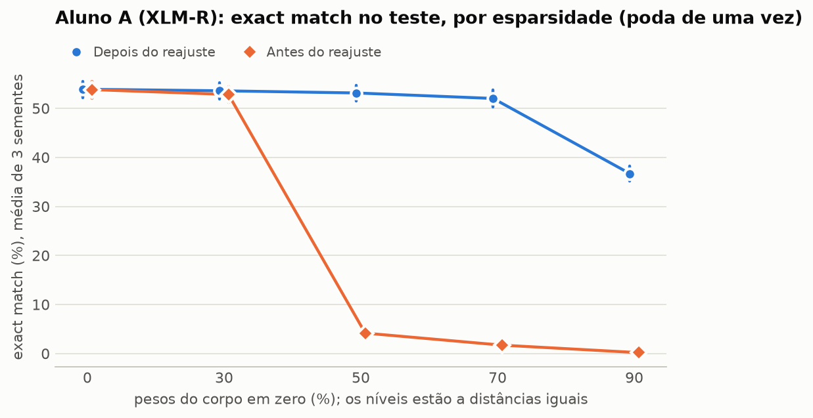
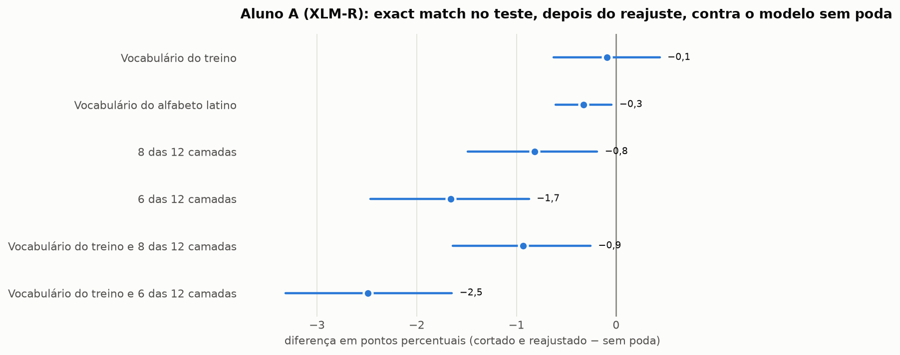
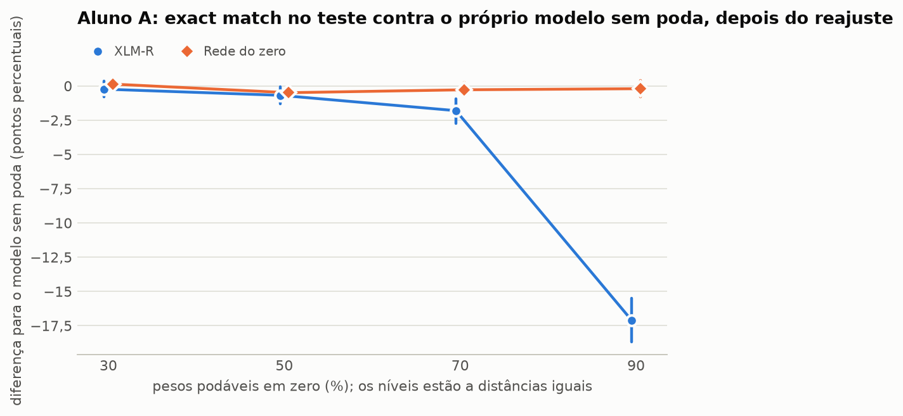
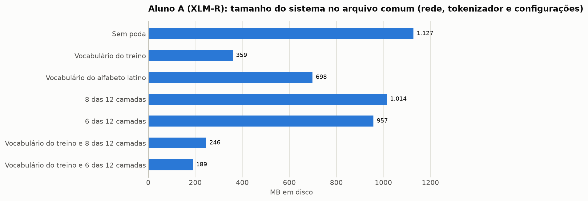

# Etapa 10b · Poda e fine-tuning de recuperação do XLM-R: resumo da entrega

**Pergunta.** Quanto dá para tirar do XLM-R, de que parte, e quanto o reajuste recupera?

**Resposta.** No aluno A, com os pesos soltos do corpo: sem reajuste, o exact match fica distinguivelmente abaixo do modelo sem poda em 50%, 70% e 90%; com reajuste, em 50%, 70% e 90%. O reajuste melhora o modelo podado, com intervalo todo acima de zero, em 50%, 70% e 90%. Em 90%: −53,6 (−55,3 a −51,9) antes e −17,1 (−18,7 a −15,5) depois. Com peças inteiras: depois do reajuste, não se distinguem do modelo sem poda em exact match: vocabulário do treino; ficam abaixo: vocabulário do alfabeto latino, 8 das 12 camadas, 6 das 12 camadas, vocabulário do treino e 8 das 12 camadas e vocabulário do treino e 6 das 12 camadas. Já sem reajuste, não se distinguem: vocabulário do treino e vocabulário do alfabeto latino. **No custo**, com 90% dos pesos do corpo em zero a rede continua com 1.110,4 MB no arquivo comum e cai para 815,3 MB no arquivo esparso; o menor sistema de peças inteiras (vocabulário do treino e 6 das 12 camadas) tem 188,9 MB, contra 1.127,5 MB sem poda. A latência só muda com as camadas: 19,2 ms com 6 das 12, contra 35,9 ms sem poda; o vocabulário do treino fica em 36,0 ms.

Segue para a quantização (Etapa 10c), do aluno A: a principal é **vocabulário do treino: −0,4 (−1,0 a +0,3) em dev, 359,0 MB no arquivo comum, 89.572.779 parâmetros diferentes de zero**; a secundária é **magnitude, 70% gradual: −0,9 (−1,8 a +0,0) em dev, 1.127,5 MB no arquivo comum, 218.129.491 parâmetros diferentes de zero**.

## O que foi feito

- **Modelos de partida:** Aluno A (rótulos do Claude Haiku 5.5), Aluno B2 (logits do Qwen3-8B) e Teto (rótulos humanos). A grade completa roda em aluno A e teto; aluno B2 recebe só a principal e a secundária do aluno A. Cada um é reajustado com o sinal com que aprendeu; a época de parada dos alunos usa o `dev` rotulado pelo professor.
- **Pesos soltos, por magnitude** (Han et al., arXiv 1506.02626): nas 72 matrizes do corpo (84.934.656 pesos, 30,6% do modelo), com o corte por matriz, em 30%, 50%, 70% e 90%; de uma vez, com medida antes e depois do reajuste, e gradual (Zhu & Gupta, arXiv 1710.01878), com a esparsidade subindo nas 5 primeiras épocas. A tabela de subtokens fica fora (Sanh et al., arXiv 2005.07683); Gordon et al. (arXiv 2002.08307) a podam: desvio declarado.
- **Peças inteiras:** o corte do vocabulário (TextPruner, arXiv 2203.15996; Abdaoui et al., arXiv 2010.05609), em duas formas que não olham `dev` nem o teste, com o tokenizador reduzido junto; as camadas de cima (Sajjad et al., arXiv 2004.03844), ficando com 8 e 6 das 12; e duas combinações.
- **Reajuste:** 10 épocas em todas as execuções (o orçamento do ajuste fino da Etapa 10a), com a receita de quem treinou o modelo e a máscara travada. Fica o melhor ponto em `dev`, e o ponto de partida concorre: em 12 das 69 execuções o modelo saiu como entrou. Um controle faz o mesmo reajuste sem tirar nada, e duas variantes do aluno A foram reajustadas também com 4 épocas (a proporção da Etapa 7).
- **O orçamento veio de um piloto no teto** (semente 0, `dev`): sem as 6 camadas de cima, 4,5% de exact match com 4 épocas de reajuste e 63,8% com 10.
- 102 execuções, 3,1 horas de placa de vídeo.

## Pesos soltos: antes e depois do reajuste (Aluno A, teste)

Exact match em % (intervalo de 95%), média de 3 sementes; diferenças pareadas em pontos percentuais.

|  | antes do reajuste | depois do reajuste | antes − sem poda | depois − sem poda | o que o reajuste recupera (depois − antes) |
| --- | --- | --- | --- | --- | --- |
| Sem poda | 53,8 (52,1 a 55,4) | — | — | — | — |
| Sem poda, com o mesmo reajuste (controle) | — | 53,9 (52,1 a 55,5) | — | +0,1 (−0,4 a +0,5) | — |
| Magnitude, 30% de uma vez | 52,8 (51,2 a 54,4) | 53,6 (51,8 a 55,2) | −1,0 (−2,0 a +0,0) | −0,2 (−0,8 a +0,3) | +0,8 (−0,3 a +1,7) |
| Magnitude, 50% de uma vez | 4,2 (3,6 a 4,7) | 53,1 (51,4 a 54,8) | −49,7 (−51,4 a −47,8) | −0,7 (−1,3 a −0,1) | +49,0 (+47,1 a +50,7) |
| Magnitude, 70% de uma vez | 1,7 (1,4 a 2,0) | 52,0 (50,3 a 53,7) | −52,1 (−53,8 a −50,3) | −1,8 (−2,8 a −0,9) | +50,3 (+48,5 a +52,0) |
| Magnitude, 90% de uma vez | 0,2 (0,1 a 0,3) | 36,7 (35,1 a 38,2) | −53,6 (−55,3 a −51,9) | −17,1 (−18,7 a −15,5) | +36,5 (+34,9 a +38,1) |

## De uma vez ou gradual (Aluno A, teste)

| Esparsidade | de uma vez, depois do reajuste | gradual | gradual − de uma vez | gradual − sem poda |
| --- | --- | --- | --- | --- |
| 30% | 53,6 (51,8 a 55,2) | 53,2 (51,5 a 54,9) | −0,3 (−0,9 a +0,2) | −0,6 (−1,2 a +0,0) |
| 50% | 53,1 (51,4 a 54,8) | 53,3 (51,5 a 54,9) | +0,2 (−0,3 a +0,7) | −0,5 (−1,2 a +0,1) |
| 70% | 52,0 (50,3 a 53,7) | 53,0 (51,2 a 54,7) | +1,0 (+0,4 a +1,6) | −0,8 (−1,6 a −0,0) |
| 90% | 36,7 (35,1 a 38,2) | 41,3 (39,6 a 42,9) | +4,6 (+3,6 a +5,5) | −12,5 (−13,9 a −11,1) |

- A gradual fica acima da poda de uma vez em 70% e 90% e abaixo em nenhum nível.

## Peças inteiras (Aluno A, teste)

| Variante | parâmetros | sistema no arquivo comum (MB) | antes do reajuste | depois do reajuste | antes − sem poda | depois − sem poda | o que o reajuste recupera (depois − antes) |
| --- | --- | --- | --- | --- | --- | --- | --- |
| Vocabulário do treino | 89.573.547 | 359,0 | 53,6 (51,8 a 55,2) | 53,7 (52,0 a 55,3) | −0,2 (−0,5 a +0,0) | −0,1 (−0,6 a +0,4) | +0,1 (−0,3 a +0,6) |
| Vocabulário do alfabeto latino | 172.555.947 | 697,9 | 53,8 (52,1 a 55,4) | 53,5 (51,8 a 55,1) | +0,0 (+0,0 a +0,0) | −0,3 (−0,6 a −0,0) | −0,3 (−0,6 a −0,0) |
| 8 das 12 camadas | 249.233.067 | 1.014,1 | 0,2 (0,1 a 0,3) | 53,0 (51,3 a 54,7) | −53,6 (−55,2 a −51,9) | −0,8 (−1,5 a −0,2) | +52,8 (+51,1 a +54,4) |
| 6 das 12 camadas | 235.057.323 | 957,3 | 0,0 (0,0 a 0,1) | 52,2 (50,4 a 53,8) | −53,8 (−55,4 a −52,0) | −1,7 (−2,5 a −0,9) | +52,1 (+50,4 a +53,8) |
| Vocabulário do treino e 8 das 12 camadas | 61.222.059 | 245,6 | 0,2 (0,1 a 0,3) | 52,9 (51,2 a 54,5) | −53,6 (−55,2 a −51,9) | −0,9 (−1,6 a −0,3) | +52,7 (+51,0 a +54,3) |
| Vocabulário do treino e 6 das 12 camadas | 47.046.315 | 188,9 | 0,0 (0,0 a 0,1) | 51,3 (49,6 a 53,0) | −53,8 (−55,4 a −52,0) | −2,5 (−3,3 a −1,6) | +51,3 (+49,6 a +52,9) |

Diagnóstico do corte do vocabulário (não escolheu nada):

| Forma | linhas que ficam | parte da tabela | treino: subtokens cortados | dev: subtokens cortados | teste: subtokens cortados | dev: pedidos com algum corte | dev: subtokens que viram <unk> | dev: subtokens por pedido, antes → depois |
| --- | --- | --- | --- | --- | --- | --- | --- | --- |
| treino | 5.196 | 2,1% | 0,00% | 1,81% | 1,83% | 12,6% | 0,01% | 8,86 → 9,06 |
| alfabeto | 113.246 | 45,3% | 0,00% | 0,00% | 0,00% | 0,0% | 0,00% | 8,86 → 8,86 |

## O orçamento do reajuste (Aluno A, teste)

- **Magnitude, 90% de uma vez:** com 10 épocas em vez de 4, o exact match fica acima (+18,6 (+17,3 a +19,9)); contra o modelo sem poda, −35,7 (−37,5 a −33,9) com 4 épocas e −17,1 (−18,7 a −15,5) com 10.
- **6 das 12 camadas:** com 10 épocas em vez de 4, o exact match fica acima (+37,4 (+35,8 a +39,1)); contra o modelo sem poda, −39,1 (−40,7 a −37,4) com 4 épocas e −1,7 (−2,5 a −0,9) com 10.

## O XLM-R ao lado da rede do zero (aluno A, teste, magnitude de uma vez)

Diferença de exact match para o próprio modelo sem poda, em pontos percentuais (intervalo de 95%).

| Esparsidade | XLM-R, antes do reajuste | Rede do zero, antes do reajuste | XLM-R, depois do reajuste | Rede do zero, depois do reajuste |
| --- | --- | --- | --- | --- |
| 30% | −1,0 (−2,0 a +0,0) | +0,3 (+0,0 a +0,5) | −0,2 (−0,8 a +0,3) | +0,1 (−0,2 a +0,5) |
| 50% | −49,7 (−51,4 a −47,8) | −0,3 (−0,7 a +0,2) | −0,7 (−1,3 a −0,1) | −0,5 (−0,9 a −0,1) |
| 70% | −52,1 (−53,8 a −50,3) | −0,4 (−1,1 a +0,2) | −1,8 (−2,8 a −0,9) | −0,3 (−0,8 a +0,2) |
| 90% | −53,6 (−55,3 a −51,9) | −36,0 (−37,7 a −34,3) | −17,1 (−18,7 a −15,5) | −0,2 (−0,8 a +0,4) |

## O que muda de verdade (Aluno A, semente 0)

Tamanhos em MB; latência p50 em ms, 1 thread de CPU, uma consulta por vez.

| Variante | Parâmetros | Diferentes de zero | Rede: arquivo comum | Rede: com zip | Rede: arquivo esparso | Tokenizador e configurações | Sistema: arquivo comum | Latência | Latência, execução esparsa |
| --- | --- | --- | --- | --- | --- | --- | --- | --- | --- |
| Sem poda | 277.584.555 | 277.583.755 | 1.110,4 | 828,1 | 1.110,4 | 17,1 | 1.127,5 | 35,9 | — |
| Magnitude, 30% de uma vez | 277.584.555 | 252.103.363 | 1.110,4 | 759,8 | 1.019,2 | 17,1 | 1.127,5 | 37,0 | 88,4 |
| Magnitude, 50% de uma vez | 277.584.555 | 235.116.427 | 1.110,4 | 704,0 | 951,2 | 17,1 | 1.127,5 | 37,6 | 63,4 |
| Magnitude, 70% de uma vez | 277.584.555 | 218.129.491 | 1.110,4 | 644,0 | 883,3 | 17,1 | 1.127,5 | 36,9 | 40,6 |
| Magnitude, 90% de uma vez | 277.584.555 | 201.142.555 | 1.110,4 | 576,4 | 815,3 | 17,1 | 1.127,5 | 36,7 | 17,2 |
| Magnitude, 30% gradual | 277.584.555 | 252.103.363 | 1.110,4 | 759,8 | 1.019,2 | 17,1 | 1.127,5 | 37,1 | — |
| Magnitude, 50% gradual | 277.584.555 | 235.116.427 | 1.110,4 | 703,9 | 951,2 | 17,1 | 1.127,5 | 37,0 | — |
| Magnitude, 70% gradual | 277.584.555 | 218.129.491 | 1.110,4 | 643,9 | 883,3 | 17,1 | 1.127,5 | 37,4 | 40,4 |
| Magnitude, 90% gradual | 277.584.555 | 201.142.555 | 1.110,4 | 576,4 | 815,3 | 17,1 | 1.127,5 | 37,1 | — |
| Vocabulário do treino | 89.573.547 | 89.572.779 | 358,3 | 332,7 | 358,4 | 0,7 | 359,0 | 36,0 | — |
| Vocabulário do alfabeto latino | 172.555.947 | 172.555.169 | 690,2 | 553,6 | 690,3 | 7,7 | 697,9 | 36,1 | — |
| 8 das 12 camadas | 249.233.067 | 249.232.267 | 996,9 | 723,0 | 997,0 | 17,1 | 1.014,1 | 24,4 | — |
| 6 das 12 camadas | 235.057.323 | 235.056.523 | 940,2 | 670,1 | 940,3 | 17,1 | 957,3 | 19,2 | — |
| Vocabulário do treino e 8 das 12 camadas | 61.222.059 | 61.221.291 | 244,9 | 227,3 | 244,9 | 0,7 | 245,6 | 24,4 | — |
| Vocabulário do treino e 6 das 12 camadas | 47.046.315 | 47.045.547 | 188,2 | 174,5 | 188,2 | 0,7 | 188,9 | 18,3 | — |

## Todas as variantes, no teste

Métricas em %, média de 3 sementes, depois do reajuste (a coluna "antes" é o exact match logo depois do corte). A diferença é pareada, contra o mesmo modelo sem poda. Tamanhos do sistema em MB e latência p50 em ms, medidos na semente 0.

| Modelo de partida | Variante | Intenção | F1 de entidades | Exact match antes | Exact match | Exact match − sem poda | Diferentes de zero | Arquivo comum | Esparso | Latência |
| --- | --- | --- | --- | --- | --- | --- | --- | --- | --- | --- |
| Aluno A | Sem poda | 82,6 | 65,5 | — | 53,8 | — | 277.583.755 | 1.127,5 | 1.127,5 | 35,9 |
| Aluno A | Sem poda, com o mesmo reajuste (controle) | 82,9 | 65,5 | — | 53,9 | +0,1 (−0,4 a +0,5) | 277.583.755 | 1.127,5 | 1.127,5 | 35,9 |
| Aluno A | Magnitude, 30% de uma vez | 82,6 | 65,1 | 52,8 | 53,6 | −0,2 (−0,8 a +0,3) | 252.103.363 | 1.127,5 | 1.036,3 | 37,0 |
| Aluno A | Magnitude, 50% de uma vez | 82,6 | 65,1 | 4,2 | 53,1 | −0,7 (−1,3 a −0,1) | 235.116.427 | 1.127,5 | 968,3 | 37,6 |
| Aluno A | Magnitude, 70% de uma vez | 81,3 | 63,2 | 1,7 | 52,0 | −1,8 (−2,8 a −0,9) | 218.129.491 | 1.127,5 | 900,4 | 36,9 |
| Aluno A | Magnitude, 90% de uma vez | 71,7 | 48,5 | 0,2 | 36,7 | −17,1 (−18,7 a −15,5) | 201.142.555 | 1.127,5 | 832,4 | 36,7 |
| Aluno A | Magnitude, 30% gradual | 82,5 | 65,1 | — | 53,2 | −0,6 (−1,2 a +0,0) | 252.103.363 | 1.127,5 | 1.036,3 | 37,1 |
| Aluno A | Magnitude, 50% gradual | 82,3 | 65,2 | — | 53,3 | −0,5 (−1,2 a +0,1) | 235.116.427 | 1.127,5 | 968,3 | 37,0 |
| Aluno A | Magnitude, 70% gradual **(secundária)** | 82,2 | 64,6 | — | 53,0 | −0,8 (−1,6 a −0,0) | 218.129.491 | 1.127,5 | 900,4 | 37,4 |
| Aluno A | Magnitude, 90% gradual | 75,4 | 51,0 | — | 41,3 | −12,5 (−13,9 a −11,1) | 201.142.555 | 1.127,5 | 832,4 | 37,1 |
| Aluno A | Vocabulário do treino **(principal)** | 82,9 | 65,1 | 53,6 | 53,7 | −0,1 (−0,6 a +0,4) | 89.572.779 | 359,0 | 359,0 | 36,0 |
| Aluno A | Vocabulário do alfabeto latino | 82,5 | 65,5 | 53,8 | 53,5 | −0,3 (−0,6 a −0,0) | 172.555.169 | 697,9 | 698,0 | 36,1 |
| Aluno A | 8 das 12 camadas | 82,3 | 64,8 | 0,2 | 53,0 | −0,8 (−1,5 a −0,2) | 249.232.267 | 1.014,1 | 1.014,1 | 24,4 |
| Aluno A | 6 das 12 camadas | 81,6 | 63,7 | 0,0 | 52,2 | −1,7 (−2,5 a −0,9) | 235.056.523 | 957,3 | 957,4 | 19,2 |
| Aluno A | Vocabulário do treino e 8 das 12 camadas | 82,3 | 64,2 | 0,2 | 52,9 | −0,9 (−1,6 a −0,3) | 61.221.291 | 245,6 | 245,6 | 24,4 |
| Aluno A | Vocabulário do treino e 6 das 12 camadas | 81,1 | 62,9 | 0,0 | 51,3 | −2,5 (−3,3 a −1,6) | 47.045.547 | 188,9 | 188,9 | 18,3 |
| Aluno A | Magnitude, 90% de uma vez, reajuste de 4 épocas | 41,4 | 40,8 | 0,2 | 18,1 | −35,7 (−37,5 a −33,9) | — | — | — | — |
| Aluno A | 6 das 12 camadas, reajuste de 4 épocas | 26,0 | 63,7 | 0,0 | 14,7 | −39,1 (−40,7 a −37,4) | — | — | — | — |
| Aluno B2 | Sem poda | 78,9 | 58,8 | — | 46,3 | — | 277.583.755 | 1.127,5 | 1.127,5 | 38,0 |
| Aluno B2 | Magnitude, 70% gradual **(secundária)** | 78,1 | 58,7 | — | 45,8 | −0,5 (−1,4 a +0,4) | 218.129.491 | 1.127,5 | 900,4 | 38,0 |
| Aluno B2 | Vocabulário do treino **(principal)** | 78,4 | 57,9 | 46,2 | 45,2 | −1,0 (−1,4 a −0,6) | 89.572.779 | 359,0 | 359,0 | 38,5 |
| Teto | Sem poda | 86,9 | 75,5 | — | 66,3 | — | 277.583.755 | 1.127,5 | 1.127,5 | 37,8 |
| Teto | Sem poda, com o mesmo reajuste (controle) | 87,1 | 75,5 | — | 66,4 | +0,1 (−0,2 a +0,5) | 277.583.755 | 1.127,5 | 1.127,5 | 37,8 |
| Teto | Magnitude, 30% de uma vez | 87,0 | 74,8 | 59,7 | 65,8 | −0,5 (−1,1 a +0,1) | 252.103.363 | 1.127,5 | 1.036,3 | — |
| Teto | Magnitude, 50% de uma vez **(secundária)** | 86,7 | 74,5 | 5,2 | 65,4 | −0,9 (−1,5 a −0,2) | 235.116.427 | 1.127,5 | 968,3 | 37,1 |
| Teto | Magnitude, 70% de uma vez | 85,3 | 71,1 | 2,0 | 61,5 | −4,7 (−5,7 a −3,8) | 218.129.491 | 1.127,5 | 900,4 | — |
| Teto | Magnitude, 90% de uma vez | 72,6 | 52,2 | 0,2 | 40,9 | −25,4 (−26,9 a −23,8) | 201.142.555 | 1.127,5 | 832,4 | — |
| Teto | Magnitude, 30% gradual | 86,6 | 74,7 | — | 65,3 | −0,9 (−1,6 a −0,3) | 252.103.363 | 1.127,5 | 1.036,3 | — |
| Teto | Magnitude, 50% gradual | 87,1 | 74,8 | — | 66,1 | −0,2 (−0,8 a +0,4) | 235.116.427 | 1.127,5 | 968,3 | — |
| Teto | Magnitude, 70% gradual | 86,2 | 73,4 | — | 63,7 | −2,6 (−3,6 a −1,8) | 218.129.491 | 1.127,5 | 900,4 | — |
| Teto | Magnitude, 90% gradual | 76,7 | 54,7 | — | 45,2 | −21,1 (−22,6 a −19,6) | 201.142.555 | 1.127,5 | 832,4 | — |
| Teto | Vocabulário do treino **(principal)** | 86,7 | 74,9 | 65,8 | 65,8 | −0,4 (−0,9 a +0,1) | 89.572.779 | 359,0 | 359,0 | 37,8 |
| Teto | Vocabulário do alfabeto latino | 87,0 | 75,5 | 66,3 | 66,5 | +0,2 (−0,2 a +0,5) | 172.555.169 | 697,9 | 698,0 | — |
| Teto | 8 das 12 camadas | 86,5 | 74,8 | 0,5 | 65,5 | −0,8 (−1,5 a −0,1) | 249.232.267 | 1.014,1 | 1.014,1 | — |
| Teto | 6 das 12 camadas | 85,5 | 73,3 | 0,0 | 63,8 | −2,5 (−3,4 a −1,7) | 235.056.523 | 957,3 | 957,4 | — |
| Teto | Vocabulário do treino e 8 das 12 camadas | 86,1 | 74,2 | 0,5 | 65,0 | −1,3 (−2,0 a −0,6) | 61.221.291 | 245,6 | 245,6 | — |
| Teto | Vocabulário do treino e 6 das 12 camadas | 85,0 | 72,9 | 0,1 | 63,1 | −3,2 (−4,0 a −2,3) | 47.045.547 | 188,9 | 188,9 | — |

## O que segue para a quantização

Regra, decidida em `dev` com os rótulos humanos: passa a variante cujo exact match, depois do reajuste, não é distinguivelmente menor que o do modelo sem poda. A **principal** é a que passa com o menor arquivo comum; se nenhuma peça inteira passa, é o modelo sem poda. A **secundária** é a de pesos soltos que passa com a maior esparsidade. Aluno B2 recebe as variantes do aluno A, por desenho.

| Modelo de partida | Principal | Secundária |
| --- | --- | --- |
| Aluno A | vocabulário do treino: −0,4 (−1,0 a +0,3) em dev, 359,0 MB no arquivo comum, 89.572.779 parâmetros diferentes de zero | magnitude, 70% gradual: −0,9 (−1,8 a +0,0) em dev, 1.127,5 MB no arquivo comum, 218.129.491 parâmetros diferentes de zero |
| Aluno B2 | vocabulário do treino: −0,4 (−0,9 a +0,0) em dev, 359,0 MB no arquivo comum, 89.572.779 parâmetros diferentes de zero | magnitude, 70% gradual: −0,4 (−1,5 a +0,6) em dev, 1.127,5 MB no arquivo comum, 218.129.491 parâmetros diferentes de zero |
| Teto | vocabulário do treino: −0,1 (−0,7 a +0,4) em dev, 359,0 MB no arquivo comum, 89.572.779 parâmetros diferentes de zero | magnitude, 50% de uma vez: −0,6 (−1,4 a +0,2) em dev, 1.127,5 MB no arquivo comum, 235.116.427 parâmetros diferentes de zero |

Dev e teste dizem o mesmo? A regra só olha `dev`; o teste não decide nada.

- **Aluno A:** passam em dev e ficam distinguivelmente abaixo no teste: vocabulário do alfabeto latino (+0,0 (−0,3 a +0,3) em dev, −0,3 (−0,6 a −0,0) no teste), magnitude, 70% gradual (−0,9 (−1,8 a +0,0) em dev, −0,8 (−1,6 a −0,0) no teste) e magnitude, 50% de uma vez (−0,4 (−1,2 a +0,3) em dev, −0,7 (−1,3 a −0,1) no teste); não passam em dev e não se distinguem no teste: nenhuma.
- **Aluno B2:** passam em dev e ficam distinguivelmente abaixo no teste: vocabulário do treino (−0,4 (−0,9 a +0,0) em dev, −1,0 (−1,4 a −0,6) no teste); não passam em dev e não se distinguem no teste: nenhuma.
- **Teto:** passam em dev e ficam distinguivelmente abaixo no teste: magnitude, 50% de uma vez (−0,6 (−1,4 a +0,2) em dev, −0,9 (−1,5 a −0,2) no teste) e magnitude, 30% gradual (−0,2 (−1,0 a +0,5) em dev, −0,9 (−1,6 a −0,3) no teste); não passam em dev e não se distinguem no teste: nenhuma.

## Critério de pronto

| Critério | Atendido |
|---|---|
| Cada variante tem 3 sementes, com o mesmo orçamento de reajuste (102 execuções) | sim |
| A esparsidade pedida é a obtida | sim |
| Nenhum rótulo humano entrou no reajuste dos alunos | sim |
| A escolha das linhas do vocabulário não usou dev nem o teste | sim |
| Cada variante tem antes e depois do reajuste, com comparação pareada contra o modelo sem poda e intervalo de 95%, no teste (180 comparações) | sim |
| Tamanho e latência foram medidos em arquivos gravados e modelos carregados, com a rede separada do tokenizador | sim |
| O que segue para a quantização saiu de dev, pela regra escrita antes | sim |
| Os modelos entregues são pastas comuns de SistemaEncoder e reproduzem as respostas do teste | sim |

## Limites

- **A tabela de subtokens ficou fora da poda por magnitude.** A esparsidade é do corpo (30,6% do modelo). Gordon et al. podam a tabela também.
- **O orçamento do reajuste (10 épocas) foi escolhido depois de um piloto no teto**: o primeiro desenho tinha 4. É um orçamento maior, em proporção, que o da Etapa 7 (o treino inteiro, contra 37,5%). O controle com 4 épocas só existe em duas variantes do aluno A.
- **O corte é por matriz e a poda é de magnitude.** O corte global e a poda de movimento (Sanh et al.), que os artigos apontam como melhor em esparsidade alta num encoder pré-treinado, não foram testados.
- **Só duas formas de corte do vocabulário e dois cortes de camadas.** A forma "treino" depende do texto de treino: palavra nova é partida em peças menores ou vira `<unk>`. A forma "alfabeto" é uma escolha deste projeto, sem artigo que a teste.
- **Aluno B2 não tem grade própria**: recebe as variantes escolhidas para o aluno A.
- **O teto serviu ao piloto.** Seis execuções dele (semente 0) foram vistas antes de a grade rodar. Fora o orçamento do reajuste, as regras não mudaram depois.
- **A regra aceita o que não se distingue.** Com o tamanho de `dev`, uma queda de menos de cerca de 1 ponto de exact match pode passar.
- **As decisões de análise usam os rótulos humanos de `dev`**, que o cenário dos alunos não tem. O reajuste e a parada não usam.
- **As respostas saem da placa de vídeo, em 32 bits**, como as da Etapa 10a; o reajuste usa precisão mista.
- **O teste foi aberto para todas as variantes**, porque a curva inteira é o resultado da etapa. Nenhuma decisão saiu dele.
- **A curva da rede do zero ao lado da do XLM-R não é um teste**: mudam juntos a rede, o que a poda alcança e o orçamento do reajuste.
- **Latência só em PyTorch, na CPU, com 1 thread.** No aluno A, todas as variantes; nos outros modelos, só as que seguem. A execução esparsa (CSR do PyTorch) só foi medida no aluno A. O modelo sem poda, medido em cada grupo, variou entre 35,6 e 35,9 ms de um grupo para outro.
- **Os pesos das variantes que não seguem foram apagados do cache** (ficam as respostas, as métricas e os históricos de todas). São refeitos pelo comando `executar`.
- **O arquivo esparso é o formato mais simples** (um bit por posição) e não é entregue: `poda_encoder.salvar_esparso` o grava a partir da pasta comum.

## Arquivos

| Arquivo | Conteúdo |
|---|---|
| `decisao.json` | Para cada modelo de partida: a principal, a secundária, a pasta de cada semente, o sinal do reajuste e os tamanhos medidos |
| `modelos/` | Os modelos que seguem, 3 sementes cada, em pastas comuns de `SistemaEncoder` (pesos densos, com zeros no lugar dos pesos podados, ou a rede menor com o tokenizador reduzido) |
| `tabela_principal.csv` | Cada variante de cada modelo de partida no teste: qualidade, diferença para o modelo sem poda, tamanhos e latência |
| `previsoes/` | As respostas dos modelos que seguem, em `dev` e no teste |
| `resultados.csv` | Cada variante de cada modelo de partida, antes e depois do reajuste, em `dev` e no teste |
| `comparacoes.csv` | Cada comparação pareada, em todas as métricas |
| `eficiencia.csv` | Parâmetros, tamanhos em disco (rede, tokenizador, sistema) e latência de cada variante (semente 0) |
| `corte_do_vocabulario.csv` | O diagnóstico das duas formas de corte: linhas que ficam e fração dos subtokens cortada em treino, `dev` e teste |
| `historicos/` | Perdas, esparsidade e métricas no `dev` de parada, época por época, de cada execução |
| `piloto.json` | O que foi visto no teto antes de a grade rodar, e que mudou o orçamento do reajuste |
| `segue_do_principal.json` | A regra aplicada ao aluno principal durante a onda: é o que definiu as execuções do outro aluno |
| `latencia/`, `latencia.sh` | O resumo de cada grupo da medida de latência e o roteiro que os mediu |
| `figuras/` | Os gráficos deste notebook |
| `10b_encoder_poda.html` | Este notebook executado, para leitura |
