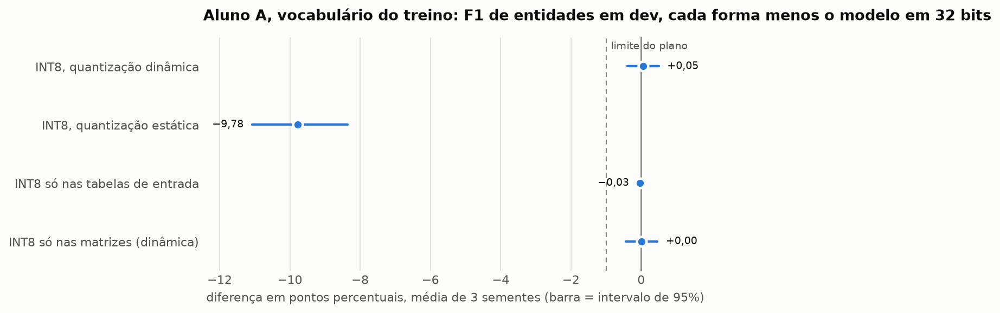
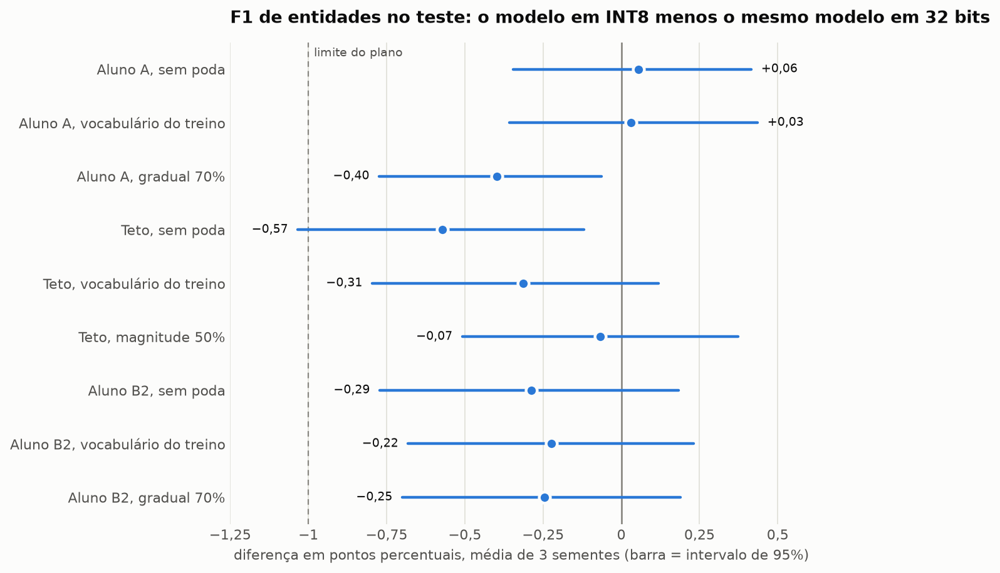
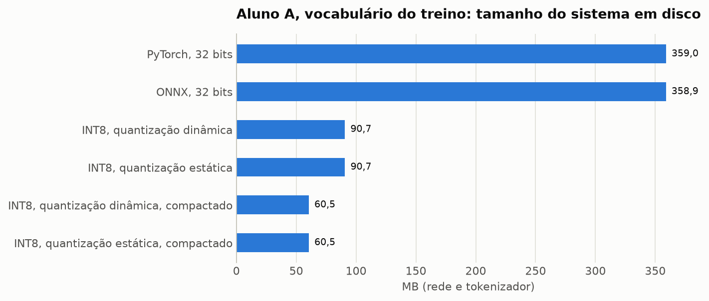
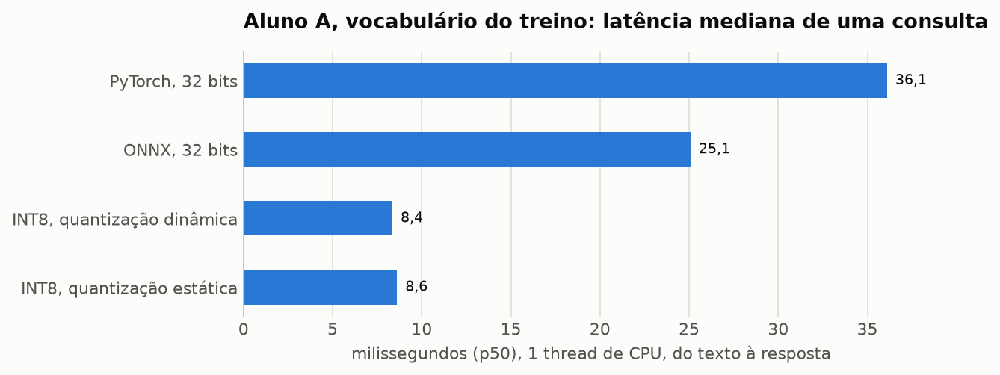

# Etapa 10c · Encoder pré-treinado: quantização. Resumo da entrega

**Pergunta.** Quanto o XLM-R encolhe e acelera em inteiros de 8 bits, e a qualidade se conserva?

**Resposta.** No modelo final deste caminho (Aluno A (rótulos do Claude Haiku 5.5), vocabulário do treino), passar para inteiros de 8 bits custa, no teste, +0,03 (−0,36 a +0,44) pontos de F1 de entidades, −0,44 (−0,77 a −0,10) de acurácia de intenção e −0,22 (−0,64 a +0,21) de exact match, em relação ao mesmo modelo em 32 bits (diferença pareada, média de 3 sementes, intervalo de 95%). O sistema vai de 359,0 MB para 90,7 MB (3,96 vezes menos), e a consulta, de 36,10 ms no PyTorch para 8,35 ms (p50, 1 thread). O ONNX de 32 bits responde em 25,08 ms: sair do PyTorch dá 1,44 vezes, e os 8 bits, mais 3,00 vezes. A forma que ficou é a INT8, quantização dinâmica. Formas que não passam na regra: A INT8, quantização estática não passa em nenhum dos 9 modelos; a diferença de F1 de entidades em `dev`, para o mesmo modelo em 32 bits, vai de −1,74 a −14,94 pontos conforme o modelo. Treino ciente de quantização: não entra. Em todo modelo há uma forma pós-treino cujo F1 de entidades cai no máximo 1 ponto em `dev`, que era a condição do plano. Um limite: a regra olha só as entidades, e a acurácia de intenção do modelo final muda −0,41 (−0,79 a −0,03) em `dev` e −0,44 (−0,77 a −0,10) no teste, uma queda pequena, mas distinguível de zero nas duas partições.

## O que foi feito

- Cada modelo foi **exportado para ONNX** (a rede, da tabela de subtokens até as pontuações) e **quantizado depois de treinado**, sem nenhum passo de treino, com o ONNX Runtime 1.32.0. O sistema exportado lê o texto com o pacote `tokenizers` e não usa PyTorch.
- Em 8 bits: a tabela de subtokens, a de posições e todas as matrizes de pesos (as 6 de cada camada e as das cabeças), um degrau por tensor. Em 32 bits: vieses, normalizações de camada, softmax, GELU e os produtos da atenção.
- Duas formas concorrem: **dinâmica** (a faixa das ativações é medida em cada pedido) e **estática** (medida antes, em 512 pedidos do treino, sem rótulo). As regras são as da Etapa 8, e o código da regra é o mesmo.
- A exportação sozinha não mudou nenhuma resposta: 135.189 de 135.189 respostas do ONNX de 32 bits iguais às do PyTorch, em `dev` e no teste.
- Nenhum peso podado deixou de ser zero depois de quantizar.

## A regra, em dev

F1 de entidades de cada forma menos o do mesmo modelo em 32 bits, em pontos percentuais (intervalo de 95%), média de 3 sementes. O limite do plano é uma queda de 1 ponto; se nenhuma forma ficasse dentro dele, entraria o treino ciente de quantização.

| Modelo | INT8, quantização dinâmica | INT8, quantização estática | Fica |
|---|---|---|---|
| Aluno A, sem poda | +0,22 (−0,28 a +0,71) | −9,26 (−10,64 a −7,80) **não passa** | INT8, quantização dinâmica |
| Aluno A, vocabulário do treino | +0,05 (−0,39 a +0,50) | −9,78 (−11,08 a −8,36) **não passa** | INT8, quantização dinâmica |
| Aluno A, gradual 70% | −0,47 (−0,93 a −0,02) | −4,43 (−5,67 a −3,15) **não passa** | INT8, quantização dinâmica |
| Teto, sem poda | −0,10 (−0,67 a +0,49) | −14,94 (−16,32 a −13,60) **não passa** | INT8, quantização dinâmica |
| Teto, vocabulário do treino | −0,20 (−0,72 a +0,34) | −13,63 (−14,98 a −12,34) **não passa** | INT8, quantização dinâmica |
| Teto, magnitude 50% | −0,52 (−1,10 a +0,05) | −13,69 (−14,99 a −12,39) **não passa** | INT8, quantização dinâmica |
| Aluno B2, sem poda | +0,20 (−0,38 a +0,76) | −10,83 (−12,26 a −9,41) **não passa** | INT8, quantização dinâmica |
| Aluno B2, vocabulário do treino | −0,16 (−0,66 a +0,37) | −11,72 (−13,06 a −10,32) **não passa** | INT8, quantização dinâmica |
| Aluno B2, gradual 70% | −0,46 (−0,99 a +0,04) | −1,74 (−2,82 a −0,56) **não passa** | INT8, quantização dinâmica |

- **Formas que não passam na regra:** A INT8, quantização estática não passa em nenhum dos 9 modelos; a diferença de F1 de entidades em `dev`, para o mesmo modelo em 32 bits, vai de −1,74 a −14,94 pontos conforme o modelo.
- **Treino ciente de quantização:** não entra. Em todo modelo há uma forma pós-treino cujo F1 de entidades cai no máximo 1 ponto em `dev`, que era a condição do plano.
- Entre duas formas que passam, fica a estática só se for mais rápida que a dinâmica em todas as 5 rodadas de latência; senão a dinâmica, que não precisa de calibração.

## No teste

Cada modelo em INT8, na forma escolhida. Qualidade em %, média de 3 sementes; tamanho do sistema e latência (p50, 1 thread) da semente 0.

| Modelo | Forma | MB | MB com zip | Acurácia de intenção | F1 de entidades | Exact match | Exact match: INT8 − 32 bits | p50 (ms) |
|---|---|---|---|---|---|---|---|---|
| Aluno A, sem poda | INT8, quantização dinâmica | 287,3 | 215,4 | 82,8 | 65,6 | 54,5 | +0,68 (+0,25 a +1,14) | 8,33 |
| Aluno A, vocabulário do treino | INT8, quantização dinâmica | 90,7 | 60,5 | 82,4 | 65,1 | 53,5 | −0,22 (−0,64 a +0,21) | 8,35 |
| Aluno A, gradual 70% | INT8, quantização dinâmica | 287,3 | 189,9 | 82,0 | 64,2 | 52,9 | −0,03 (−0,48 a +0,39) | 8,37 |
| Teto, sem poda | INT8, quantização dinâmica | 287,3 | 215,5 | 86,8 | 74,9 | 66,1 | −0,16 (−0,67 a +0,38) | 8,39 |
| Teto, vocabulário do treino | INT8, quantização dinâmica | 90,7 | 60,5 | 86,3 | 74,6 | 65,7 | −0,19 (−0,71 a +0,33) | 8,50 |
| Teto, magnitude 50% | INT8, quantização dinâmica | 287,3 | 202,3 | 86,6 | 74,4 | 65,6 | +0,15 (−0,36 a +0,64) | 8,37 |
| Aluno B2, sem poda | INT8, quantização dinâmica | 287,3 | 215,6 | 79,0 | 58,5 | 46,6 | +0,36 (−0,12 a +0,85) | 8,26 |
| Aluno B2, vocabulário do treino | INT8, quantização dinâmica | 90,7 | 60,5 | 78,2 | 57,6 | 45,2 | −0,04 (−0,50 a +0,39) | 7,94 |
| Aluno B2, gradual 70% | INT8, quantização dinâmica | 287,3 | 189,8 | 78,1 | 58,4 | 45,7 | −0,11 (−0,55 a +0,33) | 8,01 |

O modelo em INT8 menos o mesmo modelo em 32 bits. Diferença pareada, em pontos percentuais (intervalo de 95%), média de 3 sementes.

| Modelo | Forma | Acurácia de intenção | F1 de entidades | Exact match |
|---|---|---|---|---|
| Aluno A, sem poda | INT8, quantização dinâmica | +0,15 (−0,20 a +0,49) | +0,06 (−0,35 a +0,42) | +0,68 (+0,25 a +1,14) |
| Aluno A, vocabulário do treino | INT8, quantização dinâmica | −0,44 (−0,77 a −0,10) | +0,03 (−0,36 a +0,44) | −0,22 (−0,64 a +0,21) |
| Aluno A, gradual 70% | INT8, quantização dinâmica | −0,17 (−0,49 a +0,17) | −0,40 (−0,77 a −0,06) | −0,03 (−0,48 a +0,39) |
| Teto, sem poda | INT8, quantização dinâmica | −0,17 (−0,50 a +0,18) | −0,57 (−1,03 a −0,12) | −0,16 (−0,67 a +0,38) |
| Teto, vocabulário do treino | INT8, quantização dinâmica | −0,36 (−0,72 a −0,01) | −0,31 (−0,80 a +0,12) | −0,19 (−0,71 a +0,33) |
| Teto, magnitude 50% | INT8, quantização dinâmica | −0,03 (−0,38 a +0,34) | −0,07 (−0,51 a +0,37) | +0,15 (−0,36 a +0,64) |
| Aluno B2, sem poda | INT8, quantização dinâmica | +0,09 (−0,25 a +0,46) | −0,29 (−0,77 a +0,18) | +0,36 (−0,12 a +0,85) |
| Aluno B2, vocabulário do treino | INT8, quantização dinâmica | −0,18 (−0,54 a +0,16) | −0,22 (−0,68 a +0,23) | −0,04 (−0,50 a +0,39) |
| Aluno B2, gradual 70% | INT8, quantização dinâmica | −0,04 (−0,40 a +0,31) | −0,25 (−0,70 a +0,19) | −0,11 (−0,55 a +0,33) |

- Diferenças distinguíveis de zero no teste: Aluno A, sem poda, Exact match: +0,68 (+0,25 a +1,14); Aluno A, vocabulário do treino, Acurácia de intenção: −0,44 (−0,77 a −0,10); Aluno A, gradual 70%, F1 de entidades: −0,40 (−0,77 a −0,06); Teto, sem poda, F1 de entidades: −0,57 (−1,03 a −0,12); Teto, vocabulário do treino, Acurácia de intenção: −0,36 (−0,72 a −0,01). São 5 em 27 comparações; com intervalos de 95%, cerca de 1,4 sairia do zero só por acaso.

## Todas as linhas, em dev e no teste

Qualidade em %, média de 3 sementes. A decisão saiu de `dev`; o teste da forma que não ficou está aqui só para o registro. Tamanho do sistema (MB) e latência (p50, 1 thread) da semente 0.

| Modelo | Linha | dev: intenção | dev: F1 de entidades | dev: exact match | teste: intenção | teste: F1 de entidades | teste: exact match | MB | p50 (ms) |
|---|---|---|---|---|---|---|---|---|---|
| Aluno A, sem poda | PyTorch, 32 bits | 83,1 | 67,6 | 54,4 | 82,6 | 65,5 | 53,8 | 1.127,5 | 35,82 |
| Aluno A, sem poda | ONNX, 32 bits | 83,1 | 67,6 | 54,4 | 82,6 | 65,5 | 53,8 | 1.119,5 | 25,03 |
| Aluno A, sem poda | INT8, quantização dinâmica (fica) | 82,8 | 67,8 | 54,5 | 82,8 | 65,6 | 54,5 | 287,3 | 8,33 |
| Aluno A, sem poda | INT8, quantização estática (não passa) | 77,7 | 58,3 | 45,0 | 78,0 | 56,2 | 45,8 | 287,3 | 8,65 |
| Aluno A, vocabulário do treino | PyTorch, 32 bits | 83,2 | 67,7 | 54,0 | 82,9 | 65,1 | 53,7 | 359,0 | 36,10 |
| Aluno A, vocabulário do treino | ONNX, 32 bits | 83,2 | 67,7 | 54,0 | 82,9 | 65,1 | 53,7 | 358,9 | 25,08 |
| Aluno A, vocabulário do treino | INT8, quantização dinâmica (fica) | 82,8 | 67,8 | 54,0 | 82,4 | 65,1 | 53,5 | 90,7 | 8,35 |
| Aluno A, vocabulário do treino | INT8, quantização estática (não passa) | 78,2 | 57,9 | 45,1 | 78,4 | 55,8 | 45,9 | 90,7 | 8,61 |
| Aluno A, gradual 70% | PyTorch, 32 bits | 82,8 | 66,9 | 53,5 | 82,2 | 64,6 | 53,0 | 1.127,5 | 36,14 |
| Aluno A, gradual 70% | ONNX, 32 bits | 82,8 | 66,9 | 53,5 | 82,2 | 64,6 | 53,0 | 1.119,5 | 25,14 |
| Aluno A, gradual 70% | INT8, quantização dinâmica (fica) | 82,8 | 66,4 | 53,6 | 82,0 | 64,2 | 52,9 | 287,3 | 8,37 |
| Aluno A, gradual 70% | INT8, quantização estática (não passa) | 80,9 | 62,5 | 49,7 | 79,8 | 60,1 | 49,3 | 287,3 | 8,74 |
| Teto, sem poda | PyTorch, 32 bits | 87,0 | 77,3 | 66,8 | 86,9 | 75,5 | 66,3 | 1.127,5 | 37,06 |
| Teto, sem poda | ONNX, 32 bits | 87,0 | 77,3 | 66,8 | 86,9 | 75,5 | 66,3 | 1.119,5 | 25,19 |
| Teto, sem poda | INT8, quantização dinâmica (fica) | 86,5 | 77,2 | 66,0 | 86,8 | 74,9 | 66,1 | 287,3 | 8,39 |
| Teto, sem poda | INT8, quantização estática (não passa) | 79,0 | 62,3 | 50,6 | 79,5 | 60,5 | 50,7 | 287,3 | 8,85 |
| Teto, vocabulário do treino | PyTorch, 32 bits | 87,0 | 77,1 | 66,7 | 86,7 | 74,9 | 65,8 | 359,0 | 37,54 |
| Teto, vocabulário do treino | ONNX, 32 bits | 87,0 | 77,1 | 66,7 | 86,7 | 74,9 | 65,8 | 358,9 | 25,35 |
| Teto, vocabulário do treino | INT8, quantização dinâmica (fica) | 86,6 | 76,9 | 66,0 | 86,3 | 74,6 | 65,7 | 90,7 | 8,50 |
| Teto, vocabulário do treino | INT8, quantização estática (não passa) | 81,1 | 63,5 | 52,1 | 80,7 | 61,6 | 51,9 | 90,7 | 8,75 |
| Teto, magnitude 50% | PyTorch, 32 bits | 86,9 | 76,8 | 66,2 | 86,7 | 74,5 | 65,4 | 1.127,5 | 37,01 |
| Teto, magnitude 50% | ONNX, 32 bits | 86,9 | 76,8 | 66,2 | 86,7 | 74,5 | 65,4 | 1.119,5 | 25,45 |
| Teto, magnitude 50% | INT8, quantização dinâmica (fica) | 86,6 | 76,2 | 65,7 | 86,6 | 74,4 | 65,6 | 287,3 | 8,37 |
| Teto, magnitude 50% | INT8, quantização estática (não passa) | 82,2 | 63,1 | 53,0 | 82,6 | 61,5 | 53,8 | 287,3 | 8,78 |
| Aluno B2, sem poda | PyTorch, 32 bits | 79,8 | 61,3 | 47,3 | 78,9 | 58,8 | 46,3 | 1.127,5 | 37,58 |
| Aluno B2, sem poda | ONNX, 32 bits | 79,8 | 61,3 | 47,3 | 78,9 | 58,8 | 46,3 | 1.119,5 | 25,23 |
| Aluno B2, sem poda | INT8, quantização dinâmica (fica) | 79,4 | 61,6 | 47,3 | 79,0 | 58,5 | 46,6 | 287,3 | 8,26 |
| Aluno B2, sem poda | INT8, quantização estática (não passa) | 76,4 | 50,5 | 42,2 | 76,1 | 48,3 | 41,9 | 287,3 | 8,67 |
| Aluno B2, vocabulário do treino | PyTorch, 32 bits | 79,4 | 61,2 | 46,8 | 78,4 | 57,9 | 45,2 | 359,0 | 36,80 |
| Aluno B2, vocabulário do treino | ONNX, 32 bits | 79,4 | 61,2 | 46,8 | 78,4 | 57,9 | 45,2 | 358,9 | 24,33 |
| Aluno B2, vocabulário do treino | INT8, quantização dinâmica (fica) | 79,1 | 61,1 | 46,8 | 78,2 | 57,6 | 45,2 | 90,7 | 7,94 |
| Aluno B2, vocabulário do treino | INT8, quantização estática (não passa) | 76,2 | 49,5 | 41,1 | 75,4 | 47,1 | 40,8 | 90,7 | 8,24 |
| Aluno B2, gradual 70% | PyTorch, 32 bits | 78,9 | 61,2 | 46,8 | 78,1 | 58,7 | 45,8 | 1.127,5 | 36,87 |
| Aluno B2, gradual 70% | ONNX, 32 bits | 78,9 | 61,2 | 46,8 | 78,1 | 58,7 | 45,8 | 1.119,5 | 24,23 |
| Aluno B2, gradual 70% | INT8, quantização dinâmica (fica) | 78,7 | 60,7 | 46,8 | 78,1 | 58,4 | 45,7 | 287,3 | 8,01 |
| Aluno B2, gradual 70% | INT8, quantização estática (não passa) | 77,7 | 59,5 | 46,0 | 76,8 | 56,7 | 45,8 | 287,3 | 8,30 |

## O que a regra não olha: a intenção

Acurácia de intenção da forma escolhida menos a do mesmo modelo em 32 bits, em pontos percentuais (intervalo de 95%), média de 3 sementes.

| Modelo | dev | teste | Queda distinguível de zero |
|---|---|---|---|
| Aluno A, sem poda | −0,28 (−0,66 a +0,08) | +0,15 (−0,20 a +0,49) | não |
| Aluno A, vocabulário do treino | −0,41 (−0,79 a −0,03) | −0,44 (−0,77 a −0,10) | dev e teste |
| Aluno A, gradual 70% | −0,07 (−0,49 a +0,33) | −0,17 (−0,49 a +0,17) | não |
| Teto, sem poda | −0,49 (−0,98 a −0,05) | −0,17 (−0,50 a +0,18) | dev |
| Teto, vocabulário do treino | −0,46 (−0,95 a +0,00) | −0,36 (−0,72 a −0,01) | teste |
| Teto, magnitude 50% | −0,23 (−0,69 a +0,23) | −0,03 (−0,38 a +0,34) | não |
| Aluno B2, sem poda | −0,48 (−0,92 a −0,05) | +0,09 (−0,25 a +0,46) | dev |
| Aluno B2, vocabulário do treino | −0,30 (−0,71 a +0,13) | −0,18 (−0,54 a +0,16) | não |
| Aluno B2, gradual 70% | −0,18 (−0,56 a +0,21) | −0,04 (−0,40 a +0,31) | não |

- **A intenção, que a regra não olha.** A regra decide pelo F1 de entidades. Com a forma escolhida, a acurácia de intenção muda, em relação ao mesmo modelo em 32 bits, de −0,49 a −0,07 ponto em `dev` (média dos 9 modelos: −0,32) e de −0,44 a +0,15 no teste (média: −0,13). A queda é distinguível de zero em 3 dos 9 modelos em `dev` (Aluno A, vocabulário do treino; Teto, sem poda; Aluno B2, sem poda) e em 2 no teste (Aluno A, vocabulário do treino; Teto, vocabulário do treino); nas duas partições ao mesmo tempo, em 1 (Aluno A, vocabulário do treino). No modelo final (Aluno A, vocabulário do treino): −0,41 (−0,79 a −0,03) em `dev` e −0,44 (−0,77 a −0,10) no teste, distinguível nas duas.
- **Dev e teste.** Na forma escolhida, `dev` e teste não dizem o mesmo sobre a diferença para o modelo em 32 bits em 7 de 27 comparações (modelo × métrica): Aluno A, sem poda, Exact match: +0,18 (−0,39 a +0,74) em `dev` e +0,68 (+0,25 a +1,14) no teste; Teto, sem poda, Acurácia de intenção: −0,49 (−0,98 a −0,05) em `dev` e −0,17 (−0,50 a +0,18) no teste; Teto, sem poda, F1 de entidades: −0,10 (−0,67 a +0,49) em `dev` e −0,57 (−1,03 a −0,12) no teste; Teto, sem poda, Exact match: −0,84 (−1,49 a −0,18) em `dev` e −0,16 (−0,67 a +0,38) no teste; Teto, vocabulário do treino, Acurácia de intenção: −0,46 (−0,95 a +0,00) em `dev` e −0,36 (−0,72 a −0,01) no teste; Teto, vocabulário do treino, Exact match: −0,66 (−1,28 a −0,03) em `dev` e −0,19 (−0,71 a +0,33) no teste; Aluno B2, sem poda, Acurácia de intenção: −0,48 (−0,92 a −0,05) em `dev` e +0,09 (−0,25 a +0,46) no teste. A maior dessas diferenças, em valor absoluto, é de 0,84 ponto. A decisão sai de `dev`, pelo F1 de entidades, e não depende delas.
- **A forma que não ficou**, para o registro: no teste, o F1 de entidades dela muda de −15,00 a −1,93 pontos conforme o modelo (em `dev`, de −14,94 a −1,74). Ela fica guardada na entrega, marcada como não escolhida.

## Tamanho e latência

Semente 0. Tamanho: o sistema (rede, tokenizador e ficha), e a rede e o tokenizador em separado, na forma escolhida. Latência: p50 de uma consulta, 1 thread de CPU, do texto à resposta, 5 rodadas de 1.024 consultas.

| Modelo | 32 bits (MB) | INT8 (MB) | INT8: só a rede | Tokenizador | INT8 compactado (MB) | 32 bits ÷ INT8 | PyTorch 32 bits (ms) | ONNX 32 bits (ms) | INT8 dinâmica (ms) | INT8 estática (ms) |
|---|---|---|---|---|---|---|---|---|---|---|
| Aluno A, sem poda | 1.127,5 | 287,3 | 278,2 | 9,08 | 215,4 | 3,92× | 35,82 | 25,03 | 8,33 | 8,65 |
| Aluno A, vocabulário do treino | 359,0 | 90,7 | 90,2 | 0,48 | 60,5 | 3,96× | 36,10 | 25,08 | 8,35 | 8,61 |
| Aluno A, gradual 70% | 1.127,5 | 287,3 | 278,2 | 9,08 | 189,9 | 3,92× | 36,14 | 25,14 | 8,37 | 8,74 |
| Teto, sem poda | 1.127,5 | 287,3 | 278,2 | 9,08 | 215,5 | 3,92× | 37,06 | 25,19 | 8,39 | 8,85 |
| Teto, vocabulário do treino | 359,0 | 90,7 | 90,2 | 0,48 | 60,5 | 3,96× | 37,54 | 25,35 | 8,50 | 8,75 |
| Teto, magnitude 50% | 1.127,5 | 287,3 | 278,2 | 9,08 | 202,3 | 3,92× | 37,01 | 25,45 | 8,37 | 8,78 |
| Aluno B2, sem poda | 1.127,5 | 287,3 | 278,2 | 9,08 | 215,6 | 3,92× | 37,58 | 25,23 | 8,26 | 8,67 |
| Aluno B2, vocabulário do treino | 359,0 | 90,7 | 90,2 | 0,48 | 60,5 | 3,96× | 36,80 | 24,33 | 7,94 | 8,24 |
| Aluno B2, gradual 70% | 1.127,5 | 287,3 | 278,2 | 9,08 | 189,8 | 3,92× | 36,87 | 24,23 | 8,01 | 8,30 |

- **Aluno A, vocabulário do treino:** de 359,0 MB em 32 bits para 90,7 MB em INT8, 3,96 vezes menos. Só a rede vai de 358,3 para 90,2 MB (3,97 vezes). O sistema não chega a 4 vezes porque o tokenizador (0,48 MB) e os vieses e normalizações não encolhem.
- **Dinâmica e estática** guardam os mesmos pesos: a diferença entre os dois arquivos é de 47,4 KB (as faixas das ativações, que a estática grava).
- **Poda e quantização somadas** (Aluno A, vocabulário do treino contra Aluno A, sem poda em 32 bits): de 1.127,5 MB para 90,7 MB, 12,4 vezes menos. A poda responde por 3,1 vezes e a quantização por 3,96.
- **Aluno A, gradual 70%** (70,0% dos pesos das matrizes do corpo em zero): o arquivo INT8 tem 287,3 MB, o mesmo de um modelo sem zeros, porque um zero ocupa um byte. Compactado, vai a 189,9 MB (5,9 vezes menos que em 32 bits). É no arquivo compactado que a poda de pesos soltos aparece.
- **Teto, magnitude 50%** (50,0% dos pesos das matrizes do corpo em zero): o arquivo INT8 tem 287,3 MB, o mesmo de um modelo sem zeros, porque um zero ocupa um byte. Compactado, vai a 202,3 MB (5,6 vezes menos que em 32 bits). É no arquivo compactado que a poda de pesos soltos aparece.
- **Aluno B2, gradual 70%** (70,0% dos pesos das matrizes do corpo em zero): o arquivo INT8 tem 287,3 MB, o mesmo de um modelo sem zeros, porque um zero ocupa um byte. Compactado, vai a 189,8 MB (5,9 vezes menos que em 32 bits). É no arquivo compactado que a poda de pesos soltos aparece.
- Nos modelos sem pesos soltos em zero, compactar tira em média 29,1% do sistema em INT8: o compressor aproveita os pesos pequenos que viraram zero e o texto do tokenizador.
- O sistema carregado do arquivo compactado responde igual ao do arquivo comum: confere em todas as execuções.
- Na média dos modelos, sair do PyTorch deixa a consulta 1,47 vezes mais rápida, e passar para 8 bits, mais 3,02 vezes com INT8, quantização dinâmica, 2,90 vezes com INT8, quantização estática. Na rede do zero (Etapa 8) era o contrário: sair do PyTorch dava 2,6 vezes e os 8 bits, mais 1,6.
- Máquina quieta durante a medida de latência: sim (os outros processos ocuparam no máximo 0,08 núcleo de CPU durante as medidas).
- Onde vai o tempo de uma consulta (Aluno A, vocabulário do treino, INT8, quantização dinâmica): texto para subtokens, 0,103 ms, rede (ONNX Runtime), 8,573 ms, montar a resposta, 0,039 ms.

## Os zeros da poda e o zip

Semente 0, na forma escolhida. "Pesos soltos em zero" é a esparsidade que a Etapa 10b mede, nas matrizes do corpo; as duas colunas seguintes são a parte de todos os pesos gravados que vale zero, antes e depois de quantizar; "zeros perdidos" conta, nas 3 sementes, os pesos que eram zero em 32 bits e deixaram de ser em 8 bits.

| Modelo | Pesos soltos em zero | Zeros em 32 bits | Zeros em INT8 | Zeros perdidos | INT8 (MB) | INT8 com zip (MB) | O zip tira |
|---|---|---|---|---|---|---|---|
| Aluno A, sem poda | 0,0% | 0,0% | 4,8% | 0 | 287,3 | 215,4 | 25,0% |
| Aluno A, vocabulário do treino | 0,0% | 0,0% | 8,1% | 0 | 90,7 | 60,5 | 33,3% |
| Aluno A, gradual 70% | 70,0% | 21,4% | 23,6% | 0 | 287,3 | 189,9 | 33,9% |
| Teto, sem poda | 0,0% | 0,0% | 4,8% | 0 | 287,3 | 215,5 | 25,0% |
| Teto, vocabulário do treino | 0,0% | 0,0% | 8,1% | 0 | 90,7 | 60,5 | 33,2% |
| Teto, magnitude 50% | 50,0% | 15,3% | 17,5% | 0 | 287,3 | 202,3 | 29,6% |
| Aluno B2, sem poda | 0,0% | 0,0% | 4,8% | 0 | 287,3 | 215,6 | 25,0% |
| Aluno B2, vocabulário do treino | 0,0% | 0,0% | 8,1% | 0 | 90,7 | 60,5 | 33,2% |
| Aluno B2, gradual 70% | 70,0% | 21,4% | 23,6% | 0 | 287,3 | 189,8 | 33,9% |

- **Os zeros da poda são conservados.** O zero real tem um inteiro só para ele (o ponto zero da quantização), então um peso podado continua exatamente zero.
- **Um zero de 8 bits ocupa um byte**, como qualquer outro peso. Por isso o ganho em disco de um modelo de pesos soltos depende da compactação. Esses modelos vão para a entrega também compactados (pasta `<forma>_compactado`, com `rede.onnx.gz`); o sistema carrega direto do arquivo compactado e responde igual.

## O modelo final

**O modelo final do caminho do encoder pré-treinado** é o **Aluno A (rótulos do Claude Haiku 5.5), vocabulário do treino, em INT8, quantização dinâmica**: 90,7 MB em disco e 8,35 ms por consulta (p50), contra 359,0 MB e 36,10 ms do mesmo modelo em 32 bits no PyTorch, e 1.127,5 MB e 35,82 ms do modelo sem poda.

**A variante de pesos soltos do mesmo modelo** (Aluno A, gradual 70%) fica com 189,9 MB em INT8 compactado, mais que o modelo final (90,7 MB, ou 60,5 MB compactado). Isso vale só para o disco: sem compactar, e na memória depois de carregada, ela ocupa 287,3 MB, e a latência é 8,37 ms. No teste, em exact match, ela fica sem diferença distinguível para o modelo final (−0,56 (−1,41 a +0,34)). O modelo final continua sendo a variante que a Etapa 10b marcou como principal: a regra foi escrita antes da medida.

- `decisao.json` traz o modelo final, onde ele está e como carregar, e a mesma ficha para cada modelo quantizado.
- Para carregar: `SistemaEncoderOnnx.carregar(pasta da semente)`, de `especialista.compressao.sistema_encoder_onnx`. Roda no ONNX Runtime com o pacote `tokenizers`, sem PyTorch.
- O modelo final, semente 0, carregado da pasta da entrega, reproduz as respostas guardadas: 2.033 de 2.033 em `dev`; 2.974 de 2.974 em teste.

## O que fica guardado

- **As duas formas de INT8 de cada modelo, nas 3 sementes** (54 sistemas), em `modelos/<modelo>/<variante>/<forma>/semente_N/`. A forma que não passou na regra fica guardada, e está marcada em `manifesto.json` e em `decisao.json`. Nada foi apagado nem sobrescrito.
- **O ONNX de 32 bits da semente 0** de cada modelo (a linha "ONNX, 32 bits" da latência), em `modelos/<modelo>/<variante>/fp32/semente_0/`.
- **Os modelos de pesos soltos também compactados**, na forma escolhida (9 sistemas), em `modelos/<modelo>/<variante>/<forma>_compactado/`.
- **As respostas de todas as linhas** (270 arquivos em `previsoes/`): PyTorch, ONNX de 32 bits e as duas formas de INT8 em `dev` e no teste; as duas formas de diagnóstico em `dev`.
- Os sistemas e as respostas são **links físicos** para o que a execução gravou em `data/execucoes/10c_encoder_quantizacao/`: o mesmo arquivo no disco, com dois nomes. `manifesto.json` traz a impressão digital (SHA-256) de cada rede e de cada tokenizador, as versões das bibliotecas, a máquina e o código usado, copiado em `codigo/`.
- **Não ficaram guardados**, porque os comandos da etapa refazem: os sistemas das formas de diagnóstico e o ONNX de 32 bits das sementes 1 e 2.

## Critério de pronto

| Critério | Atendido |
|---|---|
| Cada modelo que a Etapa 10b marcou foi quantizado nas 3 sementes, sem nenhum treino (9 modelos) | sim |
| O ONNX de 32 bits dá as mesmas respostas do PyTorch em dev e no teste (135.189 de 135.189) | sim |
| Os pesos podados continuam em zero depois de quantizar | sim |
| Cada forma tem comparação pareada com o mesmo modelo em 32 bits, com intervalo de 95%, em dev e no teste | sim |
| Tamanho medido em arquivos gravados e latência medida no protocolo, com a máquina quieta | sim |
| A forma final saiu de dev, pela regra escrita antes, e o QAT só entra se a regra mandar | sim |
| Os sistemas entregues reproduzem as respostas do teste | sim |

## Limites

- **Uma máquina, um executor.** A latência é a desta CPU (13th Gen Intel(R) Core(TM) i7-13700K), com o ONNX Runtime, 1 thread. Ela tem as instruções VNNI, que fazem o produto de inteiros de 8 bits sem saturar; numa CPU sem elas, o ONNX Runtime usa uma instrução que pode saturar, e as respostas do modelo quantizado podem mudar um pouco.
- **Pedidos curtos.** Os pedidos do MASSIVE têm poucas palavras; com sequências longas ou lotes, o ganho de latência dos 8 bits seria outro.
- **A latência é de um modelo** (semente 0) por linha; a variação reportada é a das 5 rodadas, não a de sementes.
- **O limite de 1 ponto é sobre a diferença medida**, na média de 3 sementes; o intervalo de 95% é reportado ao lado.
- **A regra olha só as entidades.** A queda de acurácia de intenção com os 8 bits está medida acima, em `dev` e no teste; ela não entra na decisão, porque a regra foi escrita antes dos resultados.
- **Nem tudo está em 8 bits.** Normalizações de camada, softmax, GELU e os produtos da atenção rodam em 32 bits; a rede não é "só inteiros" como em Jacob et al.
- **Um degrau por tensor.** A tabela de subtokens inteira divide um degrau só. Um degrau por linha ou por coluna, e as otimizações próprias de Transformer do ONNX Runtime (juntar a atenção numa operação quantizada), não foram testados: são outras formas, fora das regras desta etapa.
- **A calibração da estática** usa 512 pedidos do treino e a faixa do menor ao maior valor visto; outras escolhas (percentis, entropia) não foram testadas.
- **O tokenizador é texto** e não entra na quantização.
- **A referência em 32 bits** é o modelo no PyTorch, na CPU. As respostas dele coincidem com as entregues pelas Etapas 10a e 10b (calculadas na placa de vídeo) em 135.189 de 135.189.
- **O teste já tinha sido aberto** nas etapas anteriores. Aqui ele foi aberto para as duas formas de INT8; o da forma que não passou fica só como registro, porque a decisão saiu de `dev`.

## Arquivos

| Arquivo | Conteúdo |
|---|---|
| `decisao.json` | O modelo final deste caminho, a forma escolhida para cada modelo, as duas formas com as suas pastas, tamanhos, latências e a regra |
| `tabela_principal.csv` | Cada modelo nas quatro linhas (PyTorch, ONNX de 32 bits, INT8 dinâmica, INT8 estática), em `dev` e no teste: qualidade com intervalo, diferença para 32 bits, tamanho e latência |
| `modelos/` | Os sistemas: as duas formas de INT8 de cada modelo, 3 sementes; o ONNX de 32 bits da semente 0; os de pesos soltos também compactados. Cada pasta tem rede em ONNX, tokenizador e ficha |
| `previsoes/` | As respostas de cada linha, por modelo, semente e partição |
| `manifesto.json` | O que foi guardado, com a impressão digital de cada arquivo, as versões das bibliotecas e a máquina |
| `codigo/` | Cópia do código da etapa, do script da cadeia de execuções e do log dela |
| `resultados.csv` | Cada modelo em 32 bits (PyTorch e ONNX) e em INT8, em `dev` e teste; as formas de diagnóstico só em `dev` |
| `comparacoes.csv` | Cada forma menos o mesmo modelo em 32 bits, pareada, em todas as métricas |
| `eficiencia.csv` | Tamanho e latência de cada sistema, com a máquina e o que os outros processos usaram de CPU durante a medida |
| `tamanhos.csv` | O tamanho de cada sistema, arquivo por arquivo, com e sem zip, e os pesos em zero antes e depois de quantizar |
| `figuras/` | Os gráficos deste notebook |
| `10c_encoder_quantizacao.html` | Este notebook executado, para leitura |
