# Etapa 10d · Comparativo dos dois caminhos: resumo da entrega

**Pergunta.** Com os mesmos professores e as mesmas regras, o que o encoder pré-treinado compra em qualidade, e quanto custa em tamanho e latência, em relação à rede feita do zero?

**Resposta.** No teste, o modelo final do XLM-R (Aluno A, vocabulário do treino, INT8, quantização dinâmica) faz 82,4 / 65,1 / 53,5 (acurácia de intenção / F1 de entidades / exact match) e o da rede do zero (Aluno A, sem 90% das linhas da tabela de features, INT8, quantização dinâmica), 80,2 / 64,9 / 51,2. O XLM-R fica acima em acurácia de intenção (+2,2 (+1,4 a +3,1)); sem diferença distinguível em F1 de entidades (+0,3 (−0,6 a +1,1)); acima em exact match (+2,3 (+1,3 a +3,3)); em `dev`, acima em acurácia de intenção (+1,4 (+0,4 a +2,4)); sem diferença distinguível em F1 de entidades (+0,9 (−0,1 a +2,0)); acima em exact match (+2,3 (+1,2 a +3,6)). **O que ele custa:** 90,7 MB contra 2,11 MB (42,9 vezes o tamanho) e 8,35 ms contra 0,26 ms por consulta (32,0 vezes a latência, 1 thread de CPU; medidos na mesma sessão, 8,00 ms contra 0,26 ms, 31,2 vezes). **O preço de cada ponto de exact match**, entre os dois modelos finais: 38,9 MB (26,9 a 70,5) e 3,56 ms (2,45 a 6,44) no teste; em `dev`, 38,0 MB (24,4 a 76,1) e 3,47 ms (2,23 a 6,95). **De onde a diferença vem:** ela já existe quando o aluno sai da destilação (+2,6 (+1,6 a +3,7) de exact match no aluno A sem poda) e atravessa a compressão: +2,6 (aluno destilado) → +2,5 (podado e reajustado) → +2,3 (INT8). Contra o professor (Claude Haiku 5.5), o final do XLM-R fica abaixo em acurácia de intenção (−1,0 (−2,0 a −0,1)); sem diferença distinguível em F1 de entidades (−0,9 (−2,1 a +0,2)); sem diferença distinguível em exact match (−0,5 (−1,9 a +0,7)); o da rede do zero, abaixo em acurácia de intenção (−3,3 (−4,4 a −2,2)); sem diferença distinguível em F1 de entidades (−1,2 (−2,4 a +0,0)); abaixo em exact match (−2,8 (−4,3 a −1,5)). **Na fronteira** de qualidade contra latência, entre os sistemas com 299 rótulos humanos, ficam: Do zero · Aluno A, INT8 sem poda (51,3%); XLM-R · Aluno A, INT8 sem poda (54,5%); na de tamanho: Do zero · Aluno A, pesos soltos, INT8 com zip (50,3%); Do zero · Aluno A, INT8 (51,2%); Do zero · Aluno A, INT8 sem poda (51,3%); XLM-R · Aluno A, INT8 (53,5%); XLM-R · Aluno A, INT8 sem poda (54,5%). O final da rede do zero é dominado por Do zero · Aluno A, INT8 sem poda (latência) e está na fronteira (tamanho); o final do XLM-R é dominado por XLM-R · Aluno A, INT8 sem poda (latência) e está na fronteira (tamanho). Na latência a poda não muda o custo, e o final de cada caminho empata com o seu próprio INT8 sem poda: a diferença de exact match entre os dois é −0,06 (−0,85 a +0,78) na rede do zero e −1,0 (−1,6 a −0,5) no XLM-R (em `dev`, −0,5 (−1,1 a +0,1)). **Nenhum caminho domina o outro**: nenhum sistema de um caminho domina o modelo final do outro. A rede do zero é o ponto barato, o XLM-R é o ponto de mais qualidade, e a escolha depende de quanto valem +2,3 pontos de exact match diante de 42,9 vezes o arquivo e 32,0 vezes a latência.

Nenhuma rede foi treinada nesta etapa. A linha de base com 299 rótulos, que não é rede neural, foi treinada de novo para gerar as respostas que a Etapa 5a não gravou, e os modelos em INT8 da rede do zero responderam de novo os pedidos; em todos os casos os números batem com os das etapas de origem. As regras foram gravadas antes das contas (2026-11-18 às 20:54:00; contas em 2026-11-18 às 21:15:27). Todos os números de qualidade vêm das respostas gravadas pelas Etapas 2 a 10c e foram refeitos: 191 linhas conferidas contra o que as etapas de origem gravaram, todas iguais (maior diferença: 0.0e+00).

## As regras, escritas antes

- **Método:** nenhuma decisão nesta etapa; `dev` e teste, contra os rótulos humanos, com a leitura principal no teste; média de 3 sementes; diferenças pareadas, bootstrap por enunciado, 2.000 reamostragens, intervalo de 95%. Uma diferença só vale quando o intervalo não contém zero.
- **Lista fechada:** 43 comparações, geradas por regra a partir das marcas do registro (de ponta a ponta: 20, entre caminhos: 11, aluno e professor: 10, poda nos 8 bits: 6 e finais: 1; 5 caem em duas famílias), e 6 cadeias, com 22 degraus. Primárias: o final de um caminho contra o do outro, nas três métricas, no teste.
- **Dominado** (a definição da Etapa 9): existe outro sistema com custo menor ou igual e exact match maior ou igual, e melhor em pelo menos um dos dois. Concorrem os sistemas com 299 rótulos humanos, dos dois caminhos. Latências a menos de 14% uma da outra são empate.
- **Preço de cada ponto:** custo a mais ÷ pontos de exact match a mais, entre os dois modelos finais; o intervalo vem do intervalo da diferença de exact match e só existe quando ele está todo acima de zero.
- `regras.json` traz o texto inteiro, e `regras_v2.json`, a versão em uso (só corrige o texto que descreve cada comparação; os pares são os mesmos). O que já era conhecido ao escrever está declarado no arquivo e nos limites.

## A conferência

| o que foi conferido | partição | igual | DIFERENTE | sem número gravado na origem |
|---|---|---|---|---|
| comparação entre sistemas | dev | 5 | 0 | 0 |
| comparação entre sistemas | test | 15 | 0 | 0 |
| degrau de uma cadeia | dev | 22 | 0 | 0 |
| degrau de uma cadeia | test | 22 | 0 | 0 |
| linha da tabela final da Etapa 9 | test | 21 | 0 | 0 |
| qualidade de um sistema | dev | 53 | 0 | 0 |
| qualidade de um sistema | test | 53 | 0 | 0 |

- 106 linhas de qualidade (44 sistemas, `dev` e teste, contra cada etapa que gravou o número), 44 degraus de cadeia, 20 comparações entre sistemas (as da Etapa 10a entre caminhos e as de ponta a ponta da Etapa 9) e as 21 linhas da tabela final da Etapa 9, coluna por coluna.
- Nenhum número de etapa anterior deixou de fechar com as respostas gravadas.

## A tabela final (teste, 2.974 pedidos)

Qualidade em % (intervalo de 95%); nos sistemas treinados, média de 3 sementes. Tamanho e latência dos modelos comprimidos são os da semente 0. A mesma tabela com a qualidade em `dev` está em `tabela_final.csv` (colunas `dev_...`).

| Caminho | Sistema | Rótulos humanos | Acurácia de intenção | F1 de entidades | Exact match | Parâmetros | Tamanho em disco | Com zip | Latência p50 | Onde a latência foi medida | Consultas por segundo | US$ por 1.000 consultas |
|---|---|---|---|---|---|---|---|---|---|---|---|---|
| os dois | Linha de base com 299 rótulos | 299 (no treino) | 47,8 (46,0 a 49,6) | 35,6 (33,7 a 37,5) | 19,4 (18,1 a 20,8) | 552.636 | não medido | — | não medida | não medida | — | — |
| os dois | Linha de base com 11.514 rótulos | 11.514 (no treino) | 84,6 (83,3 a 85,8) | 47,8 (45,9 a 49,7) | 45,2 (43,5 a 47,0) | 3.940.300 | 33,0 MB | — | 0,82 ms | CPU local: scikit-learn, threads não registradas (Etapa 2) | 1.172 | — |
| os dois | Claude Haiku 5.5 (professor fechado) | 299 (no prompt) | 83,5 (82,1 a 84,7) | 66,1 (64,5 a 67,7) | 54,0 (52,3 a 55,7) | não divulgado | não divulgado | — | 854 ms | API pela rede: rede do usuário, Brasil, uma chamada por vez (Etapa 5a) | 1,1 | 0,114 |
| os dois | Qwen3-8B em 4 bits (professor aberto) | 299 (no prompt) | 77,6 (76,1 a 79,1) | 55,7 (53,9 a 57,4) | 43,2 (41,5 a 45,0) | 8.190.735.360 | 16,4 GB | — | 1.087 ms | GPU local: um pedido por vez (Etapa 5b) | 0,8 | — |
| Do zero | Teto (DIET do zero com os 11.514 rótulos humanos) | 11.514 (no treino) | 84,4 (83,2 a 85,6) | 73,6 (72,2 a 75,1) | 62,5 (60,8 a 64,1) | 4.895.834 | 19,9 MB | 18,2 MB | 1,10 ms | CPU local: 1 thread, PyTorch (Etapa 8) | 882 | — |
| Do zero | Piso (DIET do zero só com os 299 rótulos humanos) | 299 (no treino) | 40,1 (38,6 a 41,5) | 40,8 (39,1 a 42,4) | 20,9 (19,6 a 22,2) | 2.154.586 | 8,73 MB | — | 1,12 ms | CPU local: 1 thread, PyTorch (Etapa 6) | 877 | — |
| Do zero | Aluno A (rótulos do Claude Haiku 5.5) | 299 (pelo professor) | 80,7 (79,4 a 82,0) | 64,8 (63,2 a 66,5) | 51,2 (49,6 a 52,9) | 4.895.834 | 19,9 MB | 18,2 MB | 1,11 ms | CPU local: 1 thread, PyTorch (Etapa 8) | 876 | — |
| Do zero | Aluno B1 (rótulos do Qwen3-8B) | 299 (pelo professor) | 76,3 (74,9 a 77,7) | 57,1 (55,4 a 58,9) | 43,6 (41,9 a 45,2) | 4.895.834 | 19,9 MB | — | 1,13 ms | CPU local: 1 thread, PyTorch (Etapa 6) | 866 | — |
| Do zero | Aluno B2 (logits do Qwen3-8B, T = 8) | 299 (pelo professor) | 77,8 (76,3 a 79,3) | 58,0 (56,3 a 59,8) | 46,0 (44,2 a 47,6) | 4.895.834 | 19,9 MB | 18,2 MB | 1,11 ms | CPU local: 1 thread, PyTorch (Etapa 8) | 876 | — |
| Do zero | Aluno A, sem 90% das linhas da tabela de features, PyTorch, 32 bits | 299 (pelo professor) | 80,2 (78,9 a 81,5) | 64,8 (63,3 a 66,4) | 51,3 (49,6 a 52,9) | 1.992.538 | 8,06 MB | 7,39 MB | 1,10 ms | CPU local: 1 thread, PyTorch (Etapa 8) | 881 | — |
| Do zero | Aluno A, sem 90% das linhas da tabela de features, ONNX, 32 bits | 299 (pelo professor) | 80,2 (78,9 a 81,5) | 64,8 (63,3 a 66,4) | 51,3 (49,6 a 52,9) | 1.992.538 | 7,98 MB | — | 0,43 ms | CPU local: 1 thread, ONNX Runtime (Etapa 8) | 2.308 | — |
| Do zero | Aluno A, sem 90% das linhas da tabela de features, INT8, quantização dinâmica **(modelo final)** | 299 (pelo professor) | 80,2 (78,9 a 81,5) | 64,9 (63,3 a 66,4) | 51,2 (49,5 a 52,9) | 1.992.538 | 2,11 MB | 1,70 MB | 0,26 ms | CPU local: 1 thread, ONNX Runtime (Etapa 8) | 3.615 | — |
| Do zero | Aluno A, magnitude, 95% de uma vez, INT8, quantização dinâmica, arquivo compactado | 299 (pelo professor) | 79,8 (78,5 a 81,1) | 64,3 (62,7 a 66,0) | 50,3 (48,6 a 52,0) | 4.895.834 | 5,26 MB | 0,92 MB | 0,27 ms | CPU local: 1 thread, ONNX Runtime (Etapa 8) | 3.520 | — |
| Do zero | Aluno B2, sem 90% das linhas da tabela de features, PyTorch, 32 bits | 299 (pelo professor) | 77,8 (76,4 a 79,2) | 58,0 (56,2 a 59,8) | 46,2 (44,5 a 47,9) | 1.992.538 | 8,06 MB | 7,40 MB | 1,10 ms | CPU local: 1 thread, PyTorch (Etapa 8) | 880 | — |
| Do zero | Aluno B2, sem 90% das linhas da tabela de features, ONNX, 32 bits | 299 (pelo professor) | 77,8 (76,4 a 79,2) | 58,0 (56,2 a 59,8) | 46,2 (44,5 a 47,9) | 1.992.538 | 7,98 MB | — | 0,42 ms | CPU local: 1 thread, ONNX Runtime (Etapa 8) | 2.313 | — |
| Do zero | Aluno B2, sem 90% das linhas da tabela de features, INT8, quantização dinâmica | 299 (pelo professor) | 77,8 (76,3 a 79,2) | 58,0 (56,2 a 59,8) | 46,2 (44,5 a 47,9) | 1.992.538 | 2,11 MB | 1,72 MB | 0,26 ms | CPU local: 1 thread, ONNX Runtime (Etapa 8) | 3.631 | — |
| Do zero | Aluno B2, magnitude, 90% gradual, INT8, quantização dinâmica, arquivo compactado | 299 (pelo professor) | 77,5 (76,1 a 78,9) | 58,6 (56,9 a 60,4) | 46,1 (44,4 a 47,8) | 4.895.834 | 5,26 MB | 1,26 MB | 0,27 ms | CPU local: 1 thread, ONNX Runtime (Etapa 8) | 3.472 | — |
| Do zero | Teto, sem 90% das linhas da tabela de features, PyTorch, 32 bits | 11.514 (no treino) | 83,4 (82,2 a 84,6) | 73,5 (72,0 a 74,9) | 61,3 (59,6 a 62,9) | 1.992.538 | 8,06 MB | 7,39 MB | 1,10 ms | CPU local: 1 thread, PyTorch (Etapa 8) | 883 | — |
| Do zero | Teto, sem 90% das linhas da tabela de features, ONNX, 32 bits | 11.514 (no treino) | 83,4 (82,2 a 84,6) | 73,5 (72,0 a 74,9) | 61,3 (59,6 a 62,9) | 1.992.538 | 7,98 MB | — | 0,43 ms | CPU local: 1 thread, ONNX Runtime (Etapa 8) | 2.311 | — |
| Do zero | Teto, sem 90% das linhas da tabela de features, INT8, quantização dinâmica | 11.514 (no treino) | 83,4 (82,1 a 84,6) | 73,5 (72,0 a 74,9) | 61,3 (59,7 a 62,9) | 1.992.538 | 2,11 MB | 1,73 MB | 0,26 ms | CPU local: 1 thread, ONNX Runtime (Etapa 8) | 3.670 | — |
| Do zero | Teto, magnitude, 90% de uma vez, INT8, quantização dinâmica, arquivo compactado | 11.514 (no treino) | 83,9 (82,6 a 85,1) | 73,4 (71,9 a 74,9) | 61,7 (60,0 a 63,3) | 4.895.834 | 5,26 MB | 1,31 MB | 0,27 ms | CPU local: 1 thread, ONNX Runtime (Etapa 8) | 3.535 | — |
| Do zero | Aluno A, sem poda, INT8, quantização dinâmica | 299 (pelo professor) | 80,7 (79,3 a 82,0) | 64,8 (63,2 a 66,5) | 51,3 (49,6 a 52,9) | 4.895.834 | 5,26 MB | 4,35 MB | 0,26 ms | CPU local: 1 thread, ONNX Runtime (Etapa 8) | 3.638 | — |
| Do zero | Aluno B2, sem poda, INT8, quantização dinâmica | 299 (pelo professor) | 77,9 (76,4 a 79,3) | 58,1 (56,4 a 59,9) | 45,9 (44,2 a 47,6) | 4.895.834 | 5,26 MB | 4,39 MB | 0,27 ms | CPU local: 1 thread, ONNX Runtime (Etapa 8) | 3.512 | — |
| Do zero | Teto, sem poda, INT8, quantização dinâmica | 11.514 (no treino) | 84,3 (83,1 a 85,5) | 73,7 (72,2 a 75,1) | 62,5 (60,8 a 64,1) | 4.895.834 | 5,26 MB | 4,40 MB | 0,27 ms | CPU local: 1 thread, ONNX Runtime (Etapa 8) | 3.554 | — |
| XLM-R | Teto (XLM-R base com os 11.514 rótulos humanos) | 11.514 (no treino) | 86,9 (85,8 a 88,0) | 75,5 (74,0 a 77,0) | 66,3 (64,7 a 67,9) | 277.584.555 | 1,1 GB | 832,3 MB | 37,06 ms | CPU local: 1 thread, PyTorch (Etapa 10c) | 26 | — |
| XLM-R | Piso (XLM-R base só com os 299 rótulos humanos) | 299 (no treino) | 54,7 (53,1 a 56,3) | 52,8 (51,1 a 54,5) | 32,6 (31,1 a 34,2) | 277.584.555 | 1,1 GB | — | não medida | não medida | — | — |
| XLM-R | Aluno A (rótulos do Claude Haiku 5.5) | 299 (pelo professor) | 82,6 (81,4 a 84,0) | 65,5 (64,0 a 67,2) | 53,8 (52,1 a 55,4) | 277.584.555 | 1,1 GB | 832,1 MB | 35,82 ms | CPU local: 1 thread, PyTorch (Etapa 10c) | 27 | — |
| XLM-R | Aluno B1 (rótulos do Qwen3-8B) | 299 (pelo professor) | 78,7 (77,2 a 80,1) | 58,5 (56,8 a 60,2) | 45,7 (44,0 a 47,4) | 277.584.555 | 1,1 GB | — | não medida | não medida | — | — |
| XLM-R | Aluno B2 (logits do Qwen3-8B, T = 2) | 299 (pelo professor) | 78,9 (77,5 a 80,3) | 58,8 (57,1 a 60,5) | 46,3 (44,6 a 48,0) | 277.584.555 | 1,1 GB | 832,3 MB | 37,58 ms | CPU local: 1 thread, PyTorch (Etapa 10c) | 26 | — |
| XLM-R | Aluno A, vocabulário do treino, PyTorch, 32 bits | 299 (pelo professor) | 82,9 (81,6 a 84,2) | 65,1 (63,5 a 66,8) | 53,7 (52,0 a 55,3) | 89.573.547 | 359,0 MB | 333,0 MB | 36,10 ms | CPU local: 1 thread, PyTorch (Etapa 10c) | 27 | — |
| XLM-R | Aluno A, vocabulário do treino, ONNX, 32 bits | 299 (pelo professor) | 82,9 (81,6 a 84,2) | 65,1 (63,5 a 66,8) | 53,7 (52,0 a 55,3) | 89.573.547 | 358,9 MB | — | 25,08 ms | CPU local: 1 thread, ONNX Runtime (Etapa 10c) | 38 | — |
| XLM-R | Aluno A, vocabulário do treino, INT8, quantização dinâmica **(modelo final)** | 299 (pelo professor) | 82,4 (81,2 a 83,7) | 65,1 (63,5 a 66,7) | 53,5 (51,8 a 55,1) | 89.573.547 | 90,7 MB | 60,5 MB | 8,35 ms | CPU local: 1 thread, ONNX Runtime (Etapa 10c) | 115 | — |
| XLM-R | Aluno A, magnitude, 70% gradual, INT8, quantização dinâmica, arquivo compactado | 299 (pelo professor) | 82,0 (80,8 a 83,3) | 64,2 (62,6 a 65,8) | 52,9 (51,1 a 54,6) | 277.584.555 | 287,3 MB | 189,9 MB | 8,37 ms | CPU local: 1 thread, ONNX Runtime (Etapa 10c) | 115 | — |
| XLM-R | Aluno A, sem poda, INT8, quantização dinâmica | 299 (pelo professor) | 82,8 (81,5 a 84,1) | 65,6 (64,0 a 67,2) | 54,5 (52,8 a 56,1) | 277.584.555 | 287,3 MB | 215,4 MB | 8,33 ms | CPU local: 1 thread, ONNX Runtime (Etapa 10c) | 116 | — |
| XLM-R | Aluno B2, vocabulário do treino, PyTorch, 32 bits | 299 (pelo professor) | 78,4 (77,0 a 79,8) | 57,9 (56,2 a 59,6) | 45,2 (43,5 a 47,0) | 89.573.547 | 359,0 MB | 333,0 MB | 36,80 ms | CPU local: 1 thread, PyTorch (Etapa 10c) | 26 | — |
| XLM-R | Aluno B2, vocabulário do treino, ONNX, 32 bits | 299 (pelo professor) | 78,4 (77,0 a 79,8) | 57,9 (56,2 a 59,6) | 45,2 (43,5 a 47,0) | 89.573.547 | 358,9 MB | — | 24,33 ms | CPU local: 1 thread, ONNX Runtime (Etapa 10c) | 39 | — |
| XLM-R | Aluno B2, vocabulário do treino, INT8, quantização dinâmica | 299 (pelo professor) | 78,2 (76,9 a 79,6) | 57,6 (56,0 a 59,4) | 45,2 (43,5 a 46,9) | 89.573.547 | 90,7 MB | 60,5 MB | 7,94 ms | CPU local: 1 thread, ONNX Runtime (Etapa 10c) | 121 | — |
| XLM-R | Aluno B2, magnitude, 70% gradual, INT8, quantização dinâmica, arquivo compactado | 299 (pelo professor) | 78,1 (76,7 a 79,5) | 58,4 (56,7 a 60,1) | 45,7 (44,0 a 47,3) | 277.584.555 | 287,3 MB | 189,8 MB | 8,01 ms | CPU local: 1 thread, ONNX Runtime (Etapa 10c) | 121 | — |
| XLM-R | Aluno B2, sem poda, INT8, quantização dinâmica | 299 (pelo professor) | 79,0 (77,7 a 80,4) | 58,5 (56,9 a 60,2) | 46,6 (44,9 a 48,3) | 277.584.555 | 287,3 MB | 215,6 MB | 8,26 ms | CPU local: 1 thread, ONNX Runtime (Etapa 10c) | 117 | — |
| XLM-R | Teto, vocabulário do treino, PyTorch, 32 bits | 11.514 (no treino) | 86,7 (85,5 a 87,7) | 74,9 (73,4 a 76,4) | 65,8 (64,2 a 67,4) | 89.573.547 | 359,0 MB | 333,0 MB | 37,54 ms | CPU local: 1 thread, PyTorch (Etapa 10c) | 26 | — |
| XLM-R | Teto, vocabulário do treino, ONNX, 32 bits | 11.514 (no treino) | 86,7 (85,5 a 87,7) | 74,9 (73,4 a 76,4) | 65,8 (64,2 a 67,4) | 89.573.547 | 358,9 MB | — | 25,35 ms | CPU local: 1 thread, ONNX Runtime (Etapa 10c) | 37 | — |
| XLM-R | Teto, vocabulário do treino, INT8, quantização dinâmica | 11.514 (no treino) | 86,3 (85,2 a 87,4) | 74,6 (73,1 a 76,1) | 65,7 (64,1 a 67,2) | 89.573.547 | 90,7 MB | 60,5 MB | 8,50 ms | CPU local: 1 thread, ONNX Runtime (Etapa 10c) | 113 | — |
| XLM-R | Teto, magnitude, 50% de uma vez, INT8, quantização dinâmica, arquivo compactado | 11.514 (no treino) | 86,6 (85,5 a 87,8) | 74,4 (72,9 a 75,9) | 65,6 (64,0 a 67,1) | 277.584.555 | 287,3 MB | 202,3 MB | 8,37 ms | CPU local: 1 thread, ONNX Runtime (Etapa 10c) | 115 | — |
| XLM-R | Teto, sem poda, INT8, quantização dinâmica | 11.514 (no treino) | 86,8 (85,6 a 87,9) | 74,9 (73,4 a 76,4) | 66,1 (64,5 a 67,7) | 277.584.555 | 287,3 MB | 215,5 MB | 8,39 ms | CPU local: 1 thread, ONNX Runtime (Etapa 10c) | 115 | — |

- **Máquina.** CPU local: 13th Gen Intel(R) Core(TM) i7-13700K. GPU local: NVIDIA GeForce RTX 3080. A API foi chamada desta máquina.
- **Rótulos humanos.** "no prompt": a LLM vê 299 exemplos rotulados por humanos. "pelo professor": a rede nunca vê um rótulo humano de treino; aprende com os 11.514 pedidos rotulados pela LLM. Onde os rótulos humanos de `dev` entraram em decisões está na seção 11.
- **Latência.** As do caminho do zero são da Etapa 8 e as do XLM-R, da Etapa 10c: mesmo protocolo, sessões diferentes. A seção 9 mede os dois modelos finais na mesma sessão. Do piso e do aluno B1 do XLM-R a latência não foi medida (a rede é a mesma do aluno A sem poda).
- **Tamanho.** É o do sistema inteiro como é usado; no XLM-R inclui o tokenizador. Os sistemas de pesos soltos em INT8 são entregues compactados: o tamanho deles em disco é o da coluna "com zip".
- **INT8 sem poda.** O mesmo modelo quantizado sem passar pela poda. Não é o modelo final de nenhum caminho (a regra da poda escolheu o menor arquivo que não se distingue do modelo sem poda em `dev`); entra porque foi entregue e disputa a fronteira.

## As cadeias, lado a lado

Em cada cadeia, de cima para baixo, muda uma coisa por degrau. As diferenças são pareadas, em pontos percentuais (intervalo de 95%), de cada degrau para o anterior, no teste.

### Cenário A: professor fechado

| Degrau | Do zero: exact match | Do zero: diferença para o anterior | Do zero: tamanho | Do zero: latência p50 | XLM-R: exact match | XLM-R: diferença para o anterior | XLM-R: tamanho | XLM-R: latência p50 |
|---|---|---|---|---|---|---|---|---|
| Professor (LLM) | 54,0 (52,3 a 55,7) | — | não divulgado | 854 ms | 54,0 (52,3 a 55,7) | — | não divulgado | 854 ms |
| Aluno destilado | 51,2 (49,6 a 52,9) | −2,8 (−4,3 a −1,5) | 19,9 MB | 1,11 ms | 53,8 (52,1 a 55,4) | −0,2 (−1,6 a +1,0) | 1,1 GB | 35,82 ms |
| Podado e reajustado | 51,3 (49,6 a 52,9) | +0,04 (−0,76 a +0,89) | 8,06 MB | 1,10 ms | 53,7 (52,0 a 55,3) | −0,09 (−0,63 a +0,44) | 359,0 MB | 36,10 ms |
| ONNX, 32 bits | 51,3 (49,6 a 52,9) | +0,00 (+0,00 a +0,00) | 7,98 MB | 0,43 ms | 53,7 (52,0 a 55,3) | +0,00 (+0,00 a +0,00) | 358,9 MB | 25,08 ms |
| INT8 | 51,2 (49,5 a 52,9) | −0,03 (−0,16 a +0,08) | 2,11 MB | 0,26 ms | 53,5 (51,8 a 55,1) | −0,2 (−0,6 a +0,2) | 90,7 MB | 8,35 ms |

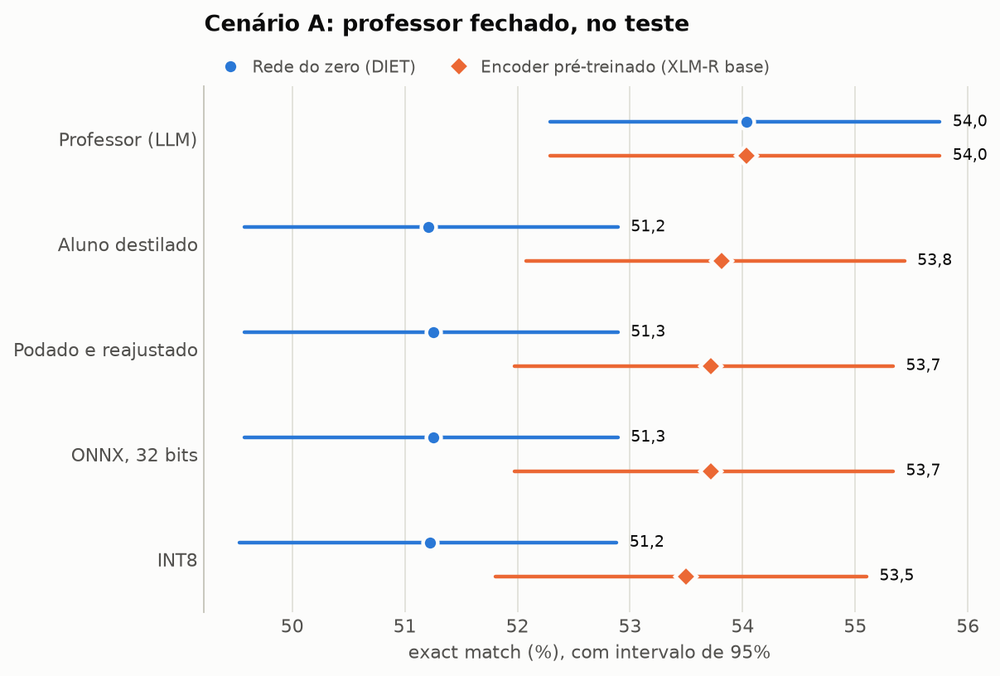

**Encoder pré-treinado (XLM-R base), degrau a degrau**

| Degrau | Sistema | Exact match | Exact match: diferença para o degrau anterior | Acurácia de intenção: diferença para o degrau anterior | F1 de entidades: diferença para o degrau anterior | Tamanho em disco | Latência p50 | Onde |
|---|---|---|---|---|---|---|---|---|
| Professor (LLM) | Claude Haiku 5.5 | 54,0 (52,3 a 55,7) | — | — | — | não divulgado | 854 ms | API pela rede |
| Aluno destilado | XLM-R · Aluno A | 53,8 (52,1 a 55,4) | −0,2 (−1,6 a +1,0) | −0,8 (−1,8 a +0,2) | −0,5 (−1,7 a +0,7) | 1,1 GB | 35,82 ms | CPU local |
| Podado e reajustado | XLM-R · Aluno A, podado | 53,7 (52,0 a 55,3) | −0,09 (−0,63 a +0,44) | +0,2 (−0,2 a +0,6) | −0,4 (−0,9 a +0,0) | 359,0 MB | 36,10 ms | CPU local |
| ONNX, 32 bits | XLM-R · Aluno A, ONNX 32 bits | 53,7 (52,0 a 55,3) | +0,00 (+0,00 a +0,00) | +0,00 (+0,00 a +0,00) | +0,00 (+0,00 a +0,00) | 358,9 MB | 25,08 ms | CPU local |
| INT8 | XLM-R · Aluno A, INT8 | 53,5 (51,8 a 55,1) | −0,2 (−0,6 a +0,2) | −0,4 (−0,8 a −0,1) | +0,03 (−0,36 a +0,44) | 90,7 MB | 8,35 ms | CPU local |

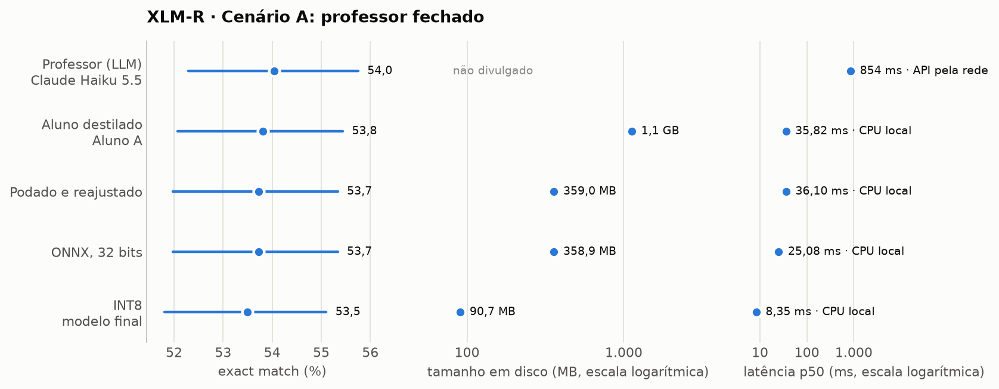

- **Destilação.** O aluno fica sem diferença distinguível para o professor em exact match: −0,2 (−1,6 a +1,0) no teste e −0,4 (−2,0 a +1,4) em `dev`. A consulta sai de 854 ms (API pela rede) para 35,82 ms (CPU local, 1 thread), e o sistema passa a ser um arquivo de 1,1 GB.
- **Poda e reajuste.** Logo depois do corte, sem reajuste, o exact match fica −0,2 (−0,5 a +0,0) em relação ao modelo sem poda; o reajuste muda +0,1 (−0,3 a +0,6) (Etapa 10b). Depois do reajuste, o modelo podado fica sem diferença distinguível em relação ao modelo sem poda: −0,09 (−0,63 a +0,44) no teste e −0,4 (−1,0 a +0,3) em `dev`. O arquivo vai de 1,1 GB para 359,0 MB (3,1 vezes menos); a latência não muda (35,82 ms e 36,10 ms).
- **Exportação.** Sair do PyTorch não muda nenhuma resposta (+0,00 (+0,00 a +0,00)) e leva a consulta de 36,10 ms para 25,08 ms (1,4 vezes menos).
- **8 bits.** Passar para INT8 muda o exact match em −0,22 (−0,64 a +0,21) (sem diferença distinguível); acurácia de intenção abaixo (−0,44 (−0,77 a −0,10) no teste, −0,41 (−0,79 a −0,03) em `dev`); F1 de entidades sem diferença distinguível (+0,03 (−0,36 a +0,44) no teste, +0,05 (−0,39 a +0,50) em `dev`). O arquivo vai de 358,9 MB para 90,7 MB (4,0 vezes menos) e a consulta, de 25,08 ms para 8,35 ms (3,0 vezes menos).

**Rede do zero (DIET), degrau a degrau** (os números são os da Etapa 9)

| Degrau | Sistema | Exact match | Exact match: diferença para o degrau anterior | Acurácia de intenção: diferença para o degrau anterior | F1 de entidades: diferença para o degrau anterior | Tamanho em disco | Latência p50 | Onde |
|---|---|---|---|---|---|---|---|---|
| Professor (LLM) | Claude Haiku 5.5 | 54,0 (52,3 a 55,7) | — | — | — | não divulgado | 854 ms | API pela rede |
| Aluno destilado | Do zero · Aluno A | 51,2 (49,6 a 52,9) | −2,8 (−4,3 a −1,5) | −2,7 (−3,9 a −1,7) | −1,2 (−2,5 a −0,0) | 19,9 MB | 1,11 ms | CPU local |
| Podado e reajustado | Do zero · Aluno A, podado | 51,3 (49,6 a 52,9) | +0,04 (−0,76 a +0,89) | −0,5 (−1,2 a +0,2) | −0,00 (−0,71 a +0,66) | 8,06 MB | 1,10 ms | CPU local |
| ONNX, 32 bits | Do zero · Aluno A, ONNX 32 bits | 51,3 (49,6 a 52,9) | +0,00 (+0,00 a +0,00) | +0,00 (+0,00 a +0,00) | +0,00 (+0,00 a +0,00) | 7,98 MB | 0,43 ms | CPU local |
| INT8 | Do zero · Aluno A, INT8 | 51,2 (49,5 a 52,9) | −0,03 (−0,16 a +0,08) | −0,01 (−0,10 a +0,08) | +0,06 (−0,03 a +0,16) | 2,11 MB | 0,26 ms | CPU local |

- **Destilação.** O aluno fica abaixo do professor em exact match: −2,8 (−4,3 a −1,5) no teste e −2,7 (−4,5 a −1,0) em `dev`. A consulta sai de 854 ms (API pela rede) para 1,11 ms (CPU local, 1 thread), e o sistema passa a ser um arquivo de 19,9 MB.
- **Poda e reajuste.** Logo depois do corte, sem reajuste, o exact match fica −9,8 (−11,0 a −8,7) em relação ao modelo sem poda; o reajuste muda +9,9 (+8,8 a +11,0) (Etapa 7). Depois do reajuste, o modelo podado fica sem diferença distinguível em relação ao modelo sem poda: +0,04 (−0,76 a +0,89) no teste e −0,4 (−1,4 a +0,6) em `dev`. O arquivo vai de 19,9 MB para 8,06 MB (2,5 vezes menos); a latência não muda (1,11 ms e 1,10 ms).
- **Exportação.** Sair do PyTorch não muda nenhuma resposta (+0,00 (+0,00 a +0,00)) e leva a consulta de 1,10 ms para 0,43 ms (2,6 vezes menos).
- **8 bits.** Passar para INT8 muda o exact match em −0,03 (−0,16 a +0,08) (sem diferença distinguível); acurácia de intenção sem diferença distinguível (−0,01 (−0,10 a +0,08) no teste, +0,00 (−0,08 a +0,08) em `dev`); F1 de entidades sem diferença distinguível (+0,06 (−0,03 a +0,16) no teste, −0,03 (−0,15 a +0,10) em `dev`). O arquivo vai de 7,98 MB para 2,11 MB (3,8 vezes menos) e a consulta, de 0,43 ms para 0,26 ms (1,6 vezes menos).

### Cenário B: professor aberto

| Degrau | Do zero: exact match | Do zero: diferença para o anterior | Do zero: tamanho | Do zero: latência p50 | XLM-R: exact match | XLM-R: diferença para o anterior | XLM-R: tamanho | XLM-R: latência p50 |
|---|---|---|---|---|---|---|---|---|
| Professor (LLM) | 43,2 (41,5 a 45,0) | — | 16,4 GB | 1.087 ms | 43,2 (41,5 a 45,0) | — | 16,4 GB | 1.087 ms |
| Aluno destilado | 46,0 (44,2 a 47,6) | +2,7 (+1,2 a +4,3) | 19,9 MB | 1,11 ms | 46,3 (44,6 a 48,0) | +3,0 (+1,7 a +4,3) | 1,1 GB | 37,58 ms |
| Podado e reajustado | 46,2 (44,5 a 47,9) | +0,2 (−0,7 a +1,2) | 8,06 MB | 1,10 ms | 45,2 (43,5 a 47,0) | −1,0 (−1,4 a −0,6) | 359,0 MB | 36,80 ms |
| ONNX, 32 bits | 46,2 (44,5 a 47,9) | +0,00 (+0,00 a +0,00) | 7,98 MB | 0,42 ms | 45,2 (43,5 a 47,0) | +0,00 (+0,00 a +0,00) | 358,9 MB | 24,33 ms |
| INT8 | 46,2 (44,5 a 47,9) | +0,01 (−0,15 a +0,16) | 2,11 MB | 0,26 ms | 45,2 (43,5 a 46,9) | −0,04 (−0,50 a +0,39) | 90,7 MB | 7,94 ms |

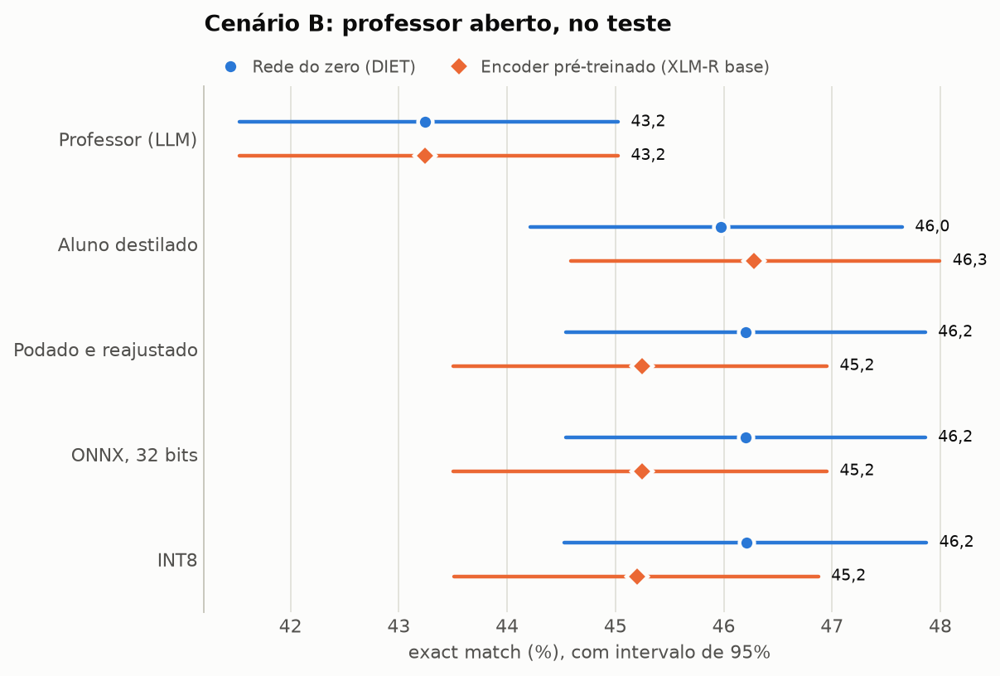

**Encoder pré-treinado (XLM-R base), degrau a degrau**

| Degrau | Sistema | Exact match | Exact match: diferença para o degrau anterior | Acurácia de intenção: diferença para o degrau anterior | F1 de entidades: diferença para o degrau anterior | Tamanho em disco | Latência p50 | Onde |
|---|---|---|---|---|---|---|---|---|
| Professor (LLM) | Qwen3-8B | 43,2 (41,5 a 45,0) | — | — | — | 16,4 GB | 1.087 ms | GPU local |
| Aluno destilado | XLM-R · Aluno B2 | 46,3 (44,6 a 48,0) | +3,0 (+1,7 a +4,3) | +1,3 (+0,2 a +2,4) | +3,1 (+1,9 a +4,5) | 1,1 GB | 37,58 ms | CPU local |
| Podado e reajustado | XLM-R · Aluno B2, podado | 45,2 (43,5 a 47,0) | −1,0 (−1,4 a −0,6) | −0,5 (−0,9 a −0,2) | −0,9 (−1,4 a −0,5) | 359,0 MB | 36,80 ms | CPU local |
| ONNX, 32 bits | XLM-R · Aluno B2, ONNX 32 bits | 45,2 (43,5 a 47,0) | +0,00 (+0,00 a +0,00) | +0,00 (+0,00 a +0,00) | +0,00 (+0,00 a +0,00) | 358,9 MB | 24,33 ms | CPU local |
| INT8 | XLM-R · Aluno B2, INT8 | 45,2 (43,5 a 46,9) | −0,04 (−0,50 a +0,39) | −0,2 (−0,5 a +0,2) | −0,2 (−0,7 a +0,2) | 90,7 MB | 7,94 ms | CPU local |

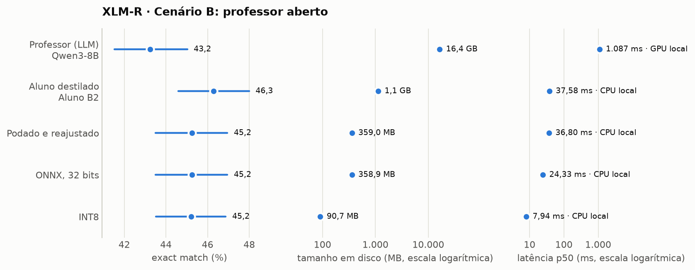

- **Destilação.** O aluno fica acima do professor em exact match: +3,0 (+1,7 a +4,3) no teste e +4,1 (+2,5 a +5,7) em `dev`. A consulta sai de 1.087 ms (GPU local) para 37,58 ms (CPU local, 1 thread), e o sistema passa a ser um arquivo de 1,1 GB.
- **Poda e reajuste.** Logo depois do corte, sem reajuste, o exact match fica −0,1 (−0,4 a +0,2) em relação ao modelo sem poda; o reajuste muda −0,9 (−1,2 a −0,6) (Etapa 10b). Depois do reajuste, o modelo podado fica abaixo em relação ao modelo sem poda: −1,0 (−1,4 a −0,6) no teste e −0,4 (−0,9 a +0,0) em `dev`. O arquivo vai de 1,1 GB para 359,0 MB (3,1 vezes menos); a latência não muda (37,58 ms e 36,80 ms).
- **Exportação.** Sair do PyTorch não muda nenhuma resposta (+0,00 (+0,00 a +0,00)) e leva a consulta de 36,80 ms para 24,33 ms (1,5 vezes menos).
- **8 bits.** Passar para INT8 muda o exact match em −0,04 (−0,50 a +0,39) (sem diferença distinguível); acurácia de intenção sem diferença distinguível (−0,18 (−0,54 a +0,16) no teste, −0,30 (−0,71 a +0,13) em `dev`); F1 de entidades sem diferença distinguível (−0,22 (−0,68 a +0,23) no teste, −0,16 (−0,66 a +0,37) em `dev`). O arquivo vai de 358,9 MB para 90,7 MB (4,0 vezes menos) e a consulta, de 24,33 ms para 7,94 ms (3,1 vezes menos).

**Rede do zero (DIET), degrau a degrau** (os números são os da Etapa 9)

| Degrau | Sistema | Exact match | Exact match: diferença para o degrau anterior | Acurácia de intenção: diferença para o degrau anterior | F1 de entidades: diferença para o degrau anterior | Tamanho em disco | Latência p50 | Onde |
|---|---|---|---|---|---|---|---|---|
| Professor (LLM) | Qwen3-8B | 43,2 (41,5 a 45,0) | — | — | — | 16,4 GB | 1.087 ms | GPU local |
| Aluno destilado | Do zero · Aluno B2 | 46,0 (44,2 a 47,6) | +2,7 (+1,2 a +4,3) | +0,2 (−1,0 a +1,3) | +2,3 (+0,8 a +3,9) | 19,9 MB | 1,11 ms | CPU local |
| Podado e reajustado | Do zero · Aluno B2, podado | 46,2 (44,5 a 47,9) | +0,2 (−0,7 a +1,2) | −0,01 (−0,78 a +0,83) | +0,01 (−0,90 a +0,93) | 8,06 MB | 1,10 ms | CPU local |
| ONNX, 32 bits | Do zero · Aluno B2, ONNX 32 bits | 46,2 (44,5 a 47,9) | +0,00 (+0,00 a +0,00) | +0,00 (+0,00 a +0,00) | +0,00 (+0,00 a +0,00) | 7,98 MB | 0,42 ms | CPU local |
| INT8 | Do zero · Aluno B2, INT8 | 46,2 (44,5 a 47,9) | +0,01 (−0,15 a +0,16) | −0,02 (−0,12 a +0,08) | −0,05 (−0,20 a +0,09) | 2,11 MB | 0,26 ms | CPU local |

- **Destilação.** O aluno fica acima do professor em exact match: +2,7 (+1,2 a +4,3) no teste e +3,7 (+1,9 a +5,5) em `dev`. A consulta sai de 1.087 ms (GPU local) para 1,11 ms (CPU local, 1 thread), e o sistema passa a ser um arquivo de 19,9 MB.
- **Poda e reajuste.** Logo depois do corte, sem reajuste, o exact match fica −10,3 (−11,6 a −9,1) em relação ao modelo sem poda; o reajuste muda +10,5 (+9,5 a +11,6) (Etapa 7). Depois do reajuste, o modelo podado fica sem diferença distinguível em relação ao modelo sem poda: +0,2 (−0,7 a +1,2) no teste e −0,03 (−1,13 a +1,05) em `dev`. O arquivo vai de 19,9 MB para 8,06 MB (2,5 vezes menos); a latência não muda (1,11 ms e 1,10 ms).
- **Exportação.** Sair do PyTorch não muda nenhuma resposta (+0,00 (+0,00 a +0,00)) e leva a consulta de 1,10 ms para 0,42 ms (2,6 vezes menos).
- **8 bits.** Passar para INT8 muda o exact match em +0,01 (−0,15 a +0,16) (sem diferença distinguível); acurácia de intenção sem diferença distinguível (−0,02 (−0,12 a +0,08) no teste, +0,08 (−0,05 a +0,21) em `dev`); F1 de entidades sem diferença distinguível (−0,05 (−0,20 a +0,09) no teste, −0,02 (−0,20 a +0,15) em `dev`). O arquivo vai de 7,98 MB para 2,11 MB (3,8 vezes menos) e a consulta, de 0,42 ms para 0,26 ms (1,6 vezes menos).

### Referência: teto (rótulos humanos)

| Degrau | Do zero: exact match | Do zero: diferença para o anterior | Do zero: tamanho | Do zero: latência p50 | XLM-R: exact match | XLM-R: diferença para o anterior | XLM-R: tamanho | XLM-R: latência p50 |
|---|---|---|---|---|---|---|---|---|
| Sem compressão | 62,5 (60,8 a 64,1) | — | 19,9 MB | 1,10 ms | 66,3 (64,7 a 67,9) | — | 1,1 GB | 37,06 ms |
| Podado e reajustado | 61,3 (59,6 a 62,9) | −1,2 (−2,1 a −0,3) | 8,06 MB | 1,10 ms | 65,8 (64,2 a 67,4) | −0,4 (−0,9 a +0,1) | 359,0 MB | 37,54 ms |
| ONNX, 32 bits | 61,3 (59,6 a 62,9) | +0,00 (+0,00 a +0,00) | 7,98 MB | 0,43 ms | 65,8 (64,2 a 67,4) | +0,00 (+0,00 a +0,00) | 358,9 MB | 25,35 ms |
| INT8 | 61,3 (59,7 a 62,9) | −0,01 (−0,17 a +0,15) | 2,11 MB | 0,26 ms | 65,7 (64,1 a 67,2) | −0,2 (−0,7 a +0,3) | 90,7 MB | 8,50 ms |

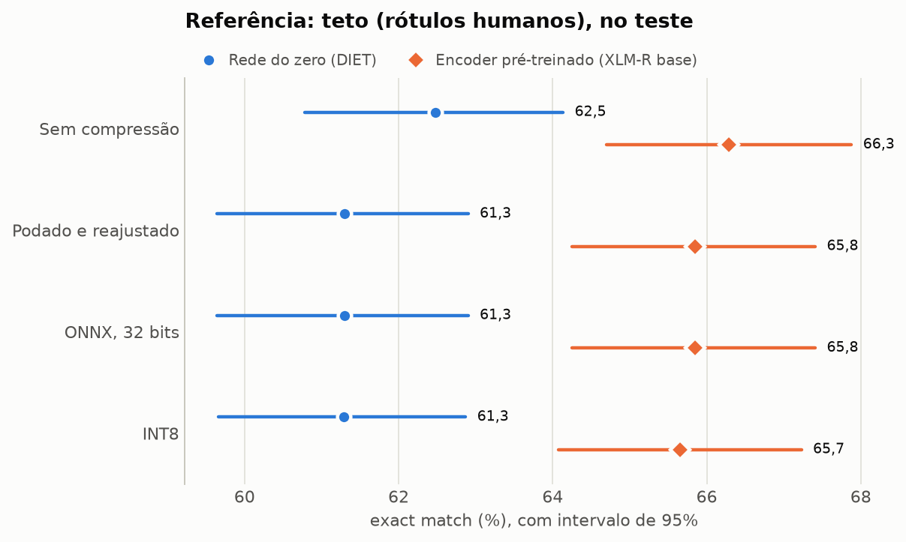

**Encoder pré-treinado (XLM-R base), degrau a degrau**

| Degrau | Sistema | Exact match | Exact match: diferença para o degrau anterior | Acurácia de intenção: diferença para o degrau anterior | F1 de entidades: diferença para o degrau anterior | Tamanho em disco | Latência p50 | Onde |
|---|---|---|---|---|---|---|---|---|
| Sem compressão | XLM-R · Teto | 66,3 (64,7 a 67,9) | — | — | — | 1,1 GB | 37,06 ms | CPU local |
| Podado e reajustado | XLM-R · Teto, podado | 65,8 (64,2 a 67,4) | −0,4 (−0,9 a +0,1) | −0,3 (−0,6 a +0,1) | −0,6 (−1,1 a −0,2) | 359,0 MB | 37,54 ms | CPU local |
| ONNX, 32 bits | XLM-R · Teto, ONNX 32 bits | 65,8 (64,2 a 67,4) | +0,00 (+0,00 a +0,00) | +0,00 (+0,00 a +0,00) | +0,00 (+0,00 a +0,00) | 358,9 MB | 25,35 ms | CPU local |
| INT8 | XLM-R · Teto, INT8 | 65,7 (64,1 a 67,2) | −0,2 (−0,7 a +0,3) | −0,4 (−0,7 a −0,0) | −0,3 (−0,8 a +0,1) | 90,7 MB | 8,50 ms | CPU local |

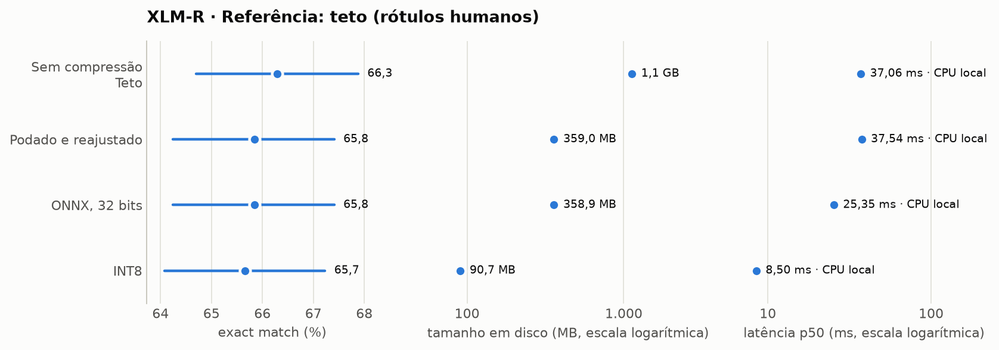

- **Poda e reajuste.** Logo depois do corte, sem reajuste, o exact match fica −0,4 (−0,8 a −0,1) em relação ao modelo sem poda; o reajuste muda +0,0 (−0,3 a +0,4) (Etapa 10b). Depois do reajuste, o modelo podado fica sem diferença distinguível em relação ao modelo sem poda: −0,4 (−0,9 a +0,1) no teste e −0,15 (−0,71 a +0,38) em `dev`. O arquivo vai de 1,1 GB para 359,0 MB (3,1 vezes menos); a latência não muda (37,06 ms e 37,54 ms).
- **Exportação.** Sair do PyTorch não muda nenhuma resposta (+0,00 (+0,00 a +0,00)) e leva a consulta de 37,54 ms para 25,35 ms (1,5 vezes menos).
- **8 bits.** Passar para INT8 muda o exact match em −0,19 (−0,71 a +0,33) (sem diferença distinguível); acurácia de intenção abaixo (−0,36 (−0,72 a −0,01) no teste, −0,46 (−0,95 a +0,00) em `dev`); F1 de entidades sem diferença distinguível (−0,31 (−0,80 a +0,12) no teste, −0,20 (−0,72 a +0,34) em `dev`). O arquivo vai de 358,9 MB para 90,7 MB (4,0 vezes menos) e a consulta, de 25,35 ms para 8,50 ms (3,0 vezes menos).

**Rede do zero (DIET), degrau a degrau** (os números são os da Etapa 9)

| Degrau | Sistema | Exact match | Exact match: diferença para o degrau anterior | Acurácia de intenção: diferença para o degrau anterior | F1 de entidades: diferença para o degrau anterior | Tamanho em disco | Latência p50 | Onde |
|---|---|---|---|---|---|---|---|---|
| Sem compressão | Do zero · Teto | 62,5 (60,8 a 64,1) | — | — | — | 19,9 MB | 1,10 ms | CPU local |
| Podado e reajustado | Do zero · Teto, podado | 61,3 (59,6 a 62,9) | −1,2 (−2,1 a −0,3) | −1,0 (−1,8 a −0,2) | −0,12 (−0,88 a +0,63) | 8,06 MB | 1,10 ms | CPU local |
| ONNX, 32 bits | Do zero · Teto, ONNX 32 bits | 61,3 (59,6 a 62,9) | +0,00 (+0,00 a +0,00) | +0,00 (+0,00 a +0,00) | +0,00 (+0,00 a +0,00) | 7,98 MB | 0,43 ms | CPU local |
| INT8 | Do zero · Teto, INT8 | 61,3 (59,7 a 62,9) | −0,01 (−0,17 a +0,15) | −0,06 (−0,18 a +0,07) | −0,05 (−0,17 a +0,09) | 2,11 MB | 0,26 ms | CPU local |

- **Poda e reajuste.** Logo depois do corte, sem reajuste, o exact match fica −14,1 (−15,3 a −12,7) em relação ao modelo sem poda; o reajuste muda +12,9 (+11,7 a +14,1) (Etapa 7). Depois do reajuste, o modelo podado fica abaixo em relação ao modelo sem poda: −1,2 (−2,1 a −0,3) no teste e −0,8 (−2,0 a +0,2) em `dev`. O arquivo vai de 19,9 MB para 8,06 MB (2,5 vezes menos); a latência não muda (1,10 ms e 1,10 ms).
- **Exportação.** Sair do PyTorch não muda nenhuma resposta (+0,00 (+0,00 a +0,00)) e leva a consulta de 1,10 ms para 0,43 ms (2,6 vezes menos).
- **8 bits.** Passar para INT8 muda o exact match em −0,01 (−0,17 a +0,15) (sem diferença distinguível); acurácia de intenção sem diferença distinguível (−0,06 (−0,18 a +0,07) no teste, +0,08 (−0,03 a +0,20) em `dev`); F1 de entidades sem diferença distinguível (−0,05 (−0,17 a +0,09) no teste, −0,01 (−0,13 a +0,11) em `dev`). O arquivo vai de 7,98 MB para 2,11 MB (3,8 vezes menos) e a consulta, de 0,43 ms para 0,26 ms (1,6 vezes menos).

**Nas seis cadeias.**

- **Rede do zero (DIET).** De 11 degraus × 3 métricas, 7 diferenças se distinguem de zero no teste: cenário A, aluno destilado, acurácia de intenção (−2,7 (−3,9 a −1,7)); cenário A, aluno destilado, F1 de entidades (−1,2 (−2,5 a −0,0)); cenário A, aluno destilado, exact match (−2,8 (−4,3 a −1,5)); cenário B, aluno destilado, F1 de entidades (+2,3 (+0,8 a +3,9)); cenário B, aluno destilado, exact match (+2,7 (+1,2 a +4,3)); teto, podado e reajustado, acurácia de intenção (−1,0 (−1,8 a −0,2)); teto, podado e reajustado, exact match (−1,2 (−2,1 a −0,3)). Nos dois cenários, a única mudança de qualidade que se distingue de zero é a da destilação; nenhum degrau de compressão se distingue (é a leitura da Etapa 9).
- **Encoder pré-treinado (XLM-R base).** De 11 degraus × 3 métricas, 9 se distinguem de zero no teste: cenário A, INT8, acurácia de intenção (−0,4 (−0,8 a −0,1)); cenário B, aluno destilado, acurácia de intenção (+1,3 (+0,2 a +2,4)); cenário B, aluno destilado, F1 de entidades (+3,1 (+1,9 a +4,5)); cenário B, aluno destilado, exact match (+3,0 (+1,7 a +4,3)); cenário B, podado e reajustado, acurácia de intenção (−0,5 (−0,9 a −0,2)); cenário B, podado e reajustado, F1 de entidades (−0,9 (−1,4 a −0,5)); cenário B, podado e reajustado, exact match (−1,0 (−1,4 a −0,6)); teto, podado e reajustado, F1 de entidades (−0,6 (−1,1 a −0,2)); teto, INT8, acurácia de intenção (−0,4 (−0,7 a −0,0)). Aqui a compressão não é neutra em todos os degraus: 6 das diferenças distinguíveis estão em degraus de compressão.
- **`dev` e teste.** As diferenças que se distinguem de zero nas duas partições ao mesmo tempo são 5 na rede do zero e 5 no XLM-R (no XLM-R: cenário A, INT8, acurácia de intenção; cenário B, aluno destilado, exact match; cenário B, aluno destilado, acurácia de intenção; cenário B, aluno destilado, F1 de entidades; cenário B, podado e reajustado, acurácia de intenção). São 66 intervalos por partição, sem correção: cerca de 3,3 sairia do zero só por acaso.
- **O custo.** Nos dois caminhos a poda diminui o arquivo e não muda a latência, a exportação diminui a latência, e os 8 bits diminuem os dois. O que muda é a proporção: na rede do zero a exportação rende mais que os 8 bits; no XLM-R, o contrário (Etapa 10c).

## Os dois caminhos no mesmo ponto

XLM-R menos rede do zero, o mesmo modelo no mesmo ponto da cadeia. Diferença pareada, em pontos percentuais (intervalo de 95%).

**No teste**

| Ponto (XLM-R − rede do zero) | Acurácia de intenção | F1 de entidades | Exact match | Exact match: do zero → XLM-R |
|---|---|---|---|---|
| Teto | +2,5 (+1,7 a +3,4) | +1,9 (+0,8 a +2,9) | +3,8 (+2,7 a +5,0) | 62,5 → 66,3 |
| Teto, podado | +3,3 (+2,4 a +4,1) | +1,4 (+0,4 a +2,4) | +4,6 (+3,4 a +5,7) | 61,3 → 65,8 |
| Teto, INT8 | +2,9 (+2,1 a +3,8) | +1,1 (+0,0 a +2,2) | +4,4 (+3,2 a +5,5) | 61,3 → 65,7 |
| Piso | +14,6 (+13,3 a +15,9) | +12,0 (+10,6 a +13,5) | +11,7 (+10,6 a +13,0) | 20,9 → 32,6 |
| Aluno A | +1,9 (+1,1 a +2,8) | +0,7 (−0,3 a +1,7) | +2,6 (+1,6 a +3,7) | 51,2 → 53,8 |
| Aluno A, podado | +2,7 (+1,8 a +3,5) | +0,3 (−0,7 a +1,2) | +2,5 (+1,4 a +3,5) | 51,3 → 53,7 |
| Aluno A, INT8 (os dois modelos finais) | +2,2 (+1,4 a +3,1) | +0,3 (−0,6 a +1,1) | +2,3 (+1,3 a +3,3) | 51,2 → 53,5 |
| Aluno B1 | +2,4 (+1,5 a +3,4) | +1,4 (+0,3 a +2,4) | +2,1 (+1,0 a +3,1) | 43,6 → 45,7 |
| Aluno B2 | +1,1 (+0,2 a +2,1) | +0,8 (−0,3 a +1,9) | +0,3 (−0,9 a +1,4) | 46,0 → 46,3 |
| Aluno B2, podado | +0,6 (−0,3 a +1,5) | −0,2 (−1,2 a +1,0) | −1,0 (−2,1 a +0,1) | 46,2 → 45,2 |
| Aluno B2, INT8 | +0,4 (−0,4 a +1,3) | −0,3 (−1,4 a +0,8) | −1,0 (−2,1 a +0,1) | 46,2 → 45,2 |

**Em dev**

| Ponto (XLM-R − rede do zero) | Acurácia de intenção | F1 de entidades | Exact match | Exact match: do zero → XLM-R |
|---|---|---|---|---|
| Teto | +3,0 (+1,9 a +4,1) | +1,5 (+0,2 a +2,7) | +4,2 (+2,8 a +5,6) | 62,6 → 66,8 |
| Teto, podado | +3,4 (+2,4 a +4,5) | +1,6 (+0,5 a +2,8) | +4,9 (+3,6 a +6,2) | 61,8 → 66,7 |
| Teto, INT8 | +2,9 (+1,9 a +3,9) | +1,4 (+0,3 a +2,6) | +4,2 (+2,9 a +5,5) | 61,8 → 66,0 |
| Piso | +14,5 (+12,9 a +16,1) | +10,8 (+9,1 a +12,5) | +10,9 (+9,4 a +12,3) | 22,1 → 33,0 |
| Aluno A | +1,5 (+0,5 a +2,6) | +0,6 (−0,5 a +1,7) | +2,3 (+1,1 a +3,7) | 52,0 → 54,4 |
| Aluno A, podado | +1,8 (+0,9 a +2,7) | +0,8 (−0,1 a +1,9) | +2,4 (+1,2 a +3,6) | 51,6 → 54,0 |
| Aluno A, INT8 (os dois modelos finais) | +1,4 (+0,4 a +2,4) | +0,9 (−0,1 a +2,0) | +2,3 (+1,2 a +3,6) | 51,7 → 54,0 |
| Aluno B1 | +1,8 (+0,7 a +3,0) | +1,6 (+0,3 a +2,8) | +1,6 (+0,2 a +2,9) | 45,2 → 46,7 |
| Aluno B2 | +1,6 (+0,4 a +2,7) | +0,9 (−0,4 a +2,2) | +0,4 (−1,1 a +1,8) | 46,9 → 47,3 |
| Aluno B2, podado | +0,7 (−0,4 a +1,8) | +0,6 (−0,7 a +2,0) | −0,0 (−1,5 a +1,3) | 46,9 → 46,8 |
| Aluno B2, INT8 | +0,3 (−0,8 a +1,4) | +0,5 (−0,9 a +1,9) | −0,3 (−1,7 a +1,2) | 47,0 → 46,8 |

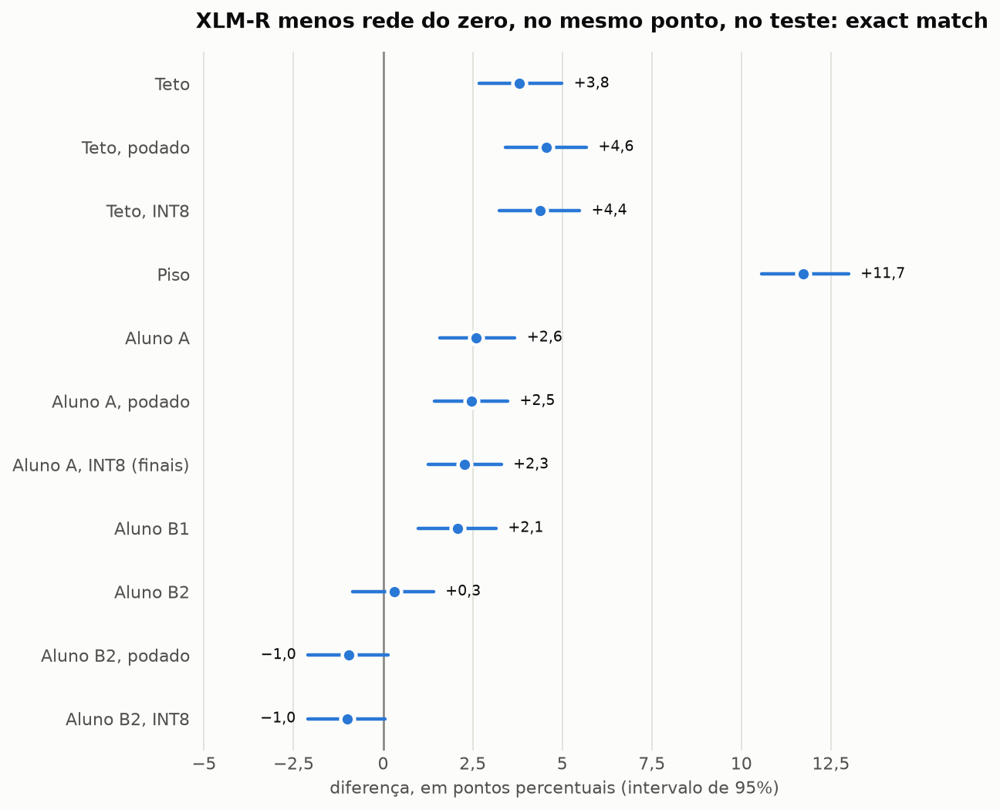

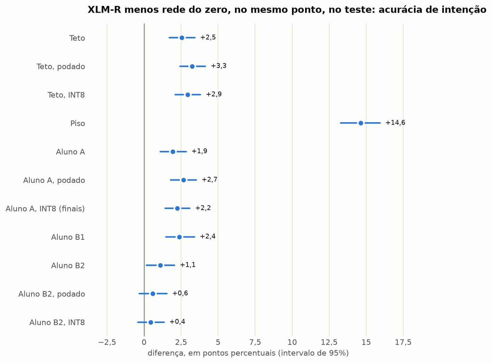

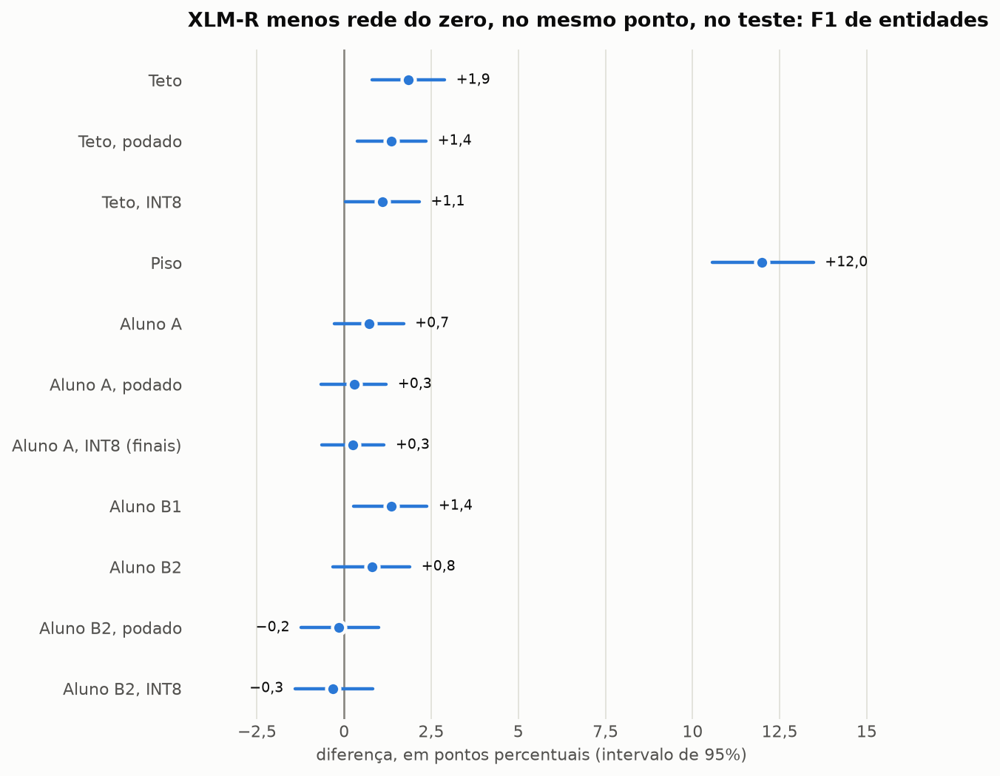

- **Os dois modelos finais.** No teste, o final do XLM-R fica acima em acurácia de intenção (+2,2 (+1,4 a +3,1)); sem diferença distinguível em F1 de entidades (+0,3 (−0,6 a +1,1)); acima em exact match (+2,3 (+1,3 a +3,3)) em relação ao final da rede do zero. Em `dev`: acima em acurácia de intenção (+1,4 (+0,4 a +2,4)); sem diferença distinguível em F1 de entidades (+0,9 (−0,1 a +2,0)); acima em exact match (+2,3 (+1,2 a +3,6)).
- **Em todos os pontos.** Em exact match, no teste, o XLM-R fica acima da rede do zero em 8 dos 11 pontos e abaixo em 0; não se distingue em: Aluno B2; Aluno B2, podado; Aluno B2, INT8. Em acurácia de intenção, acima em 9 e abaixo em 0; em F1 de entidades, acima em 5 e abaixo em 0.
- **Ao longo da cadeia** (exact match, teste). Aluno A: +2,6 (aluno destilado) → +2,5 (podado e reajustado) → +2,3 (INT8). Aluno B2: +0,3 (aluno destilado) → −1,0 (podado e reajustado) → −1,0 (INT8). Teto: +3,8 (sem compressão) → +4,6 (podado e reajustado) → +4,4 (INT8). No aluno A, a diferença se distingue de zero em 3 dos 3 pontos. No aluno B2, a diferença se distingue de zero em 0 dos 3 pontos. No teto, a diferença se distingue de zero em 3 dos 3 pontos. Onde há vantagem do XLM-R, ela já está no modelo sem poda e chega até o INT8; onde não há no modelo sem poda (aluno B2), a compressão não cria.
- **`dev` e teste.** Das 33 comparações (ponto × métrica), `dev` e teste dizem o mesmo em 33.
- São 33 intervalos por partição, sem correção: cerca de 1,7 sairia do zero só por acaso. As primárias são as três do modelo final.

## Cada aluno contra o seu professor

**No teste**

| Aluno − professor | Acurácia de intenção | F1 de entidades | Exact match |
|---|---|---|---|
| Do zero · Aluno A − Claude Haiku 5.5 | −2,7 (−3,9 a −1,7) | −1,2 (−2,5 a −0,0) | −2,8 (−4,3 a −1,5) |
| Do zero · Aluno B1 − Qwen3-8B | −1,3 (−2,5 a −0,1) | +1,4 (+0,1 a +2,9) | +0,4 (−1,0 a +1,7) |
| Do zero · Aluno B2 − Qwen3-8B | +0,2 (−1,0 a +1,3) | +2,3 (+0,8 a +3,9) | +2,7 (+1,2 a +4,3) |
| Do zero · Aluno A, INT8 − Claude Haiku 5.5 | −3,3 (−4,4 a −2,2) | −1,2 (−2,4 a +0,0) | −2,8 (−4,3 a −1,5) |
| Do zero · Aluno B2, INT8 − Qwen3-8B | +0,2 (−1,0 a +1,3) | +2,3 (+0,8 a +3,7) | +3,0 (+1,5 a +4,4) |
| XLM-R · Aluno A − Claude Haiku 5.5 | −0,8 (−1,8 a +0,2) | −0,5 (−1,7 a +0,7) | −0,2 (−1,6 a +1,0) |
| XLM-R · Aluno B1 − Qwen3-8B | +1,1 (−0,0 a +2,2) | +2,8 (+1,5 a +4,2) | +2,5 (+1,1 a +3,8) |
| XLM-R · Aluno B2 − Qwen3-8B | +1,3 (+0,2 a +2,4) | +3,1 (+1,9 a +4,5) | +3,0 (+1,7 a +4,3) |
| XLM-R · Aluno A, INT8 − Claude Haiku 5.5 | −1,0 (−2,0 a −0,1) | −0,9 (−2,1 a +0,2) | −0,5 (−1,9 a +0,7) |
| XLM-R · Aluno B2, INT8 − Qwen3-8B | +0,6 (−0,4 a +1,7) | +2,0 (+0,7 a +3,2) | +2,0 (+0,6 a +3,3) |

**Em dev**

| Aluno − professor | Acurácia de intenção | F1 de entidades | Exact match |
|---|---|---|---|
| Do zero · Aluno A − Claude Haiku 5.5 | −2,5 (−3,8 a −1,3) | −1,5 (−3,0 a −0,1) | −2,7 (−4,5 a −1,0) |
| Do zero · Aluno B1 − Qwen3-8B | −0,2 (−1,7 a +1,2) | +2,0 (+0,4 a +3,6) | +2,0 (+0,3 a +3,7) |
| Do zero · Aluno B2 − Qwen3-8B | +0,9 (−0,6 a +2,3) | +2,5 (+0,9 a +4,2) | +3,7 (+1,9 a +5,5) |
| Do zero · Aluno A, INT8 − Claude Haiku 5.5 | −2,7 (−3,9 a −1,4) | −1,6 (−3,1 a −0,2) | −3,0 (−4,8 a −1,3) |
| Do zero · Aluno B2, INT8 − Qwen3-8B | +1,4 (+0,0 a +2,8) | +2,6 (+0,9 a +4,3) | +3,8 (+2,0 a +5,6) |
| XLM-R · Aluno A − Claude Haiku 5.5 | −1,0 (−2,2 a +0,1) | −0,9 (−2,3 a +0,4) | −0,4 (−2,0 a +1,4) |
| XLM-R · Aluno B1 − Qwen3-8B | +1,6 (+0,3 a +2,9) | +3,6 (+2,1 a +5,1) | +3,5 (+1,9 a +5,1) |
| XLM-R · Aluno B2 − Qwen3-8B | +2,4 (+1,1 a +3,7) | +3,4 (+1,9 a +4,9) | +4,1 (+2,5 a +5,7) |
| XLM-R · Aluno A, INT8 − Claude Haiku 5.5 | −1,3 (−2,4 a −0,3) | −0,7 (−2,0 a +0,6) | −0,7 (−2,3 a +0,9) |
| XLM-R · Aluno B2, INT8 − Qwen3-8B | +1,7 (+0,4 a +3,0) | +3,1 (+1,7 a +4,7) | +3,6 (+2,0 a +5,1) |

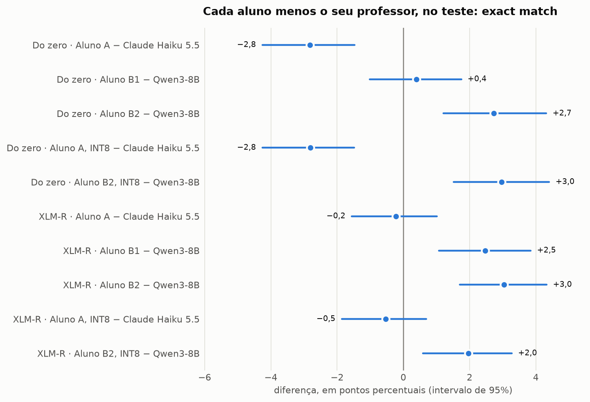

## De ponta a ponta, nos dois caminhos

As dez comparações da Etapa 9, B − A, com os sistemas de cada caminho.

**No teste**

| Comparação (B − A), em cada caminho | Do zero: exact match | XLM-R: exact match | Do zero: acurácia de intenção | XLM-R: acurácia de intenção | Do zero: F1 de entidades | XLM-R: F1 de entidades |
|---|---|---|---|---|---|---|
| a. Final − professor fechado | −2,8 (−4,3 a −1,5) | −0,5 (−1,9 a +0,7) | −3,3 (−4,4 a −2,2) | −1,0 (−2,0 a −0,1) | −1,2 (−2,4 a +0,0) | −0,9 (−2,1 a +0,2) |
| b. Final − aluno A sem compressão | +0,0 (−0,8 a +0,8) | −0,3 (−0,9 a +0,3) | −0,5 (−1,2 a +0,2) | −0,2 (−0,7 a +0,3) | +0,1 (−0,6 a +0,7) | −0,4 (−1,0 a +0,1) |
| c. Final − teto do caminho | −11,3 (−12,8 a −9,8) | −12,8 (−14,2 a −11,4) | −4,2 (−5,3 a −3,2) | −4,5 (−5,5 a −3,6) | −8,8 (−10,1 a −7,4) | −10,4 (−11,7 a −9,1) |
| d. Teto comprimido − teto | −1,2 (−2,2 a −0,3) | −0,6 (−1,3 a −0,0) | −1,0 (−1,8 a −0,3) | −0,6 (−1,1 a −0,2) | −0,2 (−0,9 a +0,6) | −0,9 (−1,5 a −0,4) |
| e1. Final do cenário B − professor aberto | +3,0 (+1,5 a +4,4) | +2,0 (+0,6 a +3,3) | +0,2 (−1,0 a +1,3) | +0,6 (−0,4 a +1,7) | +2,3 (+0,8 a +3,7) | +2,0 (+0,7 a +3,2) |
| e2. Final do cenário B − aluno B2 sem compressão | +0,2 (−0,7 a +1,2) | −1,1 (−1,6 a −0,5) | −0,0 (−0,8 a +0,8) | −0,7 (−1,1 a −0,2) | −0,0 (−1,0 a +0,9) | −1,2 (−1,7 a −0,6) |
| f. Final do cenário A − final do cenário B | +5,0 (+3,8 a +6,3) | +8,3 (+7,0 a +9,6) | +2,4 (+1,4 a +3,3) | +4,2 (+3,3 a +5,1) | +6,9 (+5,8 a +8,1) | +7,5 (+6,3 a +8,7) |
| g1. Final − linha de base, 299 rótulos | +31,8 (+29,9 a +33,5) | +34,1 (+32,1 a +35,8) | +32,4 (+30,6 a +34,2) | +34,6 (+32,7 a +36,5) | +29,3 (+27,4 a +31,2) | +29,6 (+27,6 a +31,5) |
| g2. Final − linha de base, 11.514 rótulos | +6,0 (+4,1 a +7,8) | +8,3 (+6,3 a +10,1) | −4,4 (−5,5 a −3,3) | −2,1 (−3,4 a −0,9) | +17,1 (+15,2 a +19,0) | +17,3 (+15,4 a +19,3) |
| g3. Final − piso do caminho | +30,3 (+28,7 a +31,9) | +20,9 (+19,3 a +22,3) | +40,1 (+38,5 a +41,7) | +27,7 (+26,1 a +29,3) | +24,1 (+22,5 a +25,7) | +12,3 (+11,0 a +13,8) |

**Em dev**

| Comparação (B − A), em cada caminho | Do zero: exact match | XLM-R: exact match | Do zero: acurácia de intenção | XLM-R: acurácia de intenção | Do zero: F1 de entidades | XLM-R: F1 de entidades |
|---|---|---|---|---|---|---|
| a. Final − professor fechado | −3,0 (−4,8 a −1,3) | −0,7 (−2,3 a +0,9) | −2,7 (−3,9 a −1,4) | −1,3 (−2,4 a −0,3) | −1,6 (−3,1 a −0,2) | −0,7 (−2,0 a +0,6) |
| b. Final − aluno A sem compressão | −0,3 (−1,3 a +0,6) | −0,3 (−1,0 a +0,4) | −0,2 (−1,0 a +0,6) | −0,3 (−0,8 a +0,2) | −0,1 (−1,0 a +0,7) | +0,2 (−0,4 a +0,8) |
| c. Final − teto do caminho | −10,9 (−12,6 a −9,1) | −12,8 (−14,4 a −11,1) | −2,5 (−3,6 a −1,5) | −4,2 (−5,3 a −3,2) | −8,9 (−10,5 a −7,3) | −9,5 (−11,1 a −7,9) |
| d. Teto comprimido − teto | −0,8 (−1,9 a +0,3) | −0,8 (−1,5 a −0,1) | −0,3 (−1,2 a +0,6) | −0,4 (−1,0 a +0,1) | −0,2 (−1,2 a +0,6) | −0,3 (−0,9 a +0,3) |
| e1. Final do cenário B − professor aberto | +3,8 (+2,0 a +5,6) | +3,6 (+2,0 a +5,1) | +1,4 (+0,0 a +2,8) | +1,7 (+0,4 a +3,0) | +2,6 (+0,9 a +4,3) | +3,1 (+1,7 a +4,7) |
| e2. Final do cenário B − aluno B2 sem compressão | +0,1 (−1,0 a +1,2) | −0,5 (−1,2 a +0,2) | +0,5 (−0,4 a +1,5) | −0,7 (−1,2 a −0,2) | +0,1 (−1,0 a +1,1) | −0,3 (−1,0 a +0,4) |
| f. Final do cenário A − final do cenário B | +4,7 (+3,1 a +6,2) | +7,3 (+5,7 a +8,8) | +2,6 (+1,6 a +3,6) | +3,7 (+2,6 a +4,7) | +6,3 (+4,8 a +7,6) | +6,7 (+5,4 a +8,0) |
| g1. Final − linha de base, 299 rótulos | +31,5 (+29,3 a +33,9) | +33,8 (+31,7 a +36,1) | +33,0 (+30,9 a +35,1) | +34,4 (+32,2 a +36,4) | +28,9 (+26,6 a +31,0) | +29,8 (+27,6 a +32,1) |
| g2. Final − linha de base, 11.514 rótulos | +6,7 (+4,5 a +9,1) | +9,0 (+6,8 a +11,3) | −3,1 (−4,3 a −1,8) | −1,7 (−3,1 a −0,3) | +17,0 (+14,7 a +19,2) | +17,9 (+15,7 a +20,2) |
| g3. Final − piso do caminho | +29,6 (+27,6 a +31,6) | +21,0 (+19,2 a +22,8) | +40,8 (+38,9 a +42,6) | +27,6 (+25,9 a +29,5) | +22,7 (+20,8 a +24,6) | +12,9 (+11,3 a +14,6) |

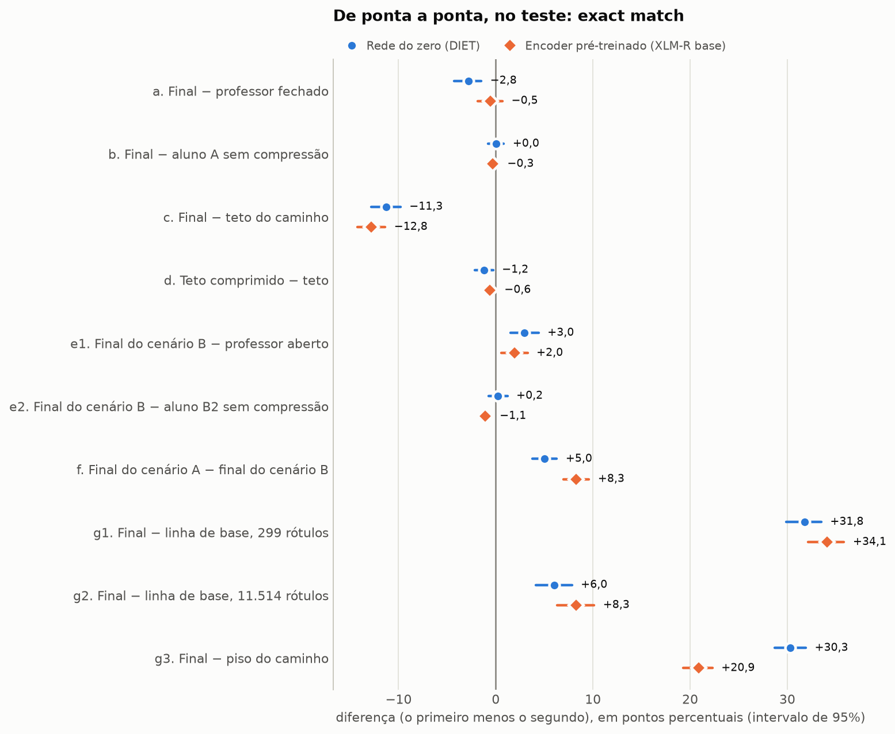

**A poda dentro dos 8 bits** (podado em INT8 menos sem poda em INT8), no teste e em dev:

| Podado em INT8 − sem poda em INT8 | Acurácia de intenção | F1 de entidades | Exact match |
|---|---|---|---|
| Do zero · Aluno A, INT8 − Do zero · Aluno A, INT8 sem poda | −0,5 (−1,2 a +0,2) | +0,1 (−0,6 a +0,7) | −0,1 (−0,9 a +0,8) |
| Do zero · Aluno B2, INT8 − Do zero · Aluno B2, INT8 sem poda | −0,1 (−0,9 a +0,8) | −0,1 (−1,1 a +0,8) | +0,3 (−0,7 a +1,3) |
| Do zero · Teto, INT8 − Do zero · Teto, INT8 sem poda | −1,0 (−1,7 a −0,2) | −0,2 (−0,9 a +0,6) | −1,2 (−2,1 a −0,3) |
| XLM-R · Aluno A, INT8 − XLM-R · Aluno A, INT8 sem poda | −0,4 (−0,8 a +0,1) | −0,5 (−0,9 a −0,0) | −1,0 (−1,6 a −0,5) |
| XLM-R · Aluno B2, INT8 − XLM-R · Aluno B2, INT8 sem poda | −0,8 (−1,1 a −0,4) | −0,9 (−1,3 a −0,5) | −1,4 (−1,9 a −1,0) |
| XLM-R · Teto, INT8 − XLM-R · Teto, INT8 sem poda | −0,4 (−0,8 a −0,1) | −0,3 (−0,8 a +0,1) | −0,5 (−0,9 a +0,0) |

| Podado em INT8 − sem poda em INT8 | Acurácia de intenção | F1 de entidades | Exact match |
|---|---|---|---|
| Do zero · Aluno A, INT8 − Do zero · Aluno A, INT8 sem poda | −0,3 (−1,1 a +0,5) | −0,1 (−0,9 a +0,8) | −0,3 (−1,3 a +0,6) |
| Do zero · Aluno B2, INT8 − Do zero · Aluno B2, INT8 sem poda | +0,6 (−0,4 a +1,5) | +0,1 (−1,0 a +1,1) | +0,0 (−1,1 a +1,1) |
| Do zero · Teto, INT8 − Do zero · Teto, INT8 sem poda | −0,3 (−1,2 a +0,6) | −0,2 (−1,2 a +0,6) | −0,7 (−1,8 a +0,4) |
| XLM-R · Aluno A, INT8 − XLM-R · Aluno A, INT8 sem poda | −0,1 (−0,5 a +0,4) | −0,0 (−0,6 a +0,6) | −0,5 (−1,1 a +0,1) |
| XLM-R · Aluno B2, INT8 − XLM-R · Aluno B2, INT8 sem poda | −0,2 (−0,7 a +0,2) | −0,5 (−1,0 a +0,1) | −0,5 (−1,0 a +0,0) |
| XLM-R · Teto, INT8 − XLM-R · Teto, INT8 sem poda | +0,1 (−0,3 a +0,5) | −0,2 (−0,7 a +0,3) | +0,0 (−0,5 a +0,6) |

- **a. Contra o professor fechado.** O final da rede do zero fica abaixo em acurácia de intenção (−3,3 (−4,4 a −2,2)); sem diferença distinguível em F1 de entidades (−1,2 (−2,4 a +0,0)); abaixo em exact match (−2,8 (−4,3 a −1,5)) em relação ao Claude Haiku 5.5; o do XLM-R, abaixo em acurácia de intenção (−1,0 (−2,0 a −0,1)); sem diferença distinguível em F1 de entidades (−0,9 (−2,1 a +0,2)); sem diferença distinguível em exact match (−0,5 (−1,9 a +0,7)). Em `dev`, em exact match: −3,0 (−4,8 a −1,3) e −0,7 (−2,3 a +0,9).
- **Quem passa o professor** (intervalo todo acima de zero, no teste): Do zero · Aluno B1 em F1 de entidades; Do zero · Aluno B2 em F1 de entidades; Do zero · Aluno B2 em exact match; Do zero · Aluno B2, INT8 em F1 de entidades; Do zero · Aluno B2, INT8 em exact match; XLM-R · Aluno B1 em F1 de entidades; XLM-R · Aluno B1 em exact match; XLM-R · Aluno B2 em acurácia de intenção; XLM-R · Aluno B2 em F1 de entidades; XLM-R · Aluno B2 em exact match; XLM-R · Aluno B2, INT8 em F1 de entidades; XLM-R · Aluno B2, INT8 em exact match. **Quem fica abaixo**: Do zero · Aluno A em acurácia de intenção; Do zero · Aluno A em F1 de entidades; Do zero · Aluno A em exact match; Do zero · Aluno B1 em acurácia de intenção; Do zero · Aluno A, INT8 em acurácia de intenção; Do zero · Aluno A, INT8 em exact match; XLM-R · Aluno A, INT8 em acurácia de intenção.
- **b. O custo de toda a compressão.** Na rede do zero: sem diferença distinguível em acurácia de intenção (−0,5 (−1,2 a +0,2)); sem diferença distinguível em F1 de entidades (+0,1 (−0,6 a +0,7)); sem diferença distinguível em exact match (+0,0 (−0,8 a +0,8)). No XLM-R: sem diferença distinguível em acurácia de intenção (−0,2 (−0,7 a +0,3)); sem diferença distinguível em F1 de entidades (−0,4 (−1,0 a +0,1)); sem diferença distinguível em exact match (−0,3 (−0,9 a +0,3)). Em tamanho, a compressão leva a rede do zero de 19,9 MB para 2,11 MB (9,4 vezes) e o XLM-R de 1,1 GB para 90,7 MB (12,4 vezes); em latência, de 1,11 ms para 0,26 ms (4,2 vezes) e de 35,82 ms para 8,35 ms (4,3 vezes).
- **c. Contra o teto do próprio caminho.** Sem os 11.514 rótulos humanos de treino, o final da rede do zero fica −11,3 (−12,8 a −9,8) em exact match e o do XLM-R, −12,8 (−14,2 a −11,4). Pelos valores medidos, a distância para o teto não diminui com o encoder pré-treinado: o teto sobe tanto quanto o aluno, ou mais. Se as duas distâncias diferem entre si não foi testado.
- **d. A compressão sozinha, no teto.** Rede do zero: −1,2 (−2,2 a −0,3); XLM-R: −0,6 (−1,3 a −0,0) em exact match.
- **e. O cenário B.** O final do cenário B fica +3,0 (+1,5 a +4,4) em relação ao Qwen3-8B na rede do zero e +2,0 (+0,6 a +3,3) no XLM-R; contra o aluno B2 sem compressão, +0,2 (−0,7 a +1,2) e −1,1 (−1,6 a −0,5).
- **f. Um cenário contra o outro.** O final do cenário A menos o do cenário B: +5,0 (+3,8 a +6,3) na rede do zero e +8,3 (+7,0 a +9,6) no XLM-R. Pelos valores medidos, trocar de professor pesa mais que trocar de caminho: as duas distâncias entre cenários são maiores que a distância entre os dois modelos finais (+2,3 (+1,3 a +3,3)).
- **g. Contra as referências.** Contra a linha de base com os mesmos 299 rótulos: +31,8 (+29,9 a +33,5) e +34,1 (+32,1 a +35,8); contra a linha de base com os 11.514: +6,0 (+4,1 a +7,8) e +8,3 (+6,3 a +10,1); contra o piso do próprio caminho: +30,3 (+28,7 a +31,9) e +20,9 (+19,3 a +22,3) (o piso do XLM-R é mais alto: 32,6% contra 20,9%).
- **A poda dentro dos 8 bits.** O final do XLM-R menos o mesmo aluno em INT8 sem poda: sem diferença distinguível em acurácia de intenção (−0,4 (−0,8 a +0,1)); abaixo em F1 de entidades (−0,5 (−0,9 a −0,0)); abaixo em exact match (−1,0 (−1,6 a −0,5)) no teste; em `dev`, −0,5 (−1,1 a +0,1) em exact match. Na rede do zero: −0,1 (−0,9 a +0,8) no teste e −0,3 (−1,3 a +0,6) em `dev`. O INT8 sem poda do XLM-R tem 287,3 MB, contra 90,7 MB do final.
- **Quantas se distinguem.** A lista fechada tem 43 comparações × 3 métricas = 129 intervalos por partição; 87 se distinguem de zero no teste e 77 em `dev`. Sem correção para comparações múltiplas: cerca de 6 sairiam do zero só por acaso. `dev` e teste discordam em 20 dos 129.

## A fronteira e o preço de cada ponto

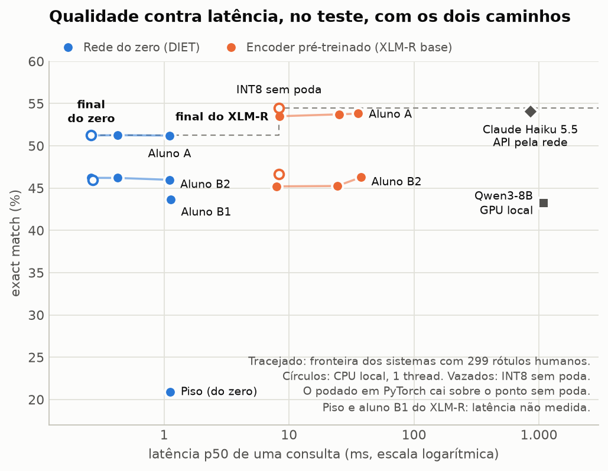

| Sistema | Latência p50 | Exact match | Na fronteira | Dominado por |
|---|---|---|---|---|
| Do zero · Aluno A, INT8 sem poda | 0,26 ms | 51,3 | sim | — |
| Do zero · Aluno B2, INT8 | 0,26 ms | 46,2 | não | Do zero · Aluno A, INT8; Do zero · Aluno A, pesos soltos, INT8 com zip; Do zero · Aluno A, INT8 sem poda |
| Do zero · Aluno A, INT8 | 0,26 ms | 51,2 | não | Do zero · Aluno A, INT8 sem poda |
| Do zero · Aluno A, pesos soltos, INT8 com zip | 0,27 ms | 50,3 | não | Do zero · Aluno A, INT8; Do zero · Aluno A, INT8 sem poda |
| Do zero · Aluno B2, INT8 sem poda | 0,27 ms | 45,9 | não | Do zero · Aluno A, INT8; Do zero · Aluno A, pesos soltos, INT8 com zip; Do zero · Aluno B2, INT8; Do zero · Aluno B2, pesos soltos, INT8 com zip; Do zero · Aluno A, INT8 sem poda |
| Do zero · Aluno B2, pesos soltos, INT8 com zip | 0,27 ms | 46,1 | não | Do zero · Aluno A, INT8; Do zero · Aluno A, pesos soltos, INT8 com zip; Do zero · Aluno B2, INT8; Do zero · Aluno A, INT8 sem poda |
| Do zero · Aluno B2, ONNX 32 bits | 0,42 ms | 46,2 | não | Do zero · Aluno A, ONNX 32 bits; Do zero · Aluno A, INT8; Do zero · Aluno A, pesos soltos, INT8 com zip; Do zero · Aluno B2, INT8; Do zero · Aluno A, INT8 sem poda |
| Do zero · Aluno A, ONNX 32 bits | 0,43 ms | 51,3 | não | Do zero · Aluno A, INT8 sem poda |
| Do zero · Aluno B2, podado | 1,10 ms | 46,2 | não | Do zero · Aluno A; Do zero · Aluno A, podado; Do zero · Aluno A, ONNX 32 bits; Do zero · Aluno A, INT8; Do zero · Aluno A, pesos soltos, INT8 com zip; Do zero · Aluno B2, ONNX 32 bits; Do zero · Aluno B2, INT8; Do zero · Aluno A, INT8 sem poda |
| Do zero · Aluno A, podado | 1,10 ms | 51,3 | não | Do zero · Aluno A, ONNX 32 bits; Do zero · Aluno A, INT8 sem poda |
| Do zero · Aluno A | 1,11 ms | 51,2 | não | Do zero · Aluno A, podado; Do zero · Aluno A, ONNX 32 bits; Do zero · Aluno A, INT8; Do zero · Aluno A, INT8 sem poda |
| Do zero · Aluno B2 | 1,11 ms | 46,0 | não | Do zero · Aluno A; Do zero · Aluno A, podado; Do zero · Aluno A, ONNX 32 bits; Do zero · Aluno A, INT8; Do zero · Aluno A, pesos soltos, INT8 com zip; Do zero · Aluno B2, podado; Do zero · Aluno B2, ONNX 32 bits; Do zero · Aluno B2, INT8; Do zero · Aluno B2, pesos soltos, INT8 com zip; Do zero · Aluno A, INT8 sem poda |
| Do zero · Piso | 1,12 ms | 20,9 | não | Do zero · Aluno A; Do zero · Aluno B1; Do zero · Aluno B2; Do zero · Aluno A, podado; Do zero · Aluno A, ONNX 32 bits; Do zero · Aluno A, INT8; Do zero · Aluno A, pesos soltos, INT8 com zip; Do zero · Aluno B2, podado; Do zero · Aluno B2, ONNX 32 bits; Do zero · Aluno B2, INT8; Do zero · Aluno B2, pesos soltos, INT8 com zip; Do zero · Aluno A, INT8 sem poda; Do zero · Aluno B2, INT8 sem poda |
| Do zero · Aluno B1 | 1,13 ms | 43,6 | não | Do zero · Aluno A; Do zero · Aluno B2; Do zero · Aluno A, podado; Do zero · Aluno A, ONNX 32 bits; Do zero · Aluno A, INT8; Do zero · Aluno A, pesos soltos, INT8 com zip; Do zero · Aluno B2, podado; Do zero · Aluno B2, ONNX 32 bits; Do zero · Aluno B2, INT8; Do zero · Aluno B2, pesos soltos, INT8 com zip; Do zero · Aluno A, INT8 sem poda; Do zero · Aluno B2, INT8 sem poda |
| XLM-R · Aluno B2, INT8 | 7,94 ms | 45,2 | não | Do zero · Aluno A; Do zero · Aluno B2; Do zero · Aluno A, podado; Do zero · Aluno A, ONNX 32 bits; Do zero · Aluno A, INT8; Do zero · Aluno A, pesos soltos, INT8 com zip; Do zero · Aluno B2, podado; Do zero · Aluno B2, ONNX 32 bits; Do zero · Aluno B2, INT8; Do zero · Aluno B2, pesos soltos, INT8 com zip; Do zero · Aluno A, INT8 sem poda; Do zero · Aluno B2, INT8 sem poda; XLM-R · Aluno A, INT8; XLM-R · Aluno A, pesos soltos, INT8 com zip; XLM-R · Aluno A, INT8 sem poda; XLM-R · Aluno B2, pesos soltos, INT8 com zip; XLM-R · Aluno B2, INT8 sem poda |
| XLM-R · Aluno B2, pesos soltos, INT8 com zip | 8,01 ms | 45,7 | não | Do zero · Aluno A; Do zero · Aluno B2; Do zero · Aluno A, podado; Do zero · Aluno A, ONNX 32 bits; Do zero · Aluno A, INT8; Do zero · Aluno A, pesos soltos, INT8 com zip; Do zero · Aluno B2, podado; Do zero · Aluno B2, ONNX 32 bits; Do zero · Aluno B2, INT8; Do zero · Aluno B2, pesos soltos, INT8 com zip; Do zero · Aluno A, INT8 sem poda; Do zero · Aluno B2, INT8 sem poda; XLM-R · Aluno A, INT8; XLM-R · Aluno A, pesos soltos, INT8 com zip; XLM-R · Aluno A, INT8 sem poda; XLM-R · Aluno B2, INT8 sem poda |
| XLM-R · Aluno B2, INT8 sem poda | 8,26 ms | 46,6 | não | Do zero · Aluno A; Do zero · Aluno A, podado; Do zero · Aluno A, ONNX 32 bits; Do zero · Aluno A, INT8; Do zero · Aluno A, pesos soltos, INT8 com zip; Do zero · Aluno A, INT8 sem poda; XLM-R · Aluno A, INT8; XLM-R · Aluno A, pesos soltos, INT8 com zip; XLM-R · Aluno A, INT8 sem poda |
| XLM-R · Aluno A, INT8 sem poda | 8,33 ms | 54,5 | sim | — |
| XLM-R · Aluno A, INT8 | 8,35 ms | 53,5 | não | XLM-R · Aluno A, INT8 sem poda |
| XLM-R · Aluno A, pesos soltos, INT8 com zip | 8,37 ms | 52,9 | não | XLM-R · Aluno A, INT8; XLM-R · Aluno A, INT8 sem poda |
| XLM-R · Aluno B2, ONNX 32 bits | 24,33 ms | 45,2 | não | Do zero · Aluno A; Do zero · Aluno B2; Do zero · Aluno A, podado; Do zero · Aluno A, ONNX 32 bits; Do zero · Aluno A, INT8; Do zero · Aluno A, pesos soltos, INT8 com zip; Do zero · Aluno B2, podado; Do zero · Aluno B2, ONNX 32 bits; Do zero · Aluno B2, INT8; Do zero · Aluno B2, pesos soltos, INT8 com zip; Do zero · Aluno A, INT8 sem poda; Do zero · Aluno B2, INT8 sem poda; XLM-R · Aluno A, ONNX 32 bits; XLM-R · Aluno A, INT8; XLM-R · Aluno A, pesos soltos, INT8 com zip; XLM-R · Aluno A, INT8 sem poda; XLM-R · Aluno B2, pesos soltos, INT8 com zip; XLM-R · Aluno B2, INT8 sem poda |
| XLM-R · Aluno A, ONNX 32 bits | 25,08 ms | 53,7 | não | XLM-R · Aluno A, INT8 sem poda |
| XLM-R · Aluno A | 35,82 ms | 53,8 | não | XLM-R · Aluno A, INT8 sem poda |
| XLM-R · Aluno A, podado | 36,10 ms | 53,7 | não | XLM-R · Aluno A; XLM-R · Aluno A, ONNX 32 bits; XLM-R · Aluno A, INT8 sem poda |
| XLM-R · Aluno B2, podado | 36,80 ms | 45,2 | não | Do zero · Aluno A; Do zero · Aluno B2; Do zero · Aluno A, podado; Do zero · Aluno A, ONNX 32 bits; Do zero · Aluno A, INT8; Do zero · Aluno A, pesos soltos, INT8 com zip; Do zero · Aluno B2, podado; Do zero · Aluno B2, ONNX 32 bits; Do zero · Aluno B2, INT8; Do zero · Aluno B2, pesos soltos, INT8 com zip; Do zero · Aluno A, INT8 sem poda; Do zero · Aluno B2, INT8 sem poda; XLM-R · Aluno A; XLM-R · Aluno B2; XLM-R · Aluno A, podado; XLM-R · Aluno A, ONNX 32 bits; XLM-R · Aluno A, INT8; XLM-R · Aluno A, pesos soltos, INT8 com zip; XLM-R · Aluno A, INT8 sem poda; XLM-R · Aluno B2, ONNX 32 bits; XLM-R · Aluno B2, pesos soltos, INT8 com zip; XLM-R · Aluno B2, INT8 sem poda |
| XLM-R · Aluno B2 | 37,58 ms | 46,3 | não | Do zero · Aluno A; Do zero · Aluno A, podado; Do zero · Aluno A, ONNX 32 bits; Do zero · Aluno A, INT8; Do zero · Aluno A, pesos soltos, INT8 com zip; Do zero · Aluno A, INT8 sem poda; XLM-R · Aluno A; XLM-R · Aluno A, podado; XLM-R · Aluno A, ONNX 32 bits; XLM-R · Aluno A, INT8; XLM-R · Aluno A, pesos soltos, INT8 com zip; XLM-R · Aluno A, INT8 sem poda; XLM-R · Aluno B2, INT8 sem poda |
| Claude Haiku 5.5 | 854 ms | 54,0 | não | XLM-R · Aluno A, INT8 sem poda |
| Qwen3-8B | 1.087 ms | 43,2 | não | Claude Haiku 5.5; Do zero · Aluno A; Do zero · Aluno B1; Do zero · Aluno B2; Do zero · Aluno A, podado; Do zero · Aluno A, ONNX 32 bits; Do zero · Aluno A, INT8; Do zero · Aluno A, pesos soltos, INT8 com zip; Do zero · Aluno B2, podado; Do zero · Aluno B2, ONNX 32 bits; Do zero · Aluno B2, INT8; Do zero · Aluno B2, pesos soltos, INT8 com zip; Do zero · Aluno A, INT8 sem poda; Do zero · Aluno B2, INT8 sem poda; XLM-R · Aluno A; XLM-R · Aluno B2; XLM-R · Aluno A, podado; XLM-R · Aluno A, ONNX 32 bits; XLM-R · Aluno A, INT8; XLM-R · Aluno A, pesos soltos, INT8 com zip; XLM-R · Aluno A, INT8 sem poda; XLM-R · Aluno B2, podado; XLM-R · Aluno B2, ONNX 32 bits; XLM-R · Aluno B2, INT8; XLM-R · Aluno B2, pesos soltos, INT8 com zip; XLM-R · Aluno B2, INT8 sem poda |

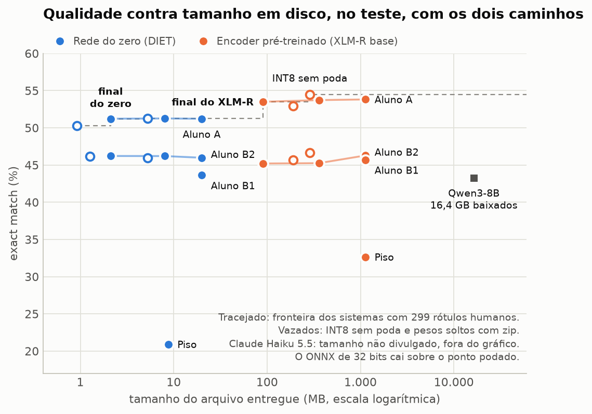

| Sistema | Tamanho entregue | Exact match | Na fronteira | Dominado por |
|---|---|---|---|---|
| Do zero · Aluno A, pesos soltos, INT8 com zip | 0,92 MB | 50,3 | sim | — |
| Do zero · Aluno B2, pesos soltos, INT8 com zip | 1,26 MB | 46,1 | não | Do zero · Aluno A, pesos soltos, INT8 com zip |
| Do zero · Aluno B2, INT8 | 2,11 MB | 46,2 | não | Do zero · Aluno A, pesos soltos, INT8 com zip |
| Do zero · Aluno A, INT8 | 2,11 MB | 51,2 | sim | — |
| Do zero · Aluno A, INT8 sem poda | 5,26 MB | 51,3 | sim | — |
| Do zero · Aluno B2, INT8 sem poda | 5,26 MB | 45,9 | não | Do zero · Aluno A, INT8; Do zero · Aluno A, pesos soltos, INT8 com zip; Do zero · Aluno B2, INT8; Do zero · Aluno B2, pesos soltos, INT8 com zip; Do zero · Aluno A, INT8 sem poda |
| Do zero · Aluno B2, ONNX 32 bits | 7,98 MB | 46,2 | não | Do zero · Aluno A, INT8; Do zero · Aluno A, pesos soltos, INT8 com zip; Do zero · Aluno B2, INT8; Do zero · Aluno A, INT8 sem poda |
| Do zero · Aluno A, ONNX 32 bits | 7,98 MB | 51,3 | não | Do zero · Aluno A, INT8 sem poda |
| Do zero · Aluno B2, podado | 8,06 MB | 46,2 | não | Do zero · Aluno A, ONNX 32 bits; Do zero · Aluno A, INT8; Do zero · Aluno A, pesos soltos, INT8 com zip; Do zero · Aluno B2, ONNX 32 bits; Do zero · Aluno B2, INT8; Do zero · Aluno A, INT8 sem poda |
| Do zero · Aluno A, podado | 8,06 MB | 51,3 | não | Do zero · Aluno A, ONNX 32 bits; Do zero · Aluno A, INT8 sem poda |
| Do zero · Piso | 8,73 MB | 20,9 | não | Do zero · Aluno A, podado; Do zero · Aluno A, ONNX 32 bits; Do zero · Aluno A, INT8; Do zero · Aluno A, pesos soltos, INT8 com zip; Do zero · Aluno B2, podado; Do zero · Aluno B2, ONNX 32 bits; Do zero · Aluno B2, INT8; Do zero · Aluno B2, pesos soltos, INT8 com zip; Do zero · Aluno A, INT8 sem poda; Do zero · Aluno B2, INT8 sem poda |
| Do zero · Aluno A | 19,9 MB | 51,2 | não | Do zero · Aluno A, podado; Do zero · Aluno A, ONNX 32 bits; Do zero · Aluno A, INT8; Do zero · Aluno A, INT8 sem poda |
| Do zero · Aluno B1 | 19,9 MB | 43,6 | não | Do zero · Aluno A; Do zero · Aluno B2; Do zero · Aluno A, podado; Do zero · Aluno A, ONNX 32 bits; Do zero · Aluno A, INT8; Do zero · Aluno A, pesos soltos, INT8 com zip; Do zero · Aluno B2, podado; Do zero · Aluno B2, ONNX 32 bits; Do zero · Aluno B2, INT8; Do zero · Aluno B2, pesos soltos, INT8 com zip; Do zero · Aluno A, INT8 sem poda; Do zero · Aluno B2, INT8 sem poda |
| Do zero · Aluno B2 | 19,9 MB | 46,0 | não | Do zero · Aluno A; Do zero · Aluno A, podado; Do zero · Aluno A, ONNX 32 bits; Do zero · Aluno A, INT8; Do zero · Aluno A, pesos soltos, INT8 com zip; Do zero · Aluno B2, podado; Do zero · Aluno B2, ONNX 32 bits; Do zero · Aluno B2, INT8; Do zero · Aluno B2, pesos soltos, INT8 com zip; Do zero · Aluno A, INT8 sem poda |
| XLM-R · Aluno A, INT8 | 90,7 MB | 53,5 | sim | — |
| XLM-R · Aluno B2, INT8 | 90,7 MB | 45,2 | não | Do zero · Aluno A; Do zero · Aluno B2; Do zero · Aluno A, podado; Do zero · Aluno A, ONNX 32 bits; Do zero · Aluno A, INT8; Do zero · Aluno A, pesos soltos, INT8 com zip; Do zero · Aluno B2, podado; Do zero · Aluno B2, ONNX 32 bits; Do zero · Aluno B2, INT8; Do zero · Aluno B2, pesos soltos, INT8 com zip; Do zero · Aluno A, INT8 sem poda; Do zero · Aluno B2, INT8 sem poda; XLM-R · Aluno A, INT8 |
| XLM-R · Aluno B2, pesos soltos, INT8 com zip | 189,8 MB | 45,7 | não | Do zero · Aluno A; Do zero · Aluno B2; Do zero · Aluno A, podado; Do zero · Aluno A, ONNX 32 bits; Do zero · Aluno A, INT8; Do zero · Aluno A, pesos soltos, INT8 com zip; Do zero · Aluno B2, podado; Do zero · Aluno B2, ONNX 32 bits; Do zero · Aluno B2, INT8; Do zero · Aluno B2, pesos soltos, INT8 com zip; Do zero · Aluno A, INT8 sem poda; Do zero · Aluno B2, INT8 sem poda; XLM-R · Aluno A, INT8 |
| XLM-R · Aluno A, pesos soltos, INT8 com zip | 189,9 MB | 52,9 | não | XLM-R · Aluno A, INT8 |
| XLM-R · Aluno A, INT8 sem poda | 287,3 MB | 54,5 | sim | — |
| XLM-R · Aluno B2, INT8 sem poda | 287,3 MB | 46,6 | não | Do zero · Aluno A; Do zero · Aluno A, podado; Do zero · Aluno A, ONNX 32 bits; Do zero · Aluno A, INT8; Do zero · Aluno A, pesos soltos, INT8 com zip; Do zero · Aluno A, INT8 sem poda; XLM-R · Aluno A, INT8; XLM-R · Aluno A, pesos soltos, INT8 com zip; XLM-R · Aluno A, INT8 sem poda |
| XLM-R · Aluno A, ONNX 32 bits | 358,9 MB | 53,7 | não | XLM-R · Aluno A, INT8 sem poda |
| XLM-R · Aluno B2, ONNX 32 bits | 358,9 MB | 45,2 | não | Do zero · Aluno A; Do zero · Aluno B2; Do zero · Aluno A, podado; Do zero · Aluno A, ONNX 32 bits; Do zero · Aluno A, INT8; Do zero · Aluno A, pesos soltos, INT8 com zip; Do zero · Aluno B2, podado; Do zero · Aluno B2, ONNX 32 bits; Do zero · Aluno B2, INT8; Do zero · Aluno B2, pesos soltos, INT8 com zip; Do zero · Aluno A, INT8 sem poda; Do zero · Aluno B2, INT8 sem poda; XLM-R · Aluno A, ONNX 32 bits; XLM-R · Aluno A, INT8; XLM-R · Aluno A, pesos soltos, INT8 com zip; XLM-R · Aluno A, INT8 sem poda; XLM-R · Aluno B2, pesos soltos, INT8 com zip; XLM-R · Aluno B2, INT8 sem poda |
| XLM-R · Aluno B2, podado | 359,0 MB | 45,2 | não | Do zero · Aluno A; Do zero · Aluno B2; Do zero · Aluno A, podado; Do zero · Aluno A, ONNX 32 bits; Do zero · Aluno A, INT8; Do zero · Aluno A, pesos soltos, INT8 com zip; Do zero · Aluno B2, podado; Do zero · Aluno B2, ONNX 32 bits; Do zero · Aluno B2, INT8; Do zero · Aluno B2, pesos soltos, INT8 com zip; Do zero · Aluno A, INT8 sem poda; Do zero · Aluno B2, INT8 sem poda; XLM-R · Aluno A, podado; XLM-R · Aluno A, ONNX 32 bits; XLM-R · Aluno A, INT8; XLM-R · Aluno A, pesos soltos, INT8 com zip; XLM-R · Aluno A, INT8 sem poda; XLM-R · Aluno B2, ONNX 32 bits; XLM-R · Aluno B2, pesos soltos, INT8 com zip; XLM-R · Aluno B2, INT8 sem poda |
| XLM-R · Aluno A, podado | 359,0 MB | 53,7 | não | XLM-R · Aluno A, ONNX 32 bits; XLM-R · Aluno A, INT8 sem poda |
| XLM-R · Aluno B1 | 1,1 GB | 45,7 | não | Do zero · Aluno A; Do zero · Aluno B2; Do zero · Aluno A, podado; Do zero · Aluno A, ONNX 32 bits; Do zero · Aluno A, INT8; Do zero · Aluno A, pesos soltos, INT8 com zip; Do zero · Aluno B2, podado; Do zero · Aluno B2, ONNX 32 bits; Do zero · Aluno B2, INT8; Do zero · Aluno B2, pesos soltos, INT8 com zip; Do zero · Aluno A, INT8 sem poda; Do zero · Aluno B2, INT8 sem poda; XLM-R · Aluno A; XLM-R · Aluno B2; XLM-R · Aluno A, podado; XLM-R · Aluno A, ONNX 32 bits; XLM-R · Aluno A, INT8; XLM-R · Aluno A, pesos soltos, INT8 com zip; XLM-R · Aluno A, INT8 sem poda; XLM-R · Aluno B2, INT8 sem poda |
| XLM-R · Piso | 1,1 GB | 32,6 | não | Do zero · Aluno A; Do zero · Aluno B1; Do zero · Aluno B2; Do zero · Aluno A, podado; Do zero · Aluno A, ONNX 32 bits; Do zero · Aluno A, INT8; Do zero · Aluno A, pesos soltos, INT8 com zip; Do zero · Aluno B2, podado; Do zero · Aluno B2, ONNX 32 bits; Do zero · Aluno B2, INT8; Do zero · Aluno B2, pesos soltos, INT8 com zip; Do zero · Aluno A, INT8 sem poda; Do zero · Aluno B2, INT8 sem poda; XLM-R · Aluno A; XLM-R · Aluno B1; XLM-R · Aluno B2; XLM-R · Aluno A, podado; XLM-R · Aluno A, ONNX 32 bits; XLM-R · Aluno A, INT8; XLM-R · Aluno A, pesos soltos, INT8 com zip; XLM-R · Aluno A, INT8 sem poda; XLM-R · Aluno B2, podado; XLM-R · Aluno B2, ONNX 32 bits; XLM-R · Aluno B2, INT8; XLM-R · Aluno B2, pesos soltos, INT8 com zip; XLM-R · Aluno B2, INT8 sem poda |
| XLM-R · Aluno B2 | 1,1 GB | 46,3 | não | Do zero · Aluno A; Do zero · Aluno A, podado; Do zero · Aluno A, ONNX 32 bits; Do zero · Aluno A, INT8; Do zero · Aluno A, pesos soltos, INT8 com zip; Do zero · Aluno A, INT8 sem poda; XLM-R · Aluno A; XLM-R · Aluno A, podado; XLM-R · Aluno A, ONNX 32 bits; XLM-R · Aluno A, INT8; XLM-R · Aluno A, pesos soltos, INT8 com zip; XLM-R · Aluno A, INT8 sem poda; XLM-R · Aluno B2, INT8 sem poda |
| XLM-R · Aluno A | 1,1 GB | 53,8 | não | XLM-R · Aluno A, INT8 sem poda |
| Qwen3-8B | 16,4 GB | 43,2 | não | Do zero · Aluno A; Do zero · Aluno B1; Do zero · Aluno B2; Do zero · Aluno A, podado; Do zero · Aluno A, ONNX 32 bits; Do zero · Aluno A, INT8; Do zero · Aluno A, pesos soltos, INT8 com zip; Do zero · Aluno B2, podado; Do zero · Aluno B2, ONNX 32 bits; Do zero · Aluno B2, INT8; Do zero · Aluno B2, pesos soltos, INT8 com zip; Do zero · Aluno A, INT8 sem poda; Do zero · Aluno B2, INT8 sem poda; XLM-R · Aluno A; XLM-R · Aluno B1; XLM-R · Aluno B2; XLM-R · Aluno A, podado; XLM-R · Aluno A, ONNX 32 bits; XLM-R · Aluno A, INT8; XLM-R · Aluno A, pesos soltos, INT8 com zip; XLM-R · Aluno A, INT8 sem poda; XLM-R · Aluno B2, podado; XLM-R · Aluno B2, ONNX 32 bits; XLM-R · Aluno B2, INT8; XLM-R · Aluno B2, pesos soltos, INT8 com zip; XLM-R · Aluno B2, INT8 sem poda |

**O preço de cada ponto de exact match, entre os dois modelos finais**

| Partição | Custo | Final do XLM-R | Final do zero | A mais | Vezes | Exact match a mais (pontos) | Preço de um ponto de exact match |
|---|---|---|---|---|---|---|---|
| teste | tamanho em disco | 90,7 MB | 2,11 MB | 88,6 MB | 42,9 | +2,3 (+1,3 a +3,3) | 38,9 MB (26,9 a 70,5) |
| teste | latência p50 (etapas de origem) | 8,35 ms | 0,26 ms | 8,09 ms | 32,0 | +2,3 (+1,3 a +3,3) | 3,56 ms (2,45 a 6,44) |
| teste | latência p50 (mesma sessão) | 8,00 ms | 0,26 ms | 7,74 ms | 31,2 | +2,3 (+1,3 a +3,3) | 3,40 ms (2,35 a 6,17) |
| dev | tamanho em disco | 90,7 MB | 2,11 MB | 88,6 MB | 42,9 | +2,3 (+1,2 a +3,6) | 38,0 MB (24,4 a 76,1) |
| dev | latência p50 (etapas de origem) | 8,35 ms | 0,26 ms | 8,09 ms | 32,0 | +2,3 (+1,2 a +3,6) | 3,47 ms (2,23 a 6,95) |
| dev | latência p50 (mesma sessão) | 8,00 ms | 0,26 ms | 7,74 ms | 31,2 | +2,3 (+1,2 a +3,6) | 3,33 ms (2,14 a 6,65) |

- **Quem domina quem, entre os caminhos.** Nenhum sistema de um caminho domina o modelo final do outro, nem em latência nem em tamanho: a rede do zero ocupa o lado barato das duas fronteiras e o XLM-R, o lado de mais qualidade. Nenhum sistema do cenário B (alunos B1 e B2, em qualquer forma, nos dois caminhos) está em nenhuma das duas fronteiras. Em latência, o Qwen3-8B é dominado por 26 sistemas, dos dois caminhos, e o Claude Haiku 5.5 é dominado por XLM-R · Aluno A, INT8 sem poda.
- **Na latência, a poda não muda o custo.** Nos dois caminhos o modelo podado e o mesmo modelo sem poda respondem no mesmo tempo (seção 5), e a regra da fronteira trata latências a menos de 14% como empate. Entre dois empatados, fica na fronteira o de maior exact match medido. Por isso o modelo final de cada caminho aparece dominado pelo seu próprio INT8 sem poda: na rede do zero por 0,06 ponto, que não se distingue de zero (−0,06 (−0,85 a +0,78)); no XLM-R por 1,0 ponto, que se distingue no teste (−1,0 (−1,6 a −0,5)) e não se distingue em `dev` (−0,5 (−1,1 a +0,1)).
- **Latência.** Entre os sistemas com 299 rótulos humanos, dos dois caminhos, a fronteira tem: Do zero · Aluno A, INT8 sem poda (51,3%); XLM-R · Aluno A, INT8 sem poda (54,5%). O final da rede do zero é dominado por Do zero · Aluno A, INT8 sem poda; o final do XLM-R é dominado por XLM-R · Aluno A, INT8 sem poda; o Claude Haiku 5.5 (854 ms pela API) é dominado por XLM-R · Aluno A, INT8 sem poda. Latências a menos de 14% uma da outra contam como empate. Com as latências medidas na mesma sessão no lugar das de origem, a fronteira é a mesma.
- **Tamanho.** A fronteira tem: Do zero · Aluno A, pesos soltos, INT8 com zip (50,3%); Do zero · Aluno A, INT8 (51,2%); Do zero · Aluno A, INT8 sem poda (51,3%); XLM-R · Aluno A, INT8 (53,5%); XLM-R · Aluno A, INT8 sem poda (54,5%). O final da rede do zero está na fronteira; o final do XLM-R está na fronteira.
- **O INT8 sem poda do XLM-R.** Ele aparece na fronteira com 54,5% de exact match, 287,3 MB e 8,33 ms. Não é o modelo final: a regra da Etapa 10b, escrita antes, escolhe o menor arquivo que não se distingue do modelo sem poda em `dev`. Contra ele, o final fica sem diferença distinguível em acurácia de intenção (−0,4 (−0,8 a +0,1)); abaixo em F1 de entidades (−0,5 (−0,9 a −0,0)); abaixo em exact match (−1,0 (−1,6 a −0,5)) no teste, e em `dev` sem diferença distinguível em exact match (−0,5 (−1,1 a +0,1)). A fronteira ordena valores medidos; a diferença entre esses dois vizinhos é a que está nesta linha. O INT8 sem poda aparece acima do Claude Haiku 5.5 pelo valor medido (54,5% contra 54,0%), mas essa comparação não está na lista fechada e não foi feita: não se pode dizer que ele passa o professor.
- **Sem o INT8 sem poda (exploratória).** Esta conta foi acrescentada depois de ver a fronteira e não está nas regras. Só com as linhas da Etapa 9 e as equivalentes do XLM-R, a fronteira de latência seria: Do zero · Aluno A, INT8 (51,2%); Do zero · Aluno A, ONNX 32 bits (51,3%); XLM-R · Aluno A, INT8 (53,5%); XLM-R · Aluno A, ONNX 32 bits (53,7%); XLM-R · Aluno A (53,8%); Claude Haiku 5.5 (54,0%); a de tamanho: Do zero · Aluno A, pesos soltos, INT8 com zip (50,3%); Do zero · Aluno A, INT8 (51,2%); Do zero · Aluno A, ONNX 32 bits (51,3%); XLM-R · Aluno A, INT8 (53,5%); XLM-R · Aluno A, ONNX 32 bits (53,7%); XLM-R · Aluno A (53,8%). O final da rede do zero estaria na de latência e o do XLM-R estaria.
- **O preço de cada ponto.** Entre os dois modelos finais, no teste, o XLM-R tem +2,3 (+1,3 a +3,3) pontos de exact match a mais, 88,6 MB a mais (42,9 vezes) e 8,09 ms a mais por consulta (32,0 vezes). Cada ponto de exact match custa 38,9 MB (26,9 a 70,5) e 3,56 ms (2,45 a 6,44). Em `dev`: 38,0 MB (24,4 a 76,1) e 3,47 ms (2,23 a 6,95). Com a latência medida na mesma sessão: 3,40 ms (2,35 a 6,17) no teste.
- **Como ler.** A fronteira usa os valores medidos, sem os intervalos: serve para ver a ordem de grandeza do custo. Dois vizinhos nela podem não se distinguir em qualidade; quem diz isso são as comparações pareadas. O intervalo do preço vem só da incerteza da qualidade: tamanho e latência são os de um modelo (semente 0).

## A latência na mesma sessão

| Sistema | Forma | p50 de origem | p50 na mesma sessão | Entre as rodadas (mesma sessão) | Mesma sessão ÷ origem | Confirma a de origem | Reproduz as respostas gravadas |
|---|---|---|---|---|---|---|---|
| Do zero · Aluno A, INT8 (modelo final) | INT8 | 0,26 ms (Etapa 8) | 0,26 ms | 0,24 a 0,27 ms | 0,98 | sim | sim |
| XLM-R · Aluno A, INT8 (modelo final) | INT8 | 8,35 ms (Etapa 10c) | 8,00 ms | 7,87 a 8,11 ms | 0,96 | sim | sim |
| Do zero · Aluno A, ONNX 32 bits | ONNX, 32 bits | 0,43 ms (Etapa 8) | 0,42 ms | 0,41 a 0,44 ms | 0,99 | sim | sim |
| XLM-R · Aluno A, ONNX 32 bits | ONNX, 32 bits | 25,08 ms (Etapa 10c) | 24,35 ms | 24,12 a 24,66 ms | 0,97 | sim | sim |
| Do zero · Aluno A, podado | PyTorch, 32 bits | 1,10 ms (Etapa 8) | 1,11 ms | 1,09 a 1,13 ms | 1,01 | sim | sim |
| XLM-R · Aluno A, podado | PyTorch, 32 bits | 36,10 ms (Etapa 10c) | 35,11 ms | 34,88 a 35,52 ms | 0,97 | sim | sim |

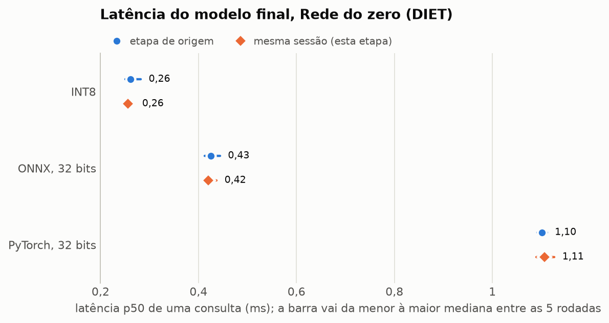

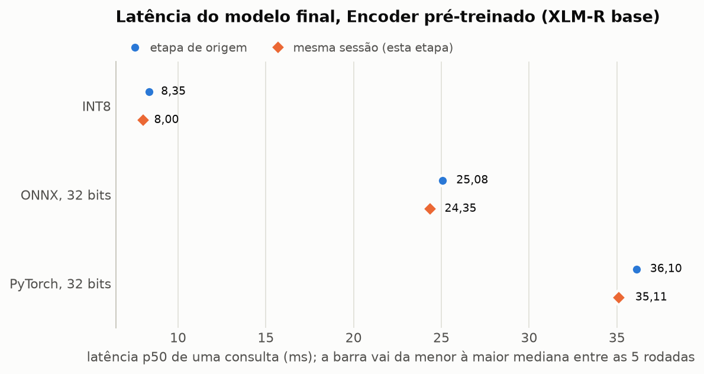

- **A medida.** Feita em 2026-11-18 às 21:01:55, com 5 rodadas de 1.024 consultas, 1 thread, os 6 sistemas alternados em cada rodada. Os outros processos ocuparam 0,068 núcleo de CPU no conjunto (o máximo numa rodada foi 0,105; o limite é 0,25): máquina quieta, sim. Os 6 sistemas reproduzem as respostas gravadas nos 200 primeiros pedidos de `dev`: sim.
- **Os dois modelos finais, em INT8.** Na mesma sessão: 0,26 ms (rede do zero) e 8,00 ms (XLM-R), 31,2 vezes. Nas etapas de origem: 0,26 ms e 8,35 ms, 32,0 vezes.
- **Em 32 bits.** ONNX: 0,42 ms e 24,35 ms (58,0 vezes; na origem, 58,9). PyTorch: 1,11 ms e 35,11 ms (31,7 vezes; na origem, 32,8).
- **Confirma a origem?** A regra: a diferença relativa entre a medida nova e a de origem é menor que a folga da fronteira (14%). Vale para os 6 sistemas: a maior diferença é de 4,2%. Os números da tabela final continuam sendo os de origem; estes ficam ao lado.
- O protocolo das Etapas 8 e 10c é o mesmo (1 thread, uma consulta por vez, do texto à resposta, pedidos de `dev`, 50 consultas de aquecimento, 5 rodadas de 1.024 consultas, sistemas alternados, a mesma função). O que as medidas de origem não tinham era os dois caminhos na mesma rodada.

## Cada passo e o seu artigo

| Passo | Caminho | Técnica | Artigo | Ano | Onde | Estava citado em | Conferida na fonte | Resumo lido |
|---|---|---|---|---|---|---|---|---|
| O caminho inteiro | os dois | Trocar a LLM por um modelo pequeno, feito para a tarefa | Belcak et al., *Small Language Models are the Future of Agentic AI* | 2025 | [arXiv 2506.02153](https://arxiv.org/abs/2506.02153) | PLANO.md; RESUMO da Etapa 9; notebook da Etapa 9 | conferida | sim |
| O caminho inteiro | os dois | LLM professora, destilação, poda e quantização em sequência | Ni et al., *From Large to Super-Tiny: End-to-End Optimization for Cost-Efficient LLMs* | 2025 | [arXiv 2504.13471](https://arxiv.org/abs/2504.13471) | PLANO.md; RESUMO da Etapa 9; notebook da Etapa 5a; notebook da Etapa 6; notebook da Etapa 9 | conferida | sim |
| O caminho inteiro | os dois | A ordem: podar, quantizar e, por fim, codificar o arquivo | Han et al., *Deep Compression: Compressing Deep Neural Networks with Pruning, Trained Quantization and Huffman Coding* | 2015 | [arXiv 1510.00149](https://arxiv.org/abs/1510.00149) | PLANO.md; RESUMO da Etapa 9; notebook da Etapa 7; notebook da Etapa 8; notebook da Etapa 9; notebook da Etapa 10b; notebook da Etapa 10c | conferida | sim |
| O caminho inteiro | os dois | A ordem das técnicas de compressão importa | Harma et al., *Effective Interplay between Sparsity and Quantization: From Theory to Practice* | 2024 | [arXiv 2405.20935](https://arxiv.org/abs/2405.20935) | PLANO.md; RESUMO da Etapa 9 | conferida | sim |
| O caminho inteiro | os dois | Poda e quantização juntas podem interagir (discussão da ordem) | Nema et al., *Compression Technique Interactions in Small Language Models: A Factorial Ablation Study* | 2026 | [arXiv 2611.00464](https://arxiv.org/abs/2611.00464) | PLANO.md; RESUMO da Etapa 9; notebook da Etapa 8; notebook da Etapa 9 | conferida | sim |
| Dados e régua | os dois | MASSIVE pt-PT; acurácia de intenção, F1 de entidades e exact match; a linha publicada do XLM-R base | FitzGerald et al., *MASSIVE: A 1M-Example Multilingual Natural Language Understanding Dataset with 51 Typologically-Diverse Languages* | 2022 | [arXiv 2204.08582](https://arxiv.org/abs/2204.08582) | PLANO.md; RESUMO da Etapa 1; RESUMO da Etapa 9; RESUMO da Etapa 10a; notebook da Etapa 1; notebook da Etapa 2; notebook da Etapa 10a | conferida | em parte |
| Dados e régua | os dois | Intervalo de 95% e comparação pareada por bootstrap, por enunciado | Koehn, *Statistical Significance Tests for Machine Translation Evaluation* | 2004 | [ACL Anthology W04-3250](https://aclanthology.org/W04-3250/) | RESUMO da Etapa 9 | conferida | não |
| Dados e régua | os dois | Intervalo de 95% e comparação pareada por bootstrap, por enunciado | Berg-Kirkpatrick et al., *An Empirical Investigation of Statistical Significance in NLP* | 2012 | [ACL Anthology D12-1091](https://aclanthology.org/D12-1091/) | RESUMO da Etapa 9 | conferida | não |
| Dados e régua | os dois | Três sementes por modelo treinado; o resultado é a média | Reimers & Gurevych, *Reporting Score Distributions Makes a Difference: Performance Study of LSTM-networks for Sequence Tagging* | 2017 | [arXiv 1707.09861](https://arxiv.org/abs/1707.09861) | RESUMO da Etapa 9; notebook da Etapa 4; notebook da Etapa 4b; notebook da Etapa 6; notebook da Etapa 7; notebook da Etapa 10a | conferida | sim |
| Dados e régua | os dois | Latência: uma consulta por vez, percentis, máquina registrada | Reddi et al., *MLPerf Inference Benchmark* | 2019 | [arXiv 1911.02549](https://arxiv.org/abs/1911.02549) | PLANO.md; RESUMO da Etapa 9; notebook da Etapa 2; notebook da Etapa 5a; notebook da Etapa 7; notebook da Etapa 9 | conferida | em parte |
| Dados e régua | os dois | Custo reportado em várias medidas (parâmetros, bytes, tempo), com a condição de cada uma | Dehghani et al., *The Efficiency Misnomer* | 2021 | [arXiv 2110.12894](https://arxiv.org/abs/2110.12894) | PLANO.md; RESUMO da Etapa 9; notebook da Etapa 2; notebook da Etapa 7; notebook da Etapa 9; notebook da Etapa 10b | conferida | sim |
| Professores | os dois | LLM com poucos exemplos no prompt: intenção perto do supervisionado, entidades atrás | He & Garner, *Can ChatGPT Detect Intent? Evaluating Large Language Models for Spoken Language Understanding* | 2023 | [arXiv 2305.13512](https://arxiv.org/abs/2305.13512) | RESUMO da Etapa 5a; RESUMO da Etapa 9; notebook da Etapa 5a; notebook da Etapa 5b | conferida | sim |
| Destilação | os dois | Destilação caixa-preta: o aluno aprende só com os rótulos da LLM | Xu et al., *A Survey on Knowledge Distillation of Large Language Models* | 2024 | [arXiv 2402.13116](https://arxiv.org/abs/2402.13116) | PLANO.md; RESUMO da Etapa 9; notebook da Etapa 5a; notebook da Etapa 5b; notebook da Etapa 6 | conferida | em parte |
| Destilação | os dois | Destilação caixa-preta: o aluno aprende só com os rótulos da LLM | Di Palo et al., *Performance-Guided LLM Knowledge Distillation for Efficient Text Classification at Scale* | 2024 | [arXiv 2411.05045](https://arxiv.org/abs/2411.05045) | PLANO.md; RESUMO da Etapa 9; notebook da Etapa 6 | conferida | sim |
| Destilação | os dois | Destilação com logits e temperatura | Hinton et al., *Distilling the Knowledge in a Neural Network* | 2015 | [arXiv 1503.02531](https://arxiv.org/abs/1503.02531) | PLANO.md; RESUMO da Etapa 6; RESUMO da Etapa 9; notebook da Etapa 5a; notebook da Etapa 5b; notebook da Etapa 6; notebook da Etapa 10a | conferida | em parte |
| Destilação | os dois | Destilação de um Transformer para um aluno menor | Jiao et al., *TinyBERT: Distilling BERT for Natural Language Understanding* | 2019 | [arXiv 1909.10351](https://arxiv.org/abs/1909.10351) | PLANO.md; RESUMO da Etapa 9 | conferida | em parte |
| Arquitetura | do zero | Rede conjunta de intenção e entidades, do zero: features esparsas, Transformer de 2 camadas, CRF | Bunk et al., *DIET: Lightweight Language Understanding for Dialogue Systems* | 2020 | [arXiv 2004.09936](https://arxiv.org/abs/2004.09936) | PLANO.md; RESUMO da Etapa 3; RESUMO da Etapa 9; notebook da Etapa 3; notebook da Etapa 4 | conferida | sim |
| Arquitetura | XLM-R | Encoder pré-treinado com cabeça conjunta de intenção e entidades | Chen et al., *BERT for Joint Intent Classification and Slot Filling* | 2019 | [arXiv 1902.10909](https://arxiv.org/abs/1902.10909) | PLANO.md; RESUMO da Etapa 9; RESUMO da Etapa 10a; notebook da Etapa 10a; notebook da Etapa 10b; notebook da Etapa 10c | conferida | sim |
| Arquitetura | XLM-R | O encoder multilíngue pré-treinado (XLM-R base) | Conneau et al., *Unsupervised Cross-lingual Representation Learning at Scale* | 2019 | [arXiv 1911.02116](https://arxiv.org/abs/1911.02116) | notebook da Etapa 10a; notebook da Etapa 10b; notebook da Etapa 10c | conferida | sim |
| Arquitetura | XLM-R | A receita de ajuste fino de um encoder pré-treinado (taxas, lote, épocas) | Devlin et al., *BERT: Pre-training of Deep Bidirectional Transformers for Language Understanding* | 2018 | [arXiv 1810.04805](https://arxiv.org/abs/1810.04805) | notebook da Etapa 10a | conferida | em parte |
| Arquitetura | XLM-R | AdamW: o decaimento de pesos separado do gradiente | Loshchilov & Hutter, *Decoupled Weight Decay Regularization* | 2017 | [arXiv 1711.05101](https://arxiv.org/abs/1711.05101) | notebook da Etapa 10a | conferida | sim |
| Arquitetura | XLM-R | Ajuste fino com poucos exemplos: o que decide é o número de passos (o piso com 299 rótulos) | Mosbach et al., *On the Stability of Fine-tuning BERT: Misconceptions, Explanations, and Strong Baselines* | 2020 | [arXiv 2006.04884](https://arxiv.org/abs/2006.04884) | RESUMO da Etapa 10a; notebook da Etapa 10a | conferida | em parte |
| Poda de vocabulário | XLM-R | Cortar da tabela de subtokens o que o corpus da tarefa não usa, com o tokenizador junto | Yang, Cui & Chen, *TextPruner: A Model Pruning Toolkit for Pre-Trained Language Models* | 2022 | [arXiv 2203.15996](https://arxiv.org/abs/2203.15996) | RESUMO da Etapa 10b; notebook da Etapa 10b | conferida | sim |
| Poda de vocabulário | XLM-R | Num modelo multilíngue a maior parte dos parâmetros está na tabela; ficar só com os idiomas que interessam | Abdaoui, Pradel & Sigel, *Load What You Need: Smaller Versions of Multilingual BERT* | 2020 | [arXiv 2010.05609](https://arxiv.org/abs/2010.05609) | RESUMO da Etapa 10b; notebook da Etapa 10b | conferida | sim |
| Poda de vocabulário | do zero | Poda de peças inteiras (estruturada): as linhas da tabela de features | Xia et al., *Structured Pruning Learns Compact and Accurate Models* | 2022 | [arXiv 2204.00408](https://arxiv.org/abs/2204.00408) | PLANO.md; RESUMO da Etapa 9; notebook da Etapa 7 | conferida | em parte |
| Corte de camadas | os dois | Tirar as camadas de cima de um encoder já treinado e ajustar (testado nos dois caminhos; não ficou em nenhum modelo final) | Sajjad et al., *On the Effect of Dropping Layers of Pre-trained Transformer Models* | 2020 | [arXiv 2004.03844](https://arxiv.org/abs/2004.03844) | RESUMO da Etapa 10b; notebook da Etapa 7; notebook da Etapa 10b | conferida | sim |
| Poda por magnitude | os dois | Treinar, podar pelos pesos de menor valor absoluto e treinar de novo | Han et al., *Learning both Weights and Connections for Efficient Neural Networks* | 2015 | [arXiv 1506.02626](https://arxiv.org/abs/1506.02626) | PLANO.md; RESUMO da Etapa 7; RESUMO da Etapa 9; RESUMO da Etapa 10b; notebook da Etapa 7; notebook da Etapa 10b | conferida | sim |
| Poda por magnitude | os dois | Poda gradual, com a esparsidade subindo durante o treino | Zhu & Gupta, *To prune, or not to prune: exploring the efficacy of pruning for model compression* | 2017 | [arXiv 1710.01878](https://arxiv.org/abs/1710.01878) | PLANO.md; RESUMO da Etapa 7; RESUMO da Etapa 9; RESUMO da Etapa 10b; notebook da Etapa 7; notebook da Etapa 10b | conferida | sim |
| Poda por magnitude | XLM-R | Poda por magnitude num BERT, matriz por matriz: de 30% a 40% sai sem perda | Gordon, Duh & Andrews, *Compressing BERT: Studying the Effects of Weight Pruning on Transfer Learning* | 2020 | [arXiv 2002.08307](https://arxiv.org/abs/2002.08307) | RESUMO da Etapa 10b; notebook da Etapa 10b | conferida | sim |
| Poda por magnitude | os dois | Como reportar poda: tamanho e velocidade, controle, sementes | Blalock et al., *What is the State of Neural Network Pruning?* | 2020 | [arXiv 2003.03033](https://arxiv.org/abs/2003.03033) | notebook da Etapa 7; notebook da Etapa 10b | conferida | sim |
| Reajuste | os dois | Fine-tuning de recuperação com a máscara travada, com o sinal do professor | Zafrir et al., *Prune Once for All: Sparse Pre-Trained Language Models* | 2021 | [arXiv 2111.05754](https://arxiv.org/abs/2111.05754) | PLANO.md; RESUMO da Etapa 9; notebook da Etapa 7; notebook da Etapa 10b | conferida | sim |
| Reajuste | os dois | Magnitude contra outros critérios num encoder pré-treinado; as tabelas de entrada fora da poda | Sanh, Wolf & Rush, *Movement Pruning: Adaptive Sparsity by Fine-Tuning* | 2020 | [arXiv 2005.07683](https://arxiv.org/abs/2005.07683) | PLANO.md; RESUMO da Etapa 9; RESUMO da Etapa 10b; notebook da Etapa 7; notebook da Etapa 10b | conferida | em parte |
| Quantização | os dois | Inteiros de 8 bits: escala e ponto zero | Jacob et al., *Quantization and Training of Neural Networks for Efficient Integer-Arithmetic-Only Inference* | 2017 | [arXiv 1712.05877](https://arxiv.org/abs/1712.05877) | PLANO.md; RESUMO da Etapa 9; notebook da Etapa 8; notebook da Etapa 10c | conferida | sim |
| Quantização | os dois | Um Transformer em 8 bits: o que quantizar e o que deixar em 32 bits | Zafrir et al., *Q8BERT: Quantized 8Bit BERT* | 2019 | [arXiv 1910.06188](https://arxiv.org/abs/1910.06188) | PLANO.md; RESUMO da Etapa 9; notebook da Etapa 8; notebook da Etapa 10c | conferida | em parte |
| Quantização | os dois | As formas de quantizar, lado a lado: dinâmica, estática, com treino | Gholami et al., *A Survey of Quantization Methods for Efficient Neural Network Inference* | 2021 | [arXiv 2103.13630](https://arxiv.org/abs/2103.13630) | notebook da Etapa 8; notebook da Etapa 10c | conferida | em parte |
| Quantização | os dois | Por que as ativações de um Transformer são difíceis de quantizar com faixa fixa (a estática que não passou) | Bondarenko et al., *Understanding and Overcoming the Challenges of Efficient Transformer Quantization* | 2021 | [arXiv 2109.12948](https://arxiv.org/abs/2109.12948) | notebook da Etapa 8; notebook da Etapa 10c | conferida | sim |
| Quantização | do zero | Quantização pós-treino, só dos pesos ou também das ativações, e quando o treino é necessário | Krishnamoorthi, *Quantizing deep convolutional networks for efficient inference: A whitepaper* | 2018 | [arXiv 1806.08342](https://arxiv.org/abs/1806.08342) | notebook da Etapa 8 | conferida | sim |
| Quantização | do zero | Um Transformer quantizado em 8 bits depois de treinado | Bhandare et al., *Efficient 8-Bit Quantization of Transformer Neural Machine Language Translation Model* | 2019 | [arXiv 1906.00532](https://arxiv.org/abs/1906.00532) | notebook da Etapa 8 | conferida | sim |
| Exportação | os dois | Levar a rede do PyTorch para o ONNX Runtime: passo de engenharia, sem artigo citado em nenhuma etapa | nenhum artigo | — | — | — | sem artigo | — |

- O quadro tem 39 linhas: 38 referências (38 artigos diferentes) e 1 passo sem artigo (Exportação: é um passo de engenharia, e nenhuma etapa cita artigo para ele). Das 38 referências, 25 já estavam no quadro da Etapa 9 e 13 vêm das Etapas 8, 10a, 10b e 10c. **Conferidas na fonte: 38 de 38** (identificador, primeiro autor e título, na consulta de 2026-11-18 às 20:55:13). **Com o resumo lido: 36**; em 25 o resumo sustenta a técnica como o projeto a usa, e em 11 sustenta em parte. As 2 sem resumo lido são as da ACL Anthology, de que só o título, os autores e o ano foram conferidos. Antes desta etapa, o `PLANO.md` registrava como lidos só dois resumos e parte de um texto, e a Etapa 9 tinha conferido título e autores de três referências.
- O que o resumo diz, nas linhas marcadas "em parte": FitzGerald et al. (arXiv 2204.08582): o conjunto (51 idiomas, 60 intenções, 55 tipos de entidade) e as três métricas, com resultados do XLM-R e do mT5; os números da linha de pt-PT estão nas tabelas do artigo, não no resumo. Reddi et al. (arXiv 1911.02549): apresenta o benchmark de inferência; o cenário de uma consulta por vez (single-stream) está no corpo do artigo. Xu et al. (arXiv 2402.13116): levantamento da destilação de LLMs, incluindo das fechadas para modelos abertos; a divisão caixa-preta e caixa-branca está no corpo. Hinton et al. (arXiv 1503.02531): destilar um conjunto de modelos num modelo só; a temperatura está no corpo do artigo. Jiao et al. (arXiv 1909.10351): destilação de um Transformer para um aluno menor, camada a camada; este projeto usa só os logits de saída. Devlin et al. (arXiv 1810.04805): o BERT é ajustado com uma camada de saída a mais; taxas, lote e épocas do ajuste fino estão no corpo. Mosbach et al. (arXiv 2006.04884): a instabilidade do ajuste fino vem da otimização, não do tamanho pequeno do conjunto; a recomendação sobre o número de passos está no corpo. Xia et al. (arXiv 2204.00408): poda estruturada de camadas, cabeças e unidades com destilação; não trata de linhas de uma tabela de features, que é como este projeto a usa. Sanh, Wolf & Rush (arXiv 2005.07683): poda de movimento contra magnitude no ajuste fino, com vantagem em esparsidade alta; deixar as tabelas de entrada fora da poda está no corpo. Zafrir et al. (arXiv 1910.06188): BERT em 8 bits, 4 vezes menor, mas com treino ciente de quantização; este projeto quantiza depois do treino e usa do artigo só o recorte do que é quantizado, que está no corpo. Gholami et al. (arXiv 2103.13630): levantamento dos métodos de quantização; a comparação entre dinâmica, estática e com treino está no corpo.
- **O corpo de nenhum artigo foi lido nesta etapa**, e os números publicados que o projeto cita não foram conferidos de novo aqui. A resposta inteira da fonte está em `artigos_na_fonte/`.

## Rótulos humanos em cada ponto dos dois caminhos

| Ponto do caminho | Caminho | Rótulos humanos de treino (de 11.514) | Decisões tomadas com os rótulos humanos de dev (2.033 pedidos) |
|---|---|---|---|
| Etapas 5a e 5b · as duas LLMs | os dois | 299 no prompt | na LLM fechada, nenhuma escolha; na aberta, a escolha entre candidatos e o formato da resposta |
| Etapas 4 e 4b · teto e receita | do zero | 11.514: o teto treina com todos | época de parada e escolha da receita, que os alunos herdam |
| Etapa 6 · alunos | do zero | nenhum: rótulos e logits das LLMs | a temperatura do B2 (T = 8) e a regra de quem segue para a poda |
| Etapa 7 · poda e reajuste | do zero | nenhum: o reajuste usa o sinal do professor | a regra do que segue para a quantização |
| Etapa 8 · quantização | do zero | nenhum: a calibração usa pedidos do treino, sem rótulo | a regra da forma de 8 bits |
| Etapa 10a · teto, receita e alunos | XLM-R | 11.514 no teto; nenhum nos alunos | a busca da receita do teto (6 configurações, 1 semente), que os alunos herdam; a época de parada do teto e do piso; a temperatura do B2 (T = 2) |
| Etapa 10b · poda e reajuste | XLM-R | nenhum nos alunos: o reajuste usa o sinal do professor | a regra do que segue para a quantização; o orçamento do reajuste saiu de um piloto no teto, visto em dev |
| Etapa 10c · quantização | XLM-R | nenhum: a calibração usa 512 pedidos do treino, sem rótulo | a regra da forma de 8 bits (a mesma da Etapa 8) |
| Etapas 9 e 10d · comparativos | os dois | nenhum | nenhuma decisão |

## Limites

- **Rótulos humanos de `dev` nas decisões (a ressalva dos 299 rótulos).** O cenário promete 299 rótulos humanos. No treino isso vale nos dois caminhos: nenhum aluno viu um rótulo humano de treino. Mas os 2.033 rótulos humanos de `dev` decidiram, nos dois caminhos, a temperatura do B2, qual poda fica e a forma de 8 bits; no XLM-R, também a receita de ajuste fino (buscada no teto) e o orçamento do reajuste. Num uso real com só 299 rótulos, essas escolhas teriam de sair de outro critério (a concordância com o professor, por exemplo); isso só foi conferido para a temperatura da rede do zero (Etapa 9).
- **Os dois caminhos não diferem só no pré-treino.** Mudam juntos a arquitetura (12 camadas contra 2), o tamanho, a receita de treino, a cabeça de entidades (sem CRF contra com CRF) e o que a poda alcança. Cada diferença "XLM-R menos rede do zero" mede o pacote, não uma peça.
- **A poda principal não é a mesma técnica nos dois caminhos.** Na rede do zero, "Sem 90% das linhas da tabela de features" (as linhas da tabela de features); no XLM-R, "Vocabulário do treino" (as linhas da tabela de subtokens). Cada uma saiu da regra da sua etapa, em `dev`. O orçamento do reajuste também difere: 10 épocas no XLM-R (o treino inteiro), e uma fração do treino na rede do zero (Etapa 7).
- **A temperatura do B2 difere entre os caminhos.** T = 8 na rede do zero e T = 2 no XLM-R: cada etapa escolheu a sua em `dev`. No XLM-R a escolhida não se distingue das outras três (Etapa 10a). O B1 da rede do zero tem suavização de rótulos; o do XLM-R, não. E o piso não foi treinado do mesmo jeito nos dois caminhos (Etapa 10a).
- **A quantização do XLM-R mexe na intenção do modelo final, e a regra só olhava entidades.** No degrau INT8 do modelo final do XLM-R, a acurácia de intenção muda −0,41 (−0,79 a −0,03) em `dev` e −0,44 (−0,77 a −0,10) no teste: distinguível nas duas. Na rede do zero, o mesmo degrau: +0,00 (−0,08 a +0,08) e −0,01 (−0,10 a +0,08). A regra das Etapas 8 e 10c decide pelo F1 de entidades e foi escrita antes dos resultados; não foi mudada.
- **A quantização estática foi testada com uma calibração só.** 512 pedidos do treino e a faixa do menor ao maior valor visto. No XLM-R ela não passou em nenhum dos 9 modelos (o F1 de entidades cai de 1,7 a 14,9 pontos em `dev`). Outras calibrações (percentis, entropia) e o treino ciente de quantização não foram testados: a regra não os pediu.
- **A poda do B2 no XLM-R não teve grade própria.** O aluno B2 recebeu as variantes escolhidas para o aluno A (Etapa 10b). A principal passa em `dev` (−0,4 (−0,9 a +0,0)) e fica abaixo no teste (−1,0 (−1,4 a −0,6)).
- **`dev` e teste discordam em parte das escolhas.** A regra das podas aceita o que não fica distinguivelmente abaixo em `dev`; com o tamanho de `dev`, uma queda de menos de cerca de 1 ponto pode passar. Aconteceu nos dois caminhos (Etapas 7, 9 e 10b). Nesta etapa, `dev` e teste discordam em 20 dos 129 intervalos da lista fechada.
- **A execução esparsa só foi medida no aluno A.** No XLM-R, 5 variantes de pesos soltos do aluno A têm latência com a execução que só faz as contas dos pesos não nulos (Etapa 10b); nos outros modelos, não. Em nenhum dos dois caminhos os pesos soltos renderam latência no executor comum.
- **O corte do vocabulário depende do texto do treino.** O modelo final do XLM-R só conhece os 5.196 subtokens que o treino usa. Palavra nova é partida em peças menores ou vira `<unk>` (Etapa 10b). Fora do domínio do MASSIVE isso não foi medido.
- **A latência é de uma CPU, de uma semente e de pedidos curtos.** 13th Gen Intel(R) Core(TM) i7-13700K, com as instruções VNNI, 1 thread, semente 0, pedidos de poucas palavras. A mediana variou até 14% entre as rodadas das medidas de origem. Em outra CPU, sem VNNI, as respostas dos modelos em 8 bits podem mudar um pouco. Com mais threads, lotes ou textos longos, a razão entre os caminhos seria outra.
- **As latências dos dois caminhos vêm de sessões diferentes.** A medida na mesma sessão (seção 9) confirma as de origem pela regra da etapa, mas é uma medida só, de um dia.
- **O teste foi aberto mais de uma vez.** Ele aparece nos resultados de 11 entregas, desde a Etapa 2. Nenhuma decisão saiu dele, mas são os mesmos 2.974 pedidos medindo tudo, e esta etapa soma 129 intervalos de comparação por partição, mais os dos degraus, sem correção para comparações múltiplas.
- **Parte das comparações já era conhecida quando as regras foram escritas.** As dos modelos sem poda (Etapa 10a) e todas as do caminho do zero (Etapa 9). As regras garantem que a lista não foi escolhida depois das contas novas, não que quem as escreveu não conhecia nenhum número.
- **A fronteira usa os valores medidos**, sem os intervalos, e inclui o INT8 sem poda, que não é o modelo escolhido pela regra de nenhum caminho. Serve para ver a ordem de grandeza do custo, não para separar vizinhos.
- **O preço de cada ponto é uma razão entre dois modelos**, não uma curva: só há dois pontos, um por caminho. O intervalo vem só da incerteza da qualidade.
- **O custo de treino não está na tabela.** A tabela mede o custo de usar. Treinar e reajustar o XLM-R pede horas de placa de vídeo (Etapas 10a e 10b); a rede do zero treina em minutos. A memória em uso durante a consulta também não foi medida no XLM-R.
- **Um conjunto, uma língua, uma rotulagem.** MASSIVE, recorte pt-PT; uma rotulagem do treino por professor; 3 sementes por modelo treinado. As LLMs podem conhecer o MASSIVE, que é público. O XLM-R foi pré-treinado em cem idiomas e aqui só vê pt-PT.
- **As referências foram conferidas pelo identificador, pelo primeiro autor, pelo título e pelo resumo.** O corpo dos artigos não foi lido nesta etapa; em 11 referências o resumo sustenta só em parte o uso que o projeto faz (seção 10).
- **O que as etapas de origem já declararam continua valendo**: os limites de cada uma estão no seu `RESUMO.md` (o professor aberto é o que coube na placa; a temperatura do B2 da rede do zero está na borda da grade; a busca da receita do XLM-R tem 1 semente; o corte por matriz e a poda de movimento não testados; um degrau por tensor na quantização).

## Como acrescentar um sistema depois

O comparativo é montado a partir de um registro (`etapa10d.registro`), não de tabelas escritas à mão. Para uma etapa nova (a Etapa 11, por exemplo) entrar:

1. ou uma função nova em `etapa10d.FONTES`, que leia o `decisao.json` da etapa e devolva as fichas; ou um arquivo `sistemas.json` na entrega da etapa (formato em `etapa10d.fichas_declaradas`);
2. cada ficha diz onde ler a qualidade e as respostas (`dev` e teste) e leva as marcas `caminho`, `modelo`, `ponto` e `professor`;
3. `regras` grava uma versão nova das regras (a anterior não é tocada), `preparar` e `calcular` refazem as contas, e este notebook é executado de novo.

Com as marcas preenchidas, o sistema entra sozinho na tabela, na fronteira e nas comparações (entre caminhos, contra o professor, de ponta a ponta).

## O que mudou fora desta etapa

Nenhuma entrega e nenhum cache de outra etapa foi alterado. Dois arquivos de código que outras etapas também usam mudaram, sem mudar o resultado delas:

- `visual.py`: `visual.fronteira` passou a aceitar um ponto de referência em cinza (`serie=None`), para as LLMs que os dois caminhos dividem. Com `serie` 0 ou 1, como a Etapa 9 usa, o desenho é o mesmo.
- `etapa9.py`: `artigos_fora_das_fontes` passou a ler só os resumos das etapas anteriores à Etapa 9. Antes lia os de todas as entregas, e o resumo desta etapa, que cita Reimers & Gurevych (arXiv 1707.09861), fazia a conferência do quadro de artigos da Etapa 9 falhar (um teste e o critério de pronto do notebook 9). Com a mudança, a função devolve o mesmo que devolvia quando a Etapa 9 foi entregue.

## Critério de pronto

| Critério | Atendido |
|---|---|
| As regras foram gravadas antes das contas, e as contas são exatamente as das regras (43 comparações, 6 cadeias; nenhuma acrescentada depois) | sim |
| A tabela tem as 21 linhas da Etapa 9, idênticas, e as do XLM-R (teto, alunos, podados, ONNX de 32 bits e INT8), com qualidade e intervalo em dev e no teste (44 linhas) | sim |
| Cada número que uma etapa de origem gravou foi refeito das respostas (191 linhas conferidas; 0 diferentes; 0 sem número de origem), e o que não bate está relatado | sim |
| Cada cadeia tem os degraus dos dois caminhos, com qualidade, tamanho, latência e a diferença pareada para o anterior, em dev e no teste (6 cadeias; 44 degraus conferidos com a origem) | sim |
| A fronteira (com quem domina quem) e o preço de cada ponto saem pelas regras, com a definição de dominado da Etapa 9 | sim |
| A latência dos dois modelos finais foi medida na mesma sessão, no protocolo das Etapas 8 e 10c, com a máquina quieta e reproduzindo as respostas gravadas | sim |
| Cada referência do quadro diz se foi conferida na fonte (38 de 38 conferidas; 36 com o resumo lido) | sim |
| Os limites dos dois caminhos estão juntos (20 limites) | sim |
| As figuras foram gravadas (15) | sim |
| Nenhuma rede foi treinada; a entrega tem manifesto, conclusão em dados e cópia do código | sim |

## Arquivos

| Arquivo | Conteúdo |
|---|---|
| `tabela_final.csv` | Uma linha por sistema: as colunas da Etapa 9 (qualidade no teste com intervalo, rótulos humanos, parâmetros, tamanho, latência e a condição da medida, consultas por segundo, custo), as marcas do registro e a qualidade em `dev` |
| `cadeias.csv` | Cada degrau de cada cadeia, dos dois caminhos, em `dev` e no teste, com a diferença pareada para o degrau anterior |
| `comparacoes.csv` | As 43 comparações da lista fechada, B − A, em `dev` e no teste, em todas as métricas |
| `conferencia.csv` | Cada número refeito aqui contra o que a etapa de origem gravou |
| `fronteira.csv` | Para cada sistema com 299 rótulos: se está na fronteira (latência e tamanho) e quem o domina; com a latência de origem e com a medida na mesma sessão |
| `fronteira_sem_int8_sem_poda_exploratoria.csv` | A mesma conta sem as linhas do INT8 sem poda. **Exploratória**: acrescentada depois de ver a fronteira, fora das regras |
| `precos.csv` | O preço de cada ponto de exact match entre os dois modelos finais |
| `latencia_ao_lado.csv`, `latencia/` | A latência medida na mesma sessão ao lado da de origem; em `latencia/20261118-205508/`, os tempos de cada rodada e o resumo |
| `artigos.csv`, `artigos_na_fonte/` | O quadro de artigos e a resposta inteira do arXiv e da ACL Anthology |
| `regras.json`, `regras_v2.json` | As regras, como foram gravadas antes das contas |
| `conclusao.json` | A resposta da etapa em dados |
| `manifesto.json`, `calculo.json` | De que arquivos a etapa leu (com impressão digital), as versões, a máquina e o código usado |
| `registro.csv` | De onde vem cada coisa de cada sistema |
| `medidas_novas.json`, `previsoes/` | As respostas produzidas nesta etapa, por não estarem em nenhuma entrega |
| `codigo/` | Cópia do código da etapa |
| `figuras/` | Os gráficos deste notebook |
| `10d_comparativo_dos_caminhos.html` | Este notebook executado, para leitura |
