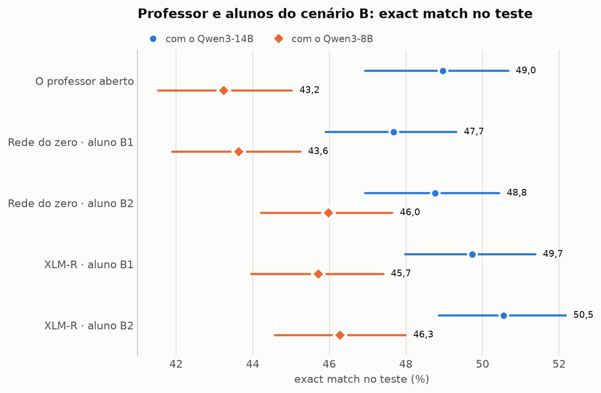
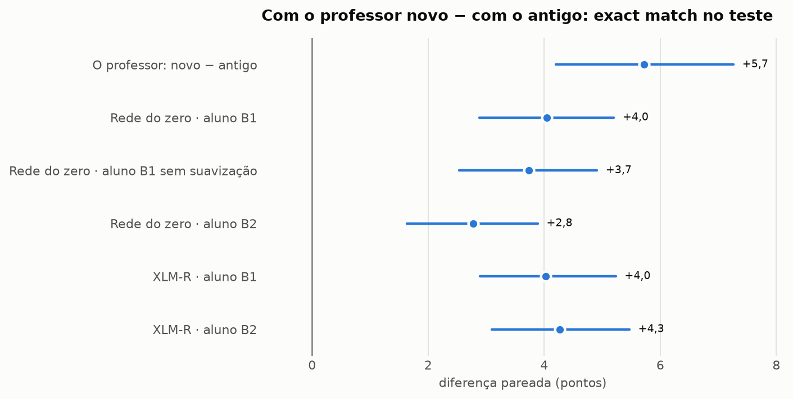
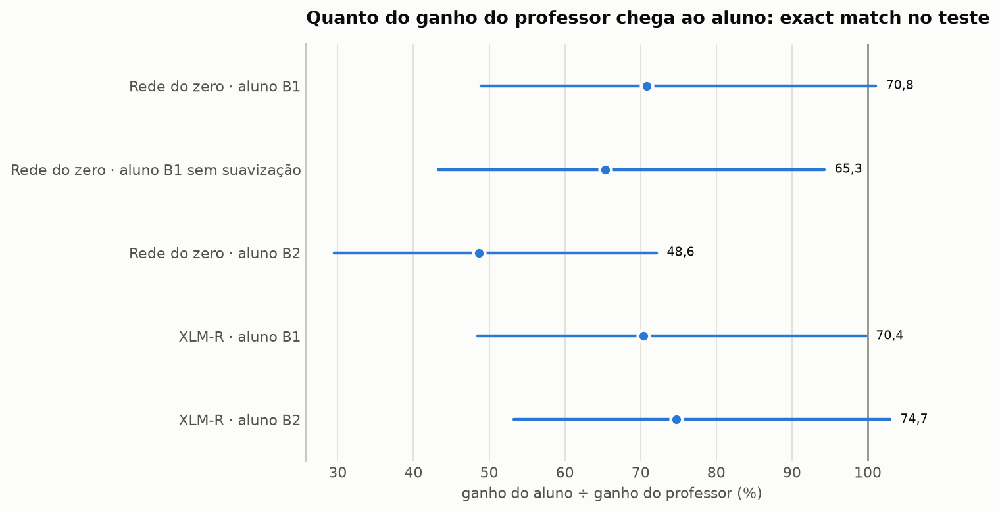
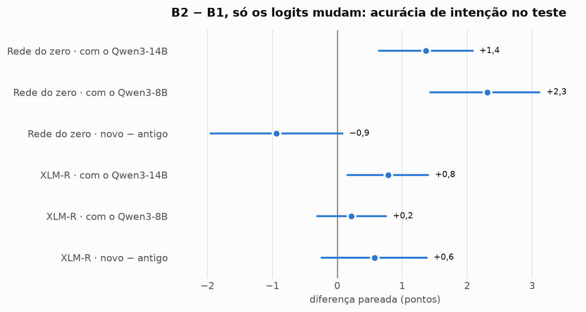
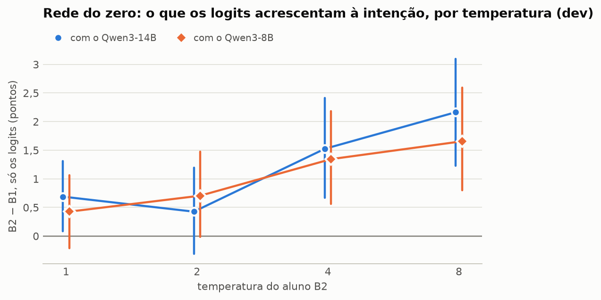
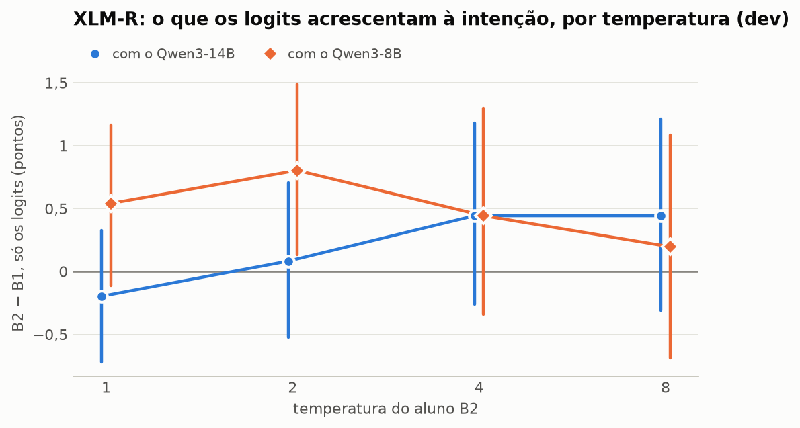
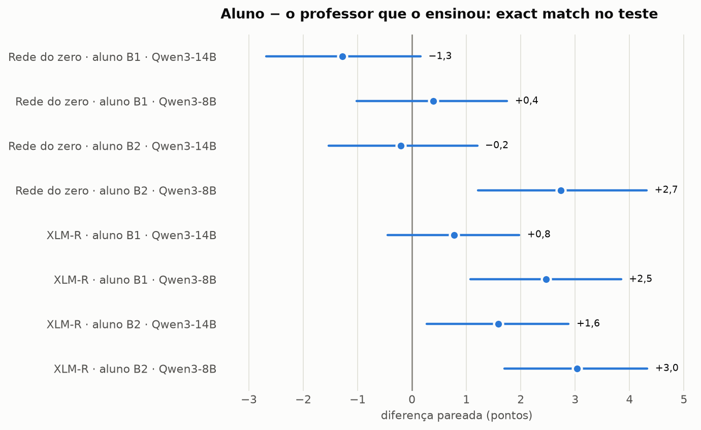
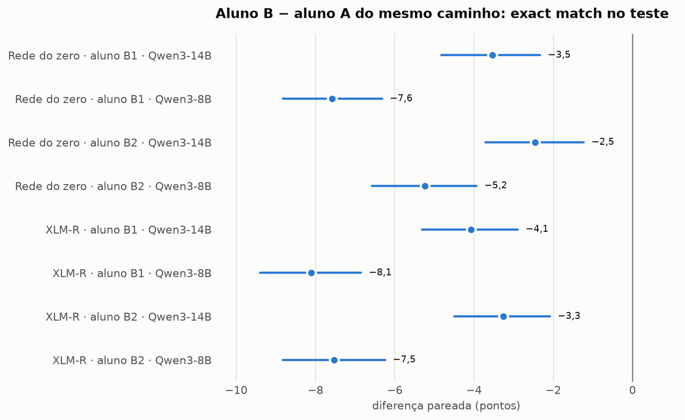

# Etapa 11b · Os alunos do cenário B com o professor aberto maior: resumo da entrega

**Pergunta.** Um professor aberto melhor faz alunos melhores? Quanto do ganho do professor chega ao aluno, e com ele os logits passam a valer mais que os rótulos?

**Resposta.** **Sim: o professor aberto melhor fez os quatro alunos melhores. Pela estimativa pontual, entre 49% e 75% do ganho do professor chegou ao aluno, com intervalos largos; e não dá para afirmar que os logits passaram a valer mais.** O professor passou de 43,2% para 49,0% de exact match no teste (+5,7 (+4,2 a +7,3)). Com a mesma receita e só o professor trocado, os alunos ganharam, em exact match no teste: aluno B1 da rede do zero, +4,0 (+2,9 a +5,2); aluno B2 da rede do zero, +2,8 (+1,6 a +3,9); aluno B1 do XLM-R, +4,0 (+2,9 a +5,2); aluno B2 do XLM-R, +4,3 (+3,1 a +5,5). Os quatro intervalos ficam acima de zero. **O repasse** (ganho do aluno ÷ ganho do professor): aluno B1 da rede do zero, 71% (49 a 101); aluno B2 da rede do zero, 49% (29 a 72); aluno B1 do XLM-R, 70% (48 a 100); aluno B2 do XLM-R, 75% (53 a 103). Em todos, o intervalo fica acima de zero: alguma parte do ganho chegou. Os intervalos são largos, 49 pontos percentuais de largura em média. O intervalo inteiro fica abaixo de 100% em: aluno B2 da rede do zero; em aluno B1 do XLM-R o limite de cima encosta em 100% (70% (48 a 100)); nos outros o intervalo passa de 100%, e não dá para afirmar que o aluno ganhou menos que o professor. Na conta em pontos (ganho do aluno − ganho do professor), o aluno ganhou distinguivelmente menos que o professor em: aluno B2 da rede do zero; em aluno B1 do XLM-R o intervalo encosta em zero (−1,7 (−3,4 a −0,0)). **Os logits:** Não dá para afirmar que passaram a valer mais com o professor novo. Na rede do zero, B2 − B1 (só os logits mudam) em acurácia de intenção vale +1,4 (+0,6 a +2,1) com o Qwen3-14B e +2,3 (+1,4 a +3,1) com o Qwen3-8B; a diferença entre os dois é de −0,9 (−2,0 a +0,1). No XLM-R, B2 − B1 (só os logits mudam) em acurácia de intenção vale +0,8 (+0,2 a +1,4) com o Qwen3-14B e +0,2 (−0,3 a +0,8) com o Qwen3-8B; a diferença entre os dois é de +0,6 (−0,2 a +1,4). **Contra o aluno A:** os alunos novos fazem 77,9 / 61,4 / 47,7 (aluno B1, Rede do zero); 78,6 / 60,4 / 48,8 (aluno B2, Rede do zero); 79,8 / 61,7 / 49,7 (aluno B1, XLM-R); 80,6 / 61,8 / 50,5 (aluno B2, XLM-R) (intenção / F1 de entidades / exact match) e continuam todos distinguivelmente abaixo do aluno A do seu caminho; em exact match a distância foi de −7,6 (−8,8 a −6,3) para −3,5 (−4,8 a −2,3); −5,2 (−6,6 a −3,9) para −2,5 (−3,7 a −1,2); −8,1 (−9,4 a −6,8) para −4,1 (−5,3 a −2,9); −7,5 (−8,8 a −6,2) para −3,3 (−4,5 a −2,1) (mesma ordem).

A única decisão da etapa foi a temperatura do aluno B2, em `dev`: T = 8 na rede do zero (antes, T = 8) e T = 8 no XLM-R (antes, T = 2). Nada segue para a compressão nesta etapa.

## O que mudou e o que não mudou

- **Só o professor aberto mudou:** de Qwen3-8B em 4 bits (`qwen3_8b__nf4__local_3080`, Etapa 5b) para Qwen3-14B em float16 (`qwen3_14b__fp16__colab_a100`, Etapa 11a). Dele vêm os rótulos do treino, os rótulos de `dev` que escolhem a época de parada e, no B2, os logits de intenção.
- **As receitas são as dos alunos antigos, sem nova busca:** rede do zero como na Etapa 6 (B1, o controle sem suavização e o B2 em T = 1, 2, 4, 8), XLM-R como na Etapa 10a (B1 e B2 nas mesmas temperaturas), 3 sementes: 33 treinos. A configuração e a receita de cada variante foram conferidas contra o `meta.json` das execuções antigas.
- **As regras foram gravadas em 2026-11-18 22:04**, antes do primeiro treino (2026-11-18 22:20): a regra da temperatura, o que seria aberto no teste, a lista fechada de comparações e a definição do repasse.
- **Os alunos antigos não foram treinados de novo.** As respostas deles vêm das entregas das Etapas 4b, 6 e 10a; as comparações que aquelas etapas já tinham gravado, refeitas aqui, fecham em 88 de 88 leituras.

## Os sistemas (dev e teste)

Em % (intervalo de 95%), contra os rótulos humanos. Sistemas treinados: média de 3 sementes. Cada B2 está na temperatura escolhida em `dev` com o seu professor.

| Sistema | Intenção (dev) | Entidades (F1) (dev) | Exact match (dev) | Intenção (teste) | Entidades (F1) (teste) | Exact match (teste) |
|---|---|---|---|---|---|---|
| Qwen3-8B em 4 bits (professor aberto antigo) | 77,4 (75,7 a 79,2) | 58,0 (55,9 a 60,1) | 43,2 (41,0 a 45,3) | 77,6 (76,1 a 79,1) | 55,7 (53,9 a 57,4) | 43,2 (41,5 a 45,0) |
| Qwen3-14B (professor aberto novo) | 80,6 (79,0 a 82,3) | 62,4 (60,4 a 64,6) | 49,1 (47,0 a 51,5) | 80,0 (78,6 a 81,4) | 61,4 (59,6 a 63,1) | 49,0 (46,9 a 50,7) |
| Claude Haiku 5.5 (professor fechado) | 84,1 (82,6 a 85,6) | 68,5 (66,5 a 70,5) | 54,7 (52,6 a 57,0) | 83,5 (82,1 a 84,7) | 66,1 (64,5 a 67,7) | 54,0 (52,3 a 55,7) |
| Rede do zero · Aluno B1 (rótulos do Qwen3-8B) | 77,2 (75,6 a 78,8) | 60,0 (57,9 a 61,9) | 45,2 (43,2 a 47,2) | 76,3 (74,9 a 77,7) | 57,1 (55,4 a 58,9) | 43,6 (41,9 a 45,2) |
| Rede do zero · Aluno B1 (rótulos do Qwen3-14B) | 79,1 (77,6 a 80,7) | 62,6 (60,7 a 64,6) | 47,5 (45,6 a 49,5) | 77,9 (76,5 a 79,3) | 61,4 (59,8 a 63,1) | 47,7 (45,9 a 49,3) |
| Rede do zero · Aluno B1 sem suavização (controle, Qwen3-8B) | 76,6 (75,0 a 78,3) | 59,5 (57,5 a 61,4) | 44,3 (42,3 a 46,3) | 75,5 (74,0 a 76,9) | 57,1 (55,4 a 58,8) | 43,3 (41,6 a 45,0) |
| Rede do zero · Aluno B1 sem suavização (controle, Qwen3-14B) | 78,3 (76,7 a 79,9) | 62,9 (61,1 a 64,9) | 47,1 (45,3 a 49,2) | 77,3 (75,9 a 78,7) | 60,9 (59,2 a 62,5) | 47,1 (45,3 a 48,7) |
| Rede do zero · Aluno B2 (logits do Qwen3-8B, T = 8) | 78,3 (76,7 a 79,9) | 60,5 (58,5 a 62,5) | 46,9 (44,9 a 49,0) | 77,8 (76,3 a 79,3) | 58,0 (56,3 a 59,8) | 46,0 (44,2 a 47,6) |
| Rede do zero · Aluno B2 (logits do Qwen3-14B, T = 8) | 80,5 (79,0 a 82,1) | 62,2 (60,3 a 64,1) | 48,5 (46,4 a 50,5) | 78,6 (77,3 a 80,0) | 60,4 (58,7 a 62,1) | 48,8 (46,9 a 50,4) |
| Rede do zero · Aluno A (rótulos do Claude Haiku 5.5) | 81,6 (80,1 a 83,1) | 67,0 (65,0 a 68,9) | 52,0 (50,0 a 54,2) | 80,7 (79,4 a 82,0) | 64,8 (63,2 a 66,5) | 51,2 (49,6 a 52,9) |
| XLM-R · Aluno B1 (rótulos do Qwen3-8B) | 79,0 (77,4 a 80,7) | 61,5 (59,6 a 63,5) | 46,7 (44,7 a 48,8) | 78,7 (77,2 a 80,1) | 58,5 (56,8 a 60,2) | 45,7 (44,0 a 47,4) |
| XLM-R · Aluno B1 (rótulos do Qwen3-14B) | 81,0 (79,4 a 82,5) | 63,3 (61,2 a 65,3) | 50,4 (48,4 a 52,5) | 79,8 (78,4 a 81,1) | 61,7 (60,0 a 63,3) | 49,7 (48,0 a 51,4) |
| XLM-R · Aluno B2 (logits do Qwen3-8B, T = 2) | 79,8 (78,2 a 81,5) | 61,3 (59,4 a 63,2) | 47,3 (45,3 a 49,3) | 78,9 (77,5 a 80,3) | 58,8 (57,1 a 60,5) | 46,3 (44,6 a 48,0) |
| XLM-R · Aluno B2 (logits do Qwen3-14B, T = 8) | 81,4 (79,9 a 83,0) | 63,7 (61,6 a 65,7) | 50,8 (48,8 a 52,9) | 80,6 (79,2 a 81,9) | 61,8 (60,2 a 63,4) | 50,5 (48,9 a 52,2) |
| XLM-R · Aluno A (rótulos do Claude Haiku 5.5) | 83,1 (81,6 a 84,6) | 67,6 (65,6 a 69,6) | 54,4 (52,4 a 56,4) | 82,6 (81,4 a 84,0) | 65,5 (64,0 a 67,2) | 53,8 (52,1 a 55,4) |

## O professor melhor faz alunos melhores? (aluno novo − aluno antigo)

Diferença pareada, em pontos percentuais (intervalo de 95%). Uma diferença só vale quando o intervalo não contém zero. A leitura principal é o exact match no teste.

| Comparação | Intenção (dev) | Entidades (F1) (dev) | Exact match (dev) | Intenção (teste) | Entidades (F1) (teste) | Exact match (teste) |
|---|---|---|---|---|---|---|
| professor novo − professor antigo | +3,1 (+1,8 a +4,5) | +4,5 (+2,8 a +6,2) | +6,0 (+4,2 a +7,7) | +2,4 (+1,3 a +3,6) | +5,7 (+4,3 a +7,1) | +5,7 (+4,2 a +7,3) |
| Rede do zero · aluno B1: com o professor novo − com o antigo | +1,9 (+0,9 a +2,9) | +2,7 (+1,4 a +4,1) | +2,3 (+0,9 a +3,8) | +1,5 (+0,7 a +2,5) | +4,3 (+3,1 a +5,4) | +4,0 (+2,9 a +5,2) |
| Rede do zero · aluno B1 sem suavização: com o professor novo − com o antigo | +1,7 (+0,7 a +2,8) | +3,5 (+2,2 a +4,8) | +2,9 (+1,4 a +4,4) | +1,8 (+0,8 a +2,7) | +3,8 (+2,7 a +5,0) | +3,7 (+2,5 a +4,9) |
| Rede do zero · aluno B2: com o professor novo − com o antigo | +2,2 (+1,2 a +3,2) | +1,7 (+0,4 a +2,9) | +1,6 (+0,2 a +2,8) | +0,8 (−0,1 a +1,8) | +2,4 (+1,3 a +3,4) | +2,8 (+1,6 a +3,9) |
| XLM-R · aluno B1: com o professor novo − com o antigo | +2,0 (+0,8 a +3,0) | +1,7 (+0,4 a +3,1) | +3,7 (+2,2 a +5,1) | +1,1 (+0,2 a +2,0) | +3,2 (+2,1 a +4,3) | +4,0 (+2,9 a +5,2) |
| XLM-R · aluno B2: com o professor novo − com o antigo | +1,6 (+0,6 a +2,6) | +2,3 (+1,1 a +3,7) | +3,5 (+2,2 a +5,0) | +1,6 (+0,8 a +2,5) | +3,0 (+1,9 a +4,1) | +4,3 (+3,1 a +5,5) |
| XLM-R · aluno B2: novo na temperatura do antigo − antigo | +1,2 (+0,1 a +2,3) | +2,7 (+1,4 a +3,9) | +3,2 (+1,8 a +4,6) | +0,9 (+0,0 a +1,8) | +3,0 (+1,8 a +4,1) | +3,6 (+2,4 a +4,8) |

O professor ganhou +5,7 (+4,2 a +7,3) pontos de exact match no teste. Os quatro alunos ficaram distinguivelmente melhores.

- Rede do zero, aluno B1: +4,0 (+2,9 a +5,2) no teste (acima); +2,3 (+0,9 a +3,8) em `dev`.
- Rede do zero, aluno B2: +2,8 (+1,6 a +3,9) no teste (acima); +1,6 (+0,2 a +2,8) em `dev`.
- XLM-R, aluno B1: +4,0 (+2,9 a +5,2) no teste (acima); +3,7 (+2,2 a +5,1) em `dev`.
- XLM-R, aluno B2: +4,3 (+3,1 a +5,5) no teste (acima); +3,5 (+2,2 a +5,0) em `dev`.

## Quanto do ganho do professor chega ao aluno (o repasse)

Repasse = (aluno novo − aluno antigo) ÷ (professor novo − professor antigo), na mesma métrica e partição. O intervalo vem do bootstrap por enunciado com os quatro sistemas reamostrados juntos (2.000 reamostragens): em cada reamostra calcula-se a razão, e ficam os percentis 2,5 e 97,5. A razão só é lida onde o ganho do professor é distinguível de zero. A última coluna de pontos é a mesma conta em diferença (ganho do aluno − ganho do professor).

Exact match:

| Aluno | Ganho do aluno (teste) | Ganho do professor (teste) | Repasse (teste) | Aluno − professor, em pontos (teste) | Repasse (dev) |
|---|---|---|---|---|---|
| Rede do zero · aluno B1 | +4,0 (+2,9 a +5,2) | +5,7 (+4,2 a +7,3) | 71% (49 a 101) | −1,7 (−3,4 a +0,1) | 39% (15 a 66) |
| Rede do zero · aluno B1 sem suavização | +3,7 (+2,5 a +4,9) | +5,7 (+4,2 a +7,3) | 65% (43 a 94) |  | 48% (25 a 77) |
| Rede do zero · aluno B2 | +2,8 (+1,6 a +3,9) | +5,7 (+4,2 a +7,3) | 49% (29 a 72) | −2,9 (−4,6 a −1,3) | 26% (4 a 49) |
| XLM-R · aluno B1 | +4,0 (+2,9 a +5,2) | +5,7 (+4,2 a +7,3) | 70% (48 a 100) | −1,7 (−3,4 a −0,0) | 62% (38 a 92) |
| XLM-R · aluno B2 | +4,3 (+3,1 a +5,5) | +5,7 (+4,2 a +7,3) | 75% (53 a 103) | −1,4 (−3,0 a +0,1) | 60% (36 a 88) |

No teste, em exact match, o repasse vai de 49% a 75% entre os quatro alunos. Em todos, o intervalo fica acima de zero: alguma parte do ganho chegou. Os intervalos são largos, 49 pontos percentuais de largura em média. O intervalo inteiro fica abaixo de 100% em: aluno B2 da rede do zero; em aluno B1 do XLM-R o limite de cima encosta em 100% (70% (48 a 100)); nos outros o intervalo passa de 100%, e não dá para afirmar que o aluno ganhou menos que o professor. Na conta em pontos (ganho do aluno − ganho do professor), o aluno ganhou distinguivelmente menos que o professor em: aluno B2 da rede do zero; em aluno B1 do XLM-R o intervalo encosta em zero (−1,7 (−3,4 a −0,0)).

Nas outras métricas, no teste:

| Aluno | Métrica | Ganho do aluno | Ganho do professor | Repasse |
|---|---|---|---|---|
| Rede do zero · aluno B1 | Intenção | +1,5 (+0,7 a +2,5) | +2,4 (+1,3 a +3,6) | 64% (26 a 126) |
| Rede do zero · aluno B1 sem suavização | Intenção | +1,8 (+0,8 a +2,7) | +2,4 (+1,3 a +3,6) | 73% (34 a 142) |
| Rede do zero · aluno B2 | Intenção | +0,8 (−0,1 a +1,8) | +2,4 (+1,3 a +3,6) | 34% (−3 a 80) |
| XLM-R · aluno B1 | Intenção | +1,1 (+0,2 a +2,0) | +2,4 (+1,3 a +3,6) | 44% (8 a 96) |
| XLM-R · aluno B2 | Intenção | +1,6 (+0,8 a +2,5) | +2,4 (+1,3 a +3,6) | 68% (33 a 131) |
| Rede do zero · aluno B1 | Entidades (F1) | +4,3 (+3,1 a +5,4) | +5,7 (+4,3 a +7,1) | 75% (53 a 104) |
| Rede do zero · aluno B1 sem suavização | Entidades (F1) | +3,8 (+2,7 a +5,0) | +5,7 (+4,3 a +7,1) | 67% (45 a 94) |
| Rede do zero · aluno B2 | Entidades (F1) | +2,4 (+1,3 a +3,4) | +5,7 (+4,3 a +7,1) | 42% (23 a 64) |
| XLM-R · aluno B1 | Entidades (F1) | +3,2 (+2,1 a +4,3) | +5,7 (+4,3 a +7,1) | 56% (36 a 78) |
| XLM-R · aluno B2 | Entidades (F1) | +3,0 (+1,9 a +4,1) | +5,7 (+4,3 a +7,1) | 52% (33 a 76) |

## O que os logits valem com cada professor (B2 − B1)

| Comparação | Intenção (dev) | Entidades (F1) (dev) | Exact match (dev) | Intenção (teste) | Entidades (F1) (teste) | Exact match (teste) |
|---|---|---|---|---|---|---|
| Rede do zero · professor novo: B2 − B1 sem suavização · só os logits mudam | +2,2 (+1,2 a +3,1) | −0,8 (−1,7 a +0,1) | +1,3 (+0,2 a +2,4) | +1,4 (+0,6 a +2,1) | −0,5 (−1,2 a +0,3) | +1,7 (+0,8 a +2,6) |
| Rede do zero · professor antigo: B2 − B1 sem suavização · só os logits mudam | +1,7 (+0,8 a +2,6) | +1,0 (+0,0 a +2,1) | +2,6 (+1,6 a +3,7) | +2,3 (+1,4 a +3,1) | +1,0 (+0,1 a +1,8) | +2,7 (+1,7 a +3,7) |
| XLM-R · professor novo: B2 − B1 · só os logits mudam | +0,4 (−0,3 a +1,2) | +0,4 (−0,4 a +1,2) | +0,4 (−0,5 a +1,3) | +0,8 (+0,2 a +1,4) | +0,1 (−0,5 a +0,9) | +0,8 (+0,1 a +1,5) |
| XLM-R · professor antigo: B2 − B1 · só os logits mudam | +0,8 (+0,1 a +1,5) | −0,2 (−0,9 a +0,5) | +0,6 (−0,2 a +1,3) | +0,2 (−0,3 a +0,8) | +0,3 (−0,2 a +0,9) | +0,6 (−0,0 a +1,2) |
| Rede do zero · professor novo: B2 − B1 · entram os logits e sai a suavização | +1,4 (+0,5 a +2,3) | −0,5 (−1,4 a +0,4) | +1,0 (−0,2 a +2,0) | +0,8 (+0,1 a +1,6) | −1,0 (−1,8 a −0,2) | +1,1 (+0,2 a +2,0) |
| Rede do zero · professor antigo: B2 − B1 · entram os logits e sai a suavização | +1,1 (+0,2 a +2,0) | +0,5 (−0,5 a +1,6) | +1,7 (+0,7 a +2,9) | +1,5 (+0,7 a +2,3) | +0,9 (+0,0 a +1,7) | +2,3 (+1,4 a +3,3) |

A diferença das diferenças, (B2 − B1 com o professor novo) − (B2 − B1 com o antigo):

| Comparação | Intenção (dev) | Entidades (F1) (dev) | Exact match (dev) | Intenção (teste) | Entidades (F1) (teste) | Exact match (teste) |
|---|---|---|---|---|---|---|
| Rede do zero · o valor dos logits (só os logits mudam): com o professor novo − com o antigo | +0,5 (−0,6 a +1,6) | −1,8 (−3,1 a −0,6) | −1,3 (−2,8 a +0,0) | −0,9 (−2,0 a +0,1) | −1,4 (−2,5 a −0,4) | −1,0 (−2,1 a +0,2) |
| XLM-R · o valor dos logits (só os logits mudam): com o professor novo − com o antigo | −0,4 (−1,3 a +0,6) | +0,6 (−0,4 a +1,7) | −0,1 (−1,3 a +1,0) | +0,6 (−0,2 a +1,4) | −0,2 (−1,1 a +0,7) | +0,2 (−0,7 a +1,1) |
| Rede do zero · B2 − B1 (entram os logits e sai a suavização): com o professor novo − com o antigo | +0,3 (−0,7 a +1,4) | −1,0 (−2,3 a +0,2) | −0,8 (−2,2 a +0,6) | −0,7 (−1,7 a +0,3) | −1,9 (−3,0 a −0,8) | −1,3 (−2,4 a −0,1) |

- **Rede do zero.** Com o Qwen3-14B, os logits valem em intenção: +1,4 (+0,6 a +2,1); com o Qwen3-8B, valem: +2,3 (+1,4 a +3,1). A diferença das diferenças é de −0,9 (−2,0 a +0,1) no teste (+0,5 (−0,6 a +1,6) em `dev`): não dá para afirmar que mudaram de valor. Em exact match, B2 − B1 vale +1,7 (+0,8 a +2,6) com o novo e +2,7 (+1,7 a +3,7) com o antigo.
- **XLM-R.** Com o Qwen3-14B, os logits valem em intenção: +0,8 (+0,2 a +1,4); com o Qwen3-8B, não se distinguem de zero: +0,2 (−0,3 a +0,8). A diferença das diferenças é de +0,6 (−0,2 a +1,4) no teste (−0,4 (−1,3 a +0,6) em `dev`): não dá para afirmar que mudaram de valor. Em exact match, B2 − B1 vale +0,8 (+0,1 a +1,5) com o novo e +0,6 (−0,0 a +1,2) com o antigo. Em `dev` a leitura de cada professor é outra: +0,4 (−0,3 a +1,2) com o novo (sem diferença distinguível) e +0,8 (+0,1 a +1,5) com o antigo (acima).
- Na rede do zero, com o professor novo, o F1 de entidades do B2 fica sem diferença distinguível em relação ao controle (−0,5 (−1,2 a +0,3)); contra o B1 com suavização, −1,0 (−1,8 a −0,2). Os logits são só de intenção: as entidades do B2 vêm dos mesmos rótulos do B1.

## A temperatura do aluno B2 (dev)

Regra: a da Etapa 6 (`etapa6.escolher_temperatura`), aplicada em cada caminho, com o professor novo: maior acurácia de intenção em dev (rótulos humanos), média de 3 sementes; empate exato: maior exact match, depois a menor temperatura. A grade é a das Etapas 6 e 10a e não é ampliada, mesmo que a escolhida fique na ponta.

| Caminho | T | Intenção do B2 novo | Exact match do B2 novo | Intenção: B2 − B1, só os logits (novo) | Intenção: a escolhida − esta (novo) | Escolhida com o professor novo | Intenção do B2 antigo | Intenção: B2 − B1, só os logits (antigo) | Escolhida com o professor antigo |
|---|---|---|---|---|---|---|---|---|---|
| Rede do zero | 1 | 79,01 | 47,68 | +0,7 (+0,1 a +1,3) | +1,5 (+0,6 a +2,4) |  | 77,06 | +0,4 (−0,2 a +1,1) |  |
| Rede do zero | 2 | 78,75 | 47,04 | +0,4 (−0,3 a +1,2) | +1,7 (+0,9 a +2,5) |  | 77,34 | +0,7 (−0,0 a +1,5) |  |
| Rede do zero | 4 | 79,85 | 48,11 | +1,5 (+0,7 a +2,4) | +0,6 (+0,0 a +1,3) |  | 77,98 | +1,3 (+0,6 a +2,2) |  |
| Rede do zero | 8 | 80,49 | 48,45 | +2,2 (+1,2 a +3,1) |  | sim | 78,29 | +1,7 (+0,8 a +2,6) | sim |
| XLM-R | 1 | 80,80 | 50,22 | −0,2 (−0,7 a +0,3) | +0,6 (−0,0 a +1,3) |  | 79,59 | +0,5 (−0,1 a +1,2) |  |
| XLM-R | 2 | 81,08 | 50,48 | +0,1 (−0,5 a +0,7) | +0,4 (−0,3 a +1,0) |  | 79,85 | +0,8 (+0,1 a +1,5) | sim |
| XLM-R | 4 | 81,44 | 50,16 | +0,4 (−0,3 a +1,2) | +0,0 (−0,6 a +0,6) |  | 79,49 | +0,4 (−0,3 a +1,3) |  |
| XLM-R | 8 | 81,44 | 50,83 | +0,4 (−0,3 a +1,2) |  | sim | 79,24 | +0,2 (−0,7 a +1,1) |  |

- **Rede do zero: T = 8**, a mesma do professor antigo. A escolhida é distinguivelmente melhor que T = 1, 2; entre a melhor e a pior temperatura há 1,7 ponto de intenção. É a maior da grade: daqui não dá para saber se uma temperatura ainda maior seria melhor, e a grade não foi ampliada.
- **XLM-R: T = 8**; com o professor antigo era T = 2. Em intenção, T = 8 empata exatamente com T = 4 (81,44%); o desempate foi pelo exact match (50,83% contra 50,16%). A escolhida não é distinguivelmente melhor que nenhuma das outras; entre a melhor e a pior temperatura há 0,6 ponto de intenção. É a maior da grade: daqui não dá para saber se uma temperatura ainda maior seria melhor, e a grade não foi ampliada.
- Pela regra da Etapa 6 para "quem segue", aplicada só como relato, o aluno que representa o cenário B é: Rede do zero: o B2 (em `dev`, B2 − B1 em intenção: +1,4, de +0,5 a +2,3); XLM-R: o B1 (em `dev`, B2 − B1 em intenção: +0,4, de −0,3 a +1,2).

## O aluno ao lado do seu professor e do aluno A

| Comparação | Intenção (dev) | Entidades (F1) (dev) | Exact match (dev) | Intenção (teste) | Entidades (F1) (teste) | Exact match (teste) |
|---|---|---|---|---|---|---|
| Rede do zero · aluno B1 − professor novo | −1,5 (−2,9 a −0,1) | +0,2 (−1,3 a +1,8) | −1,7 (−3,4 a +0,0) | −2,2 (−3,3 a −1,0) | −0,0 (−1,3 a +1,3) | −1,3 (−2,7 a +0,2) |
| Rede do zero · aluno B1 − professor antigo | −0,2 (−1,7 a +1,2) | +2,0 (+0,4 a +3,6) | +2,0 (+0,3 a +3,7) | −1,3 (−2,5 a −0,1) | +1,4 (+0,1 a +2,9) | +0,4 (−1,0 a +1,7) |
| Rede do zero · aluno B2 − professor novo | −0,1 (−1,5 a +1,2) | −0,3 (−1,8 a +1,4) | −0,7 (−2,5 a +1,0) | −1,4 (−2,5 a −0,2) | −1,0 (−2,4 a +0,3) | −0,2 (−1,5 a +1,2) |
| Rede do zero · aluno B2 − professor antigo | +0,9 (−0,6 a +2,3) | +2,5 (+0,9 a +4,2) | +3,7 (+1,9 a +5,5) | +0,2 (−1,0 a +1,3) | +2,3 (+0,8 a +3,9) | +2,7 (+1,2 a +4,3) |
| XLM-R · aluno B1 − professor novo | +0,4 (−0,9 a +1,7) | +0,8 (−0,6 a +2,4) | +1,3 (−0,3 a +2,8) | −0,3 (−1,3 a +0,8) | +0,2 (−0,9 a +1,4) | +0,8 (−0,4 a +2,0) |
| XLM-R · aluno B1 − professor antigo | +1,6 (+0,3 a +2,9) | +3,6 (+2,1 a +5,1) | +3,5 (+1,9 a +5,1) | +1,1 (−0,0 a +2,2) | +2,8 (+1,5 a +4,2) | +2,5 (+1,1 a +3,8) |
| XLM-R · aluno B2 − professor novo | +0,9 (−0,3 a +2,1) | +1,3 (−0,3 a +2,8) | +1,7 (+0,1 a +3,2) | +0,5 (−0,5 a +1,6) | +0,4 (−0,8 a +1,6) | +1,6 (+0,3 a +2,9) |
| XLM-R · aluno B2 − professor antigo | +2,4 (+1,1 a +3,7) | +3,4 (+1,9 a +4,9) | +4,1 (+2,5 a +5,7) | +1,3 (+0,2 a +2,4) | +3,1 (+1,9 a +4,5) | +3,0 (+1,7 a +4,3) |
| Rede do zero · aluno B1 do professor novo − aluno A | −2,5 (−3,5 a −1,5) | −4,3 (−5,6 a −3,0) | −4,6 (−6,1 a −3,0) | −2,9 (−3,8 a −1,9) | −3,4 (−4,5 a −2,3) | −3,5 (−4,8 a −2,3) |
| Rede do zero · aluno B1 do professor antigo − aluno A | −4,4 (−5,6 a −3,3) | −7,0 (−8,4 a −5,6) | −6,9 (−8,5 a −5,3) | −4,4 (−5,4 a −3,4) | −7,7 (−8,9 a −6,6) | −7,6 (−8,8 a −6,3) |
| Rede do zero · aluno B2 do professor novo − aluno A | −1,1 (−2,2 a −0,0) | −4,8 (−6,2 a −3,5) | −3,6 (−5,2 a −2,2) | −2,1 (−3,0 a −1,1) | −4,4 (−5,6 a −3,3) | −2,5 (−3,7 a −1,2) |
| Rede do zero · aluno B2 do professor antigo − aluno A | −3,3 (−4,6 a −2,2) | −6,5 (−7,9 a −5,1) | −5,1 (−6,7 a −3,7) | −2,9 (−3,9 a −1,9) | −6,8 (−8,0 a −5,6) | −5,2 (−6,6 a −3,9) |
| XLM-R · aluno B1 do professor novo − aluno A | −2,1 (−3,1 a −1,1) | −4,3 (−5,7 a −3,0) | −4,0 (−5,4 a −2,5) | −2,9 (−3,8 a −2,0) | −3,9 (−5,0 a −2,9) | −4,1 (−5,3 a −2,9) |
| XLM-R · aluno B1 do professor antigo − aluno A | −4,1 (−5,1 a −3,0) | −6,0 (−7,4 a −4,7) | −7,6 (−9,2 a −6,0) | −4,0 (−4,9 a −3,0) | −7,1 (−8,1 a −6,0) | −8,1 (−9,4 a −6,8) |
| XLM-R · aluno B2 do professor novo − aluno A | −1,7 (−2,7 a −0,6) | −3,9 (−5,2 a −2,5) | −3,5 (−5,0 a −2,1) | −2,1 (−3,0 a −1,3) | −3,7 (−4,8 a −2,7) | −3,3 (−4,5 a −2,1) |
| XLM-R · aluno B2 do professor antigo − aluno A | −3,3 (−4,4 a −2,2) | −6,2 (−7,6 a −4,8) | −7,1 (−8,6 a −5,6) | −3,7 (−4,6 a −2,8) | −6,7 (−7,9 a −5,6) | −7,5 (−8,8 a −6,2) |
| professor novo − professor fechado | −3,5 (−4,9 a −2,2) | −6,0 (−7,7 a −4,3) | −5,6 (−7,6 a −3,6) | −3,4 (−4,5 a −2,3) | −4,6 (−6,1 a −3,3) | −5,1 (−6,7 a −3,5) |
| professor antigo − professor fechado | −6,7 (−8,2 a −5,2) | −10,5 (−12,2 a −8,7) | −11,6 (−13,4 a −9,6) | −5,9 (−7,2 a −4,5) | −10,4 (−11,9 a −8,9) | −10,8 (−12,4 a −9,1) |

- **Contra o professor.** Em exact match no teste, passam o Qwen3-14B com intervalo todo acima de zero: aluno B2 do XLM-R; ficam abaixo: nenhum. Com o Qwen3-8B, passavam o professor: aluno B2 da rede do zero, aluno B1 do XLM-R, aluno B2 do XLM-R. Rede do zero, aluno B1: −1,3 (−2,7 a +0,2) (antes, +0,4 (−1,0 a +1,7)). Rede do zero, aluno B2: −0,2 (−1,5 a +1,2) (antes, +2,7 (+1,2 a +4,3)). XLM-R, aluno B1: +0,8 (−0,4 a +2,0) (antes, +2,5 (+1,1 a +3,8)). XLM-R, aluno B2: +1,6 (+0,3 a +2,9) (antes, +3,0 (+1,7 a +4,3)).
- **Contra o aluno A.** Os quatro alunos novos continuam distinguivelmente abaixo do aluno A do seu caminho, mas a distância encolheu: Rede do zero, aluno B1: de −7,6 (−8,8 a −6,3) para −3,5 (−4,8 a −2,3). Rede do zero, aluno B2: de −5,2 (−6,6 a −3,9) para −2,5 (−3,7 a −1,2). XLM-R, aluno B1: de −8,1 (−9,4 a −6,8) para −4,1 (−5,3 a −2,9). XLM-R, aluno B2: de −7,5 (−8,8 a −6,2) para −3,3 (−4,5 a −2,1). Entre os professores, o Qwen3-14B está a −5,1 (−6,7 a −3,5) do Claude Haiku 5.5.

A fração do caminho entre o piso e o teto, no teste ((aluno − piso) / (teto − piso), cada caminho com o seu piso e o seu teto):

| Sistema | Intenção | Entidades (F1) | Exact match |
|---|---|---|---|
| Rede do zero · Aluno B1 (rótulos do Qwen3-8B) | 82% (79 a 84) | 50% (46 a 54) | 55% (51 a 58) |
| Rede do zero · Aluno B1 (rótulos do Qwen3-14B) | 85% (83 a 88) | 63% (59 a 66) | 64% (61 a 67) |
| Rede do zero · Aluno B2 (logits do Qwen3-8B, T = 8) | 85% (83 a 88) | 52% (48 a 56) | 60% (57 a 64) |
| Rede do zero · Aluno B2 (logits do Qwen3-14B, T = 8) | 87% (85 a 90) | 60% (56 a 63) | 67% (64 a 70) |
| Rede do zero · Aluno A (rótulos do Claude Haiku 5.5) | 92% (90 a 94) | 73% (70 a 77) | 73% (70 a 76) |
| XLM-R · Aluno B1 (rótulos do Qwen3-8B) | 74% (71 a 78) | 25% (19 a 31) | 39% (35 a 43) |
| XLM-R · Aluno B1 (rótulos do Qwen3-14B) | 78% (75 a 81) | 39% (34 a 44) | 51% (47 a 55) |
| XLM-R · Aluno B2 (logits do Qwen3-8B, T = 2) | 75% (72 a 78) | 26% (21 a 32) | 41% (36 a 44) |
| XLM-R · Aluno B2 (logits do Qwen3-14B, T = 8) | 80% (77 a 83) | 40% (35 a 45) | 53% (49 a 57) |
| XLM-R · Aluno A (rótulos do Claude Haiku 5.5) | 87% (84 a 90) | 56% (51 a 61) | 63% (59 a 66) |

O aluno imita o professor? (teste)

| Aluno | Intenção igual à do professor | Resposta inteira igual à do professor | Só o aluno acerta a intenção | Só o professor acerta a intenção | Os dois erram a intenção com a mesma resposta |
|---|---|---|---|---|---|
| Rede do zero · Aluno A (rótulos do Claude Haiku 5.5) | 83,6 (82,3 a 84,8) | 60,7 (59,0 a 62,3) | 4,5% | 7,2% | 7,3% |
| XLM-R · Aluno A (rótulos do Claude Haiku 5.5) | 86,5 (85,4 a 87,6) | 64,2 (62,7 a 65,7) | 4,3% | 5,1% | 8,1% |
| Rede do zero · Aluno B1 (rótulos do Qwen3-8B) | 79,2 (77,7 a 80,5) | 48,8 (47,1 a 50,4) | 6,2% | 7,5% | 9,0% |
| Rede do zero · Aluno B1 (rótulos do Qwen3-14B) | 81,7 (80,4 a 83,0) | 55,6 (53,9 a 57,2) | 5,2% | 7,3% | 9,0% |
| Rede do zero · Aluno B2 (logits do Qwen3-8B, T = 8) | 80,1 (78,7 a 81,5) | 47,6 (45,9 a 49,3) | 6,8% | 6,6% | 9,1% |
| Rede do zero · Aluno B2 (logits do Qwen3-14B, T = 8) | 82,6 (81,3 a 83,9) | 55,4 (53,7 a 57,1) | 5,4% | 6,7% | 9,3% |
| XLM-R · Aluno B1 (rótulos do Qwen3-8B) | 82,1 (80,9 a 83,4) | 53,1 (51,4 a 54,7) | 6,4% | 5,3% | 9,8% |
| XLM-R · Aluno B1 (rótulos do Qwen3-14B) | 85,3 (84,1 a 86,5) | 61,2 (59,6 a 62,7) | 4,7% | 5,0% | 10,2% |
| XLM-R · Aluno B2 (logits do Qwen3-8B, T = 2) | 83,2 (82,0 a 84,5) | 53,1 (51,4 a 54,8) | 6,2% | 4,9% | 10,4% |
| XLM-R · Aluno B2 (logits do Qwen3-14B, T = 8) | 86,4 (85,3 a 87,6) | 60,7 (59,0 a 62,2) | 4,9% | 4,4% | 10,8% |

## Onde dev e teste discordam

De 93 leituras (31 comparações × 3 métricas), 11 mudam de veredito entre `dev` e o teste; em 0 o sinal se inverte.

- **Novo − antigo, em exact match:** as quatro comparações principais têm o mesmo veredito em dev e no teste.
- **Logits, em intenção:** 2 das 4 comparações 'só os logits mudam' mudam de veredito: XLM-R · professor novo: B2 − B1 · só os logits mudam (+0,4 (−0,3 a +1,2) em dev, +0,8 (+0,2 a +1,4) no teste); XLM-R · professor antigo: B2 − B1 · só os logits mudam (+0,8 (+0,1 a +1,5) em dev, +0,2 (−0,3 a +0,8) no teste).
- **Repasse em exact match:** Rede do zero, aluno B1: 39% em dev e 71% no teste; Rede do zero, aluno B2: 26% em dev e 49% no teste; XLM-R, aluno B1: 62% em dev e 70% no teste; XLM-R, aluno B2: 60% em dev e 75% no teste. O ganho do professor é quase o mesmo nas duas partições; o que oscila é o ganho do aluno.

| Comparação | Métrica | dev | Leitura em dev | teste | Leitura no teste |
|---|---|---|---|---|---|
| Rede do zero · aluno B2: com o professor novo − com o antigo | Intenção | +2,2 (+1,2 a +3,2) | acima | +0,8 (−0,1 a +1,8) | sem diferença distinguível |
| Rede do zero · professor novo: B2 − B1 · entram os logits e sai a suavização | Entidades (F1) | −0,5 (−1,4 a +0,4) | sem diferença distinguível | −1,0 (−1,8 a −0,2) | abaixo |
| Rede do zero · professor novo: B2 − B1 · entram os logits e sai a suavização | Exact match | +1,0 (−0,2 a +2,0) | sem diferença distinguível | +1,1 (+0,2 a +2,0) | acima |
| Rede do zero · aluno B2 − professor novo | Intenção | −0,1 (−1,5 a +1,2) | sem diferença distinguível | −1,4 (−2,5 a −0,2) | abaixo |
| Rede do zero · professor antigo: B2 − B1 · entram os logits e sai a suavização | Entidades (F1) | +0,5 (−0,5 a +1,6) | sem diferença distinguível | +0,9 (+0,0 a +1,7) | acima |
| Rede do zero · aluno B1 − professor antigo | Intenção | −0,2 (−1,7 a +1,2) | sem diferença distinguível | −1,3 (−2,5 a −0,1) | abaixo |
| Rede do zero · aluno B1 − professor antigo | Exact match | +2,0 (+0,3 a +3,7) | acima | +0,4 (−1,0 a +1,7) | sem diferença distinguível |
| XLM-R · professor novo: B2 − B1 · só os logits mudam | Intenção | +0,4 (−0,3 a +1,2) | sem diferença distinguível | +0,8 (+0,2 a +1,4) | acima |
| XLM-R · professor novo: B2 − B1 · só os logits mudam | Exact match | +0,4 (−0,5 a +1,3) | sem diferença distinguível | +0,8 (+0,1 a +1,5) | acima |
| XLM-R · professor antigo: B2 − B1 · só os logits mudam | Intenção | +0,8 (+0,1 a +1,5) | acima | +0,2 (−0,3 a +0,8) | sem diferença distinguível |
| XLM-R · aluno B1 − professor antigo | Intenção | +1,6 (+0,3 a +2,9) | acima | +1,1 (−0,0 a +2,2) | sem diferença distinguível |

## Os treinos

| Sistema | Exemplos de treino | Época escolhida (sementes 0, 1 e 2) | Escolheram a última época |
|---|---|---|---|
| Rede do zero · Aluno B1 (rótulos do Qwen3-14B) | 11.514 | 30, 30, 50 | 0 de 3 |
| Rede do zero · Aluno B1 sem suavização de rótulos (controle do B2; rótulos do Qwen3-14B) | 11.514 | 35, 45, 25 | 0 de 3 |
| Rede do zero · Aluno B2 (logits do Qwen3-14B, temperatura 1) | 11.514 | 20, 25, 30 | 0 de 3 |
| Rede do zero · Aluno B2 (logits do Qwen3-14B, temperatura 2) | 11.514 | 70, 65, 60 | 0 de 3 |
| Rede do zero · Aluno B2 (logits do Qwen3-14B, temperatura 4) | 11.514 | 75, 70, 80 | 1 de 3 |
| Rede do zero · Aluno B2 (logits do Qwen3-14B, temperatura 8) | 11.514 | 80, 80, 75 | 2 de 3 |
| XLM-R · Aluno B1 (rótulos do Qwen3-14B) | 11.514 | 10, 9, 9 | 1 de 3 |
| XLM-R · Aluno B2 (logits do Qwen3-14B, temperatura 1) | 11.514 | 10, 10, 9 | 2 de 3 |
| XLM-R · Aluno B2 (logits do Qwen3-14B, temperatura 2) | 11.514 | 10, 9, 9 | 1 de 3 |
| XLM-R · Aluno B2 (logits do Qwen3-14B, temperatura 4) | 11.514 | 10, 9, 9 | 1 de 3 |
| XLM-R · Aluno B2 (logits do Qwen3-14B, temperatura 8) | 11.514 | 8, 9, 8 | 0 de 3 |

- A rodada levou 92 minutos de relógio para 33 treinos: a rede do zero com 7 de cada vez, depois o XLM-R em fila.
- Rede do zero: 8,4 s por época por treino, com 7 treinos juntos na placa. XLM-R: 22,3 s por época, com pico de 2,8 GB na placa; na Etapa 10a o mesmo treino levava 11,7 s. A causa provável é a placa dividida com outros programas da máquina, vistos no `nvidia-smi` antes do lançamento; a rodada não mediu isso. O resultado de um treino não depende do tempo que ele leva.
- O código do pacote ficou igual do começo ao fim da rodada: sim. A cópia do código com que os treinos rodaram está no cache da etapa.

## Os artigos: o que sustentam e o que não

Cada referência foi conferida na API do arXiv; só o resumo foi lido.

| Referência | Para que serve aqui | Na fonte | O que o resumo sustenta, e o que não cobre |
|---|---|---|---|
| Hinton, Vinyals & Dean, [arXiv 1503.02531](https://arxiv.org/abs/1503.02531) | A perda do aluno B2: os logits do professor amolecidos por uma temperatura | conferida | em parte: o resumo fala em destilar um conjunto de modelos num modelo só; a temperatura, os alvos suaves e o fator T² estão no corpo do artigo, que não foi relido aqui (a perda do projeto tem teste próprio contra a conta à mão) |
| Cho & Hariharan, [arXiv 1910.01348](https://arxiv.org/abs/1910.01348) | Um professor mais exato não faz, por si só, um aluno melhor | conferida | em parte: o resumo diz que professores mais exatos muitas vezes não são bons professores e que modelos maiores não costumam ensinar melhor, por diferença de capacidade. Sustenta a pergunta (o ganho do professor não chega ao aluno por garantia), não a resposta: o resumo não diz em que dados mediu, e lá o professor é uma rede treinada na mesma tarefa; aqui é uma LLM com poucos exemplos no prompt, e o aluno não vê rótulo humano |
| Mirzadeh et al., [arXiv 1902.03393](https://arxiv.org/abs/1902.03393) | A distância de tamanho entre professor e aluno atrapalha a destilação | conferida | em parte: o resumo diz que o aluno piora quando a distância para o professor é grande e que um aluno fixo não aproveita um professor arbitrariamente grande; experimentos em CIFAR-10, CIFAR-100 e ImageNet, com CNN e ResNet. Não sustenta nada sobre texto nem sobre LLM como professora: aqui os dois professores são milhares de vezes maiores que o aluno, e a etapa mede um degrau só (8B para 14B) |
| Menon et al., [arXiv 2005.10419](https://arxiv.org/abs/2005.10419) | O que os logits valem depende de quão bem aproximam as probabilidades de cada classe | conferida | em parte: o resumo diz que o professor estima as probabilidades de classe de Bayes e que o aluno ganha com um conhecimento aproximado delas (um compromisso entre viés e variância). Sustenta que o valor dos logits depende da qualidade das probabilidades, e não só do acerto; o resumo não compara professores de acertos diferentes |
| Yuan et al., [arXiv 1909.11723](https://arxiv.org/abs/1909.11723) | Parte do ganho dos alvos suaves é regularização, como a suavização de rótulos (o controle do B2) | conferida | em parte: o resumo diz que a destilação é uma suavização de rótulos aprendida e que até um professor mal treinado melhora o aluno. Sustenta o controle desta etapa (separar os logits da suavização); os experimentos são de visão, e não com rótulos de LLM |
| Stanton et al., [arXiv 2106.05945](https://arxiv.org/abs/2106.05945) | Imitar o professor e acertar a tarefa são medidas diferentes (aluno − professor e concordância) | conferida | em parte: o resumo diz que sobra uma distância grande entre as previsões do professor e do aluno, e que imitar melhor nem sempre generaliza melhor. Sustenta medir a concordância com o professor à parte da qualidade; não trata de professor que só entrega rótulos |
| Furlanello et al., [arXiv 1805.04770](https://arxiv.org/abs/1805.04770) | Um aluno pode passar o seu professor | conferida | em parte: o resumo diz que alunos com a mesma arquitetura do professor o superam, em visão e em modelagem de linguagem. Sustenta que um aluno passar o professor é um fenômeno conhecido; aqui o aluno é muito menor que o professor e de outra família, caso que o resumo não cobre |

## Critério de pronto

| Critério | Atendido |
|---|---|
| Regras gravadas antes do primeiro treino (22:04 contra 22:20) | sim |
| As 33 execuções estão prontas, 3 sementes por variante, sem erro na rodada | sim |
| Toda execução leu do professor novo os rótulos do treino, os de dev e, no B2, os logits | sim |
| A configuração e a receita de cada variante são as do aluno antigo de mesmo nome | sim |
| Nenhum rótulo humano entrou no treino nem na parada dos alunos | sim |
| A temperatura do B2 saiu de dev, pela regra da Etapa 6, e o teste só foi aberto para os sistemas previstos | sim |
| Toda comparação da lista fechada está calculada em dev e no teste (31 diferenças, 7 diferenças de diferenças, 5 repasses) | sim |
| As comparações dos alunos antigos, refeitas aqui, fecham com as entregues (88 de 88 leituras) | sim |
| Nada no cache e na entrega das Etapas 6 e 10a mudou desde antes do primeiro treino | sim |
| O código do pacote não mudou durante a rodada | sim |
| Os modelos entregues, relidos do disco na CPU, repetem as respostas medidas no teste | sim |
| Os 4 sistemas declarados entram na tabela do comparativo com o número desta etapa | sim |
| Cada referência foi conferida na fonte | sim |

## Limites

- **Um degrau, uma família, uma rotulagem.** A etapa compara dois professores da mesma família (Qwen3-8B em 4 bits e Qwen3-14B em float16), cada um com uma rotulagem só. Entre eles mudam o tamanho, a compressão e a máquina; a Etapa 11a mediu que a compressão sozinha não muda o exact match, mas o que chega ao aluno é o pacote. O resultado não diz o que aconteceria com um professor ainda maior nem com outra família.
- **O repasse tem intervalo largo.** A razão divide dois ganhos de poucos pontos, e a incerteza dos dois entra na conta: no teste, em exact match, os intervalos têm 49 pontos percentuais de largura em média. Os números pontuais (49% a 75%) não devem ser lidos como medida fina, e em `dev` eles são outros (ver "Onde dev e teste discordam").
- **11 exemplos de treino a mais.** O professor antigo deixou 11.503 pedidos do treino com rótulo aproveitável; o novo, 11.514. Os alunos novos treinam com 11 exemplos a mais (0,10% do treino). Faz parte da troca de professor e não foi separado do efeito dos rótulos melhores.
- **O que os artigos sustentam.** Cho & Hariharan e Mirzadeh et al. sustentam a pergunta (um professor melhor ou maior não garante um aluno melhor), não a resposta: lá o professor é uma rede treinada na mesma tarefa e o aluno treina com rótulos verdadeiros; aqui o professor é uma LLM com poucos exemplos no prompt e o aluno nunca vê rótulo humano. Esta etapa não separa "professor maior" de "professor mais exato": no degrau medido, as duas coisas vêm juntas. Só os resumos dos artigos foram lidos.
- **A temperatura do B2 foi escolhida com os rótulos humanos de `dev`**, que o cenário não tem, e entre 4 tentativas; o B1 teve uma só. Toda comparação do B2 em `dev` carrega essa vantagem; por isso a leitura principal é no teste.
- **A temperatura escolhida é a maior da grade** em: Rede do zero, XLM-R; a grade não foi ampliada. No caminho XLM-R, T = 8 e T = 4 empatam em intenção em `dev`, e o desempate foi pelo exact match: outra amostra de `dev` poderia escolher diferente. A comparação de sensibilidade (o B2 novo na temperatura antiga) está na tabela.
- **Os logits são só da intenção.** As entidades do B2 vêm dos mesmos rótulos do B1.
- **O orçamento de épocas é o dos alunos antigos.** Escolheram a última época, ou seja, ainda melhoravam contra o professor quando o treino acabou: Rede do zero · Aluno B2 (logits do Qwen3-14B, temperatura 4), 1 de 3 sementes; Rede do zero · Aluno B2 (logits do Qwen3-14B, temperatura 8), 2 de 3 sementes; XLM-R · Aluno B1 (rótulos do Qwen3-14B), 1 de 3 sementes; XLM-R · Aluno B2 (logits do Qwen3-14B, temperatura 1), 2 de 3 sementes; XLM-R · Aluno B2 (logits do Qwen3-14B, temperatura 2), 1 de 3 sementes; XLM-R · Aluno B2 (logits do Qwen3-14B, temperatura 4), 1 de 3 sementes. Para esses, mais épocas poderiam dar outro resultado; o orçamento não foi aumentado para não mudar duas coisas de uma vez.
- **A parada é pelo `dev` rotulado pelo professor.** Um professor melhor também escolhe melhor a época de parada: esse efeito está dentro de "novo − antigo" e não foi separado.
- **Os dois caminhos não diferem só no pré-treino** (ver os limites da Etapa 10a): esta etapa compara cada aluno com o seu antigo, dentro do caminho, e não um caminho com o outro.
- **O teste já tinha sido aberto** nas etapas anteriores. Aqui ele foi aberto para 6 variantes, com a temperatura já decidida em `dev`.
- **A extensão da escada.** Quando esta etapa foi entregue, a extensão da escada da Etapa 11a (um quarto degrau, maior) ainda estava sendo fechada. Pela regra desta etapa, só se treinam alunos do professor que toma o lugar do titular na escada. Esta entrega cobre os alunos do Qwen3-14B.
- **O treino do XLM-R ficou mais lento que na Etapa 10a** (22,3 contra 11,7 segundos por época), provavelmente porque a placa estava dividida com outros programas da máquina; isso não foi medido. Não afeta os resultados, mas o custo de treino medido aqui não serve de referência.

## Arquivos

| Arquivo | Conteúdo |
|---|---|
| `decisao.json` | A temperatura do B2 em cada caminho, quem representa o cenário B pela regra da Etapa 6, e onde estão os modelos, a configuração e o sinal de treino de cada aluno |
| `regras.json` | Tudo o que foi fixado antes dos treinos, com a hora |
| `sistemas.json` | Os quatro alunos novos (B1 e B2, nos dois caminhos), declarados para o comparativo no formato de `etapa10d.fichas_declaradas` |
| `resultados.csv` | Cada variante treinada em `dev` e, as abertas, no teste (formato de `avaliacao/resultados.py`) |
| `qualidade.csv` | Todos os sistemas das comparações (professores, alunos novos e antigos, aluno A, piso e teto), em `dev` e teste, com intervalo |
| `comparacoes.csv`, `diferencas_de_diferencas.csv`, `repasses.csv` | A lista fechada, em `dev` e teste, em todas as métricas |
| `temperaturas.csv` | A grade do B2 em `dev`, com cada professor |
| `fracao_do_caminho.csv`, `concordancia_com_o_professor.csv` | A fração piso → teto e a concordância de cada aluno com o seu professor |
| `conferencia.csv` | As comparações dos alunos antigos refeitas aqui, ao lado do número gravado na etapa de origem |
| `treinos.csv`, `historicos/` | Uma linha por execução, e as perdas e métricas época por época |
| `previsoes/` | As respostas de cada treino em `dev` e, das variantes abertas, no teste |
| `modelos/` | Os alunos B1 e B2 (na temperatura escolhida) dos dois caminhos, 3 sementes cada, por link físico para o cache |
| `artigos.csv`, `artigos_na_fonte.json` | As referências, o que o arXiv devolveu e o que cada resumo sustenta |
| `rodadas/`, `fumaca/` | O registro e o log da rodada de treinos, o teste de fumaça e a impressão digital das outras etapas tirada antes dos treinos |
| `codigo/` | O código da etapa, o construtor deste notebook e os testes |
| `manifesto.json` | Tudo o que a entrega contém, com impressão digital, e de que arquivos ela foi feita |
| `figuras/`, `11b_alunos_do_professor_maior.html` | Os gráficos e este notebook executado |
