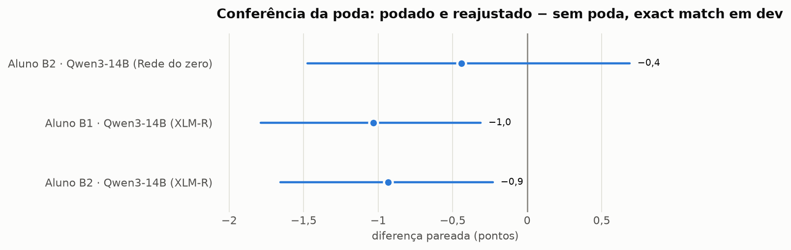
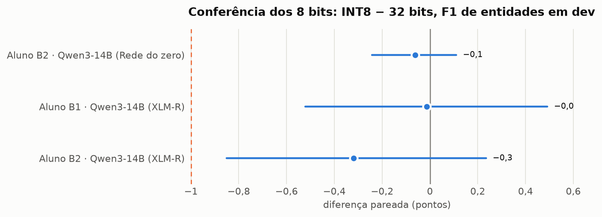
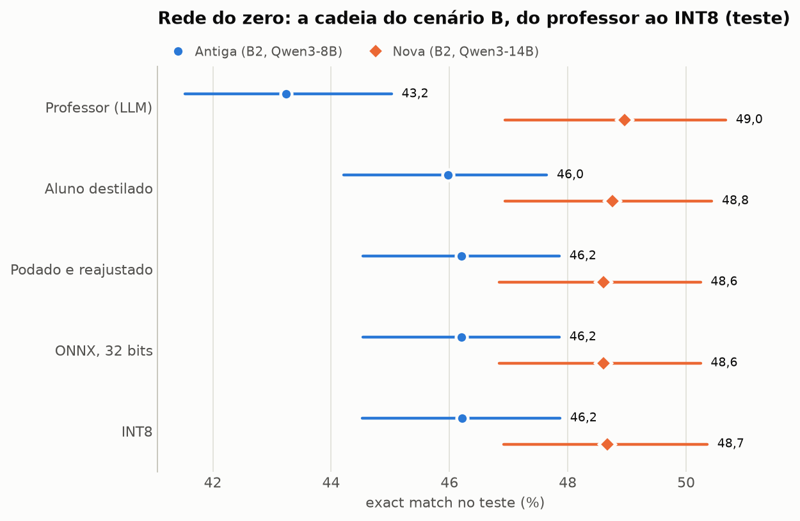
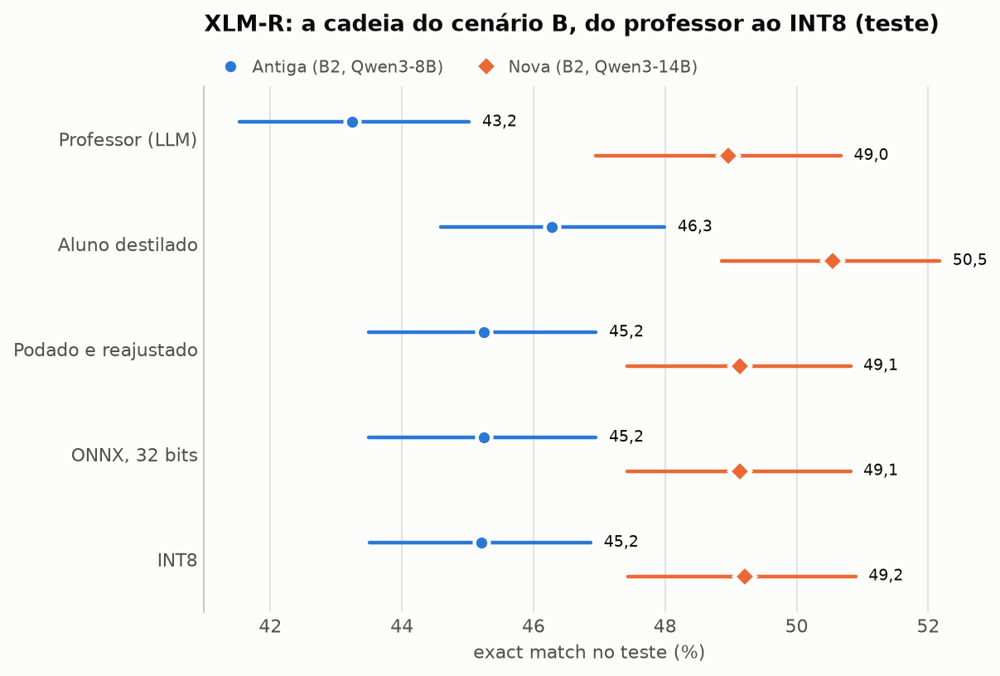
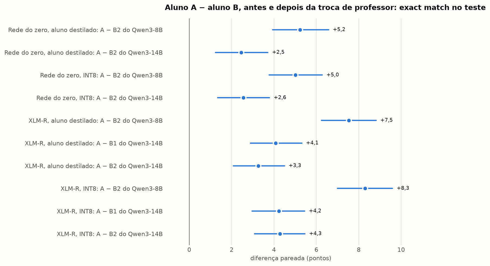
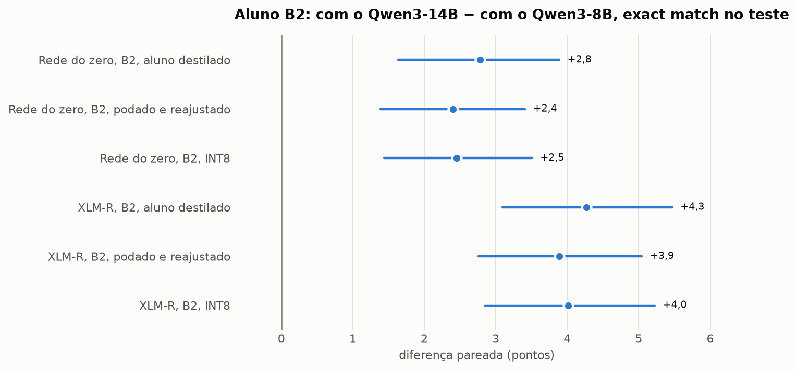
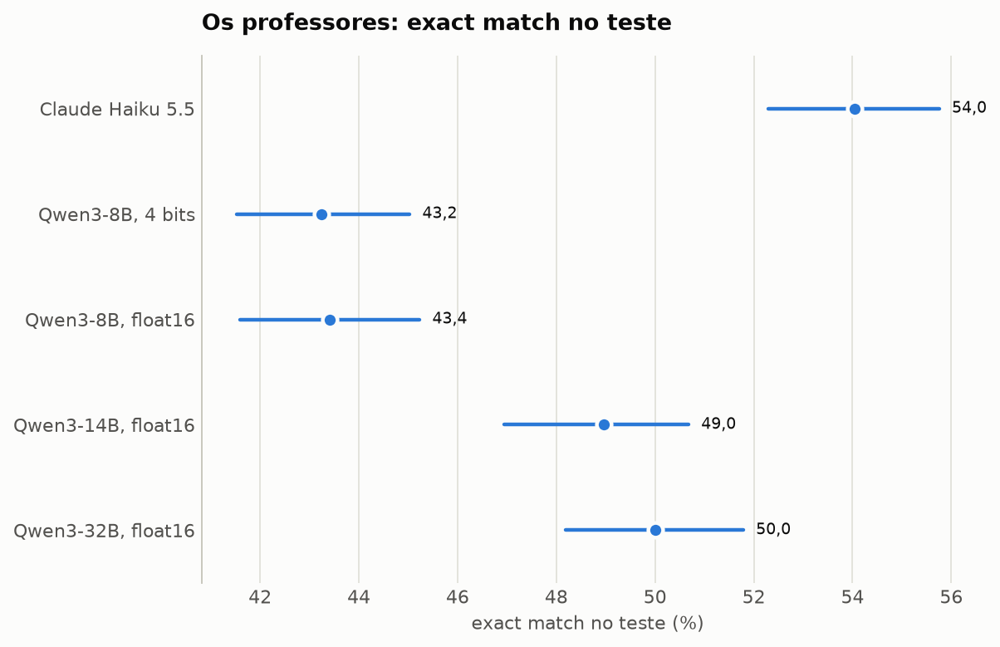
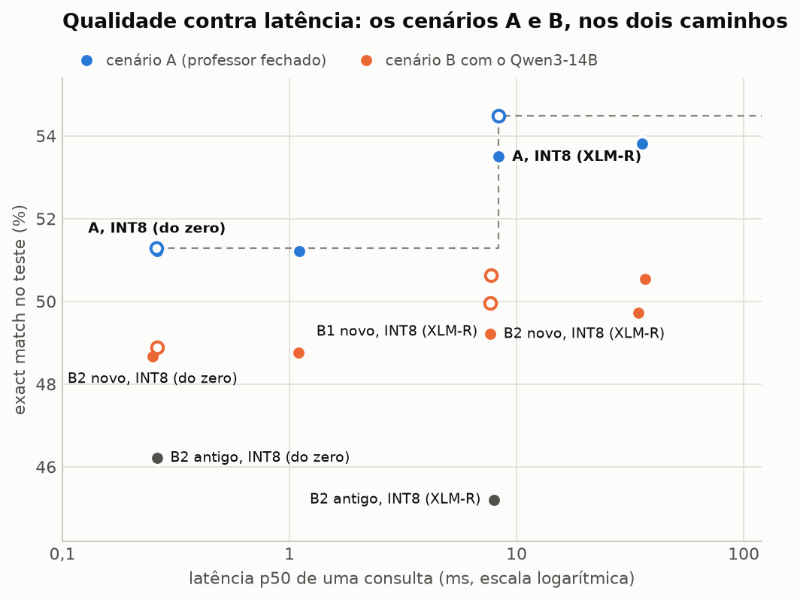
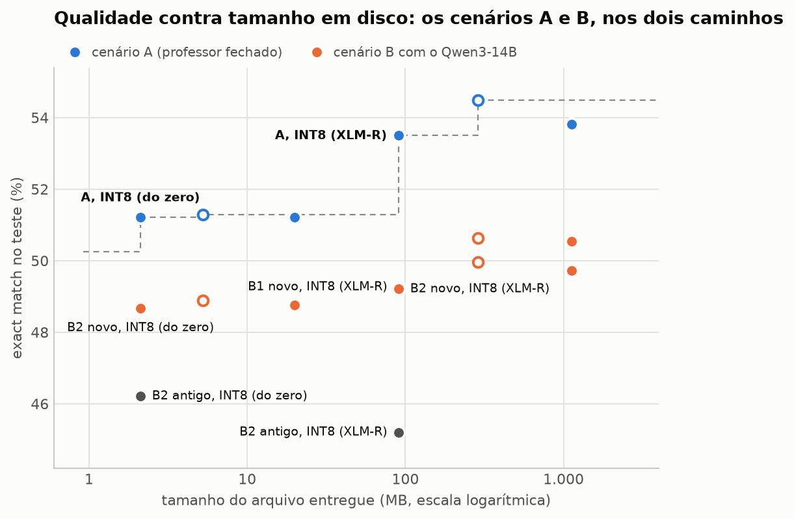

# Etapa 11c · O cenário B com o professor novo até o fim do caminho, e o comparativo atualizado: resumo da entrega

**Pergunta.** As receitas de poda e de quantização já escolhidas valem para os alunos do professor novo, e onde o cenário B fica na tabela final com ele?

**Resposta.** **Em parte.** 7 de 9 conferências passam: a forma de 8 bits passa com os 3 alunos novos e o ONNX de 32 bits repete o PyTorch em todas as respostas; a poda passa em 1 de 3. Não passa: a poda "vocabulário do treino" com o aluno B1 do XLM-R: exact match em dev de 50,4 para 49,4, −1,0 (−1,8 a −0,3); a poda "vocabulário do treino" com o aluno B2 do XLM-R: exact match em dev de 50,8 para 49,9, −0,9 (−1,7 a −0,2). **Na tabela final, o cenário B sobe no teste, mas continua abaixo do A e fora da fronteira.** Em INT8, no teste, em exact match: Rede do zero: aluno B2 do Qwen3-14B, 48,7; aluno A, 51,2; A − B = +2,6 (+1,3 a +3,8) (com o B2 do Qwen3-8B era +5,0 (+3,8 a +6,3)). XLM-R: aluno B1 do Qwen3-14B, 49,3; aluno A, 53,5; A − B = +4,2 (+3,0 a +5,4) (com o B2 do Qwen3-8B era +8,3 (+7,0 a +9,6)). Rede do zero: o ganho do B2 com o professor novo é de +2,8 (+1,6 a +3,9) no aluno destilado e de +2,5 (+1,4 a +3,5) no INT8 (acima). XLM-R: o ganho do B2 com o professor novo é de +4,3 (+3,1 a +5,5) no aluno destilado e de +4,0 (+2,8 a +5,2) no INT8 (acima). Em `dev` o ganho no INT8 não tem a mesma leitura em: Rede do zero, +0,9 (−0,4 a +2,2) (sem diferença distinguível). Nenhum sistema do cenário B entra na fronteira, em latência ou em tamanho; a fronteira é a mesma da Etapa 10d.

Nenhuma decisão foi tomada nesta etapa. Os modelos finais do projeto continuam os das Etapas 8 e 10c (o aluno A, em cada caminho).

## O que foi fixado antes de rodar

As regras foram gravadas em 2026-11-19 00:40; a cadeia começou em 2026-11-19 00:45. São 3 alunos: em cada caminho, o que a regra de "quem segue" aponta como representante do cenário B com o Qwen3-14B (Rede do zero: B2; XLM-R: B1) e, no XLM-R, também o B2, porque a cadeia antiga do cenário B é de B2. A grade tem 33 execuções: 9 podas com reajuste, 18 exportações com quantização (o modelo podado e, como referência, o mesmo aluno sem poda) e 6 medidas de latência.

- **Quem é comprimido:** em cada caminho, o aluno que a regra de 'quem segue' das etapas de origem (`etapa6.quem_segue`) aponta como representante do cenário B com o professor novo, como a Etapa 11b relata em `quem_representa_o_cenario_b` (entregas/11b_alunos_do_professor_maior/decisao.json); e, onde o representante não é o B2, também o B2, porque as cadeias antigas do cenário B são de B2 nos dois caminhos. Com o Qwen3-14B: Aluno B2 · Qwen3-14B (Rede do zero; representa o cenário B neste caminho); Aluno B1 · Qwen3-14B (XLM-R; representa o cenário B neste caminho); Aluno B2 · Qwen3-14B (XLM-R; entra para a cadeia ficar comparável com a antiga, que é de B2).
- **Receitas, sem escolha nova:** Rede do zero: poda "sem 90% das linhas da tabela de features" com reajuste de 30 épocas (entregas/07_poda/decisao.json) e INT8, quantização dinâmica (entregas/08_quantizacao/decisao.json); XLM-R: poda "vocabulário do treino" com reajuste de 10 épocas (entregas/10b_encoder_poda/decisao.json) e INT8, quantização dinâmica (entregas/10c_encoder_quantizacao/decisao.json). O reajuste usa o sinal de quem treinou o aluno: os rótulos (e, no B2, os logits) do Qwen3-14B.
- **Conferências:** a das Etapas 7 e 10b (`etapa7.quem_segue`, passo 1): passa a poda cujo exact match em dev, depois do reajuste, não é distinguivelmente menor que o do modelo sem poda (o intervalo de 95% da diferença pareada, na média de 3 sementes, não fica todo abaixo de zero); a das Etapas 8 e 10c (`etapa8.escolher_forma`, passo 1; PLANO.md): passa a forma cuja queda de F1 de entidades é de no máximo 1 ponto em dev, contra o mesmo modelo em 32 bits no PyTorch (diferença pareada, média de 3 sementes); o ONNX de 32 bits tem de dar a mesma resposta do PyTorch em todos os pedidos de dev e do teste, em toda execução (contagem em meta.json). A receita que não passar com um aluno novo é relatada como está; não se procura outra poda, outra forma, outro orçamento de reajuste nem treino ciente de quantização.
- **O que mais é exportado:** o modelo podado e reajustado e, como as Etapas 8 e 10c fizeram ('como referência'), o mesmo aluno sem poda: é ele que dá a latência do aluno destilado no mesmo protocolo e o ponto 'INT8, sem poda' do registro. A função de origem produz todas as formas dela (ONNX de 32 bits, dinâmica, estática e as duas de diagnóstico). A forma desta etapa é a escolhida na origem; as outras são subproduto da função reaproveitada: nenhuma conta desta etapa as lê para decidir, e a estática só participa do rodízio da latência, para o protocolo ser o mesmo das Etapas 8 e 10c.
- **Custo:** bytes dos arquivos gravados, como nas Etapas 8 e 10c (no XLM-R, com a rede separada do tokenizador); latência: o protocolo das Etapas 8 e 10c: semente 0, 1 thread, uma consulta por vez, do texto à resposta, pedidos de dev, 5 rodadas de 1.024 consultas, sistemas alternados em cada rodada (PyTorch, ONNX de 32 bits, dinâmica e estática), por último na cadeia, com a placa e o resto parados; os outros processos ocupam no máximo 0,25 núcleo de CPU durante a medida (`etapa8.nucleos_de_outros`). Uma medida acima disso é guardada como `latencia_recusada_<n>` e refeita, até 3 tentativas; se nenhuma passar, a última fica e a cadeia termina com `FIM COM ERROS`.
- **Comparativo:** em cada caminho, o aluno A em INT8 menos o representante do cenário B com o professor novo em INT8, nas três métricas, no teste: é o que resta de distância entre os cenários depois da troca de professor. As outras comparações descrevem de onde ela vem. Famílias novas: `troca_de_professor`: o mesmo aluno, no mesmo caminho e no mesmo ponto da cadeia (destilado, podado, int8), com o professor novo menos com o antigo. Cada B2 está na temperatura que a regra escolheu em dev com o seu professor; `cenario_a_menos_b`: em cada caminho, o aluno A menos cada aluno do cenário B (com o professor antigo e com o novo), como saiu da destilação e na forma final de 8 bits: é a distância entre os cenários, antes e depois da troca de professor; `compressao_inteira`: cada modelo em INT8 menos o mesmo modelo como saiu do treino: o custo de toda a compressão (para os sistemas antigos, são as comparações b, d e e2 da Etapa 9); `entre_professores`: cada professor aberto menos o professor fechado, e cada professor aberto da Etapa 11a menos o aberto antigo.

## A cadeia

A cadeia rodou de 00:45 a 02:01 (76 minutos): 33 de 33 execuções prontas, 0 com erro. O código do pacote não mudou durante a cadeia. Toda poda leu os rótulos (e, no B2, os logits) da pasta do Qwen3-14B e partiu da entrega da Etapa 11b: sim. O ONNX de 32 bits deu a mesma resposta do PyTorch em 90.126 de 90.126 respostas. Durante as medidas de latência, os outros processos ocuparam no máximo 0,03 núcleo de CPU (o limite é 0,25); nenhuma medida foi recusada.

## As receitas passam na conferência?

Em `dev`, com os rótulos humanos, média de 3 sementes, diferença pareada com intervalo de 95%.

**7 de 9 conferências passam.** Poda: 1 de 3. 8 bits: 3 de 3. ONNX de 32 bits: 3 de 3. **Não passa:** a poda "vocabulário do treino" com o aluno B1 do XLM-R: exact match em dev de 50,4 para 49,4, −1,0 (−1,8 a −0,3); a poda "vocabulário do treino" com o aluno B2 do XLM-R: exact match em dev de 50,8 para 49,9, −0,9 (−1,7 a −0,2).

| Aluno | Caminho | Conferência | Receita | Sem a receita | Com a receita | Diferença (IC de 95%) | Critério | Passa? |
|---|---|---|---|---|---|---|---|---|
| Aluno B2 · Qwen3-14B | Rede do zero | poda: exact match em dev | Sem 90% das linhas da tabela de features | 48,5 | 48,0 | −0,4 (−1,5 a +0,7) | o intervalo de 95% da diferença não fica todo abaixo de zero | sim |
| Aluno B2 · Qwen3-14B | Rede do zero | 8 bits: F1 de entidades em dev | INT8, quantização dinâmica | 62,0 | 61,9 | −0,1 (−0,2 a +0,1) | a queda é de no máximo 1 ponto | sim |
| Aluno B2 · Qwen3-14B | Rede do zero | ONNX de 32 bits = PyTorch | exportação | 15.021 respostas | 15.021 iguais | 0 | todas as respostas iguais, nas 3 sementes | sim |
| Aluno B1 · Qwen3-14B | XLM-R | poda: exact match em dev | Vocabulário do treino | 50,4 | 49,4 | −1,0 (−1,8 a −0,3) | o intervalo de 95% da diferença não fica todo abaixo de zero | NÃO |
| Aluno B1 · Qwen3-14B | XLM-R | 8 bits: F1 de entidades em dev | INT8, quantização dinâmica | 62,8 | 62,8 | −0,0 (−0,5 a +0,5) | a queda é de no máximo 1 ponto | sim |
| Aluno B1 · Qwen3-14B | XLM-R | ONNX de 32 bits = PyTorch | exportação | 15.021 respostas | 15.021 iguais | 0 | todas as respostas iguais, nas 3 sementes | sim |
| Aluno B2 · Qwen3-14B | XLM-R | poda: exact match em dev | Vocabulário do treino | 50,8 | 49,9 | −0,9 (−1,7 a −0,2) | o intervalo de 95% da diferença não fica todo abaixo de zero | NÃO |
| Aluno B2 · Qwen3-14B | XLM-R | 8 bits: F1 de entidades em dev | INT8, quantização dinâmica | 62,9 | 62,6 | −0,3 (−0,9 a +0,2) | a queda é de no máximo 1 ponto | sim |
| Aluno B2 · Qwen3-14B | XLM-R | ONNX de 32 bits = PyTorch | exportação | 15.021 respostas | 15.021 iguais | 0 | todas as respostas iguais, nas 3 sementes | sim |

Registro (nenhuma regra lê): os dois passos da poda e os 8 bits, em `dev` e no teste. As respostas de cada rede na CPU (a referência dos 8 bits) são as mesmas que a etapa que a treinou gravou: 90.126 de 90.126 respostas iguais.

| Aluno | Caminho | Diferença | Exact match (dev) | Exact match (teste) | Entidades (F1) (dev) | Entidades (F1) (teste) |
|---|---|---|---|---|---|---|
| Aluno B2 · Qwen3-14B | Rede do zero | corte, antes do reajuste − sem poda | −10,8 (−12,3 a −9,3) | −10,3 (−11,6 a −9,2) | −13,1 (−14,6 a −11,6) | −11,5 (−12,7 a −10,3) |
| Aluno B2 · Qwen3-14B | Rede do zero | reajuste: depois − antes | +10,3 (+9,0 a +11,7) | +10,2 (+9,1 a +11,2) | +12,9 (+11,6 a +14,4) | +11,4 (+10,3 a +12,5) |
| Aluno B2 · Qwen3-14B | Rede do zero | podado e reajustado − sem poda | −0,4 (−1,5 a +0,7) | −0,2 (−1,0 a +0,7) | −0,2 (−1,2 a +0,8) | −0,1 (−1,0 a +0,7) |
| Aluno B2 · Qwen3-14B | Rede do zero | INT8 − 32 bits, no modelo podado | −0,0 (−0,2 a +0,1) | +0,1 (−0,0 a +0,2) | −0,1 (−0,2 a +0,1) | −0,0 (−0,1 a +0,1) |
| Aluno B2 · Qwen3-14B | Rede do zero | INT8 − 32 bits, no modelo sem poda | +0,1 (−0,0 a +0,2) | +0,1 (+0,0 a +0,2) | +0,1 (−0,0 a +0,2) | +0,2 (+0,1 a +0,3) |
| Aluno B1 · Qwen3-14B | XLM-R | corte, antes do reajuste − sem poda | −0,6 (−0,9 a −0,2) | +0,1 (−0,1 a +0,4) | −0,4 (−0,8 a −0,0) | −0,2 (−0,5 a +0,1) |
| Aluno B1 · Qwen3-14B | XLM-R | reajuste: depois − antes | −0,5 (−1,1 a +0,2) | −0,9 (−1,5 a −0,4) | −0,1 (−0,7 a +0,5) | −0,6 (−1,1 a −0,1) |
| Aluno B1 · Qwen3-14B | XLM-R | podado e reajustado − sem poda | −1,0 (−1,8 a −0,3) | −0,8 (−1,4 a −0,1) | −0,5 (−1,2 a +0,2) | −0,8 (−1,4 a −0,2) |
| Aluno B1 · Qwen3-14B | XLM-R | INT8 − 32 bits, no modelo podado | −0,1 (−0,6 a +0,4) | +0,3 (−0,1 a +0,7) | −0,0 (−0,5 a +0,5) | +0,0 (−0,4 a +0,4) |
| Aluno B1 · Qwen3-14B | XLM-R | INT8 − 32 bits, no modelo sem poda | −0,2 (−0,7 a +0,4) | +0,2 (−0,3 a +0,7) | −0,3 (−0,9 a +0,2) | +0,2 (−0,3 a +0,7) |
| Aluno B2 · Qwen3-14B | XLM-R | corte, antes do reajuste − sem poda | −0,4 (−0,7 a +0,0) | −0,1 (−0,4 a +0,2) | −0,0 (−0,4 a +0,3) | −0,3 (−0,6 a −0,1) |
| Aluno B2 · Qwen3-14B | XLM-R | reajuste: depois − antes | −0,6 (−1,2 a +0,1) | −1,3 (−1,8 a −0,8) | −0,7 (−1,4 a −0,1) | −0,7 (−1,2 a −0,2) |
| Aluno B2 · Qwen3-14B | XLM-R | podado e reajustado − sem poda | −0,9 (−1,7 a −0,2) | −1,4 (−2,0 a −0,8) | −0,8 (−1,4 a −0,1) | −1,1 (−1,6 a −0,5) |
| Aluno B2 · Qwen3-14B | XLM-R | INT8 − 32 bits, no modelo podado | −0,1 (−0,7 a +0,4) | +0,1 (−0,4 a +0,6) | −0,3 (−0,9 a +0,2) | −0,5 (−1,0 a +0,0) |
| Aluno B2 · Qwen3-14B | XLM-R | INT8 − 32 bits, no modelo sem poda | −0,2 (−0,8 a +0,4) | +0,1 (−0,4 a +0,6) | −0,3 (−0,9 a +0,3) | −0,2 (−0,7 a +0,2) |

## Cada linha dos alunos novos

Em % contra os rótulos humanos, média de 3 sementes; tamanho dos arquivos gravados; latência p50 de uma consulta, 1 thread, semente 0. Do aluno sem poda em PyTorch ao INT8 podado: Aluno B2 · Qwen3-14B (Rede do zero): 9,4 vezes menor e 4,4 vezes mais rápido; Aluno B1 · Qwen3-14B (XLM-R): 12,4 vezes menor e 4,5 vezes mais rápido; Aluno B2 · Qwen3-14B (XLM-R): 12,4 vezes menor e 4,8 vezes mais rápido.

| Aluno | Caminho | Linha | Exact match (dev) | Intenção (teste) | Entidades, F1 (teste) | Exact match (teste) | Parâmetros | Tamanho (MB) | Latência p50 (ms) |
|---|---|---|---|---|---|---|---|---|---|
| Aluno B2 · Qwen3-14B | Rede do zero | Sem poda, PyTorch | 48,5 (46,4 a 50,5) | 78,6 | 60,4 | 48,8 (46,9 a 50,4) | 4.895.834 | 19,9 | 1,10 |
| Aluno B2 · Qwen3-14B | Rede do zero | Podado, antes do reajuste | 37,7 (35,9 a 39,5) | 71,5 | 49,0 | 38,4 (36,9 a 40,0) | 1.992.538 | 8,06 | – |
| Aluno B2 · Qwen3-14B | Rede do zero | Podado e reajustado, PyTorch | 48,0 (46,0 a 50,1) | 79,1 | 60,3 | 48,6 (46,8 a 50,2) | 1.992.538 | 8,06 | 1,07 |
| Aluno B2 · Qwen3-14B | Rede do zero | ONNX, 32 bits | 48,0 (46,0 a 50,1) | 79,1 | 60,3 | 48,6 (46,8 a 50,2) | 1.992.538 | 7,98 | 0,41 |
| Aluno B2 · Qwen3-14B | Rede do zero | INT8 | 48,0 (45,9 a 50,1) | 79,2 | 60,3 | 48,7 (46,9 a 50,4) | 1.992.538 | 2,11 | 0,25 |
| Aluno B2 · Qwen3-14B | Rede do zero | INT8, sem poda | 48,5 (46,5 a 50,6) | 78,7 | 60,6 | 48,9 (47,1 a 50,5) | 4.895.834 | 5,26 | 0,26 |
| Aluno B1 · Qwen3-14B | XLM-R | Sem poda, PyTorch | 50,4 (48,4 a 52,5) | 79,8 | 61,7 | 49,7 (48,0 a 51,4) | 277.584.555 | 1127,5 | 34,4 |
| Aluno B1 · Qwen3-14B | XLM-R | Podado, antes do reajuste | 49,9 (47,9 a 51,9) | 79,8 | 61,5 | 49,9 (48,1 a 51,5) | 89.573.547 | 359,0 | – |
| Aluno B1 · Qwen3-14B | XLM-R | Podado e reajustado, PyTorch | 49,4 (47,4 a 51,4) | 79,4 | 60,9 | 49,0 (47,2 a 50,6) | 89.573.547 | 359,0 | 34,4 |
| Aluno B1 · Qwen3-14B | XLM-R | ONNX, 32 bits | 49,4 (47,4 a 51,4) | 79,4 | 60,9 | 49,0 (47,2 a 50,6) | 89.573.547 | 358,9 | 23,6 |
| Aluno B1 · Qwen3-14B | XLM-R | INT8 | 49,3 (47,4 a 51,3) | 79,1 | 60,9 | 49,3 (47,5 a 50,9) | 89.573.547 | 90,7 | 7,69 |
| Aluno B1 · Qwen3-14B | XLM-R | INT8, sem poda | 50,3 (48,3 a 52,3) | 79,7 | 61,9 | 50,0 (48,2 a 51,6) | 277.584.555 | 287,3 | 7,68 |
| Aluno B2 · Qwen3-14B | XLM-R | Sem poda, PyTorch | 50,8 (48,8 a 52,9) | 80,6 | 61,8 | 50,5 (48,9 a 52,2) | 277.584.555 | 1127,5 | 36,8 |
| Aluno B2 · Qwen3-14B | XLM-R | Podado, antes do reajuste | 50,5 (48,5 a 52,5) | 80,4 | 61,5 | 50,5 (48,7 a 52,1) | 89.573.547 | 359,0 | – |
| Aluno B2 · Qwen3-14B | XLM-R | Podado e reajustado, PyTorch | 49,9 (47,9 a 51,9) | 80,0 | 60,7 | 49,1 (47,4 a 50,8) | 89.573.547 | 359,0 | 34,5 |
| Aluno B2 · Qwen3-14B | XLM-R | ONNX, 32 bits | 49,9 (47,9 a 51,9) | 80,0 | 60,7 | 49,1 (47,4 a 50,8) | 89.573.547 | 358,9 | 23,7 |
| Aluno B2 · Qwen3-14B | XLM-R | INT8 | 49,8 (47,7 a 51,8) | 79,7 | 60,3 | 49,2 (47,4 a 50,9) | 89.573.547 | 90,7 | 7,65 |
| Aluno B2 · Qwen3-14B | XLM-R | INT8, sem poda | 50,6 (48,6 a 52,6) | 80,2 | 61,6 | 50,6 (48,9 a 52,2) | 277.584.555 | 287,3 | 7,69 |

## O comparativo: regras e conferência

A versão 3 das regras foi gravada em 2026-11-19 00:40, antes da cadeia, com 62 sistemas e 84 comparações. A versão 4 foi gravada em 2026-11-19 02:46, depois que a Etapa 11a entregou o Qwen3-32B e antes de qualquer conta (as da compressão são de 02:53; as do comparativo, de 02:56): 63 sistemas, 86 comparações e 9 cadeias. Da versão 3 para a 4 entrou só o que a regra gera com o professor a mais: 2 comparações (Qwen3-32B, float16 − Claude Haiku 5.5; Qwen3-32B, float16 − Qwen3-8B). Das 86 comparações, 43 são as da Etapa 10d e 43 são novas.

Cada número que outra etapa já tinha gravado foi refeito aqui das respostas: 420 de 420 leituras fecham (tolerância de 1e-09). Nenhuma discorda. Entre elas, as 44 linhas da tabela final da 10d e as 86 leituras das comparações dela (43 comparações em dev e no teste).

## As cadeias do cenário B, novas ao lado das antigas

Exact match no teste, em % (intervalo de 95%), e a diferença pareada para o degrau anterior.

**Rede do zero**

| Degrau | Antiga (B2, Qwen3-8B): exact match | Antiga (B2, Qwen3-8B): − degrau anterior | Nova (B2, Qwen3-14B): exact match | Nova (B2, Qwen3-14B): − degrau anterior |
|---|---|---|---|---|
| Professor (LLM) | 43,2 (41,5 a 45,0) |  | 49,0 (46,9 a 50,7) |  |
| Aluno destilado | 46,0 (44,2 a 47,6) | +2,7 (+1,2 a +4,3) | 48,8 (46,9 a 50,4) | −0,2 (−1,5 a +1,2) |
| Podado e reajustado | 46,2 (44,5 a 47,9) | +0,2 (−0,7 a +1,2) | 48,6 (46,8 a 50,2) | −0,2 (−1,0 a +0,7) |
| ONNX, 32 bits | 46,2 (44,5 a 47,9) | +0,0 (+0,0 a +0,0) | 48,6 (46,8 a 50,2) | +0,0 (+0,0 a +0,0) |
| INT8 | 46,2 (44,5 a 47,9) | +0,0 (−0,1 a +0,2) | 48,7 (46,9 a 50,4) | +0,1 (−0,0 a +0,2) |

| Degrau | Antiga (B2, Qwen3-8B): MB | Antiga (B2, Qwen3-8B): ms | Nova (B2, Qwen3-14B): MB | Nova (B2, Qwen3-14B): ms |
|---|---|---|---|---|
| Professor (LLM) | 16397,4 | outra condição | não medido | outra condição |
| Aluno destilado | 19,9 | 1,11 | 19,9 | 1,10 |
| Podado e reajustado | 8,06 | 1,10 | 8,06 | 1,07 |
| ONNX, 32 bits | 7,98 | 0,42 | 7,98 | 0,41 |
| INT8 | 2,11 | 0,26 | 2,11 | 0,25 |

- Antiga (B2, Qwen3-8B): do professor (43,2) ao INT8 (46,2), +3,0 (+1,5 a +4,4) (acima). Nenhum degrau perde de forma distinguível. Degraus que ganham: aluno destilado (+2,7, de +1,2 a +4,3).
- Nova (B2, Qwen3-14B): do professor (49,0) ao INT8 (48,7), −0,3 (−1,7 a +1,1) (sem diferença distinguível). Nenhum degrau perde de forma distinguível. 

**XLM-R**

| Degrau | Antiga (B2, Qwen3-8B): exact match | Antiga (B2, Qwen3-8B): − degrau anterior | Nova (B1, Qwen3-14B): exact match | Nova (B1, Qwen3-14B): − degrau anterior | Nova (B2, Qwen3-14B): exact match | Nova (B2, Qwen3-14B): − degrau anterior |
|---|---|---|---|---|---|---|
| Professor (LLM) | 43,2 (41,5 a 45,0) |  | 49,0 (46,9 a 50,7) |  | 49,0 (46,9 a 50,7) |  |
| Aluno destilado | 46,3 (44,6 a 48,0) | +3,0 (+1,7 a +4,3) | 49,7 (48,0 a 51,4) | +0,8 (−0,4 a +2,0) | 50,5 (48,9 a 52,2) | +1,6 (+0,3 a +2,9) |
| Podado e reajustado | 45,2 (43,5 a 47,0) | −1,0 (−1,4 a −0,6) | 49,0 (47,2 a 50,6) | −0,8 (−1,4 a −0,1) | 49,1 (47,4 a 50,8) | −1,4 (−2,0 a −0,8) |
| ONNX, 32 bits | 45,2 (43,5 a 47,0) | +0,0 (+0,0 a +0,0) | 49,0 (47,2 a 50,6) | +0,0 (+0,0 a +0,0) | 49,1 (47,4 a 50,8) | +0,0 (+0,0 a +0,0) |
| INT8 | 45,2 (43,5 a 46,9) | −0,0 (−0,5 a +0,4) | 49,3 (47,5 a 50,9) | +0,3 (−0,1 a +0,7) | 49,2 (47,4 a 50,9) | +0,1 (−0,4 a +0,6) |

| Degrau | Antiga (B2, Qwen3-8B): MB | Antiga (B2, Qwen3-8B): ms | Nova (B1, Qwen3-14B): MB | Nova (B1, Qwen3-14B): ms | Nova (B2, Qwen3-14B): MB | Nova (B2, Qwen3-14B): ms |
|---|---|---|---|---|---|---|
| Professor (LLM) | 16397,4 | outra condição | não medido | outra condição | não medido | outra condição |
| Aluno destilado | 1127,5 | 37,6 | 1127,5 | 34,4 | 1127,5 | 36,8 |
| Podado e reajustado | 359,0 | 36,8 | 359,0 | 34,4 | 359,0 | 34,5 |
| ONNX, 32 bits | 358,9 | 24,3 | 358,9 | 23,6 | 358,9 | 23,7 |
| INT8 | 90,7 | 7,94 | 90,7 | 7,69 | 90,7 | 7,65 |

- Antiga (B2, Qwen3-8B): do professor (43,2) ao INT8 (45,2), +2,0 (+0,6 a +3,3) (acima). Degraus que perdem de forma distinguível: podado e reajustado (−1,0, de −1,4 a −0,6). Degraus que ganham: aluno destilado (+3,0, de +1,7 a +4,3).
- Nova (B1, Qwen3-14B): do professor (49,0) ao INT8 (49,3), +0,3 (−1,0 a +1,5) (sem diferença distinguível). Degraus que perdem de forma distinguível: podado e reajustado (−0,8, de −1,4 a −0,1). 
- Nova (B2, Qwen3-14B): do professor (49,0) ao INT8 (49,2), +0,3 (−1,1 a +1,6) (sem diferença distinguível). Degraus que perdem de forma distinguível: podado e reajustado (−1,4, de −2,0 a −0,8). Degraus que ganham: aluno destilado (+1,6, de +0,3 a +2,9).

Em `dev`:

**Rede do zero**

| Degrau | Antiga (B2, Qwen3-8B): exact match | Antiga (B2, Qwen3-8B): − degrau anterior | Nova (B2, Qwen3-14B): exact match | Nova (B2, Qwen3-14B): − degrau anterior |
|---|---|---|---|---|
| Professor (LLM) | 43,2 (41,0 a 45,3) |  | 49,1 (47,0 a 51,5) |  |
| Aluno destilado | 46,9 (44,9 a 49,0) | +3,7 (+1,9 a +5,5) | 48,5 (46,4 a 50,5) | −0,7 (−2,5 a +1,0) |
| Podado e reajustado | 46,9 (44,8 a 48,9) | −0,0 (−1,1 a +1,0) | 48,0 (46,0 a 50,1) | −0,4 (−1,5 a +0,7) |
| ONNX, 32 bits | 46,9 (44,8 a 48,9) | +0,0 (+0,0 a +0,0) | 48,0 (46,0 a 50,1) | +0,0 (+0,0 a +0,0) |
| INT8 | 47,0 (45,0 a 49,0) | +0,2 (−0,0 a +0,3) | 48,0 (45,9 a 50,1) | −0,0 (−0,2 a +0,1) |

**XLM-R**

| Degrau | Antiga (B2, Qwen3-8B): exact match | Antiga (B2, Qwen3-8B): − degrau anterior | Nova (B1, Qwen3-14B): exact match | Nova (B1, Qwen3-14B): − degrau anterior | Nova (B2, Qwen3-14B): exact match | Nova (B2, Qwen3-14B): − degrau anterior |
|---|---|---|---|---|---|---|
| Professor (LLM) | 43,2 (41,0 a 45,3) |  | 49,1 (47,0 a 51,5) |  | 49,1 (47,0 a 51,5) |  |
| Aluno destilado | 47,3 (45,3 a 49,3) | +4,1 (+2,5 a +5,7) | 50,4 (48,4 a 52,5) | +1,3 (−0,3 a +2,8) | 50,8 (48,8 a 52,9) | +1,7 (+0,1 a +3,2) |
| Podado e reajustado | 46,8 (44,7 a 48,8) | −0,4 (−0,9 a +0,0) | 49,4 (47,4 a 51,4) | −1,0 (−1,8 a −0,3) | 49,9 (47,9 a 51,9) | −0,9 (−1,7 a −0,2) |
| ONNX, 32 bits | 46,8 (44,7 a 48,8) | +0,0 (+0,0 a +0,0) | 49,4 (47,4 a 51,4) | +0,0 (+0,0 a +0,0) | 49,9 (47,9 a 51,9) | +0,0 (+0,0 a +0,0) |
| INT8 | 46,8 (44,7 a 48,8) | −0,1 (−0,6 a +0,5) | 49,3 (47,4 a 51,3) | −0,1 (−0,6 a +0,4) | 49,8 (47,7 a 51,8) | −0,1 (−0,7 a +0,4) |

## A distância entre os cenários A e B, antes e depois da troca de professor

**Leituras principais (INT8, teste, exact match).** Rede do zero: o aluno A fica +2,6 (+1,3 a +3,8) do aluno B2 do Qwen3-14B; com o B2 do Qwen3-8B a distância era de +5,0 (+3,8 a +6,3). XLM-R: o aluno A fica +4,2 (+3,0 a +5,4) do aluno B1 do Qwen3-14B; com o B2 do Qwen3-8B a distância era de +8,3 (+7,0 a +9,6). Nos dois caminhos o intervalo continua acima de zero: o cenário B continua distinguivelmente abaixo do A.

| Caminho | Ponto | Aluno B | Aluno A (teste) | Aluno B (teste) | A − B, exact match (teste) | A − B, exact match (dev) |
|---|---|---|---|---|---|---|
| Rede do zero | aluno destilado | B2 do Qwen3-8B (antes) | 51,2 | 46,0 | +5,2 (+3,9 a +6,6) | +5,1 (+3,7 a +6,7) |
| Rede do zero | aluno destilado | B2 do Qwen3-14B (representa) | 51,2 | 48,8 | +2,5 (+1,2 a +3,7) | +3,6 (+2,2 a +5,2) |
| Rede do zero | INT8 | B2 do Qwen3-8B (antes) | 51,2 | 46,2 | +5,0 (+3,8 a +6,3) | +4,7 (+3,1 a +6,2) |
| Rede do zero | INT8 | B2 do Qwen3-14B (representa) | 51,2 | 48,7 | +2,6 (+1,3 a +3,8) | +3,8 (+2,3 a +5,2) |
| XLM-R | aluno destilado | B2 do Qwen3-8B (antes) | 53,8 | 46,3 | +7,5 (+6,2 a +8,8) | +7,1 (+5,6 a +8,6) |
| XLM-R | aluno destilado | B1 do Qwen3-14B (representa) | 53,8 | 49,7 | +4,1 (+2,9 a +5,3) | +4,0 (+2,5 a +5,4) |
| XLM-R | aluno destilado | B2 do Qwen3-14B | 53,8 | 50,5 | +3,3 (+2,1 a +4,5) | +3,5 (+2,1 a +5,0) |
| XLM-R | INT8 | B2 do Qwen3-8B (antes) | 53,5 | 45,2 | +8,3 (+7,0 a +9,6) | +7,3 (+5,7 a +8,8) |
| XLM-R | INT8 | B1 do Qwen3-14B (representa) | 53,5 | 49,3 | +4,2 (+3,0 a +5,4) | +4,7 (+3,3 a +6,2) |
| XLM-R | INT8 | B2 do Qwen3-14B | 53,5 | 49,2 | +4,3 (+3,1 a +5,5) | +4,3 (+2,8 a +5,7) |

As leituras principais, nas três métricas:

| Caminho | Comparação (INT8) | Intenção (teste) | Intenção (dev) | Entidades (F1) (teste) | Entidades (F1) (dev) | Exact match (teste) | Exact match (dev) |
|---|---|---|---|---|---|---|---|
| Rede do zero | aluno A − aluno B2 do Qwen3-14B | +1,0 (+0,1 a +1,9) | +1,9 (+0,9 a +2,9) | +4,6 (+3,6 a +5,7) | +4,9 (+3,6 a +6,3) | +2,6 (+1,3 a +3,8) | +3,8 (+2,3 a +5,2) |
| XLM-R | aluno A − aluno B1 do Qwen3-14B | +3,4 (+2,4 a +4,3) | +2,8 (+1,8 a +3,7) | +4,2 (+3,2 a +5,3) | +5,0 (+3,6 a +6,4) | +4,2 (+3,0 a +5,4) | +4,7 (+3,3 a +6,2) |

## A troca de professor, ponto a ponto

Rede do zero: o ganho do B2 com o professor novo é de +2,8 (+1,6 a +3,9) no aluno destilado e de +2,5 (+1,4 a +3,5) no INT8 (acima). XLM-R: o ganho do B2 com o professor novo é de +4,3 (+3,1 a +5,5) no aluno destilado e de +4,0 (+2,8 a +5,2) no INT8 (acima).

| Caminho | Aluno | Ponto | Com o antigo (teste) | Com o novo (teste) | Novo − antigo, exact match (teste) | Novo − antigo, exact match (dev) | Leitura (teste) |
|---|---|---|---|---|---|---|---|
| Rede do zero | B2 | aluno destilado | 46,0 | 48,8 | +2,8 (+1,6 a +3,9) | +1,6 (+0,2 a +2,8) | acima |
| Rede do zero | B2 | podado e reajustado | 46,2 | 48,6 | +2,4 (+1,4 a +3,4) | +1,1 (−0,2 a +2,4) | acima |
| Rede do zero | B2 | INT8 | 46,2 | 48,7 | +2,5 (+1,4 a +3,5) | +0,9 (−0,4 a +2,2) | acima |
| XLM-R | B2 | aluno destilado | 46,3 | 50,5 | +4,3 (+3,1 a +5,5) | +3,5 (+2,2 a +5,0) | acima |
| XLM-R | B2 | podado e reajustado | 45,2 | 49,1 | +3,9 (+2,8 a +5,0) | +3,0 (+1,7 a +4,4) | acima |
| XLM-R | B2 | INT8 | 45,2 | 49,2 | +4,0 (+2,8 a +5,2) | +3,0 (+1,6 a +4,4) | acima |

## Os professores lado a lado

Do Qwen3-8B em 4 bits para o Qwen3-14B, o exact match sobe +5,7 (+4,2 a +7,3) no teste e +6,0 (+4,2 a +7,7) em `dev`. Do Qwen3-14B para o Qwen3-32B, a diferença é de −0,0 (−1,6 a +1,7) em `dev` e de +1,0 (−0,3 a +2,5) no teste (lido de `entregas/11a_professor_aberto_maior/comparacoes.csv`; a comparação é da Etapa 11a e não faz parte da lista desta etapa): nas duas partições o intervalo contém zero. Com estes dados não dá para afirmar que o professor aberto melhorou do 14B para o 32B; também não dá para afirmar que não melhorou: no teste o intervalo vai até +2,5 pontos. O professor fechado continua acima de todos: o Qwen3-32B fica −4,0 (−5,6 a −2,5) dele no teste, e o Qwen3-14B, −5,1 (−6,7 a −3,5).

| Professor | Intenção (dev) | Entidades (F1) (dev) | Exact match (dev) | Intenção (teste) | Entidades (F1) (teste) | Exact match (teste) | Menos o fechado: exact match (teste) |
|---|---|---|---|---|---|---|---|
| Claude Haiku 5.5 (professor fechado) | 84,1 (82,6 a 85,6) | 68,5 (66,5 a 70,5) | 54,7 (52,6 a 57,0) | 83,5 (82,1 a 84,7) | 66,1 (64,5 a 67,7) | 54,0 (52,3 a 55,7) |  |
| Qwen3-8B em 4 bits (professor aberto) | 77,4 (75,7 a 79,2) | 58,0 (55,9 a 60,1) | 43,2 (41,0 a 45,3) | 77,6 (76,1 a 79,1) | 55,7 (53,9 a 57,4) | 43,2 (41,5 a 45,0) | −10,8 (−12,4 a −9,1) |
| Qwen3-8B sem os 4 bits (professor aberto sem compressão, Etapa 11a) | 77,9 (76,2 a 79,7) | 57,8 (55,7 a 60,0) | 43,2 (41,0 a 45,5) | 77,9 (76,5 a 79,4) | 56,5 (54,8 a 58,2) | 43,4 (41,6 a 45,2) | −10,6 (−12,2 a −9,0) |
| Qwen3-14B sem os 4 bits (professor aberto maior, Etapa 11a) | 80,6 (79,0 a 82,3) | 62,4 (60,4 a 64,6) | 49,1 (47,0 a 51,5) | 80,0 (78,6 a 81,4) | 61,4 (59,6 a 63,1) | 49,0 (46,9 a 50,7) | −5,1 (−6,7 a −3,5) |
| Qwen3-32B sem os 4 bits (professor aberto da extensão, Etapa 11a) | 81,0 (79,4 a 82,7) | 63,3 (61,3 a 65,4) | 49,1 (47,0 a 51,4) | 80,9 (79,4 a 82,3) | 62,5 (60,8 a 64,3) | 50,0 (48,2 a 51,8) | −4,0 (−5,6 a −2,5) |

## A tabela final e a fronteira

**Nenhum sistema do cenário B entra na fronteira**, em latência ou em tamanho. A fronteira é a mesma da Etapa 10d nos dois custos: em latência, Aluno A, INT8 sem poda (do zero) e Aluno A, INT8 sem poda (XLM-R); em tamanho, Aluno A, pesos soltos, INT8 com zip (do zero), Aluno A, INT8 (do zero), Aluno A, INT8 sem poda (do zero), Aluno A, INT8 (XLM-R) e Aluno A, INT8 sem poda (XLM-R). Todos os pontos da fronteira são do aluno A. Cada sistema novo em 8 bits é dominado, nos dois custos, por pelo menos um sistema do cenário A (tabela abaixo).

| Custo | Sistema | Caminho | Valor do custo | Exact match (teste) | Cenário |
|---|---|---|---|---|---|
| latência | Aluno A, sem poda, INT8, quantização dinâmica | Rede do zero | 0,26 ms | 51,3 | A |
| latência | Aluno A, sem poda, INT8, quantização dinâmica | XLM-R | 8,33 ms | 54,5 | A |
| tamanho | Aluno A, magnitude, 95% de uma vez, INT8, quantização dinâmica, arquivo compactado | Rede do zero | 0,92 MB | 50,3 | A |
| tamanho | Aluno A, sem 90% das linhas da tabela de features, INT8, quantização dinâmica | Rede do zero | 2,11 MB | 51,2 | A |
| tamanho | Aluno A, sem poda, INT8, quantização dinâmica | Rede do zero | 5,26 MB | 51,3 | A |
| tamanho | Aluno A, vocabulário do treino, INT8, quantização dinâmica | XLM-R | 90,67 MB | 53,5 | A |
| tamanho | Aluno A, sem poda, INT8, quantização dinâmica | XLM-R | 287,28 MB | 54,5 | A |

Os sistemas novos em 8 bits e quem os domina:

| Sistema novo | Caminho | Exact match (teste) | Latência p50 (ms) | Tamanho (MB) | Dominado por, em latência | Dominado por, em tamanho |
|---|---|---|---|---|---|---|
| Aluno B2 · Qwen3-14B, sem 90% das linhas da tabela de features, INT8, quantização dinâmica | Rede do zero | 48,7 | 0,25 | 2,11 | 4 sistema(s), entre eles Aluno A, INT8 e Aluno A, pesos soltos, INT8 com zip | 1 sistema(s), entre eles Aluno A, pesos soltos, INT8 com zip |
| Aluno B2 · Qwen3-14B, sem poda, INT8, quantização dinâmica | Rede do zero | 48,9 | 0,26 | 5,26 | 3 sistema(s), entre eles Aluno A, INT8 e Aluno A, pesos soltos, INT8 com zip | 3 sistema(s), entre eles Aluno A, INT8 e Aluno A, pesos soltos, INT8 com zip |
| Aluno B1 · Qwen3-14B, vocabulário do treino, INT8, quantização dinâmica | XLM-R | 49,3 | 7,69 | 90,7 | 11 sistema(s), entre eles Aluno A e Aluno A, podado | 7 sistema(s), entre eles Aluno A e Aluno A, podado |
| Aluno B1 · Qwen3-14B, sem poda, INT8, quantização dinâmica | XLM-R | 50,0 | 7,68 | 287,3 | 10 sistema(s), entre eles Aluno A e Aluno A, podado | 9 sistema(s), entre eles Aluno A e Aluno A, podado |
| Aluno B2 · Qwen3-14B, vocabulário do treino, INT8, quantização dinâmica | XLM-R | 49,2 | 7,65 | 90,7 | 12 sistema(s), entre eles Aluno A e Aluno A, podado | 8 sistema(s), entre eles Aluno A e Aluno A, podado |
| Aluno B2 · Qwen3-14B, sem poda, INT8, quantização dinâmica | XLM-R | 50,6 | 7,69 | 287,3 | 8 sistema(s), entre eles Aluno A e Aluno A, podado | 8 sistema(s), entre eles Aluno A e Aluno A, podado |

A tabela final (63 sistemas; 19 novos em relação à Etapa 10d). A latência é de CPU local, 1 thread, salvo quando outra condição está escrita:

| Sistema | Caminho | Ponto | Intenção | Entidades (F1) | Exact match (teste) | Exact match (dev) | Tamanho (MB) | Latência p50 (ms) |
|---|---|---|---|---|---|---|---|---|
| Linha de base com 299 rótulos | os dois | Linha de base | 47,8 | 35,6 | 19,4 (18,1 a 20,8) | 20,2 | não medido | não medida |
| Linha de base com 11.514 rótulos | os dois | Linha de base | 84,6 | 47,8 | 45,2 (43,5 a 47,0) | 45,1 | 33,0 | 0,82 |
| Claude Haiku 5.5 (professor fechado) | os dois | Professor (LLM) | 83,5 | 66,1 | 54,0 (52,3 a 55,7) | 54,7 | não medido | 854,1 (API pela rede) |
| Qwen3-8B em 4 bits (professor aberto) | os dois | Professor (LLM) | 77,6 | 55,7 | 43,2 (41,5 a 45,0) | 43,2 | 16397,4 | 1087,2 (GPU local) |
| Teto (DIET do zero com os 11.514 rótulos humanos) | Rede do zero | Sem compressão | 84,4 | 73,6 | 62,5 (60,8 a 64,1) | 62,6 | 19,9 | 1,10 |
| Piso (DIET do zero só com os 299 rótulos humanos) | Rede do zero | Piso | 40,1 | 40,8 | 20,9 (19,6 a 22,2) | 22,1 | 8,73 | 1,12 |
| Aluno A (rótulos do Claude Haiku 5.5) | Rede do zero | Aluno destilado | 80,7 | 64,8 | 51,2 (49,6 a 52,9) | 52,0 | 19,9 | 1,11 |
| Aluno B1 (rótulos do Qwen3-8B) | Rede do zero | Aluno destilado | 76,3 | 57,1 | 43,6 (41,9 a 45,2) | 45,2 | 19,9 | 1,13 |
| Aluno B2 (logits do Qwen3-8B, T = 8) | Rede do zero | Aluno destilado | 77,8 | 58,0 | 46,0 (44,2 a 47,6) | 46,9 | 19,9 | 1,11 |
| Aluno A, sem 90% das linhas da tabela de features, PyTorch, 32 bits | Rede do zero | Podado e reajustado | 80,2 | 64,8 | 51,3 (49,6 a 52,9) | 51,6 | 8,06 | 1,10 |
| Aluno A, sem 90% das linhas da tabela de features, ONNX, 32 bits | Rede do zero | ONNX, 32 bits | 80,2 | 64,8 | 51,3 (49,6 a 52,9) | 51,6 | 7,98 | 0,43 |
| Aluno A, sem 90% das linhas da tabela de features, INT8, quantização dinâmica | Rede do zero | INT8 | 80,2 | 64,9 | 51,2 (49,5 a 52,9) | 51,7 | 2,11 | 0,26 |
| Aluno A, magnitude, 95% de uma vez, INT8, quantização dinâmica, arquivo compactado | Rede do zero | Pesos soltos, INT8 | 79,8 | 64,3 | 50,3 (48,6 a 52,0) | 51,2 | 5,26 | 0,27 |
| Aluno B2, sem 90% das linhas da tabela de features, PyTorch, 32 bits | Rede do zero | Podado e reajustado | 77,8 | 58,0 | 46,2 (44,5 a 47,9) | 46,9 | 8,06 | 1,10 |
| Aluno B2, sem 90% das linhas da tabela de features, ONNX, 32 bits | Rede do zero | ONNX, 32 bits | 77,8 | 58,0 | 46,2 (44,5 a 47,9) | 46,9 | 7,98 | 0,42 |
| Aluno B2, sem 90% das linhas da tabela de features, INT8, quantização dinâmica | Rede do zero | INT8 | 77,8 | 58,0 | 46,2 (44,5 a 47,9) | 47,0 | 2,11 | 0,26 |
| Aluno B2, magnitude, 90% gradual, INT8, quantização dinâmica, arquivo compactado | Rede do zero | Pesos soltos, INT8 | 77,5 | 58,6 | 46,1 (44,4 a 47,8) | 46,9 | 5,26 | 0,27 |
| Teto, sem 90% das linhas da tabela de features, PyTorch, 32 bits | Rede do zero | Podado e reajustado | 83,4 | 73,5 | 61,3 (59,6 a 62,9) | 61,8 | 8,06 | 1,10 |
| Teto, sem 90% das linhas da tabela de features, ONNX, 32 bits | Rede do zero | ONNX, 32 bits | 83,4 | 73,5 | 61,3 (59,6 a 62,9) | 61,8 | 7,98 | 0,43 |
| Teto, sem 90% das linhas da tabela de features, INT8, quantização dinâmica | Rede do zero | INT8 | 83,4 | 73,5 | 61,3 (59,7 a 62,9) | 61,8 | 2,11 | 0,26 |
| Teto, magnitude, 90% de uma vez, INT8, quantização dinâmica, arquivo compactado | Rede do zero | Pesos soltos, INT8 | 83,9 | 73,4 | 61,7 (60,0 a 63,3) | 62,0 | 5,26 | 0,27 |
| Aluno A, sem poda, INT8, quantização dinâmica | Rede do zero | INT8, sem poda | 80,7 | 64,8 | 51,3 (49,6 a 52,9) | 52,1 | 5,26 | 0,26 |
| Aluno B2, sem poda, INT8, quantização dinâmica | Rede do zero | INT8, sem poda | 77,9 | 58,1 | 45,9 (44,2 a 47,6) | 47,0 | 5,26 | 0,27 |
| Teto, sem poda, INT8, quantização dinâmica | Rede do zero | INT8, sem poda | 84,3 | 73,7 | 62,5 (60,8 a 64,1) | 62,5 | 5,26 | 0,27 |
| Teto (XLM-R base com os 11.514 rótulos humanos) | XLM-R | Sem compressão | 86,9 | 75,5 | 66,3 (64,7 a 67,9) | 66,8 | 1127,5 | 37,1 |
| Piso (XLM-R base só com os 299 rótulos humanos) | XLM-R | Piso | 54,7 | 52,8 | 32,6 (31,1 a 34,2) | 33,0 | 1127,5 | não medida |
| Aluno A (rótulos do Claude Haiku 5.5) | XLM-R | Aluno destilado | 82,6 | 65,5 | 53,8 (52,1 a 55,4) | 54,4 | 1127,5 | 35,8 |
| Aluno B1 (rótulos do Qwen3-8B) | XLM-R | Aluno destilado | 78,7 | 58,5 | 45,7 (44,0 a 47,4) | 46,7 | 1127,5 | não medida |
| Aluno B2 (logits do Qwen3-8B, T = 2) | XLM-R | Aluno destilado | 78,9 | 58,8 | 46,3 (44,6 a 48,0) | 47,3 | 1127,5 | 37,6 |
| Aluno A, vocabulário do treino, PyTorch, 32 bits | XLM-R | Podado e reajustado | 82,9 | 65,1 | 53,7 (52,0 a 55,3) | 54,0 | 359,0 | 36,1 |
| Aluno A, vocabulário do treino, ONNX, 32 bits | XLM-R | ONNX, 32 bits | 82,9 | 65,1 | 53,7 (52,0 a 55,3) | 54,0 | 358,9 | 25,1 |
| Aluno A, vocabulário do treino, INT8, quantização dinâmica | XLM-R | INT8 | 82,4 | 65,1 | 53,5 (51,8 a 55,1) | 54,0 | 90,7 | 8,35 |
| Aluno A, magnitude, 70% gradual, INT8, quantização dinâmica, arquivo compactado | XLM-R | Pesos soltos, INT8 | 82,0 | 64,2 | 52,9 (51,1 a 54,6) | 53,6 | 287,3 | 8,37 |
| Aluno A, sem poda, INT8, quantização dinâmica | XLM-R | INT8, sem poda | 82,8 | 65,6 | 54,5 (52,8 a 56,1) | 54,5 | 287,3 | 8,33 |
| Aluno B2, vocabulário do treino, PyTorch, 32 bits | XLM-R | Podado e reajustado | 78,4 | 57,9 | 45,2 (43,5 a 47,0) | 46,8 | 359,0 | 36,8 |
| Aluno B2, vocabulário do treino, ONNX, 32 bits | XLM-R | ONNX, 32 bits | 78,4 | 57,9 | 45,2 (43,5 a 47,0) | 46,8 | 358,9 | 24,3 |
| Aluno B2, vocabulário do treino, INT8, quantização dinâmica | XLM-R | INT8 | 78,2 | 57,6 | 45,2 (43,5 a 46,9) | 46,8 | 90,7 | 7,94 |
| Aluno B2, magnitude, 70% gradual, INT8, quantização dinâmica, arquivo compactado | XLM-R | Pesos soltos, INT8 | 78,1 | 58,4 | 45,7 (44,0 a 47,3) | 46,8 | 287,3 | 8,01 |
| Aluno B2, sem poda, INT8, quantização dinâmica | XLM-R | INT8, sem poda | 79,0 | 58,5 | 46,6 (44,9 a 48,3) | 47,3 | 287,3 | 8,26 |
| Teto, vocabulário do treino, PyTorch, 32 bits | XLM-R | Podado e reajustado | 86,7 | 74,9 | 65,8 (64,2 a 67,4) | 66,7 | 359,0 | 37,5 |
| Teto, vocabulário do treino, ONNX, 32 bits | XLM-R | ONNX, 32 bits | 86,7 | 74,9 | 65,8 (64,2 a 67,4) | 66,7 | 358,9 | 25,3 |
| Teto, vocabulário do treino, INT8, quantização dinâmica | XLM-R | INT8 | 86,3 | 74,6 | 65,7 (64,1 a 67,2) | 66,0 | 90,7 | 8,50 |
| Teto, magnitude, 50% de uma vez, INT8, quantização dinâmica, arquivo compactado | XLM-R | Pesos soltos, INT8 | 86,6 | 74,4 | 65,6 (64,0 a 67,1) | 65,7 | 287,3 | 8,37 |
| Teto, sem poda, INT8, quantização dinâmica | XLM-R | INT8, sem poda | 86,8 | 74,9 | 66,1 (64,5 a 67,7) | 66,0 | 287,3 | 8,39 |
| Qwen3-8B sem os 4 bits (professor aberto sem compressão, Etapa 11a) | os dois | Professor (LLM) | 77,9 | 56,5 | 43,4 (41,6 a 45,2) | 43,2 | não medido | não medida |
| Qwen3-14B sem os 4 bits (professor aberto maior, Etapa 11a) | os dois | Professor (LLM) | 80,0 | 61,4 | 49,0 (46,9 a 50,7) | 49,1 | não medido | não medida |
| Qwen3-32B sem os 4 bits (professor aberto da extensão, Etapa 11a) | os dois | Professor (LLM) | 80,9 | 62,5 | 50,0 (48,2 a 51,8) | 49,1 | não medido | não medida |
| Aluno B1 (rótulos do Qwen3-14B) | Rede do zero | Aluno destilado | 77,9 | 61,4 | 47,7 (45,9 a 49,3) | 47,5 | 19,9 | não medida |
| Aluno B2 (logits do Qwen3-14B, T = 8) | Rede do zero | Aluno destilado | 78,6 | 60,4 | 48,8 (46,9 a 50,4) | 48,5 | 19,9 | 1,10 |
| Aluno B1 (rótulos do Qwen3-14B) | XLM-R | Aluno destilado | 79,8 | 61,7 | 49,7 (48,0 a 51,4) | 50,4 | 1127,5 | 34,4 |
| Aluno B2 (logits do Qwen3-14B, T = 8) | XLM-R | Aluno destilado | 80,6 | 61,8 | 50,5 (48,9 a 52,2) | 50,8 | 1127,5 | 36,8 |
| Aluno B2 · Qwen3-14B, sem 90% das linhas da tabela de features, PyTorch, 32 bits | Rede do zero | Podado e reajustado | 79,1 | 60,3 | 48,6 (46,8 a 50,2) | 48,0 | 8,06 | 1,07 |
| Aluno B2 · Qwen3-14B, sem 90% das linhas da tabela de features, ONNX, 32 bits | Rede do zero | ONNX, 32 bits | 79,1 | 60,3 | 48,6 (46,8 a 50,2) | 48,0 | 7,98 | 0,41 |
| Aluno B2 · Qwen3-14B, sem 90% das linhas da tabela de features, INT8, quantização dinâmica | Rede do zero | INT8 | 79,2 | 60,3 | 48,7 (46,9 a 50,4) | 48,0 | 2,11 | 0,25 |
| Aluno B2 · Qwen3-14B, sem poda, INT8, quantização dinâmica | Rede do zero | INT8, sem poda | 78,7 | 60,6 | 48,9 (47,1 a 50,5) | 48,5 | 5,26 | 0,26 |
| Aluno B1 · Qwen3-14B, vocabulário do treino, PyTorch, 32 bits | XLM-R | Podado e reajustado | 79,4 | 60,9 | 49,0 (47,2 a 50,6) | 49,4 | 359,0 | 34,4 |
| Aluno B1 · Qwen3-14B, vocabulário do treino, ONNX, 32 bits | XLM-R | ONNX, 32 bits | 79,4 | 60,9 | 49,0 (47,2 a 50,6) | 49,4 | 358,9 | 23,6 |
| Aluno B1 · Qwen3-14B, vocabulário do treino, INT8, quantização dinâmica | XLM-R | INT8 | 79,1 | 60,9 | 49,3 (47,5 a 50,9) | 49,3 | 90,7 | 7,69 |
| Aluno B1 · Qwen3-14B, sem poda, INT8, quantização dinâmica | XLM-R | INT8, sem poda | 79,7 | 61,9 | 50,0 (48,2 a 51,6) | 50,3 | 287,3 | 7,68 |
| Aluno B2 · Qwen3-14B, vocabulário do treino, PyTorch, 32 bits | XLM-R | Podado e reajustado | 80,0 | 60,7 | 49,1 (47,4 a 50,8) | 49,9 | 359,0 | 34,5 |
| Aluno B2 · Qwen3-14B, vocabulário do treino, ONNX, 32 bits | XLM-R | ONNX, 32 bits | 80,0 | 60,7 | 49,1 (47,4 a 50,8) | 49,9 | 358,9 | 23,7 |
| Aluno B2 · Qwen3-14B, vocabulário do treino, INT8, quantização dinâmica | XLM-R | INT8 | 79,7 | 60,3 | 49,2 (47,4 a 50,9) | 49,8 | 90,7 | 7,65 |
| Aluno B2 · Qwen3-14B, sem poda, INT8, quantização dinâmica | XLM-R | INT8, sem poda | 80,2 | 61,6 | 50,6 (48,9 a 52,2) | 50,6 | 287,3 | 7,69 |

## Onde dev e teste discordam

Das 43 comparações novas, 6 têm leitura diferente em `dev` e no teste em exact match. As leituras principais (aluno A − representante do cenário B, em INT8) têm a mesma leitura nas duas partições, nas três métricas. Sem correção para comparações múltiplas: nas 43 comparações novas e nas três métricas, 92 intervalos ficam fora do zero no teste e 90 em `dev`; só por acaso seriam esperados cerca de 6.

| Comparação (B − A) | Famílias | Em dev | Leitura em dev | No teste | Leitura no teste |
|---|---|---|---|---|---|
| Aluno B2 · Qwen3-14B, podado (XLM-R) − Aluno B2 · Qwen3-14B, podado (do zero) | entre_caminhos | +1,9 (+0,6 a +3,2) | acima | +0,5 (−0,6 a +1,6) | sem diferença distinguível |
| Aluno B2 · Qwen3-14B, INT8 (XLM-R) − Aluno B2 · Qwen3-14B, INT8 (do zero) | entre_caminhos | +1,8 (+0,6 a +3,2) | acima | +0,5 (−0,5 a +1,6) | sem diferença distinguível |
| Aluno B1 · Qwen3-14B, INT8 (XLM-R) − Aluno B1 · Qwen3-14B, INT8 sem poda (XLM-R) | poda_nos_8_bits | −0,9 (−1,7 a −0,1) | abaixo | −0,7 (−1,4 a +0,0) | sem diferença distinguível |
| Aluno B2 · Qwen3-14B, podado (do zero) − Aluno B2, podado (do zero) | troca_de_professor | +1,1 (−0,2 a +2,4) | sem diferença distinguível | +2,4 (+1,4 a +3,4) | acima |
| Aluno B2 · Qwen3-14B, INT8 (do zero) − Aluno B2, INT8 (do zero) | troca_de_professor | +0,9 (−0,4 a +2,2) | sem diferença distinguível | +2,5 (+1,4 a +3,5) | acima |
| Aluno B1 · Qwen3-14B, INT8 (XLM-R) − Aluno B1 · Qwen3-14B (XLM-R) | compressao_inteira | −1,1 (−1,8 a −0,4) | abaixo | −0,5 (−1,1 a +0,2) | sem diferença distinguível |

## Critério de pronto

| Critério | Atendido |
|---|---|
| Regras gravadas antes da cadeia (00:40 contra 00:45) | sim |
| Regras do comparativo (versão 4) gravadas antes das contas (02:46 contra 02:53 e 02:56) | sim |
| As 33 execuções estão prontas, sem erro, e o código não mudou durante a cadeia | sim |
| Toda poda leu o professor novo e partiu da entrega da Etapa 11b; nenhum rótulo humano entrou no reajuste | sim |
| A poda, o orçamento do reajuste e a forma de 8 bits são os das decisões de origem; o resto da receita é o do aluno | sim |
| As etapas de origem ficaram como estavam (a troca vale só dentro do bloco) | sim |
| Cada receita tem a sua conferência calculada em dev e relatada (9 leituras; 7 passam) | sim |
| O ONNX de 32 bits repete o PyTorch em todas as respostas (90.126 de 90.126) | sim |
| Latência medida com a máquina quieta (no máximo 0,03 núcleo de outros processos), sem medida recusada | sim |
| Toda comparação da lista fechada está calculada em dev e no teste (86 comparações, 9 cadeias) | sim |
| O que a Etapa 10d entregou sai igual aqui (130 de 130 leituras) e o registro dela continua com os 44 sistemas | sim |
| Os números que outras etapas já tinham gravado, refeitos aqui, fecham (420 de 420 leituras) | sim |
| Os 12 sistemas declarados entram no registro, com as respostas na entrega | sim |
| Nada no cache e nas entregas das outras etapas mudou desde antes da cadeia (29 pastas; a Etapa 11a, que outro agente fechou no meio, fica de fora) | sim |
| Os modelos entregues, relidos do disco, repetem as respostas medidas no teste | sim |
| Cada referência citada está conferida na fonte (quadro da Etapa 10d) | sim |

## Limites

- **As receitas foram escolhidas com os alunos antigos.** A poda principal de cada caminho saiu da regra aplicada ao aluno A (Etapas 7 e 10b), e o orçamento de reajuste do XLM-R, de um piloto no teto. Aqui elas são só aplicadas. Onde a conferência não passou (aluno B1 do XLM-R e aluno B2 do XLM-R), a etapa não procurou outra poda nem outro orçamento, e não investigou a causa: o modelo podado desses alunos segue na tabela como a receita o deixou, ao lado do mesmo aluno em INT8 sem poda.
- **A conferência usa os rótulos humanos de `dev`**, que o cenário do projeto não tem. Ela diz se a receita vale; não é um passo que um usuário do cenário B poderia repetir.
- **A latência é de uma CPU e de uma semente:** 13th Gen Intel(R) Core(TM) i7-13700K, WSL2, 1 thread, semente 0, uma consulta por vez. Em outra máquina os números e até a ordem entre as formas podem mudar. Os professores rodam em placa de vídeo ou por API: a latência deles não é comparável e não entra na fronteira dos alunos como igual.
- **O teste foi aberto muitas vezes.** Todas as execuções desta etapa respondem ao teste (30 linhas de `resultados.csv`), e o comparativo lê o teste de 63 sistemas em 86 comparações, sem correção para comparações múltiplas. Nenhuma escolha desta etapa leu o teste, mas ele já tinha sido aberto em todas as etapas anteriores: os intervalos não descontam isso.
- **A extensão do Qwen3-32B foi decidida depois de ver resultados** (Etapa 11a: esta extensão NÃO estava nas regras das 17h16). Ele entra aqui só como linha de professor; não tem alunos. A leitura "do 14B para o 32B" é uma segunda olhada nos mesmos dados, com um intervalo que contém zero: não prova que o professor aberto chegou ao teto.
- **As regras do comparativo têm duas versões nesta etapa.** A 3 é de antes da cadeia; a 4 foi gravada depois que o Qwen3-32B chegou, quando o resultado dele já era conhecido, e antes de qualquer conta. A lista só cresceu pelo que a regra gera com um professor a mais (2 comparações); a comparação 32B − 14B não está na lista e foi lida da Etapa 11a.
- **Um professor aberto, de uma família, com uma rotulagem.** O cenário B com o professor novo é o cenário B com o Qwen3-14B em float16, rodado numa placa alugada. O resultado não diz o que outro modelo aberto faria.
- **No XLM-R, o B2 antigo e o novo têm temperaturas diferentes** (T = 2 e T = 8), cada uma escolhida em `dev` com o seu professor. "Novo − antigo" compara cada aluno na sua temperatura.
- **O representante do cenário B muda de aluno entre os caminhos** (B2 na rede do zero, B1 no XLM-R), pela regra de "quem segue". A cadeia do B2 do XLM-R existe para comparar com a antiga; a leitura principal desse caminho é a do B1.
- **A poda do XLM-R encolhe o arquivo, não a latência:** Aluno B1 · Qwen3-14B: de 1127,5 para 359,0 MB, e de 34,4 para 34,4 ms em PyTorch; Aluno B2 · Qwen3-14B: de 1127,5 para 359,0 MB, e de 36,8 para 34,5 ms em PyTorch. O corte do vocabulário tira linhas da tabela de entrada; a Etapa 10b já tinha medido o mesmo nos alunos antigos.
- **A forma estática e as formas de diagnóstico** foram produzidas pelas funções das Etapas 8 e 10c e não foram lidas para decidir nada; as comparações delas estão em `comparacoes.csv` como registro e os modelos ficaram só no cache.
- **Código alterado depois da cadeia:** src/especialista/experimentos/etapa11a.py e src/especialista/experimentos/etapa11c.py. A cadeia rodou com o código cuja cópia está no cache (`11c_cenario_b_ate_o_fim/cadeias/codigo_20261119-004553`); `etapa11c.py` ganhou depois as funções das contas e da entrega, e `etapa11a.py` foi editado por outro agente, no fecho da extensão da Etapa 11a. Os arquivos das funções de poda, de quantização e de latência (Etapas 7, 8, 10b e 10c e a pasta `compressao/`) têm hoje a mesma impressão digital do começo da cadeia.
- **A latência dos modelos finais não foi medida de novo na mesma sessão.** A Etapa 10d fez isso para os dois modelos finais; aqui as latências dos alunos novos são as da cadeia desta etapa, e as dos antigos, as das Etapas 8 e 10c.

## Arquivos

| Arquivo | Conteúdo |
|---|---|
| `decisao.json` | Não há decisão nova: para cada aluno, se cada receita passou na conferência, a qualidade, o tamanho e a latência de cada linha, e onde estão os modelos |
| `regras.json` | Tudo o que foi fixado antes da cadeia, com a hora |
| `conferencias.csv` | Cada receita com cada aluno novo: a regra de origem reaplicada em `dev`, e se passa |
| `resultados.csv`, `comparacoes.csv`, `eficiencia.csv`, `reajustes.csv`, `contas.json` | A compressão dos alunos novos, no formato das Etapas 8 e 10c: qualidade por linha, diferenças pareadas, tamanho e latência, e cada reajuste |
| `sistemas.json` | As 12 formas comprimidas e as 3 cadeias novas, declaradas para o comparativo (formato de `etapa10d.fichas_declaradas`) |
| `comparativo/` | As regras (versões 3 e 4), a tabela final, as cadeias, as comparações, a fronteira, o preço de cada ponto entre os modelos finais e a conferência |
| `previsoes/` | As respostas de cada linha em `dev` e no teste, por semente |
| `modelos/` | Os modelos podados (PyTorch), os de 8 bits (podado e sem poda) e o ONNX de 32 bits (semente 0), por link físico para o cache |
| `historicos/`, `latencia/` | As épocas de cada reajuste e cada medida de latência como foi gravada |
| `cadeia/`, `fumaca/` | O registro e o log da cadeia, o teste de fumaça, as impressões digitais das outras etapas e a prova de que a Etapa 10d reproduz o que entregou |
| `codigo/` | O código da etapa, o da 10d (com a lista de entregas que valem), o construtor deste notebook e os testes |
| `manifesto.json` | Tudo o que a entrega contém, com impressão digital, e de que arquivos ela foi feita |
| `figuras/`, `11c_cenario_b_ate_o_fim.html` | Os gráficos e este notebook executado |
